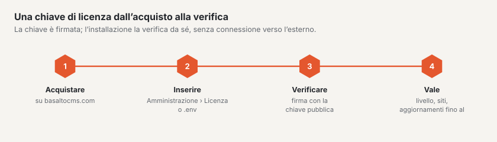

# Licenza

Basalto è **source-available**: il codice è pubblico, l’utilizzo è disciplinato dal contratto di licenza di Basalto.
Può leggerlo nel backend in `/admin/recht/lizenzvertrag` e pubblicamente in `/_recht/de/lizenzvertrag`. Questa pagina
mostra i livelli e come inserire e verificare una chiave.



## Livelli

| Livello | In breve |
| --- | --- |
| **Free** | senza chiave: un sito, un utente del backend, tutti i moduli; per sviluppo, test e uso privato |
| **Sito** | un dominio di produzione, fino a tre siti in un’installazione; nuove versioni per un anno dall’acquisto |
| **Agenzia** | tutti i siti e le installazioni per Lei e per i Suoi clienti; chiave di sottolicenza per ogni cliente, su richiesta senza il marchio Basalto nel backend |

Fanno stato i §§ da 3 a 5 del contratto di licenza.

## Come Basalto verifica la licenza

- **Offline.** La chiave è firmata con Ed25519 e viene verificata con la chiave pubblica di prodotto nel core — senza
  alcuna chiamata verso il produttore.
- **Mai bloccata.** Se un’installazione supera il proprio livello (più utenti, più siti, dominio non presente nella
  chiave), è considerata «non registrata». Basalto mostra allora degli avvisi, ma non blocca alcuna funzione.
- **Barra a piè di pagina dopo 30 giorni.** Se un’installazione resta non registrata per più di
  `BASALTO_LICENSE_BANNER_DAYS` giorni (predefinito 30), il frontend mostra una barra a piè di pagina. Da quando, lo
  indica Amministrazione › Licenza.
- **Diritto agli aggiornamenti.** Se è scaduto, il software continua a funzionare; le nuove versioni richiedono un
  rinnovo.
- Lo scheduler aggiorna lo stato ogni ora con `basalto:license`.

## Inserire la chiave

Due vie — l’inserimento nel backend ha la precedenza sul `.env`:

1. **Amministrazione › Licenza:** incollare la chiave, verificarla, inserirla. Una chiave non valida non viene
   inserita. La pagina mostra livello, stato, limiti e avvisi.
2. **`.env`:**

   ```dotenv
   BASALTO_LICENSE_KEY=<schlüssel>
   ```

> **Attenzione:** `.env.example` contiene la riga vuota `BASALTO_LICENSE_PUBLIC_KEY=`. Un valore vuoto sovrascrive la
> chiave di prodotto nel core, e Basalto non può allora verificare alcuna chiave («Kein öffentlicher Lizenzschlüssel
> konfiguriert», cioè nessuna chiave di licenza pubblica configurata). Rimuova la riga o la commenti; deve impostarla
> solo per test ed emissioni proprie.

## Collegare il conto cliente

Chi ha acquistato una licenza su basaltocms.com vede chiavi, fatture e acquisti nel Marketplace direttamente nel
proprio backend — su basaltocms.com resta solo l’acquisto. In **Amministrazione › Licenza › Conto cliente presso il
produttore** (solo gestori):

1. Inserire l’**indirizzo e-mail** del conto cliente → **Richiedi codice**. basaltocms.com invia un codice di sei cifre
   a questo indirizzo — solo se lì esiste un conto cliente; la risposta nel backend è la stessa in entrambi i casi.
   L’e-mail indica l’host di questa installazione.
2. Inserire il **Codice** → **Collega**. L’installazione riceve un token e lo salva cifrato (con l’`APP_KEY`); non
   compare mai nell’interfaccia né nel registro. Il registro annota solo «collegato» e «scollegato» con l’host del
   produttore.
3. Una volta collegata, la pagina mostra:
   - **Licenze** con livello, domini, diritto agli aggiornamenti e stato (attivo, bloccato, in elaborazione). **Usa
     questa chiave** inserisce una chiave come il modulo accanto — stessa verifica, stessa posizione di
     memorizzazione.
   - **Fatture** con numero, data, importo, stato e **PDF**. Il link al PDF è un indirizzo firmato su basaltocms.com,
     vale un’ora e solo finché l’installazione è collegata.
   - **Acquisti nel Marketplace** con ricevuta, se ce ne sono.

I dati restano dieci minuti nella cache; **Aggiorna** li ricarica subito. La pagina non attende mai il produttore: i
dati vengono caricati in un secondo momento e, se basaltocms.com non è raggiungibile (limite di tempo di pochi
secondi), compare un messaggio invece di una pagina bloccata.

**Firma.** basaltocms.com firma ogni risposta con la chiave del Marketplace; l’installazione la verifica con la chiave
pubblica nel core (`basalto.marketplace.public_key`). Se la firma è errata o la risposta appartiene a un’altra
installazione, la pagina mostra un errore e nessun dato. Se la firma manca, i dati compaiono con il contrassegno «non
firmato». I link contenuti nella risposta compaiono solo se puntano al produttore.

**Scollega** revoca il token presso basaltocms.com e lo elimina qui. Se basaltocms.com non è raggiungibile in quel
momento, il token viene comunque eliminato qui e diventa così inutilizzabile.

Anche l’**account cliente** su basaltocms.com elenca le installazioni collegate con host e ultima consultazione; **Scollega** lì revoca ugualmente il token.

La verifica della licenza resta comunque **offline** — il collegamento serve solo per questa panoramica. L’indirizzo
del produttore proviene da `BASALTO_VENDOR_URL` (predefinito `https://basaltocms.com`, in locale
`https://basalto.test`); se cambia, l’installazione è considerata non collegata.

## `basalto:license`

```sh
php artisan basalto:license                     # mostrare e registrare lo stato della licenza
php artisan basalto:license --check=<schlüssel> # verificare una chiave senza inserirla
php artisan basalto:license --help              # tutte le opzioni
```

Le altre opzioni (`--keypair`, `--issue` con `--plan`, `--licensee`, `--domains`, `--seats`, `--sites`,
`--updates-until`, `--agency`, `--customer`, `--white-label`, `--secret-file`, nonché `--revoke`) servono a emettere e
bloccare chiavi. Richiedono la chiave di prodotto privata, che si trova solo presso basaltocms.com, e non sono
necessarie nell’esercizio di un’installazione.


Domande sulla licenza: email@basaltocms.com.

## Per continuare

- [Licenza](../verwaltung/lizenz.md)
- [Installazione](installation.md)
