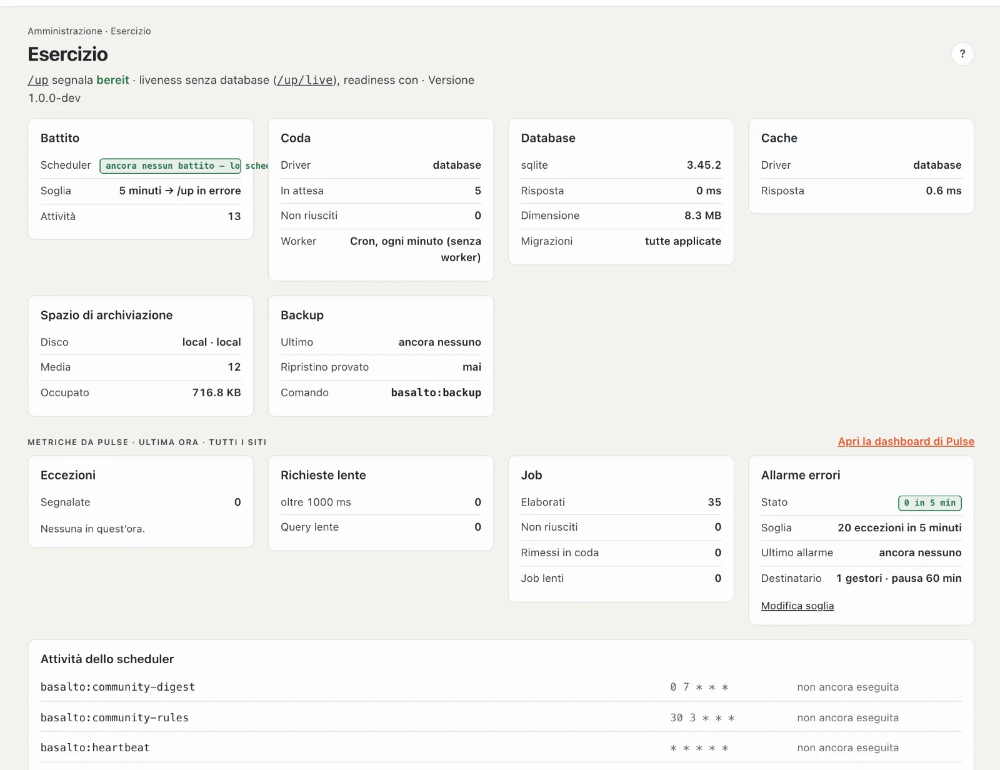

# Monitoraggio

Basalto mostra i dati d’esercizio dove comunque si va a guardare: in **Amministrazione › Esercizio** nel backend. A
questi si aggiungono la dashboard di [Laravel Pulse](https://laravel.com/docs/pulse) e un allarme via e-mail quando gli
errori si accumulano — entrambi senza servizi di terzi.



| Che cosa | Dove | Chi lo vede |
| --- | --- | --- |
| Battito, coda, database, cache, spazio di archiviazione, backup, scheduler | Amministrazione › Esercizio, `/up`, `/up/live` | chi può amministrare il sito |
| Metriche da Pulse (ultima ora, tutti i siti) e stato dell’allarme errori | Amministrazione › Esercizio, sezione «Metriche da Pulse» | gestori dell’installazione |
| Dashboard di Pulse con tutte le schede | `/admin/pulse` | gestori dell’installazione |
| Allarme errori | e-mail | gestori dell’installazione |

I **gestori dell’installazione** sono proprietario e amministrazione dell’account dell’installazione — il primo
account, creato da `php artisan basalto:install`. Gestori o amministratori di un singolo sito non vedono i dati di
Pulse, perché comprendono tutti i siti dell’installazione (nella SaaS anche quelli di altri clienti). Gli account
disattivati non contano.

## Pulse

Pulse fa parte dell’applicazione (`laravel/pulse` 1.8) e registra nel database dell’applicazione: tabelle
`pulse_values`, `pulse_entries` e `pulse_aggregates`, create da `php artisan migrate`. La configurazione si trova in
`config/pulse.php`.

- **Dashboard:** `/<BASALTO_BACKEND_PATH>/pulse`, quindi di solito `/admin/pulse` (percorso proprio con `PULSE_PATH`).
  Gli ospiti finiscono sulla pagina di accesso, tutti gli altri tranne i gestori dell’installazione ricevono 403. Il
  link si trova anche sulla pagina «Esercizio».
- **Su «Esercizio»:** eccezioni segnalate (le più frequenti con il punto in cui si verificano), richieste lente oltre
  la soglia (`PULSE_SLOW_REQUESTS_THRESHOLD`, predefinito 1000 ms), query lente, job elaborati, falliti e rimessi in
  coda, job lenti — sempre riferiti all’ultima ora.
- **Disattivare:** `PULSE_ENABLED=false`. Pulse non registra più nulla; «Esercizio» lo indica e mostra gli ultimi dati
  rilevati. In `phpunit.xml` Pulse è disattivato.
- **Conservazione:** Pulse elimina da sé le voci dopo sette giorni (`PULSE_STORAGE_KEEP`).
- **Molto traffico:** campionamento per registratore (`PULSE_USER_REQUESTS_SAMPLE_RATE=0.1` ecc.) oppure acquisizione
  tramite Redis (`PULSE_INGEST_DRIVER=redis`, con in più `php artisan pulse:work` permanente). Su un hosting semplice
  nessuna delle due cose è necessaria.
- **Cache delle schede:** le schede salvano le loro query come oggetti nella cache; Laravel 13 non deserializza oggetti
  dalla cache (`cache.serializable_classes`). Basalto le mette quindi, per ogni richiesta, nello store array
  (`PULSE_CACHE_DRIVER=array`, predefinito in `config/pulse.php`). Conseguenza: `php artisan pulse:restart` non
  raggiunge i processi `pulse:check`/`pulse:work` in esecuzione — riavviare questi processi dopo il deploy (Laravel
  Cloud lo fa comunque).
- **Scheda server:** memoria e CPU compaiono solo se `php artisan pulse:check` gira in permanenza (su Laravel Cloud come
  processo in background). Su un hosting semplice la scheda resta vuota — non è un errore.
- **Database:** Pulse supporta SQLite, MariaDB, MySQL e PostgreSQL. Su SQL Server la migrazione salta le tabelle;
  «Esercizio» segnala allora «Pulse non è configurato», e `PULSE_ENABLED=false` va inserito nel `.env`.
- **Protezione dei dati:** Pulse memorizza ID utente (scheda «Application Usage»), percorsi, query e punti delle
  eccezioni, nessun contenuto. Basalto mostra le persone senza Gravatar (nessuna chiamata a un servizio di terzi). La
  dashboard di Pulse stessa carica risorse di terzi: il carattere da `fonts.bunny.net` e, nella scheda «Slow Outgoing
  Requests», i loghi degli host di destinazione da `unavatar.io`. Ciò riguarda solo i gestori, non i visitatori del
  sito.
- **Livewire:** Pulse porta con sé Livewire. Basalto ne disattiva l’inclusione automatica (`livewire.inject_assets`),
  affinché `livewire.js` non finisca mai nelle pagine del sito o del backend.

## Allarme errori

Basalto conta ogni eccezione segnalata per minuto nella cache — indipendentemente dal fatto che Pulse registri. Lo
scheduler richiama ogni minuto `php artisan basalto:error-alarm`. Se nella finestra ci sono almeno tante eccezioni
quante ne indica la soglia, parte un’e-mail ai gestori dell’installazione; poi, per la durata della pausa, c’è
silenzio, anche se gli errori persistono. Le eccezioni non segnalate (404, validazione) non contano.

| Impostazione (Amministrazione › Impostazioni › Esercizio) | Chiave | Predefinito |
| --- | --- | --- |
| Allarme errori da | `operations.error_alarm_threshold` | 20 eccezioni (0 = nessun allarme) |
| Finestra dell’allarme errori | `operations.error_alarm_minutes` | 5 minuti |
| Pausa dopo un allarme errori | `operations.error_alarm_pause_minutes` | 60 minuti |

Requisiti: lo scheduler è in esecuzione (cron ogni minuto o Laravel Cloud) e la posta è configurata (`MAIL_*` nel
`.env`). Con `MAIL_MAILER=log` l’e-mail compare solo nel log. La scheda «Allarme errori» su «Esercizio» mostra soglia,
numero attuale, ultimo allarme e numero di destinatari.

Verifica manuale:

```sh
php artisan basalto:error-alarm     # segnala «unter der Schwelle» (sotto la soglia), «gedrosselt» (limitato) o «Alarm an n Betreiber» (allarme a n gestori)
```

## Osservare più istanze

Chi gestisce molte istanze può collegare in aggiunta [Laravel Nightwatch](https://nightwatch.laravel.com): richieste,
query, job ed eccezioni di tutte le istanze. I segnaposto sono commentati in `.env.example` (`NIGHTWATCH_ENABLED`,
`NIGHTWATCH_TOKEN` e i campionamenti); il pacchetto `laravel/nightwatch` va installato in proprio. Nightwatch
trasmette dati d’esercizio a Laravel — verifichi il trattamento dei dati per conto terzi e l’informativa sulla privacy
prima di attivarlo.

## Per continuare

- [Esercizio](../verwaltung/betrieb.md)
- [Hosting](hosting.md)
- [Comandi](befehle.md)
