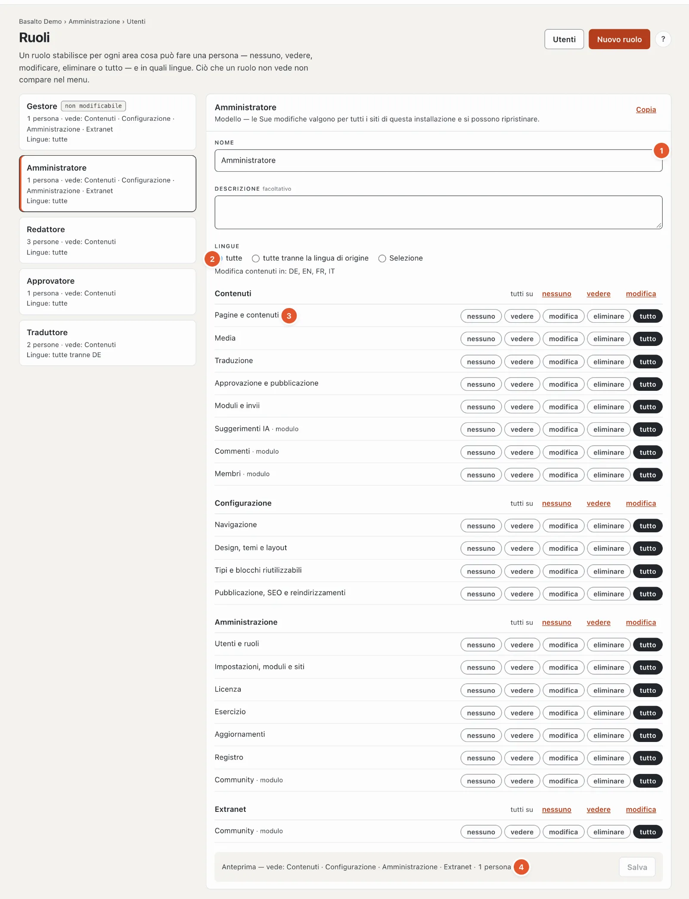

# Ruoli e diritti

Chi può fare che cosa nel backend lo stabilisce il **ruolo**. Una persona ha esattamente un ruolo per ogni sito; i
ruoli stessi valgono per tutti i siti dell’installazione (o dell’account SaaS). Li gestisce in
**Amministrazione › Ruoli**.

## Aree e livelli

Un ruolo ha un **livello** per ogni **area**. I livelli si basano l’uno sull’altro:

| Livello | Significa |
| --- | --- |
| **nessuno** | L’area non compare nel menu, i suoi indirizzi rispondono con 403. |
| **vedere** | Leggere, senza modificare nulla. |
| **modifica** | Creare e modificare. |
| **eliminare** | In più, eliminare. |
| **tutto** | In più, le impostazioni delicate dell’area — ad esempio il webhook di un modulo, le impostazioni e l’esportazione dei membri o la chiave dei suggerimenti IA. |

Le aree sono ordinate in tre gruppi. Se un ruolo non vede nemmeno un’area di un gruppo, manca anche il selettore di
modalità verso di esso.

| Gruppo | Aree |
| --- | --- |
| **Contenuti** | Pagine e contenuti · Media · Traduzione · Approvazione e pubblicazione · Moduli e invii · dai moduli: Commenti, Membri, Suggerimenti IA |
| **Configurazione** | Navigazione · Design, temi e layout · Tipi e blocchi riutilizzabili · Pubblicazione, SEO e reindirizzamenti |
| **Amministrazione** | Utenti e ruoli · Impostazioni, moduli e siti · Licenza · Esercizio · Registro · dai moduli: Vendita licenze, Marketplace, Gestione test |

I moduli registrano da sé le proprie aree; un modulo appena installato compare subito nella matrice.

## Modelli

Sono predefiniti cinque ruoli. Può adattarli e **ripristinarli** in qualsiasi momento allo stato di fabbrica —
tranne «Gestore».

| Modello | Può |
| --- | --- |
| **Gestore** | Tutto. Immutabile, affinché nessun sito possa chiudersi fuori. Ogni sito conserva almeno un gestore. |
| **Amministrazione** | Tutto, tranne assegnare il ruolo Gestore. |
| **Redattore** | Pagine, media e moduli fino a «eliminare», Traduzione, Commenti, Membri e Suggerimenti IA «modifica». Nessuna configurazione, nessuna amministrazione, nessuna approvazione. |
| **Approvatore** | Approvazione e pubblicazione «tutto»; pagine, media, traduzione, moduli e commenti «vedere». |
| **Traduttore** | Pagine e traduzione «modifica», media «vedere», suggerimenti IA «modifica» — in tutte le lingue **tranne la lingua di origine**. |

Proprietario e amministrazione di un account SaaS possono fare tutto su tutti i siti dell’account, come un gestore.

## Ruoli propri

**Nuovo ruolo** crea un ruolo vuoto (non può nulla) oppure una copia di un ruolo esistente («Partendo da» o
**Copia**). Nella matrice sceglie il livello per ogni area; «tutti su» imposta un intero gruppo in una volta. In basso
l’anteprima mostra che cosa vede il ruolo («Contenuti · Configurazione · Amministrazione») e quante persone lo hanno.
Ogni modifica si salva da sola (una serie di modifiche è una sola riga nel registro) e vale dalla richiesta successiva.

Un ruolo si assegna come sempre in **Utenti** (selezione nell’elenco o al momento dell’invito). Un ruolo proprio si
può **eliminare**, finché nessuno lo ha e nessun invito aperto lo riporta.

## Lingue

Per ogni ruolo stabilisce in quali lingue può modificare i contenuti: **tutte**, **tutte tranne la lingua di origine**
oppure una **selezione**. La lingua di origine (lingua standard del sito) è inclusa solo se la sceglie. Creare,
eliminare e spostare pagine e modificarne le impostazioni richiede la lingua di origine. Il blocco vale nell’editor,
nella panoramica «Traduzione», nei suggerimenti IA, sulla pagina stessa (editor nel frontend) e tramite l’API.

## Regole che nessuno aggira

- **Il Gestore resta immutabile.** Il ruolo non si può né modificare né eliminare; l’ultimo gestore di un sito non può
  essere declassato né disattivato da nessuno.
- **Nessun diritto regalato.** Chi assegna, revoca o modifica un ruolo deve avere in ogni area almeno lo stesso livello
  e ciascuna delle sue lingue. Il ruolo Gestore lo assegna solo un gestore.
- **Modificare i ruoli richiede «Utenti e ruoli · tutto».** Per vederli basta «vedere».
- **I token API** agiscono con i diritti del loro utente — un token di un traduttore non modifica la lingua di origine.
- **Tutto finisce nel registro:** ruolo creato, modificato (prima/dopo), ripristinato, eliminato e ogni nuova
  assegnazione.

## Per sviluppatori

Un modulo registra le proprie aree nel service provider e vi associa le proprie route; le route senza associazione
richiedono «Impostazioni · tutto» (meglio troppo rigido che troppo permissivo), e un test le individua. Un diritto si
verifica con `Gate::allows('area', [$site, 'bereich', Level::Edit])`. Dettagli in
[Moduli e plugin](../entwickler/erweiterungen.md).

## Per continuare

- [Ruoli](../verwaltung/rollen.md)
- [Utenti](../verwaltung/benutzer.md)
