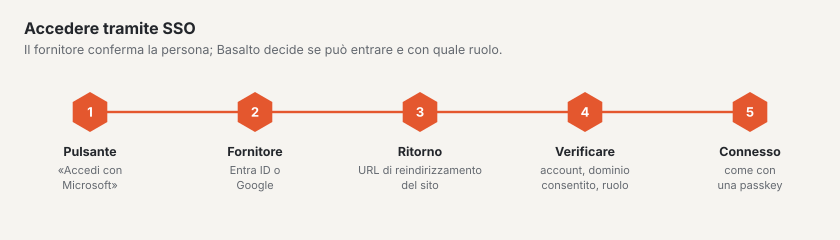

# SSO per gli utenti del backend

Gli utenti del backend di un sito accedono con l’account della loro azienda: «Accedi con Microsoft» (Microsoft Entra
ID) oppure «Accedi con Google» (Google Workspace o account Google). Passkey e codice via e-mail restano disponibili —
se il fornitore non funziona, si entra comunque.

Ciò vale allo stesso modo per le installazioni proprie e per la SaaS.

## Principi

- **Configurato per ogni sito**, non per account: i ruoli dipendono dal sito, e un’agenzia gestisce in un unico account
  siti di aziende diverse con tenant diversi. Due siti della stessa azienda richiedono due voci (la stessa
  registrazione dell’app può essere usata entrambe le volte, con entrambi gli URL di reindirizzamento).
- **Solo utenti esistenti.** Accede chi ha in Basalto un utente con l’e-mail confermata **e** un ruolo sul sito. La
  prima volta Basalto collega l’utente al suo identificativo presso il fornitore; da quel momento conta
  l’identificativo (un indirizzo modificato presso il fornitore non interrompe l’accesso).
- **La creazione automatica è disattivata di fabbrica.** Chi la attiva sceglie un ruolo (Redattore, Approvatore o
  Traduttore — mai Gestore o Amministratore). Con Google è possibile solo con un **dominio consentito**, altrimenti
  qualsiasi account Google al mondo otterrebbe l’accesso. I nuovi utenti compaiono nel registro («Utente creato tramite
  SSO»).
- **Gli account disattivati** restano esclusi, anche tramite SSO.
- **Il client secret** è salvato nel database cifrato con l’`APP_KEY`, non arriva mai al browser, mai nel registro e
  non nell’esportazione di un sito. Dopo un trasloco configuri di nuovo l’SSO.
- **Possono configurarlo** il gestore del sito nonché proprietario e amministrazione dell’account — non l’amministratore
  del sito: chi stabilisce il fornitore decide quali account possono accedere.

## Dove nel backend

**Amministrazione › Siti › (sito) › Accesso tramite SSO** (`/admin/sites/<id>/anmeldung`). Lì si trovano

- l’**indirizzo di accesso** del sito (`/admin/login?site=<handle>`) — sotto un dominio del sito i pulsanti compaiono
  anche senza aggiunta; in un’installazione con un solo sito sempre. La pagina di accesso non mostra mai un elenco di
  tutti i siti.
- per ogni fornitore i campi, un interruttore (spento = nessun pulsante), gli **URL di reindirizzamento da copiare** (uno
  per ogni indirizzo sotto cui il backend è raggiungibile) e **«Verifica connessione»**.

«Verifica connessione» è un’indicazione, non una garanzia: con Entra, Basalto ottiene un token per l’app stessa e
traduce i codici di errore (tenant sconosciuto, client ID non presente nel tenant, secret errato o scaduto); con Google
verifica se client ID e secret sono noti. Se l’URL di reindirizzamento è corretto e se gli utenti possono dare il
consenso lo mostra solo un accesso reale — meglio una volta in una finestra privata.

## Microsoft Entra ID: registrare un’app

1. [Microsoft Entra Admin Center](https://entra.microsoft.com) › **Identità › Applicazioni › Registrazioni app ›
   Nuova registrazione**.
2. Nome, ad es. «Basalto – Muster AG». **Tipi di account supportati: «Solo account in questa directory
   organizzativa»** (un solo tenant). Basalto accetta comunque solo il tenant inserito.
3. **URI di reindirizzamento:** piattaforma **Web**, l’URL di reindirizzamento indicato da Basalto, ad es.
   `https://muster.ch/admin/login/sso/entra/callback`. Altri indirizzi (alias, `APP_URL`) in
   **Autenticazione › Aggiungi URI**.
4. Nella **Panoramica** si trovano **ID applicazione (client)** e **ID directory (tenant)** — riportare entrambi i
   GUID in Basalto. `common`, `organizations` o un nome di dominio non funzionano.
5. **Certificati e segreti › Nuovo segreto client**, scegliere la scadenza (al massimo 24 mesi), copiare subito il
   **Valore** (non l’«ID segreto») e inserirlo in Basalto. Prima della scadenza generarne uno nuovo e inserirlo.
6. **Autorizzazioni API:** Microsoft Graph, delegate: `openid`, `profile`, `email`, `User.Read` (di solito è già
   presente). A seconda dell’impostazione del tenant **«Concedi il consenso amministratore»** — altrimenti al primo
   accesso gli utenti vedono una richiesta di consenso o un rifiuto.
7. Facoltativo: in **Applicazioni aziendali › (app) › Proprietà** attivare «Assegnazione obbligatoria» e assegnare
   solo determinati gruppi.

**Quale indirizzo conta:** il nome dell’entità utente (UPN) — il suo dominio è sempre un dominio verificato del tenant.
Il campo `mail` conta solo se ha lo stesso dominio. Gli **account guest** (`…#EXT#@…`) vengono respinti: il loro
indirizzo appartiene a un’altra directory. Al ritorno il tenant dell’account viene confrontato con quello inserito.

## Google: creare un client OAuth

1. [Google Cloud Console](https://console.cloud.google.com) › scegliere o creare un progetto.
2. **API e servizi › Schermata di consenso OAuth** (o «Google Auth Platform»): tipo di utente **Interno**, se sono
   ammessi solo account della Sua organizzazione Workspace, altrimenti **Esterno**. Nome dell’app, indirizzo di
   supporto, logo a piacere. Ambiti: `openid`, `email`, `profile` — nessun ambito sensibile, nessuna verifica da parte
   di Google necessaria.
3. **Credenziali › Crea credenziali › ID client OAuth**, tipo di applicazione **Applicazione web**.
4. **URI di reindirizzamento autorizzati:** gli URL di reindirizzamento indicati da Basalto, ad es.
   `https://muster.ch/admin/login/sso/google/callback`.
5. Riportare in Basalto il **Client ID** (termina con `.apps.googleusercontent.com`) e il **client secret**.
6. Impostare in Basalto il **Dominio consentito** (ad es. `muster.ch`), se devono entrare solo gli account Workspace di
   questo dominio. Basalto verifica allora `hd` e il dominio dell’e-mail al ritorno; senza dominio vale qualsiasi
   account Google con e-mail confermata per la quale esista in Basalto un utente con un ruolo.

## Procedura e sicurezza

- **Inoltro** con `state` e PKCE (entrambi nella sessione), con Entra sempre verso il tenant inserito, con
  `prompt=select_account`. **Ritorno** solo con una sessione corrispondente; un ritorno scaduto o estraneo → «L’accesso
  è scaduto».
- **Entra:** Socialite verifica l’ID token (firma, emittente, destinatario, scadenza); Basalto confronta il tenant.
  **Google:** `email_verified` deve essere vero; con un dominio consentito anche `hd` e il dominio dell’e-mail.
- **Gli errori** vengono rimandati alla pagina di accesso in modo cortese e senza dettagli. Il motivo lo annota il
  registro («SSO respinto»: tenant estraneo, account guest, non confermato, dominio errato, sconosciuto, senza ruolo,
  disattivato) — degli estranei solo il dominio dell’e-mail, mai l’indirizzo completo.
- **Limiti:** inoltro e ritorno condividono il limite della verifica del codice (20 richieste al minuto per IP),
  «Verifica connessione» dieci al minuto.
- **Registro:** «Accesso» con metodo `sso-entra` o `sso-google` e il sito, «SSO collegato» la prima volta,
  «SSO configurato»/«SSO rimosso» in caso di modifiche (con «Secret modificato: sì/no», mai il valore).
- **Accesso ai dati e cancellazione** (protezione dei dati) indicano o rimuovono i collegamenti di un utente.

## Dietro un proxy

Basalto costruisce l’URL di reindirizzamento a partire da schema e host della richiesta. Dietro un proxy o un load
balancer `TrustProxies` e `X-Forwarded-Proto` devono essere corretti, altrimenti si ottiene `http://…` invece di
`https://…` e il fornitore respinge il ritorno (Entra: AADSTS50011, Google: `redirect_uri_mismatch`). Verifichi
perciò gli URL di reindirizzamento mostrati direttamente nell’ambiente di destinazione, non in locale.

## Se qualcosa non funziona

| Messaggio / codice | Causa | Rimedio |
| --- | --- | --- |
| AADSTS50011 / `redirect_uri_mismatch` | l’URL di reindirizzamento manca presso il fornitore o non corrisponde (schema, host, barra finale) | inserire l’URL esattamente come indicato da Basalto |
| AADSTS700016 | client ID non presente nel tenant inserito | usare tenant ID e client ID della stessa registrazione |
| AADSTS7000215 / 7000222 | secret errato o scaduto | generare un nuovo valore e inserirlo |
| AADSTS65001 | manca il consenso | concedere il consenso amministratore |
| «Con questo account non è possibile accedere …» | account senza utente/ruolo, guest, tenant estraneo, dominio errato | leggere il motivo nel registro alla voce «SSO respinto»; invitare l’utente o assegnargli un ruolo |
| «L’accesso è scaduto» | ritorno senza sessione corrispondente (altro host, cookie bloccato, attesa troppo lunga) | ricominciare dall’indirizzo di accesso del sito; host dell’URL di reindirizzamento = host dell’accesso |

## Per continuare

- [Siti](../verwaltung/sites.md)
- [Ruoli e diritti](rollen.md)
