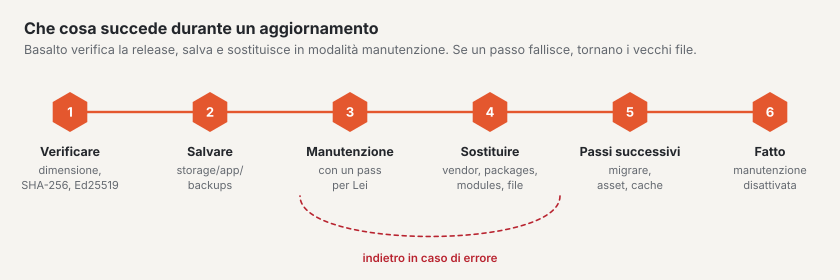

# Aggiornamenti

Le nuove versioni di Basalto, dei moduli forniti, dei plugin e dei temi si installano nel backend in
**Amministrazione › Aggiornamenti** oppure da console. Basalto scarica la release firmata, esegue prima un backup,
sostituisce i file e in caso di errore ripristina lo stato precedente.



## Nel backend o da console

Nel browser: [Aggiornamenti](../verwaltung/updates.md). Da console:

```sh
php artisan basalto:update                   # verificare: core, plugin, temi — con la fonte
php artisan basalto:update --kern            # installare il core dalla release firmata
php artisan basalto:update --plugin=anbieter/paket
```

- **Che cosa succede:** scaricare l’archivio (`/_download/latest.json` della fonte), verificare dimensione, SHA-256 ed
  Ed25519, backup in `storage/app/backups`, modalità manutenzione. Poi la sostituzione: `vendor`, `packages` e
  `modules` per intero, tutto il resto file per file. Successivamente `package:discover`, `migrate --force`, asset e
  `optimize:clear`, ciascuno in un nuovo processo PHP. Se un passaggio fallisce, tornano i vecchi file.
- **Che cosa resta:** `.env`, `storage`, `auth.json`, `public/storage`, `public/hot`, ogni `*.sqlite` e tutto ciò che
  non è nell’archivio.
- **Ripristino manuale:** dopo l’esecuzione i file sostituiti si trovano in
  `storage/app/updates/lauf-<zeit>/vorher/` (resta solo l’ultima esecuzione). Ricopiarli, poi
  `php artisan optimize:clear`.
- **Stato e registro:** `storage/app/updates/status.json` (lo legge la pagina nel backend) e
  `storage/logs/update.log`.
- **Fonte:** `BASALTO_UPDATES_URL`, altrimenti basaltocms.com.
- **Controllo giornaliero:** alle 04:10 lo scheduler richiama `basalto:update --benachrichtigen` (si disattiva con
  `BASALTO_UPDATES_CHECK=false`).
- **Plugin:** servono l’e-mail e il token dell’account cliente (`auth.json` oppure `BASALTO_MARKETPLACE_EMAIL` e
  `BASALTO_MARKETPLACE_TOKEN`).

Prima di un salto importante conviene comunque un proprio backup con prova di ripristino ([Backup](backup.md)).

## Installazioni con Composer

Se la Sua installazione gestisce Basalto come pacchetti Composer, la pagina «Aggiornamenti» mostra lo stato e i
comandi; l’installazione avviene poi con Composer:

1. Eseguire e verificare il backup, attivare la modalità manutenzione:

   ```sh
   php artisan basalto:backup
   php artisan basalto:backup-verify
   php artisan down
   ```

2. Scaricare le nuove versioni — nell’ambiente di sviluppo, non sul server:

   ```sh
   composer update "basalto/*"     # solo core, Lava e moduli
   composer update                 # tutto
   ```

3. Portare il nuovo stato (`composer.json`, `composer.lock`) sul server e installarlo lì:

   ```sh
   composer install --no-dev --optimize-autoloader
   php artisan migrate --force
   php artisan vendor:publish --tag=basalto-assets --force
   php artisan optimize
   ```

## Cache dopo l’aggiornamento

| Che cosa | Comando | Quando |
| --- | --- | --- |
| Cache di Laravel | `php artisan optimize` | dopo ogni aggiornamento; in caso di problemi prima `php artisan optimize:clear` |
| Cache delle pagine | `php artisan basalto:page-cache clear`, poi `php artisan basalto:page-cache warm` | se la cache delle pagine è attiva; `--site=<handle>` per un singolo sito |
| Indice di ricerca | `php artisan basalto:search-index` | se l’aggiornamento riguarda la ricerca o dopo un cambio di driver; `--site=<handle>` per un singolo sito |
| Coda | `php artisan queue:restart` | solo con worker proprio; tramite lo scheduler `queue:work` si riavvia ogni minuto |

La cache delle pagine dipende dall’impronta della sorgente del tema e dalla generazione del sito, non dalla release.
Se un aggiornamento modifica l’output del core, la svuoti quindi manualmente.

## Verifica dopo l’aggiornamento

```sh
php artisan up
```

1. **`/up`** segnala «bereit» (pronto) (database e battito).
2. **Amministrazione › Esercizio:** battito attuale, coda vuota o in elaborazione, nessun nuovo job fallito, ultima
   esecuzione delle attività senza errori.
3. **Verificare il tema**, se Lava è cambiato:

   ```sh
   php artisan basalto:check --site=<handle>          # tema dal database
   php artisan basalto:check --theme=themes/<name>    # tema da file
   php artisan basalto:publish <handle> --dry-run     # verifica prima della messa online, senza scrivere
   ```

4. Nel frontend aprire una pagina con immagini e un modulo, nel backend modificare una pagina.
5. **Amministrazione › Licenza:** se il diritto agli aggiornamenti è scaduto, lì compare un avviso ([Licenza](lizenz.md)).
6. **MariaDB o MySQL:** `php artisan basalto:db-zeitzone` indica se date e ore più vecchie vanno convertite
   ([Fuso orario del database](installation.md#fuso-orario-del-database)).

Se qualcosa va storto: la modalità manutenzione resta attiva, ripristinare lo stato dal backup
([Backup](backup.md#ripristino)).

## Per continuare

- [Aggiornamenti](../verwaltung/updates.md)
- [Backup](backup.md)
- [Comandi](befehle.md)
