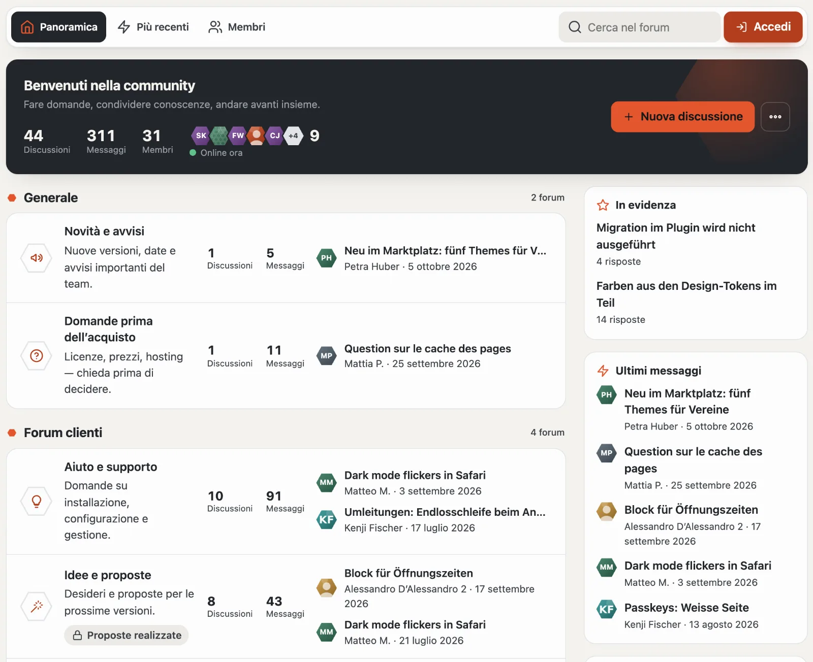
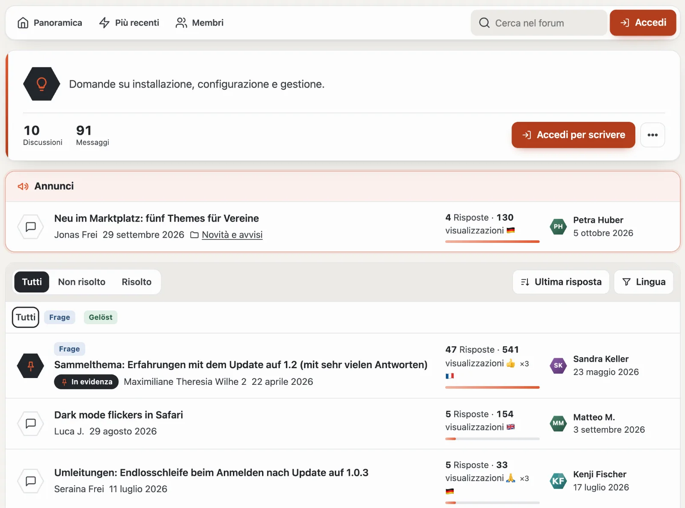
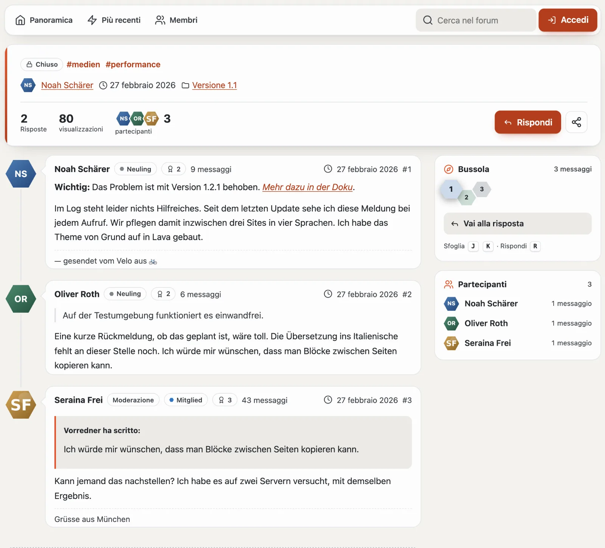
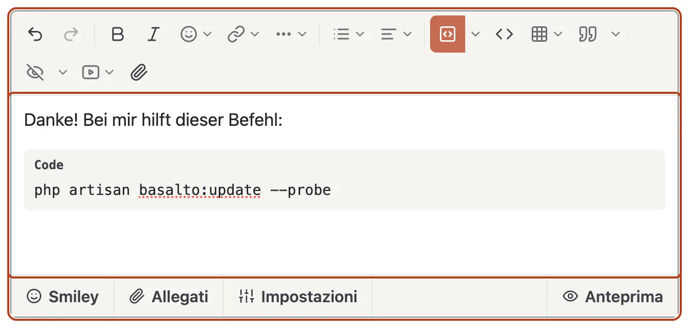
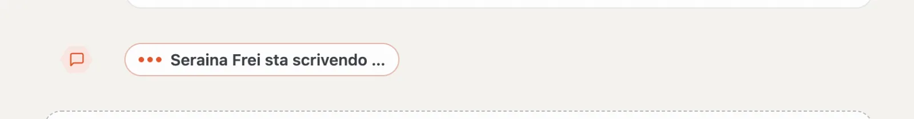
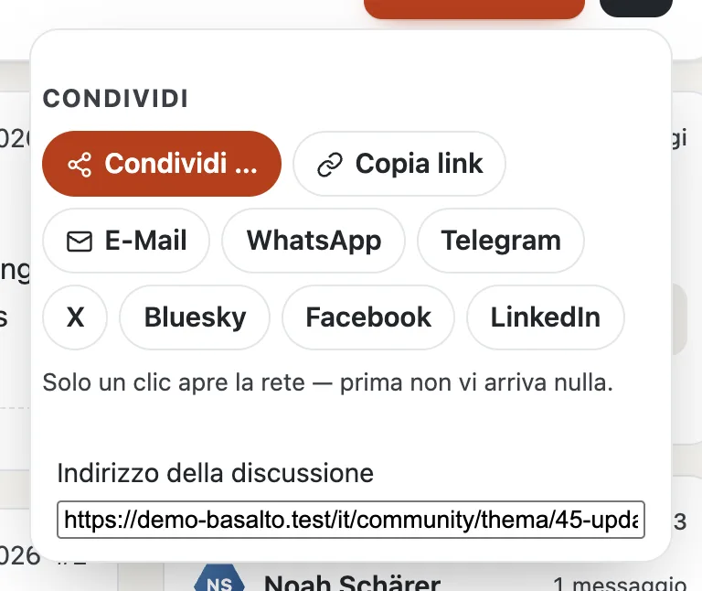

# Forum

La panoramica sotto `/community` inizia con il **polso**: un saluto, ciò che è nuovo dalla Sua ultima visita, discussioni, messaggi, membri e chi è online ora, con **«+ Nuova discussione»** e il menu **«…»** (segna tutto come letto, RSS, ricerca, membri). Sotto seguono le categorie con i loro forum. Per ogni forum l’esagono mostra un simbolo — in lava quando c’è qualcosa di nuovo —, accanto il numero di discussioni e di messaggi, i sottoforum e le due ultime discussioni con immagine, prefisso, nome e ora. A destra si trovano dei riquadri: in evidenza, ultimi messaggi, dal blog, discussioni calde e tag. In fondo segue una fascia con le statistiche (messaggi al giorno, membro più recente) e «Membri online» con il record.

Ogni pagina del forum inizia con il **navigatore**: **Panoramica**, **Più recenti**, **Non lette** (con il numero), **Iscritto**, **Seguiti**, **Membri**, la ricerca, i messaggi, la campanella, per la moderazione lo scudo con i casi aperti, e il Suo profilo. Sul telefono i percorsi diventano una barra di simboli.

I riquadri esistono anche come parti Lava per ogni regione di un layout (`forum.latest`, `forum.hot`, `forum.featured`, `forum.online`, `forum.stats`, `forum.members`, `forum.team`).

## Leggere

- **Elenco delle discussioni:** l’intestazione mostra simbolo, descrizione e cifre del forum, **«+ Nuova discussione»**, **Iscriviti** (campanella) e il menu «…». Gli annunci stanno sopra, le discussioni fissate in alto. L’esagono davanti a ogni discussione ne mostra lo stato: lava = nuova, verde = risolta, a strisce = in attesa di moderazione, scuro = fissata. La barra sotto le cifre mostra quanto è vivace una discussione. **Tutti**, **Non risolto** e **Risolto** filtrano; **ordinare** per ultima risposta, data di creazione, risposte o titolo; i prefissi come pastiglie, la lingua nel menu. Ciò che non è stato letto è in grassetto e porta al primo messaggio nuovo.
- **Discussione:** l’intestazione mostra prefisso, stato e tag, chi l’ha aperta quando e in quale forum, risposte, visualizzazioni, i partecipanti e — se è già stato qui — **«nuovi per Lei»**. Dei salti portano alla risposta più utile e ai messaggi ufficiali del team. I messaggi sono appesi a una linea con le immagini del profilo; quelli nuovi la colorano di lava e portano **«Nuovo»**. L’intestazione di ogni messaggio mostra nome, gruppo, rango, trofei, numero di messaggi, ora e numero. La risposta più utile porta una fascia verde.
- **Bussola:** a destra mostra i messaggi della pagina come celle di un alveare nel colore della persona che li ha scritti — così vede chi porta avanti la conversazione. Nuovo, soluzione, in attesa e team sono evidenziati; il messaggio che sta leggendo è più grande. Un clic ci porta; con la tastiera **J** e **K** passano da un messaggio all’altro, **R** porta alla risposta.

- **Elenchi:** Più recenti, Non lette, Iscritto, Seguiti (novità dalle persone che segue).

## Scrivere

- **Aprire una discussione:** già mentre digita il titolo, il forum mostra **discussioni simili** — forse la domanda ha già una risposta. In più titolo, prefisso, campi della discussione del forum, tag (al massimo cinque, separati da virgole), testo, allegati e, se desiderato, un sondaggio.
- **Editor:** la barra in alto ha tutto ciò che serve per un buon messaggio:
  - **Annulla** e **Ripeti**, **Grassetto**, **Corsivo**, **Emoji** e **Link** (indirizzo e testo in un piccolo modulo);
  - **«…»** per il formato del paragrafo (paragrafo, titolo da 1 a 3), sottolineato, barrato, pedice e apice, rimuovi formattazione e l’**evidenziatore** in cinque colori;
  - **Elenchi** (puntato, numerato, riduci e aumenta rientro) e **Allineamento** (sinistra, centrato, destra, giustificato);
  - **Blocco di codice:** un clic lo inserisce; la freccia accanto sceglie il linguaggio (o il rilevamento automatico), il numero della prima riga e un nome di file. Alla lettura il codice è evidenziato a colori, con i numeri di riga e il pulsante **«Copia»**;
  - **Codice nel testo**, **Tabella** (scegliere la dimensione nella griglia; con il cursore in una tabella il menu inserisce o rimuove righe e colonne), **Citazione** (con le citazioni memorizzate), **Spoiler** (se desidera con titolo), **Video** e **File**.

  Menziona qualcuno con `@` e le prime lettere. Il team e la moderazione (o chi riceve dall’amministrazione il diritto «Menzionare gruppi») menzionano anche gruppi interi, ad esempio `@Moderation` — tutti i loro membri ricevono una notifica. La barra funziona anche con la tastiera: Tab vi entra, le frecce si spostano, Esc chiude un menu. Senza script resta un semplice campo di testo.
- **Schede sotto il testo:** **Smiley**, **Allegati** (caricare, tipi consentiti, dimensione per file, spazio libero), **Impostazioni** (ad esempio «messaggio ufficiale del team»), all’apertura di una discussione **Sondaggio** e a destra l’**Anteprima** — mostra il messaggio esattamente come apparirà dopo l’invio.
- **Chi sta scrivendo:** se qualcun altro sta scrivendo una risposta nella stessa discussione, alla fine dei messaggi e nell’angolo del Suo campo di risposta compare **«Anna sta scrivendo …»** — così due persone non rispondono la stessa cosa contemporaneamente. Maggiori informazioni in [Aggiornamento in tempo reale](live.md).
- **Modificare:** entro la finestra temporale del sito, con motivo; la cronologia resta visibile.
- Alcuni forum approvano i nuovi messaggi solo in un secondo momento — allora il suo messaggio compare non appena la moderazione lo approva. Tra due messaggi c’è un breve intervallo minimo.

## Partecipare

- **Reazioni:** sotto ogni messaggio compaiono come conteggio, la Sua evidenziata. Il pulsante con lo smiley apre la scelta 👍 ❤️ 😂 😮 😢 🙏; sceglierla di nuovo la ritira.
- **Rispondi, Cita, Memorizza** stanno sotto ogni messaggio. **Modifica**, **Cronologia**, **Risposta più utile** e **Segnala** si trovano nel menu «…» del messaggio.
- **Iscriversi** è la campanella nell’intestazione di una discussione o di un forum, **Ignora** sta nel menu «…». La campanella nel navigatore mostra le novità, le e-mail arrivano subito, ogni giorno o mai (nel profilo).
- **La risposta più utile** la sceglie chi ha aperto la discussione.
- **Segnalare:** nel menu «…» di un messaggio altrui — chi ha scritto non viene a sapere chi ha segnalato.
- **Condividere:** nell’intestazione di una discussione, **«Condividi»** apre e-mail, WhatsApp, Telegram, X, Bluesky, Facebook e LinkedIn — come semplici link: solo il Suo clic apre la rete; prima non viene a sapere nulla. In più **«Copia link»** e, sul telefono, la condivisione del dispositivo. Come immagine di anteprima le reti mostrano la prima immagine del messaggio di apertura.

## Trovare

- **Cerca nel forum** sotto `/community/suche`; le discussioni compaiono anche nella ricerca dell’intero sito, con il filtro «Forum».
- **Tag:** `#Theme` porta a tutte le discussioni con questo tag.
- **RSS:** `/community/feed` per l’intero forum, `/community/<forum>/feed` per ogni forum.

## Per continuare

- [Profili e conversazioni](profile.md)
- [Moderazione](moderation.md)
- [Community](README.md)
