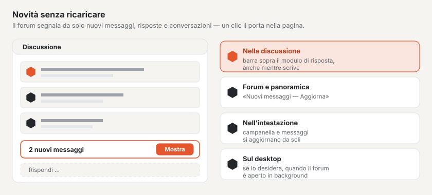

# Aggiornamento in tempo reale

Il forum segnala da sé le novità: nuovi messaggi nella discussione aperta, nuove discussioni e risposte nell’elenco
delle discussioni, nuovi messaggi in una conversazione e notifiche non lette nell’intestazione. Nessuno deve ricaricare
la pagina — un clic porta le novità nella pagina. Funziona su qualsiasi hosting; dove è configurato un server WebSocket
compaiono subito, altrimenti al più tardi dopo circa 15 secondi.

## Nella discussione

Se arriva una risposta mentre Lei legge una discussione, in fondo alla finestra compare la barra **«1 nuovo messaggio»**
con il pulsante **«Mostra»**. Un clic inserisce il messaggio alla fine della pagina — con numero, reazioni e tutti i
pulsanti, come se la pagina fosse stata ricaricata. La barra si trova subito sopra il modulo di risposta e resta
agganciata al bordo inferiore della finestra: la vede anche mentre scrive e, prima di inviare, può leggere che cosa è
stato risposto nel frattempo.

- Su una pagina precedente della discussione, la barra propone **«Vai all’ultima pagina»**.
- Se i nuovi messaggi sono più di quanti ne stiano in una pagina, anche il pulsante porta all’ultima pagina.
- Compare solo ciò che Lei potrebbe vedere comunque: i messaggi in attesa di approvazione solo dopo l’approvazione; i
  messaggi delle persone che ha bloccato chiusi, come nella pagina.
- I messaggi caricati in questo modo contano come letti.

## Nel forum e nella panoramica

Quando in un forum si aggiunge una discussione o una risposta, sopra l’elenco delle discussioni compare **«Nuovi
messaggi in questo forum»** con **«Aggiorna»**. Vale anche per i forum di livello superiore (una risposta in un
sottoforum modifica la panoramica della categoria) e per la panoramica del forum.

## Conversazioni

In una conversazione aperta compare **«Nuovo messaggio in questa conversazione»** non appena un’altra persona scrive.
**«Mostra»** carica la conversazione e salta al modulo di risposta.

## Chi sta scrivendo

Appena qualcuno inizia a scrivere una risposta in una discussione, alla fine dei messaggi compare **«Anna sta
scrivendo …»** con tre puntini pulsanti — per tutti coloro che leggono la discussione, anche gli ospiti. Chi scrive lo
vede anche nell’angolo del proprio campo di risposta. Con due persone appare «Anna e Ben stanno scrivendo …», con
più persone il numero.

- L’indicazione scompare alcuni secondi dopo l’ultimo tasto, all’invio o quando la persona lascia la pagina.
- Nelle conversazioni la vedono solo i partecipanti.
- Lei non vede sé stesso; chi ha un divieto di scrittura non compare.

## Campanella e messaggi

Chi ha effettuato l’accesso vede nell’intestazione del forum il numero di notifiche (campanella) e di messaggi non
letti. Entrambi i numeri si aggiornano da soli, senza ricaricare la pagina.

## Notifiche desktop

Nella pagina **Notifiche** può attivare le notifiche desktop. Il browser chiede una volta il permesso; poi mostra la
notifica più recente come avviso del sistema quando il forum è aperto in una scheda in background. Un clic sull’avviso
la apre. Quando il forum è in primo piano, bastano la campanella e i contatori. La scelta vale per questo browser e lì
può essere di nuovo disattivata.

## Buono a sapersi

- La pagina chiede le novità solo finché la sua scheda è visibile — in background solo con le notifiche desktop attive,
  e allora più di rado.
- Senza JavaScript il forum funziona come prima; le novità compaiono allora al caricamento successivo.
- Ciò che il forum trasmette è solo un segnale «c’è qualcosa di nuovo». Il browser carica il contenuto tramite
  l’indirizzo consueto, con gli stessi diritti della pagina.

## Per continuare

- [Forum](forum.md)
- [Profili e conversazioni](profile.md)
- [Configurare l’aggiornamento in tempo reale](../betrieb/live.md)
