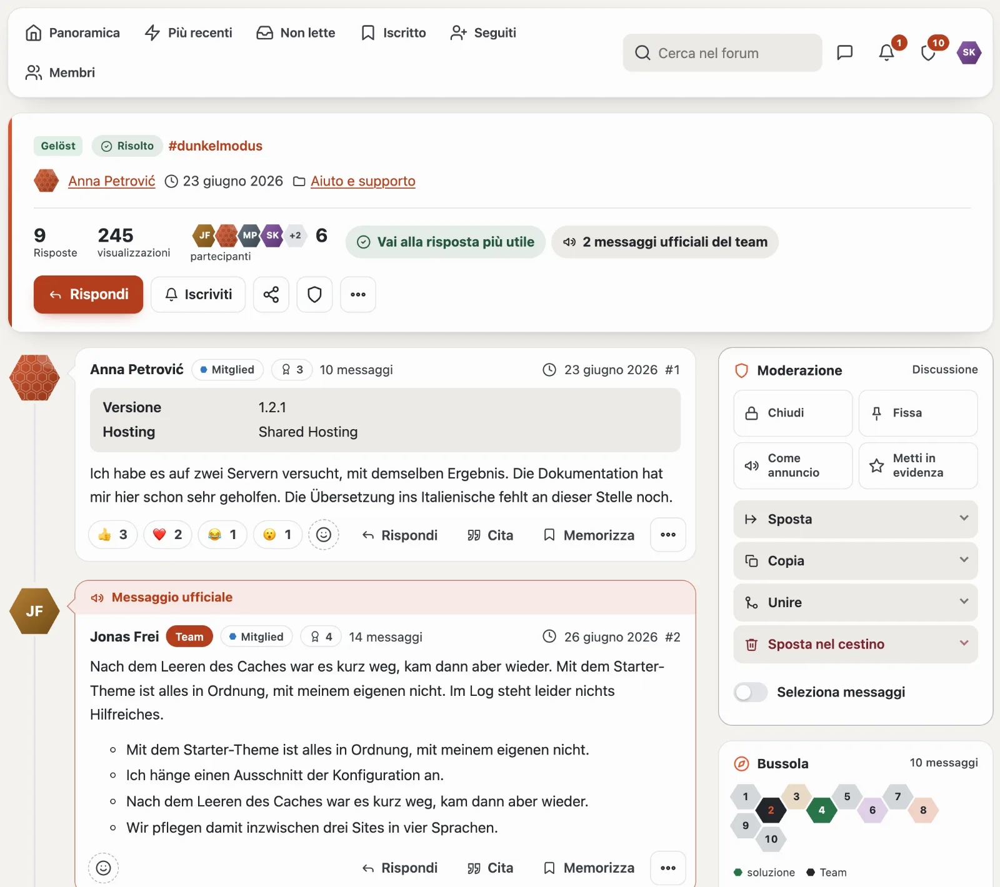
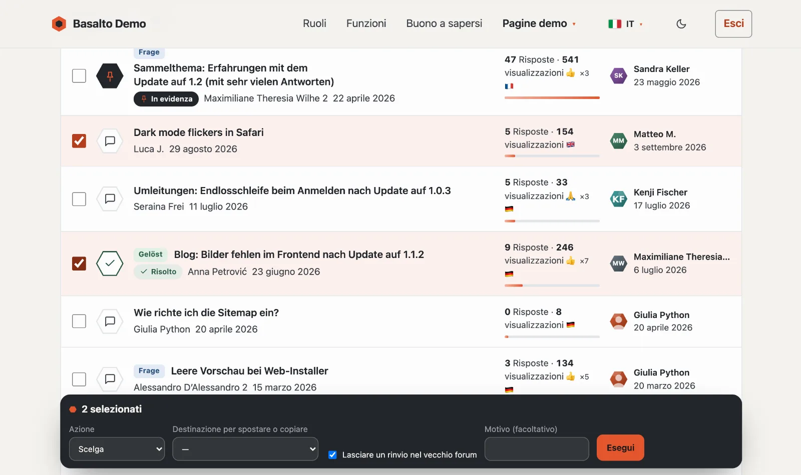
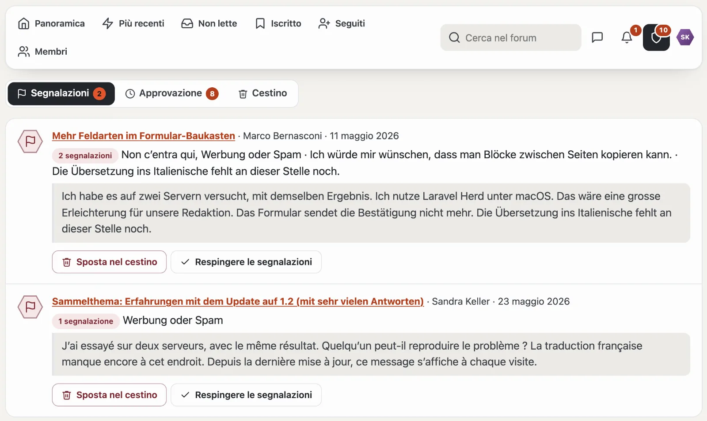
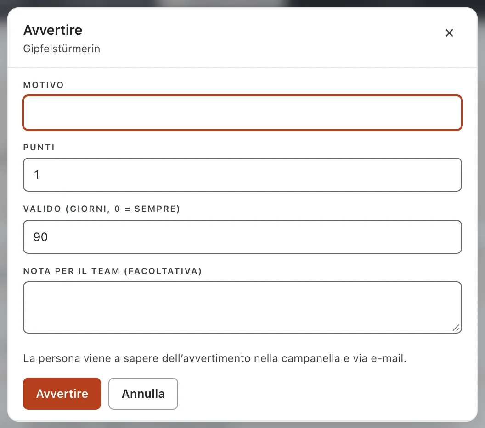
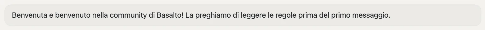

# Moderazione

Può moderare chi in un forum ha il permesso **«Moderare»** (di fabbrica i gruppi Moderazione e Team). Ogni azione esiste in due luoghi — sul posto nel forum e nell’amministrazione (extranet o backend) — con le stesse conseguenze e la stessa riga nel **registro di moderazione**.

## Sul posto

- **Scheda Moderazione nella discussione:** accanto ai messaggi ci sono riquadri per **Chiudi**, **Fissa**, **Come annuncio** e **Metti in evidenza**. Quando qualcosa è attivo, il riquadro è scuro e indica la via del ritorno (per esempio «In evidenza · sblocca»). Sotto si aprono **Sposta** (se desiderato con un rinvio nel vecchio forum, che scompare dopo alcuni giorni), **Copia** (con tutti i messaggi visibili, i tag e il sondaggio senza voti), **Unire** e **Sposta nel cestino**. Sul telefono la scheda sta alla fine della discussione; lo scudo nell’intestazione ci porta.
- **Selezionare:** l’interruttore **«Seleziona»** sopra l’elenco delle discussioni e **«Seleziona messaggi»** nella scheda mostrano le caselle di spunta. La barra scura «n selezionati» esegue l’azione per tutti.

- **Sul messaggio:** se un messaggio è in attesa o segnalato, una fascia in alto offre la decisione (**Approvare**, **Sposta nel cestino**, **Respingere le segnalazioni**) e inoltre **Avvertire** e **Rimuovere come spammer**. Per tutti gli altri messaggi, Avvertire e Rimuovere come spammer stanno nel menu «…».
- **Messaggi:** approvare, nascondere, spostare nel cestino, dividere in una nuova discussione.
- **Bloccare la modifica:** nel menu «…» di un messaggio la moderazione blocca la modifica per chi l’ha scritto (ad esempio in una disputa sul contenuto); questa persona vede «Modifica bloccata (moderazione)». «Consenti la modifica» la sblocca; la moderazione stessa può sempre modificare.
- L’elenco `/community/moderation` raccoglie segnalazioni, elementi in attesa e il cestino; le schede mostrano il numero di casi aperti, lo scudo nel navigatore il loro totale.

## Segnalazioni

I membri segnalano i messaggi indicando un motivo. A partire dal numero impostato di segnalazioni aperte (predefinito tre) un messaggio è nascosto provvisoriamente, finché la moderazione decide. Le segnalazioni relative alle valutazioni nel Marketplace e ai messaggi privati si trovano nello stesso elenco dell’amministrazione.

## Avvertimenti e sospensioni

- Un **avvertimento** ha un motivo, dei punti e una validità. La persona avvertita lo viene a sapere nella campanella e via e-mail.
- A partire dai punti impostati segue automaticamente un **blocco della scrittura** (leggere sì; scrivere, reagire, votare e messaggi no) o una **sospensione** (la persona conta come un ospite).
- **Rimuovere come spammer:** sospende senza scadenza, sposta tutte le discussioni e i messaggi nel cestino ed evade le segnalazioni aperte — i contatori sono poi corretti.
- Sotto **Membri** imposta e revoca le sospensioni a mano e ritira gli avvertimenti.

## Protezione dagli abusi

- **Approvazione:** se «Scrivere senza approvazione» per un gruppo (globalmente o per forum) è su «No», ogni nuovo messaggio attende la moderazione.
- **Intervallo minimo** tra due messaggi (flood control); moderazione e team non attendono mai.
- **Censura:** un elenco di parole (`*` per un numero qualsiasi di lettere) blocca l’invio con un’indicazione — nulla viene modificato in silenzio.

## Avvisi

Sotto **Avvisi** crea dei banner — per l’intera community, la panoramica o un forum, per tutti, solo ospiti, solo chi ha effettuato l’accesso o determinati gruppi, con un periodo. Chi ha effettuato l’accesso può nascondere per sé gli avvisi nascondibili; anche gli ospiti — il loro browser lo ricorda.

## Per continuare

- [Amministrazione della community](verwaltung.md)
- [Forum](forum.md)
