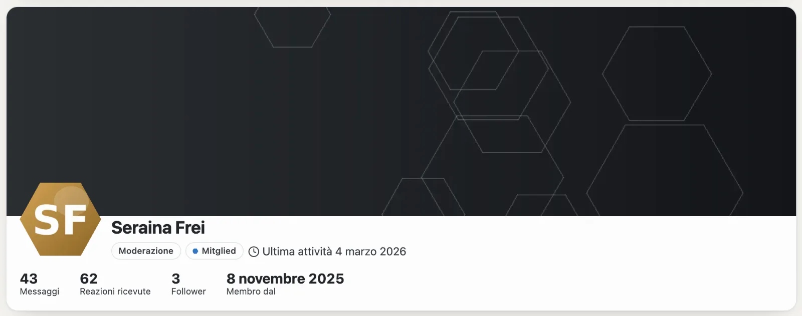
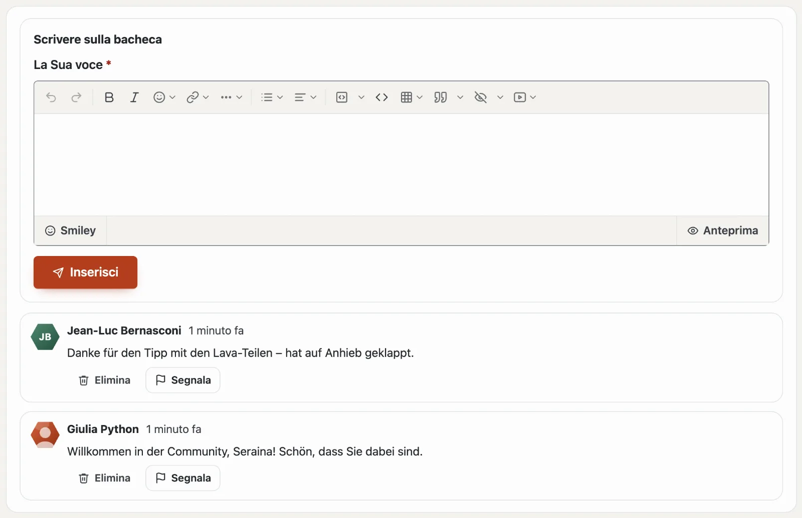
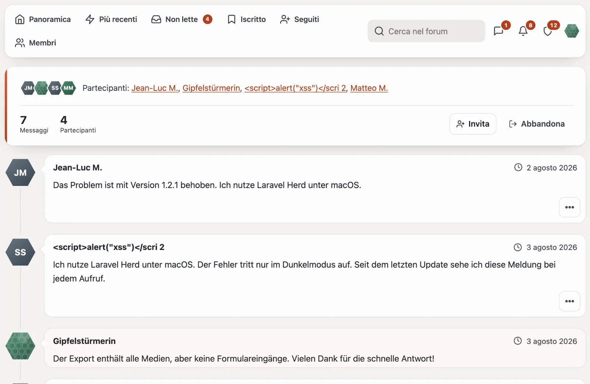

# Profili e conversazioni

## Il Suo profilo

Sotto «Il Suo profilo» (`/community/konto`) stabilisce:

- **Nome visualizzato** (univoco nella community), **Immagine del profilo** e **Firma**,
- **Su di me**, una **Foto di copertina** e i **campi propri** del sito (ad esempio sito web o località) — ogni campo indica chi lo vede: tutti, i membri che hanno effettuato l’accesso o solo il team,
- e-mail per risposte e menzioni (subito, ogni giorno, mai) e se iscriversi automaticamente alle discussioni in cui scrive.

Il profilo pubblico sotto `/community/mitglied/<nummer>-<name>` mostra rango, trofei, messaggi, reazioni ricevute, follower e schede di tutti i moduli: messaggi e discussioni dal forum, voci e valutazioni dal Marketplace.

## Bacheca

Il profilo ha la scheda **Bacheca**: i membri vi lasciano un saluto, un grazie o una domanda — pubblica come il
profilo. In «Il Suo profilo» decide **chi può scrivere sulla Sua bacheca**: tutti i membri, solo le persone che segue
o nessuno.

- La campanella (e l’e-mail) La avvisa quando qualcuno scrive sulla Sua bacheca.
- Possono eliminare una voce chi l’ha scritta, Lei stesso e il team; ogni voce altrui si può **segnalare**.
- Chi è bloccato non scrive sulla Sua bacheca — e Lei non sulla sua.

## Seguire e bloccare

- **Seguire:** riceve una notifica nella campanella quando la persona apre una discussione; «Seguiti» elenca i suoi nuovi messaggi.
- **Bloccare:** i messaggi della persona sono chiusi per lei, le sue risposte, menzioni, citazioni e reazioni non generano alcuna notifica, e non può scriverle. Il blocco è privato; il team non si può bloccare.

## Conversazioni

- «Invia messaggio» nel profilo o «Nuova conversazione» sotto **Messaggi** — a una o più persone (nomi visualizzati separati da virgole).
- Solo i partecipanti leggono. Può invitare altre persone o abbandonare la conversazione.
- I nuovi messaggi vengono contati nella barra e arrivano nella campanella e via e-mail.
- **Segnalare** un messaggio mostra al team solo quel singolo messaggio, mai l’intera conversazione.

## Ranghi e trofei

- **I ranghi** dipendono dal numero dei suoi messaggi (alcuni solo per un gruppo) e compaiono accanto al suo nome — con un simbolo come ⭐ se la community ne ha scelto uno.
- **I trofei** li assegna la community secondo regole — primo messaggio, molte reazioni, risposte più utili, licenza acquistata — oppure il team a mano. Una volta assegnati, restano.

## Per continuare

- [Forum](forum.md)
- [Community](README.md)
