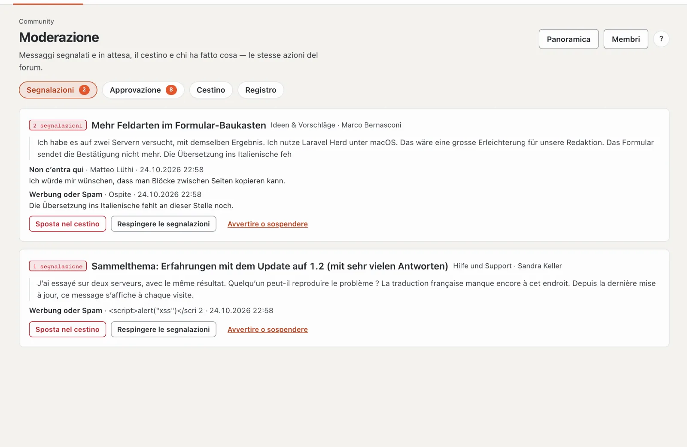
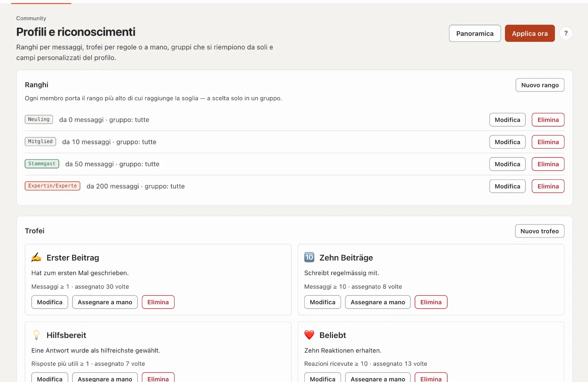

# Amministrazione della community

L’amministrazione si trova su basaltocms.com nell’**extranet** sotto «Community», su ogni altro sito nel backend sotto **Amministrazione › Community** — le stesse pagine con le stesse azioni.

| Pagina | A che cosa serve |
| --- | --- |
| **Panoramica** | cifre, moderazione aperta, pagina nel frontend, il suo account nel team, impostazioni |
| **Forum** | albero con categorie, forum, sottoforum e rinvii; prefissi e campi della discussione per forum |
| **Gruppi e permessi** | gruppi di visitatori e la matrice dei permessi, globale e per forum (Sì, No, Mai) |
| **Moderazione** | segnalazioni, approvazione, cestino, registro con filtro |
| **Membri** | ricerca e filtri (sospesi, blocco della scrittura, avvertiti); avvertire, sospendere, rimuovere spammer |
| **Avvisi** | banner con ambito, destinatari e periodo, con anteprima |
| **Profili e riconoscimenti** | ranghi, trofei, gruppi automatici, campi del profilo propri |

## Profili e riconoscimenti

- **Ranghi:** titolo, colore e, se desidera, un simbolo (ad esempio ⭐, al posto del punto colorato) a partire da un numero di messaggi, a scelta solo per un gruppo.
- **Trofei:** secondo una regola o a mano. Le regole le portano i moduli: messaggi, reazioni ricevute, membro da, follower (nucleo), discussioni aperte e risposte più utili (forum), «Ha una licenza» (vendita licenze), «Autore nel Marketplace» (Marketplace). L’anteprima mostra quanti membri soddisfano oggi una regola.
- **Campi del profilo propri:** testo, più righe, indirizzo o **scelta** con possibilità fisse (una per riga), ciascuno con la visibilità (tutti, membri con accesso, solo team) e, se desidera, obbligatorio.
- **Gruppi automatici:** una regola riempie un gruppo proprio e rimuove soltanto le appartenenze che ha impostato essa stessa.
- L’esecuzione avviene ogni giorno alle 03:30 (`basalto:community-rules`) o subito con «Applica ora».

## Impostazioni

Nella panoramica: finestra di modifica, allegati (tipi, dimensione, spazio per account, **allegati per messaggio**), quali **reazioni** sono disponibili, rinvio dopo lo spostamento, intervallo minimo, soglia delle segnalazioni, validità degli avvertimenti e punti per blocco della scrittura e sospensione con la loro durata, censura e che cosa succede ai messaggi quando si elimina un account.

### Condizioni della community

Di base, chi apre il forum accetta per prima cosa: una finestra indica le condizioni d’uso e le linee guida della
community (pagine del tema, altrimenti note legali e protezione dei dati) e richiede la spunta. Senza consenso un conto
conta come un ospite — leggere sì, scrivere, reagire, messaggi e moderazione no; il forum dietro è bloccato. Gli ospiti
accettano nel browser (cookie `basalto_community_terms`). Il conto cliente mostra data, ora e versione del consenso,
con «Revocare il consenso» — dopo la finestra ricompare.

Nelle impostazioni: **Richiedere il consenso** (attivo/disattivo) e **Versione** — una nuova versione (p. es. la data
della modifica) chiede di nuovo a tutti.

## Protezione dei dati

Informativa e cancellazione (`basalto:privacy`) comprendono profilo, immagini, messaggi, allegati, reazioni, iscrizioni, persone seguite, blocchi, messaggi privati, trofei, avvertimenti e segnalazioni. Di fabbrica i messaggi restano **anonimizzati** (la discussione resta leggibile); nelle impostazioni si può scegliere «eliminare» — le discussioni senza messaggi di altri spariscono allora del tutto. I messaggi nelle conversazioni restano anonimi per gli altri partecipanti.

## Ricerca, sitemap e feed

Le discussioni dei forum che gli ospiti possono leggere compaiono nella ricerca del sito (filtro «Forum»), nella sitemap e nei feed RSS; ogni discussione porta dati strutturati (`DiscussionForumPosting`). Se cambiano i permessi, l’indice si ricostruisce; a mano: `php artisan basalto:search-index`.

## Comandi

| Comando | A che cosa serve |
| --- | --- |
| `php artisan basalto:forum-seed <site>` | struttura iniziale della community di Basalto come in WoltLab: Generale (Novità e avvisi, Domande prima dell’acquisto), Forum per i clienti (Aiuto e supporto, Idee e proposte, Segnalazioni di errori — ciascuno con un sottoforum per ciò che è risolto), Personalizzazione (Temi e Lava, Moduli e plugin, rinvio alla documentazione per sviluppatori), Varie (Off-topic); con simboli, prefissi e campi della discussione — non crea nulla due volte |
| `php artisan basalto:testdaten <site>` | riempie il forum (e tutto il resto) con molti dati di test per provare; `--entfernen` li rimuove di nuovo |
| `php artisan basalto:forum-recount [site]` | ricalcolare i contatori di forum, discussioni e profili |
| `php artisan basalto:community-rules [site]` | assegnare trofei e attribuire gruppi secondo le regole |
| `php artisan basalto:community-digest` | riepilogo giornaliero via e-mail |
| `php artisan basalto:forum-benchmark` | test di carico con 100 000 messaggi su un sito usa e getta: elenco delle discussioni e discussione sotto 300 ms |

## Per continuare

- [Moderazione](moderation.md)
- [Impostazioni](../verwaltung/einstellungen.md)
