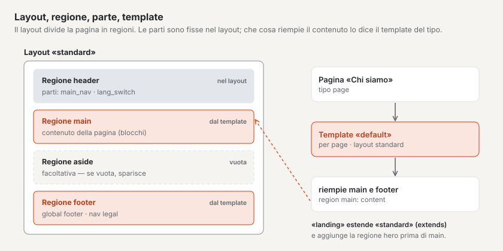
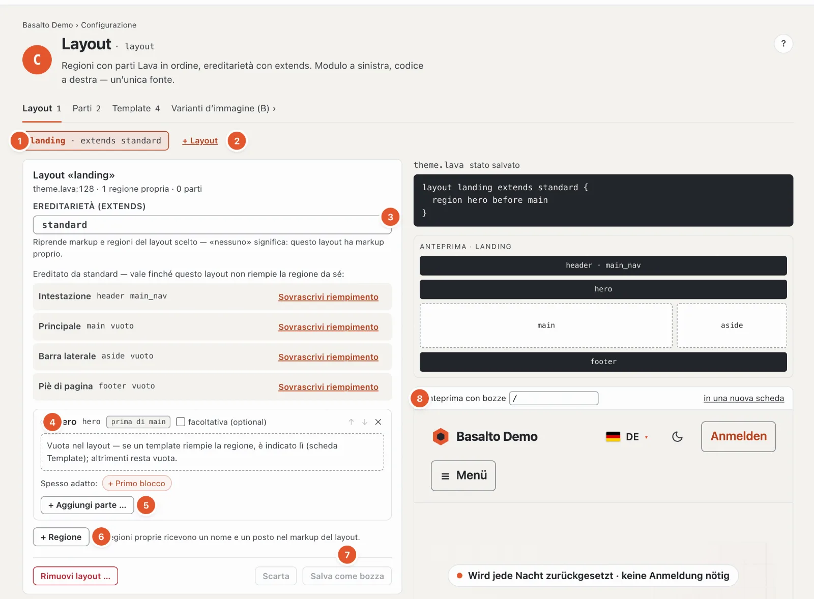
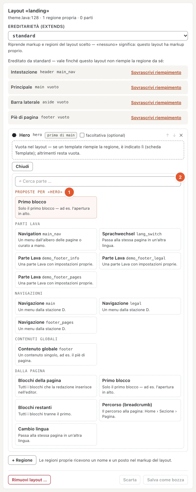
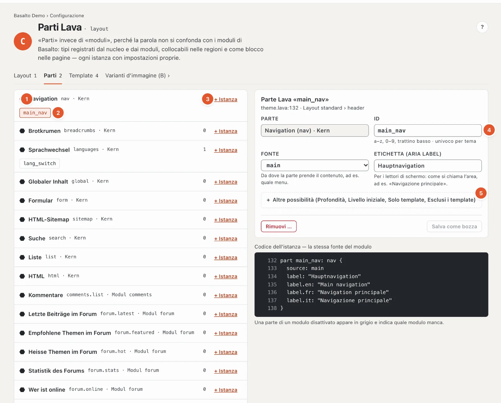
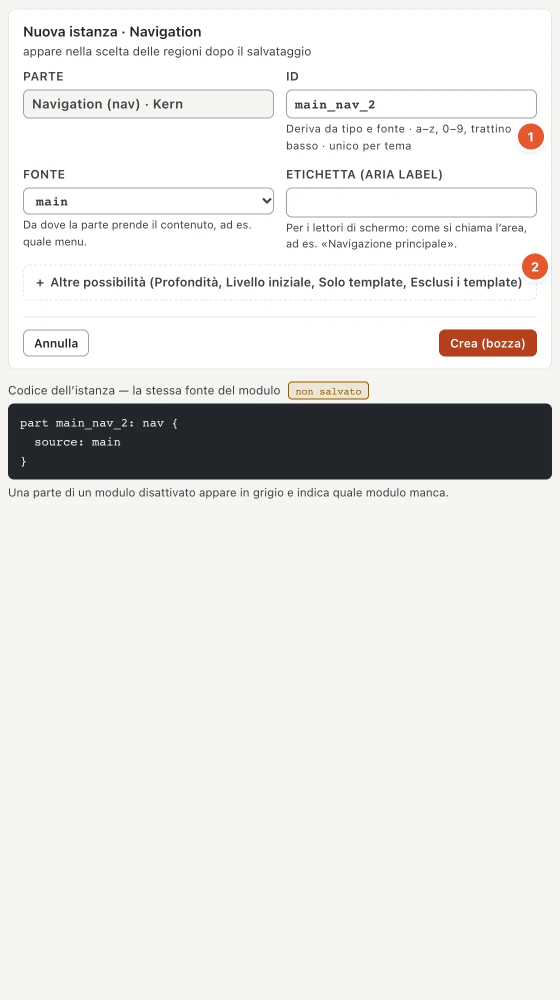
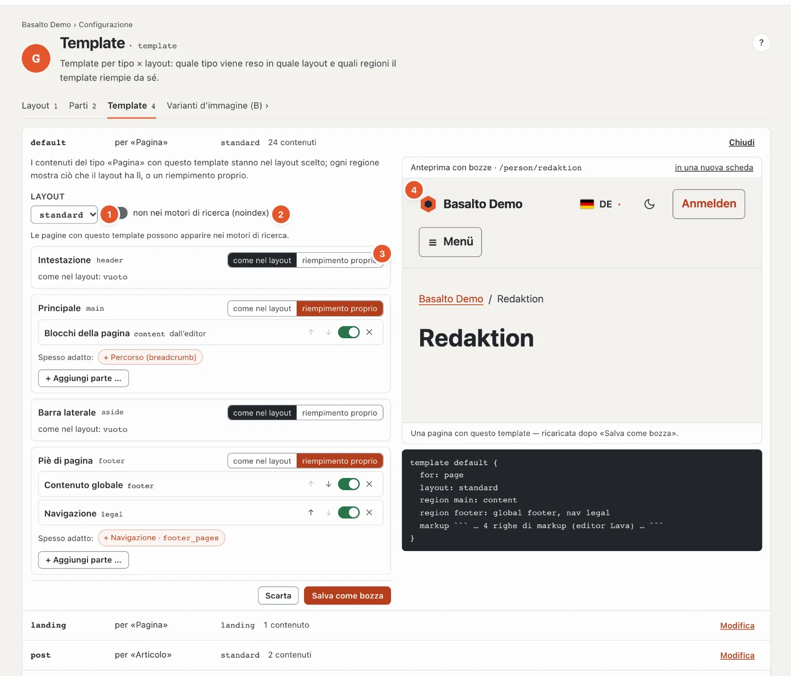

# Struttura: layout, parti e template

La stazione **«Com’è costruito?»** stabilisce di quali aree è composta una pagina e che cosa si trova in quale area. Riunisce due verifiche: layout (C) e template (G).

- Un **layout** è l’ossatura di una pagina: intestazione, parte principale, piè di pagina. Suddivide la pagina in **regioni**.
- Una **parte** (parte Lava) è un elemento pronto che si trova in una regione — per esempio la navigazione principale o il cambio lingua. Le parti provengono dal nucleo e dai moduli; Lei le colloca con impostazioni proprie.
- Un **template** dice come un tipo di contenuto compare in un layout e quali regioni riempie il contenuto stesso.
- Un layout può **estenderne** un altro («extends»): riprende tutto e aggiunge regioni — nello Starter «landing» inserisce un hero prima della parte principale.

## Dove

Modalità «Configurazione» › «Com’è costruito?» › **«Apri layout»**. La pagina ha le schede **Layout**, **Parti** e **Template**, più un salto alle [varianti d’immagine](aussehen.md#varianti-dimmagine).

Se il tema si trova ancora nella cartella dell’installazione, la pagina mostra in alto «Questo tema si trova nella cartella» e si può solo visualizzare; si può modificare dopo **«Riprendi nel database»**. Tutte le modifiche nascono poi come **bozza** e vanno online tramite l’approvazione — vedi [Bozze e approvazione](entwuerfe.md).

## Scheda «Layout»

1. **Scegliere il layout** — un pulsante per layout, con «extends …» se ne estende un altro.
2. **«+ Layout»** — un nuovo layout: nome (proposte come «schmal» o «landing» con un clic) ed **«Eredita da»** — sotto è indicato quali regioni riprende. Il markup (HTML) di un layout resta codice; un layout del tutto senza modello si crea nell’editor del tema.
3. **Ereditarietà (extends)** — da quale layout questo riprende markup e regioni; «— nessuna: markup proprio» per i layout con HTML proprio.
4. **Le regioni** — per ogni regione una scheda con nome, ID e posizione («vor main»). **«facoltativa (optional)»** significa: se la regione resta vuota, scompare del tutto. Con ↑ e ↓ cambia l’ordine, ✕ rimuove la regione. Le regioni ereditate portano «Ereditato da …»; **«Sovrascrivi riempimento»** dà a questo layout un riempimento proprio. Una regione vuota la riempie il template — se lì non c’è nulla, resta vuota.
5. **Aggiungere una parte** — vedi sotto. Le parti di una regione sono in ordine e si possono spostare, disattivare e attivare e rimuovere.
6. **«+ Regione»** — una regione propria: nome e posizione nel markup del layout (prima o dopo, rispetto a una regione esistente). Le regioni frequenti — hero, barra laterale, barra di avviso, invito all’azione — impostano nome e posizione con un clic. Se il markup inserisce già la regione, non serve alcuna posizione.
7. **«Salva come bozza»** e **«Scarta»**; **«Rimuovi layout …»** elimina un layout dopo una conferma. Se qualcosa non va, compare «Nulla salvato — un tema con errori non va mai online», e il codice mostra il punto.
8. **Anteprima con bozze** — il sito web con le Sue bozze salvate, per un percorso a scelta («/» è la pagina iniziale); «in una nuova scheda» la apre a tutto schermo.

### Che cosa va in una regione

Sotto ogni regione Basalto propone ciò che vi si trova spesso — come pulsanti «Spesso adatto: + Navigation · main …»:
nell’**intestazione** la navigazione principale e il cambio lingua, nel **piè di pagina** la riga a piè di pagina e i
menu per le note legali, nell’**hero** il primo blocco, nell’**area principale** i blocchi della pagina, nella **barra
laterale** ricerca ed elenchi. **«+ Aggiungi parte …»** apre l’intera selezione:

1. **Proposte per la regione** — in alto, senza ciò che vi si trova già.
2. **Ricerca** e i gruppi **Parti Lava**, **Navigazioni**, **Contenuti globali** e **Dalla pagina** (tutti i blocchi,
   solo il primo, i restanti, percorso, cambio lingua) — per ogni voce una frase su a che cosa serve. Invio prende il
   primo risultato.

A destra si trovano inoltre il **codice** del layout (stato salvato), **«Mostra markup»** per l’HTML, le **segnalazioni** con E (errore) e W (avviso) e un’**anteprima schematica** delle regioni. In basso «Template per tipo × layout» mostra quali template usano questo layout e quanti contenuti ne dipendono.

## Scheda «Parti»

1. **I tipi di parti** — dal nucleo (navigazione, breadcrumb, cambio lingua, contenuto globale, modulo, sitemap HTML, ricerca, elenco, HTML) e dai moduli (per esempio commenti, accesso per i membri). A destra il numero di istanze.
2. **Un’istanza** — una parte collocata con un nome proprio, per esempio «main_nav». Un clic ne apre le impostazioni.
3. **«+ Istanza»** — creare una nuova parte di questo tipo.
4. **ID** — lettere minuscole, cifre e trattino basso, univoco nel tema. Sotto, le **impostazioni del tipo** con una frase per impostazione — per una navigazione per esempio la fonte (quale menu) e l’etichetta per i lettori di schermo.
5. **Altre possibilità** — profondità, livello iniziale, **Solo template / Esclusi i template** (la parte compare solo in determinati template o in tutti tranne questi) e l’etichetta per ogni altra lingua.

In una **nuova istanza** la prima fonte è già scelta, e l’**ID** nasce da fonte e tipo
(1) — «main» e «nav» danno «main_nav» —, finché non lo modifica Lei stessa o Lei stesso. Ciò che si usa raramente si
trova sotto **«Altre possibilità»** (2).

Le istanze si trovano nelle regioni di un layout — e come blocco su singole pagine («+ Parte Lava» nell’editor). Un’istanza si può rimuovere solo quando non si trova più in alcuna regione; altrimenti compare «Si trova in: … — toglierla prima da lì». Se una parte appartiene a un modulo disattivato per il sito, appare in grigio: l’istanza resta, ma non viene emesso nulla.

## Scheda «Template»

Una riga per template: nome, per quale tipo («per «Pagina»»), in quale layout e quanti contenuti lo usano.
«Modifica» lo apre; in alto è spiegato in una frase che cosa fa un template:

1. **Layout** — in quale layout si trovano i contenuti con questo template.
2. **Non nei motori di ricerca (noindex)** — le pagine con questo template non compaiono su Google & Co. e mancano nella
   sitemap. Se il template si chiama come una pagina legale, di ringraziamento o di errore («legal», «danke», «404»),
   Basalto propone di attivare noindex.
3. **Per regione: «come nel layout» o «riempimento proprio»** — compaiono tutte le regioni del layout, anche quelle che
   inserisce solo il markup. «Riempimento proprio» riprende prima ciò che il layout ha lì; poi lo modifica con le stesse
   proposte e la stessa selezione del layout («Spesso adatto», «+ Aggiungi parte …»).
4. **Anteprima con bozze** — una pagina che usa questo template, con le Sue bozze salvate; dopo
   «Salva come bozza» si ricarica.

Sotto si trova il **codice** — il template in Lava. Il suo markup (l’HTML del contenuto) resta codice e si modifica
nell’editor del tema. Un tipo può avere più template; quale usa una pagina lo sceglie nelle impostazioni della
pagina, scheda «Layout» (vedi [Pagine](../redaktion/seiten.md)).

## Domande frequenti

**Perché non posso modificare nulla?**
Il tema si trova nella cartella dell’installazione — lo riprenda nel database. Oppure il Suo ruolo consente l’area «Design, temi e layout» solo in visualizzazione.

**Ho salvato, ma il sito web non lo mostra.**
Si salva come bozza. L’«Anteprima con bozze» la mostra; va online solo dopo l’approvazione (vedi [Bozze e approvazione](entwuerfe.md)).

## Per continuare

- [Menu](menues.md)
- [Blocchi riutilizzabili](bausteine.md)
- [Bozze e approvazione nella configurazione](entwuerfe.md)
