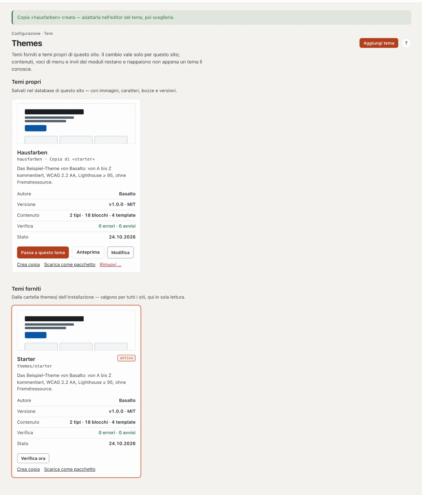
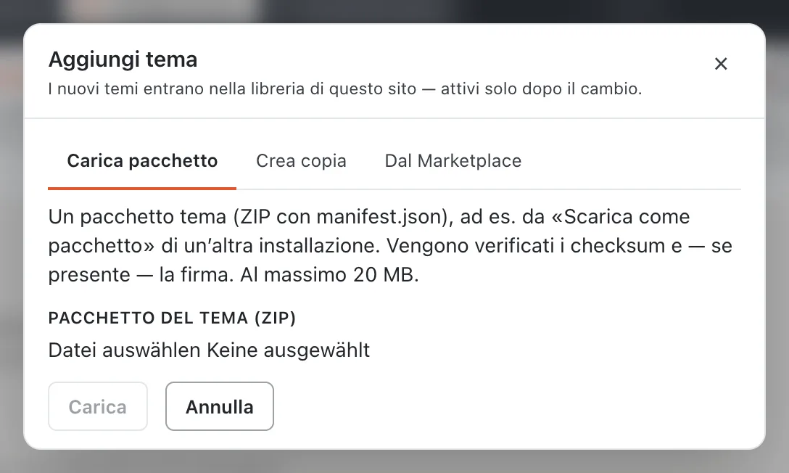
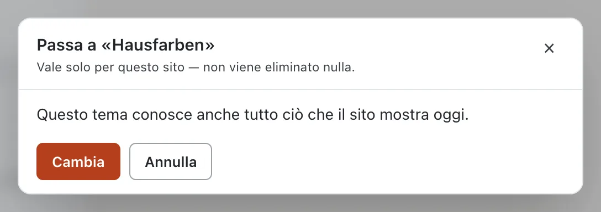
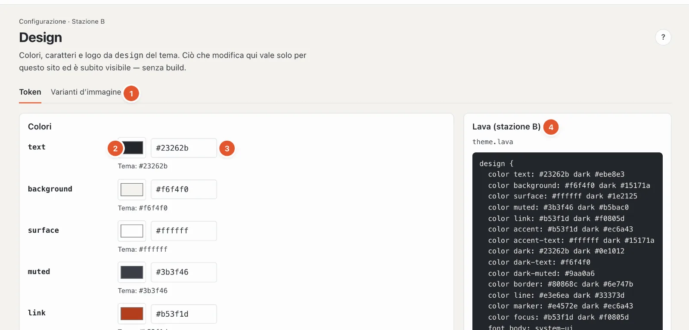
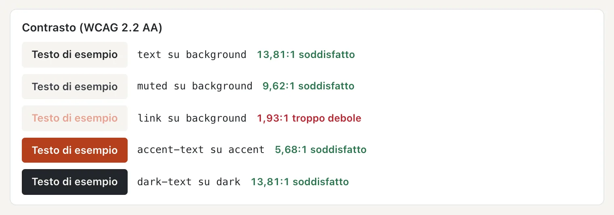
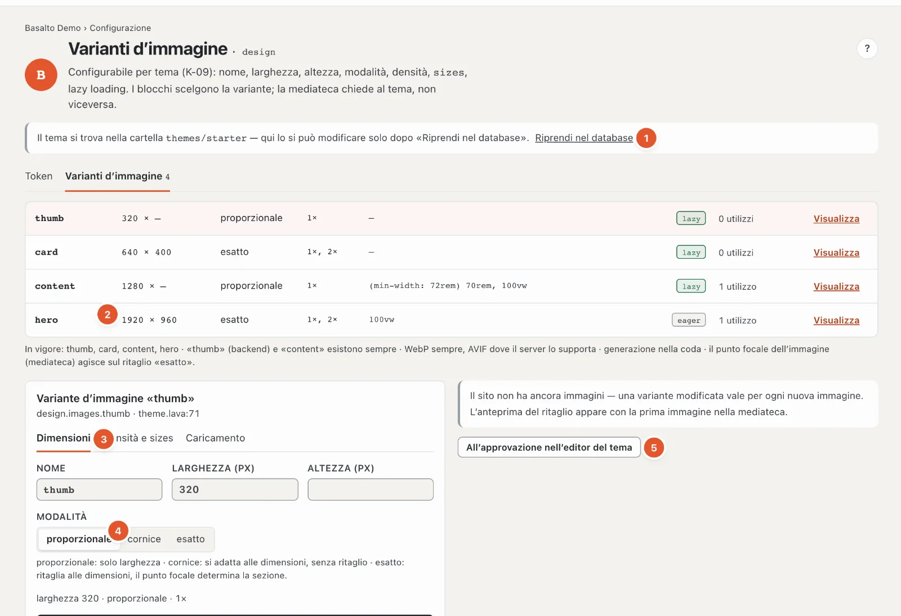
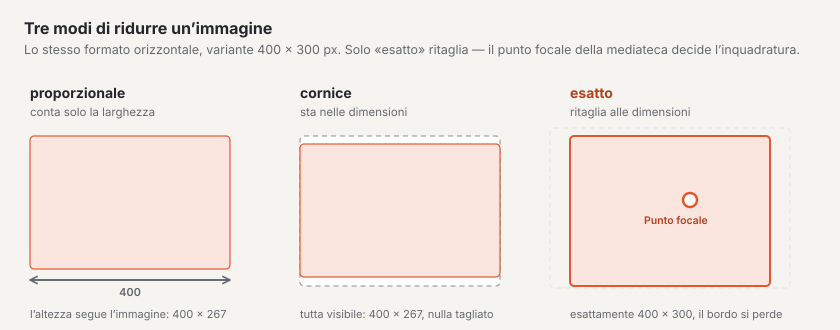

# Aspetto: temi, design e varianti d’immagine

La stazione **«Che aspetto ha?»** determina l’aspetto del sito. Il **tema** lo definisce; nel **design** adatta colori, caratteri e logo, nelle **varianti d’immagine** le dimensioni in cui vengono distribuite le immagini — tutto senza codice.

## Temi

Modalità «Configurazione» › «Che aspetto ha?» › **Temi** (nel percorso il riquadro con il nome del tema attivo).

La pagina mostra due gruppi:

- **Temi propri** — si trovano nel database di questo sito, con immagini, caratteri, bozze e versioni. Si possono modificare.
- **Temi forniti** — provengono dalla cartella `themes/` dell’installazione, valgono per tutti i siti e qui sono solo in lettura.

Ogni scheda mostra un’immagine di anteprima, nome e provenienza (per esempio «Copia di «starter»», «dal Marketplace», «da pacchetto (firmato)»), la descrizione, **Autore**, **Versione**, **Contenuto** (tipi, blocchi, template), il risultato della **Verifica** e lo **Stato**. Il tema attivo porta il contrassegno «attivo».

I pulsanti di una scheda:

- **«Passa a questo tema»** — vedi sotto.
- **«Anteprima»** — mostra il sito web con questo tema, solo nella Sua sessione. In alto compare allora «L’anteprima con il tema … è attiva nella Sua sessione — il sito stesso è invariato.»; **«Termina anteprima»** torna indietro. L’anteprima è aperta a tutti coloro che vedono la pagina.
- **«Modifica»** — apre il tema proprio nell’editor del tema (codice).
- **«Verifica ora»** — verifica di nuovo il tema; in caso di errori **«Vedi segnalazioni»** porta ai messaggi. Un tema con errori non si può scegliere.
- **«Crea copia»** — una copia con tutti i file, le immagini e i caratteri, il miglior punto di partenza per un tema proprio. L’originale resta invariato.
- **«Scarica come pacchetto»** — scarica il tema come ZIP, per esempio per un’altra installazione.
- **«Rimuovi …»** (solo temi propri) — elimina file, immagini, caratteri, bozze e tutte le versioni del tema; i contenuti del sito restano. Se il tema è attivo, il sito mostra subito di nuovo il tema fornito con lo stesso nome. Chi ne ha ancora bisogno in seguito sceglie prima **«Prima scarica il pacchetto»**.
- **«Nascondi»** (solo temi forniti non attivi) — toglie un tema dall’elenco; in basso **«Mostra di nuovo»** lo riporta.

### Aggiungere un tema

**«Aggiungi tema»** offre tre vie. I nuovi temi entrano nella biblioteca di questo sito — attivi solo dopo il cambio.

- **Carica pacchetto** — un pacchetto del tema (ZIP con `manifest.json`), per esempio da «Scarica come pacchetto» di un’altra installazione, fino a 20 MB. Vengono verificati i checksum e, se presente, la firma.
- **Crea copia** — scegliere il **Modello**, la **Denominazione** (come si chiama il tema nel backend) e il **Nome** (lettere minuscole, cifre e trattini — così si chiama il tema in Lava e nel pacchetto).
- **Dal Marketplace** — i temi del Marketplace sono firmati dal produttore. Una volta installati entrano nella biblioteca come tema proprio; un aggiornamento successivo compare nell’editor del tema come bozza.

### Passare a un altro tema

**«Passa a questo tema»** verifica prima che cosa il sito non potrebbe più mostrare con il nuovo tema e lo elenca in un rapporto:

- tipi di contenuto che il tema non conosce,
- blocchi che non vengono più visualizzati,
- template a cui rimandano delle pagine,
- menu con voci proprie,
- moduli con invii.

Un cambio vale solo per questo sito, e **non viene eliminato nulla**: ciò che il nuovo tema non conosce resta nel database e ricompare non appena un tema lo conosce. Se nel rapporto non c’è nulla («Questo tema conosce anche tutto ciò che il sito mostra oggi.»), il pulsante si chiama «Cambia»; altrimenti **«Cambia comunque»**.

Cambiare, aggiungere e rimuovere può chi ha un ruolo che consente di modificare l’area «Design, temi e layout»; altrimenti in alto compare «Il Suo ruolo non consente di cambiare, aggiungere o rimuovere temi».

## Design

Modalità «Configurazione» › «Che aspetto ha?» › **«Adatta design»**, scheda **Token**. Ciò che modifica qui vale solo per questo sito ed è subito visibile — senza build. Il tema stesso resta invariato.

1. **Token · Varianti d’immagine** — le due schede della stazione.
2. **Selettore colore** — un clic apre la scelta dei colori del sistema.
3. **Colore come codice** — `#rgb` o `#rrggbb`. Sotto è indicato il valore del tema («Tema: #23262b»); se il Suo colore si discosta, **«ripristina»** lo riporta al valore del tema.
4. **Lava (stazione B)** — la parte `design` del tema, solo in lettura. Sotto, i **Fogli di stile** del tema e gli stessi valori **per Tailwind 4**, nel caso qualcuno sviluppi ulteriormente il sito con Tailwind.

Quali colori esistono lo determina il tema — nello Starter per esempio `text`, `background`, `surface`, `muted`, `link`, `accent`, `accent-text`, `dark`, `dark-text`, `dark-muted`, `border`, `line`, `marker` e `focus`.

### Contrasto

Sotto i colori Basalto verifica ogni coppia di colore del testo e colore di sfondo secondo la regola dell’accessibilità (WCAG 2.2 AA): **almeno 4,5:1**. Le coppie risultano dai nomi — `text` su `background`, `link` su `background`, `accent-text` su `accent` e così via. Per ogni coppia vede un testo di esempio, il rapporto e «soddisfatto» o **«troppo debole»**.

Se una coppia è troppo debole, il colore **non viene salvato**; accanto al campo compare per esempio «Il contrasto «link» su «background» è 1,93:1 — almeno 4,5:1.». Scelga un colore più scuro o più chiaro.

### Caratteri

Per ogni ruolo del carattere (per esempio **body**, **heading**, **code**) un campo con il nome del carattere; sotto il valore del tema e il peso. Il carattere deve trovarsi nel tema o essere presente sul dispositivo — altrimenti vale il carattere sostitutivo. «ripristina» ripristina il valore del tema.

### Logo

Il tema mostra il logo dove inserisce `{{ site.logo }}`. Lei sceglie:

- **dal tema** — il logo che il tema porta con sé (predefinito),
- **Immagine dalla mediateca** — un’immagine propria,
- **nessun logo**.

Non appena qualcosa si discosta dal tema, in alto a destra compare **«Tutto come nel tema»**: riporta tutti i colori, i caratteri e il logo ai valori del tema.

## Varianti d’immagine

Scheda **Varianti d’immagine** accanto a «Token». Una **variante d’immagine** è una dimensione in cui Basalto tiene pronta ogni immagine della mediateca — per esempio «thumb» per le miniature, «card» per le schede, «hero» per l’hero. I blocchi scelgono la variante; redattrici e redattori caricano solo l’originale.

1. **Tema nella cartella** — se il tema si trova ancora nella cartella dell’installazione, le varianti si possono modificare solo dopo **«Riprendi nel database»** (vedi [Bozze e approvazione](entwuerfe.md)).
2. **Le varianti** — per riga nome, dimensioni (larghezza × altezza, «—» significa libera), modalità, densità, `sizes`, «lazy» o «eager», quante volte viene usata la variante, e «Visualizza» o «Modifica». **«+ Variante»** ne crea una nuova.
3. **La variante scelta** in tre schede: **Dimensioni** (nome, larghezza, altezza, modalità), **Densità e sizes**, **Caricamento**. Sotto, il codice della variante.
4. **Modalità** — come l’immagine arriva alla dimensione (vedi lo schema).
5. **Salvataggio** — da sé nella bozza (il nome uscendo dal campo); **«All’approvazione nell’editor del tema»** invia la modifica per approvazione.

Le impostazioni nel dettaglio:

- **Modalità**: **proporzionale** — conta solo la larghezza, l’altezza segue l’immagine; **cornice** — entra tutta nella dimensione, senza ritaglio; **esatto** — ritaglia alla dimensione, il **punto focale** dell’immagine (impostato nella mediateca) determina l’inquadratura.
- **Densità** — 1× per schermi normali, 2× per schermi ad alta risoluzione. Le densità più alte nascono solo se l’originale è abbastanza grande; altrimenti compare «2× richiederebbe … px di larghezza — resta 1×».
- **sizes** — dice al browser quanto è larga l’immagine sulla pagina, per esempio «100vw» per la larghezza piena.
- **Lazy loading** — le immagini si caricano solo quando entrano nella visuale scorrendo. Disattivato per le immagini in cima alla pagina (hero), altrimenti attivo.

Importante:

- «thumb» (per il backend) e «content» esistono sempre.
- Basalto distribuisce sempre WebP, più AVIF dove il server lo supporta. Le varianti nascono in background (coda).
- Se una variante cambia, **dopo la pubblicazione** tutte le immagini del sito vengono ritagliate di nuovo; fino ad allora la cache fornisce quelle vecchie. Se il sito ha già immagini, un’anteprima mostra il nuovo ritaglio sulla prima immagine.

## Domande frequenti

**Il colore non si può salvare.**
Il contrasto è troppo debole. Il messaggio accanto al campo indica la coppia e il rapporto — almeno 4,5:1.

**Ho cambiato tema e una parte delle pagine sembra vuota.**
Il nuovo tema non ne conosce i blocchi o i template. Non è andato perso nulla: torni al tema precedente o completi il nuovo tema.

**Qual è la differenza tra design ed editor del tema?**
Nel design modifica valori che il tema mette a disposizione (colori, caratteri, logo). Nell’editor del tema modifica il tema stesso, in Lava.

## Per continuare

- [Struttura: layout, parti e template](aufbau.md)
- [Temi](../entwickler/themes.md)
- [Marketplace per installazioni](../marktplatz/installieren.md)
