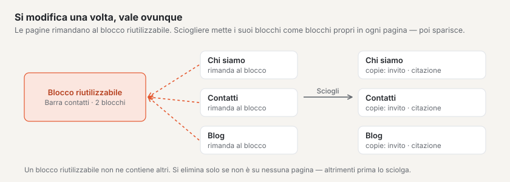
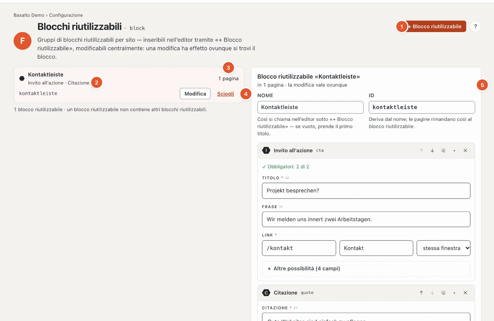

# Blocchi riutilizzabili

La stazione **«Di che cosa sono fatte le pagine?»** ha due lati: i **blocchi** — testo, immagine, invito all’azione, schede e così via — li porta il tema; quali esistono lo vede nella tavolozza dei blocchi dell’editor (vedi [Modificare i contenuti con i blocchi](../redaktion/bloecke.md)). I **blocchi riutilizzabili** invece li crea Lei stessa o Lei stesso: un gruppo di blocchi che compare uguale su più pagine — una barra di contatto, un invito all’azione, un avviso sugli orari di apertura.

La differenza:

| | Blocco | Blocco riutilizzabile | Parte Lava |
| --- | --- | --- | --- |
| Che cosa | un elemento di contenuto di una pagina | un gruppo di blocchi con contenuto fisso | un elemento del tema con impostazioni (menu, ricerca, modulo) |
| Da dove | tema | Lei, qui | nucleo e moduli, collocata sotto [Struttura](aufbau.md#scheda-parti) |
| Modificare | su ogni pagina singolarmente | una volta — vale ovunque | nelle sue impostazioni |

## Dove

Modalità «Configurazione» › «Di che cosa sono fatte le pagine?» › **«Gestisci blocchi riutilizzabili»**. Il codice dei blocchi lo mostra «Vedi i blocchi nel codice» nell’editor del tema.

1. **«+ Blocco riutilizzabile»** ne crea uno nuovo.
2. **L’elenco** — per ogni blocco riutilizzabile nome, i blocchi che contiene (qui «Invito all’azione · Citazione»), ID e «Modifica».
3. **Dove si trova** — su quante pagine è inserito il blocco riutilizzabile; nel blocco riutilizzabile aperto sotto «Presente su» con link alle pagine.
4. **«Sciogli»** — vedi sotto.
5. **Il blocco riutilizzabile aperto** — «in 1 pagina · la modifica vale ovunque».

## Creare e modificare un blocco riutilizzabile

1. **«+ Blocco riutilizzabile»**, poi **Nome** (per esempio «Barra di contatto»). L’**ID** ne deriva; si può adattare (lettere minuscole, cifre, trattino). Se lascia vuoto il nome, prende il primo titolo che scrive nel primo blocco.
2. Aggiungere blocchi — con la tavolozza dei blocchi come nell’editor di una pagina, con gli stessi campi, ↑ ↓, duplicare e rimuovere. Il modulo mostra prima l’essenziale, un aiuto a ogni campo e sotto «Altre possibilità» le impostazioni di dettaglio ([I campi di un blocco](../redaktion/bloecke.md#i-campi-di-un-blocco)).
3. In basso a destra la finestra **«Anteprima dal vivo»** mostra il blocco riutilizzabile con il tema del Suo sito, aggiornato a ogni inserimento — il campo in cui scrive vi si illumina, e un clic nell’anteprima salta al campo ([Anteprima dal vivo](../redaktion/bloecke.md#anteprima-dal-vivo-in-una-finestra)).
4. **«Crea»**. Il blocco riutilizzabile compare nell’editor di ogni pagina sotto **«+ Blocco riutilizzabile»**. In seguito le modifiche si salvano da sole; l’identificativo cambia solo con Invio o uscendo dal campo — le pagine vi rimandano.

**Attenzione:** un blocco riutilizzabile non ha versioni. Una modifica vale dopo il salvataggio (una breve pausa dopo la digitazione) **subito su tutte le pagine** che lo contengono — senza invio per approvazione né approvazione. La modifica compare nel registro.

Un blocco riutilizzabile non contiene blocchi riutilizzabili — nella tavolozza manca lì il gruppo «Riutilizzabili».

## Inserire un blocco riutilizzabile

Nell’editor di una pagina: **«+ Inserisci blocco»** › gruppo «Riutilizzabili» › **«+ Blocco riutilizzabile»** e scegliere il blocco riutilizzabile («Inserisci blocco riutilizzabile»). Sulla pagina compare allora un **riferimento** con l’avviso «Riferimento — le modifiche al blocco riutilizzabile valgono su tutte le pagine che lo contengono.»; lì il contenuto non si può modificare.

Se una pagina deve mostrare il contenuto in modo diverso, sciolga il riferimento **su questa pagina**: i suoi blocchi diventano copie che modifica liberamente qui. Il blocco riutilizzabile stesso e le altre pagine restano come sono.

## Sciogliere o eliminare

- **«Sciogli»** — su tutte le pagine che contengono il blocco riutilizzabile, i suoi blocchi diventano **blocchi propri** della pagina; non va perso nulla. Dopo, il blocco riutilizzabile non c’è più. Basalto chiede prima: «Sciogliere «…»?» e indica le pagine.
- **«Elimina»** — possibile solo se il blocco riutilizzabile non si trova su alcuna pagina. Altrimenti lo sciolga prima o lo tolga dalle pagine.

Modificare possono i ruoli con l’area «Tipi e blocchi riutilizzabili»; altrimenti in alto compare «Il Suo ruolo consente di vedere i blocchi riutilizzabili, non di modificarli.». Inserire è possibile per tutti coloro che possono modificare pagine.

## Domande frequenti

**Ho modificato un blocco riutilizzabile — perché è già online?**
I blocchi riutilizzabili non hanno versioni; una modifica vale subito ovunque.

**Un blocco riutilizzabile può avere un aspetto diverso su una pagina?**
Non come blocco riutilizzabile — è uguale ovunque. Lo sciolga nell’editor di questa pagina (allora diventano blocchi propri) oppure crei un secondo blocco riutilizzabile.

## Per continuare

- [Tipi di contenuto](inhaltstypen.md)
- [Modificare i contenuti con i blocchi](../redaktion/bloecke.md)
