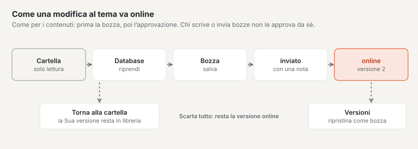
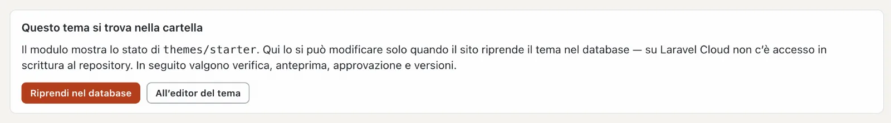
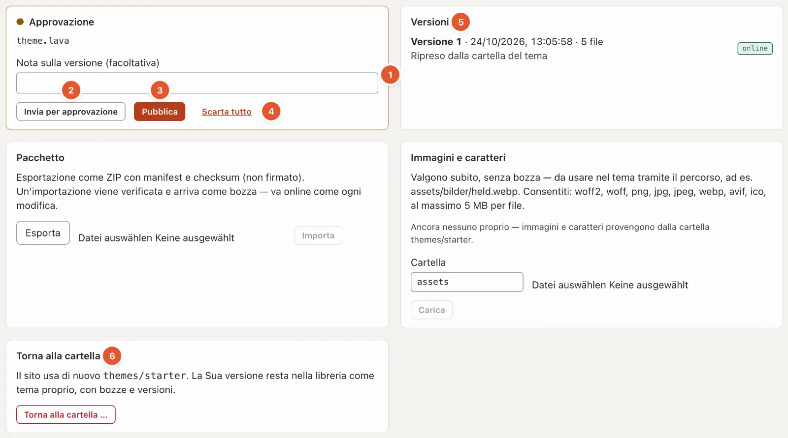

# Bozze e approvazione nella configurazione

Le modifiche a layout, parti, template, varianti d’immagine e al codice del tema non vanno subito online. Nascono come **bozza**, vengono verificate e diventano la nuova **versione** del tema solo con **«Pubblica»** — come i contenuti nella modalità «Contenuti».

Eccezioni che valgono subito: i valori nel [design](aussehen.md#design) (colori, caratteri, logo), le impostazioni del [sito](site.md), i [menu](menues.md), i [blocchi riutilizzabili](bausteine.md) e le immagini e i caratteri del tema.

## Tema nella cartella o nel database

Un tema fornito si trova nella cartella `themes/` dell’installazione. Basalto non modifica mai questa cartella — nelle installazioni in hosting lì non c’è nemmeno accesso in scrittura. Perciò layout, varianti d’immagine ed editor del tema mostrano all’inizio «Questo tema si trova nella cartella» e si possono solo visualizzare.

**«Riprendi nel database»** crea per questo sito una versione propria del tema nel database (versione 1, «Ripreso dalla cartella del tema»). Da quel momento valgono verifica, anteprima, bozze, approvazione e versioni. Nel rapporto di verifica compare poi «Database» invece di «file».

## Bozze

Ogni **«Salva come bozza»** — nei layout, nelle varianti d’immagine o nell’editor del tema — crea una bozza. Basalto verifica così l’intero tema: se contiene un errore, **non viene salvato nulla** («un tema con errori non va mai online»), e il codice mostra il punto.

Che effetto hanno le bozze lo mostra l’**anteprima con bozze** — nei layout e nell’editor del tema, per un percorso a scelta. **«Sfoglia l’intero sito con le bozze»** estende l’anteprima, per la Sua sessione, all’intero sito web; i visitatori continuano a vedere la versione online.

## L’approvazione

In fondo all’editor del tema (modalità «Configurazione» › «Codice») si trova la scheda **Approvazione**:

In alto indica i file con bozze (qui `theme.lava`).

1. **Nota sulla versione** — facoltativa, per esempio «Variante d’immagine thumb più larga». Compare in seguito nell’elenco delle versioni.
2. **«Invia per approvazione»** — le bozze vanno alla verifica.
3. **«Pubblica»** — le bozze diventano la nuova versione e vanno online. Se cambiano varianti d’immagine, Basalto ritaglia di nuovo in background tutte le immagini del sito.
4. **«Scarta tutto»** — tutte le bozze vengono eliminate; la versione online resta.
5. **Versioni** — ogni versione pubblicata con data e ora, numero di file e nota; «online» contrassegna quella attuale. **«Ripristina come bozza»** rende di nuovo bozza una versione vecchia — così annulla una modifica.
6. **«Torna alla cartella …»** — il sito usa di nuovo il tema fornito dalla cartella. La Sua versione resta, con bozze e versioni, come tema proprio nella [biblioteca](aussehen.md#temi).

Se il sito richiede il **principio dei quattro occhi** («Amministrazione › Impostazioni», gruppo «Approvazione», «Principio dei quattro occhi» — di fabbrica disattivato), le bozze devono prima essere inviate per approvazione, e chi le ha scritte o inviate non le approva. Senza questa impostazione può pubblicare direttamente.

Accanto si trovano le schede **Pacchetto** (esportare il tema come ZIP o importare un pacchetto — un’importazione arriva come bozza) e **Immagini e caratteri** (caricare file del tema; valgono subito, senza bozza).

## Domande frequenti

**Ho salvato, ma il sito web non mostra la modifica.**
Ha salvato una bozza. La pubblichi nella scheda «Approvazione» dell’editor del tema — oppure la faccia approvare, se vale il principio dei quattro occhi.

**«Nulla salvato» — e ora?**
Con la Sua modifica il tema avrebbe un errore. La segnalazione indica il punto; lo corregga e salvi di nuovo.

## Per continuare

- [Andare online](live-gehen.md)
- [Configurazione: progettare e costruire il sito](README.md)
