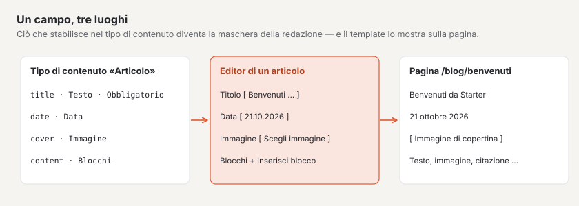
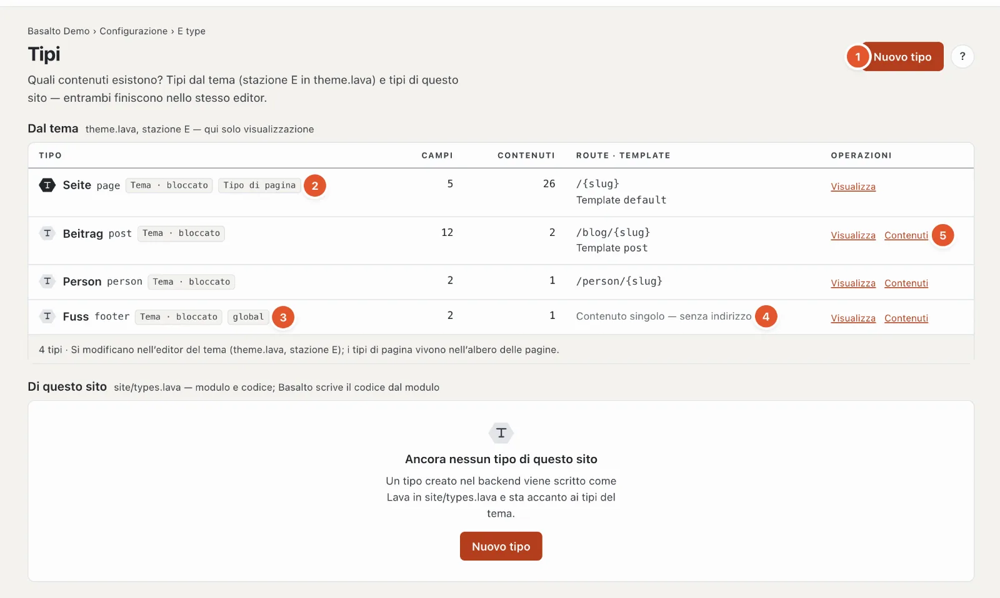
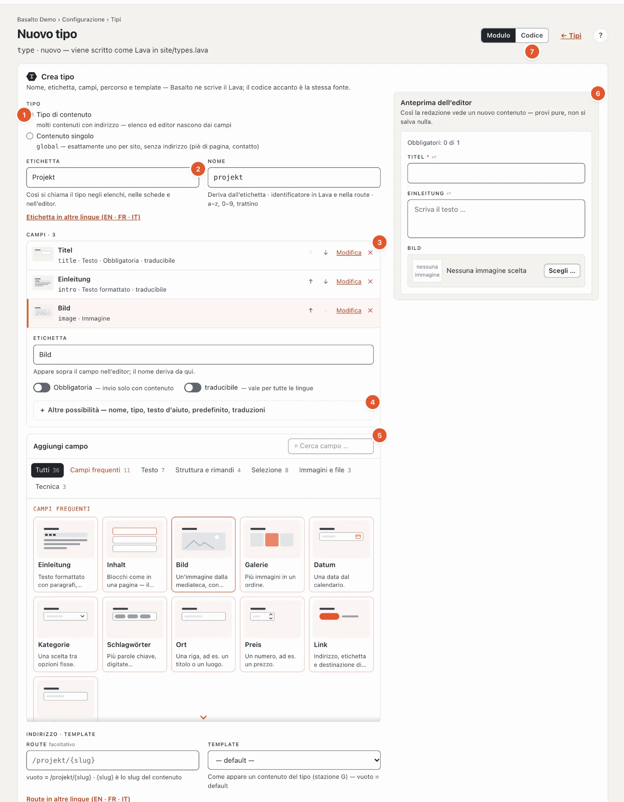
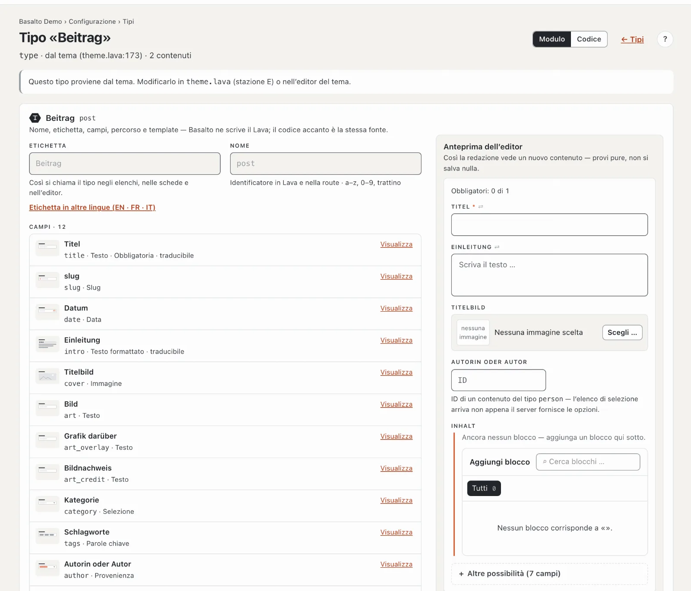

# Tipi di contenuto

La stazione **«Che cosa si può curare?»** stabilisce quali generi di contenuti conosce il sito — pagine, articoli, persone, eventi — e quali **campi** ha ciascun genere. Dai campi nasce la maschera che la redazione compila nell’editor.

## Dove

Modalità «Configurazione» › «Che cosa si può curare?» › **«Apri tipi di contenuto»**.

La pagina ha due elenchi:

- **Dal tema** — i tipi che il tema porta con sé. Qui solo da visualizzare; si possono modificare nell’editor del tema (stazione E).
- **Di questo sito** — tipi che crea nel backend. Basalto li scrive come Lava in `site/types.lava`; stanno con pari dignità accanto ai tipi del tema.

Per ogni tipo: nome e ID, contrassegni come «Tema · bloccato», il numero di campi e di contenuti, indirizzo (route) e template, e le operazioni.

1. **«Nuovo tipo»** crea un tipo di questo sito.
2. **Tipo di pagina** — il tipo «Pagina» vive nell’[albero delle pagine](../redaktion/seiten.md); i suoi contenuti hanno lì il loro posto.
3. **globale** — un **contenuto singolo**: esattamente uno per sito, senza indirizzo, per esempio il piè di pagina.
4. Al posto della route, per i contenuti singoli compare «Contenuto singolo — senza indirizzo».
5. **«Contenuti»** apre l’elenco di tutti i contenuti di questo tipo (per i contenuti singoli l’unico contenuto); **«Visualizza»** o **«Modifica»** il tipo.

Se il tema non conosce più un tipo di cui esistono ancora contenuti, questo compare con «non più definito — i contenuti restano». Se il tema non compila, la pagina mostra in alto le segnalazioni.

## Creare un tipo

1. **Tipo**:
   - **Tipo di contenuto** — molti contenuti con indirizzo; elenco ed editor nascono dai campi (per esempio articoli, progetti).
   - **Contenuto singolo** — esattamente uno per sito, senza indirizzo e senza template; il tema lo legge tramite un elemento «global» (per esempio piè di pagina, dati di contatto).
2. **Etichetta** — così si chiama il tipo negli elenchi, nelle schede e nell’editor, per esempio «Progetto». Il **Nome** ne deriva («progetto»): l’ID in Lava e nell’indirizzo, composto da lettere minuscole, cifre e trattino; se lo modifica, resta come lo scrive. Le etichette in altre lingue si trovano dietro «Etichetta in altre lingue».
3. **Campi** — una riga per campo con disegno, etichetta, nome e tipo. Un tipo di contenuto richiede il campo **title**; porta il titolo negli elenchi e nell’editor ed è già presente. Con ↑ e ↓ cambia l’ordine, ✕ toglie un campo, **«Modifica»** ne apre le impostazioni — prima l’essenziale: **Etichetta** (il nome del campo la segue finché non lo modifica Lei), **Obbligatoria**, **traducibile** e ciò che serve al tipo di campo (opzioni di una selezione, blocchi consentiti, tipo di destinazione di un riferimento).
4. **Altre possibilità** di un campo — nome, tipo di campo, **Testo d’aiuto** (compare nell’editor sotto il campo), **Predefinito** e l’etichetta in altre lingue. Se lì c’è un errore, l’area è già aperta.
5. **Aggiungi campo** — una tavolozza come per i blocchi: disegno e frase per tipo di campo, per gruppi, con ricerca. I **campi frequenti** portano subito con sé etichetta per lingua e nome: introduzione, contenuto (blocchi — tutti i blocchi del tema consentiti), immagine, galleria, data, categoria, parole chiave, luogo, prezzo, link, cliente.
6. **Anteprima dell’editor** — a destra vede ciò che la redazione compila per un nuovo contenuto di questo tipo, aggiornato a ogni modifica; si può provare, non viene salvato nulla.
7. **Modulo · Codice** — in alto a destra passa alla vista del codice. Modulo e codice sono due viste della stessa fonte; il codice compare dopo il salvataggio.

Sotto, **indirizzo e template**: la **route** dei contenuti, per esempio `/progetti/{slug}` — `{slug}` è lo slug del contenuto, se vuoto vale `/‹name›/{slug}` — e il **template** della stazione G (se vuoto vale «default»). Le route di altre lingue si trovano dietro «Route in altre lingue»; se lì è inserita un’etichetta, Basalto ne propone la route («Dall’etichetta: usare /projects/{slug}»).

**«Salva»** crea il tipo; poi le modifiche si salvano da sole, i nomi quando si lascia il campo. **«Salva e chiudi»** riporta all’elenco.

### I tipi di campo

| Tipo di campo | A che cosa serve |
| --- | --- |
| Testo · Testo su più righe | testi brevi o più lunghi senza formattazione |
| Testo formattato · Markdown | testo formattato |
| Blocchi | l’editor a blocchi; **Blocchi consentiti** determina quali blocchi si possono inserire — senza selezione l’editor non ha un’area dei contenuti |
| Numero · Sì/No · Data · Data e ora | valori |
| Selezione | una scelta tra **Opzioni** (separate da virgole) |
| Parole chiave | parole chiave assegnate liberamente, per esempio per il blog |
| Immagine · Galleria · File | dalla mediateca |
| Link · URL · E-mail | indirizzi |
| Riferimento | a un altro contenuto; **Tipo di destinazione** dice a quale tipo (per esempio un articolo alla sua autrice del tipo «Persona») |
| Ripetizione | un gruppo di campi che si può creare più volte |
| Slug · SEO · Colore · Codice · JSON | casi speciali |

**Traducibile** significa: il campo ha un valore proprio per ogni lingua e compare durante la traduzione. Altrimenti vale per tutte le lingue («condiviso», vedi [Tradurre](../redaktion/uebersetzen.md)).

## Visualizzare un tipo dal tema

I tipi dal tema mostrano la stessa maschera, bloccata, con l’avviso «Questo tipo proviene dal tema». Così vede quali campi compila la redazione — qui per esempio titolo, data, introduzione, immagine di copertina, categoria (selezione), parole chiave, autore (riferimento a «Persona») e blocchi con i blocchi consentiti.

## Eliminare un tipo

In fondo al tipo: **«Elimina»**, poi «Sì, elimina». I contenuti di questo tipo restano nel database; senza tipo non compaiono più, finché un tipo con lo stesso nome non li riconosce di nuovo.

## Domande frequenti

**Dove curo un contenuto singolo, per esempio il piè di pagina?**
Nella modalità «Contenuti» › **Contenuti**: lì ha una scheda propria con la sua etichetta («Piè di pagina»). Poiché esiste esattamente una volta, lì manca «Nuovo contenuto».

**Non vedo il mio nuovo tipo in «Contenuti».**
Salvi il tipo e ricarichi l’elenco «Contenuti». I tipi di pagina si trovano nell’albero delle pagine, non lì.

**Posso modificare un tipo del tema?**
Non qui. Lo modifichi nell’editor del tema — oppure crei un tipo proprio di questo sito.

## Per continuare

- [Blocchi riutilizzabili](bausteine.md)
- [Pagine e albero delle pagine](../redaktion/seiten.md)
