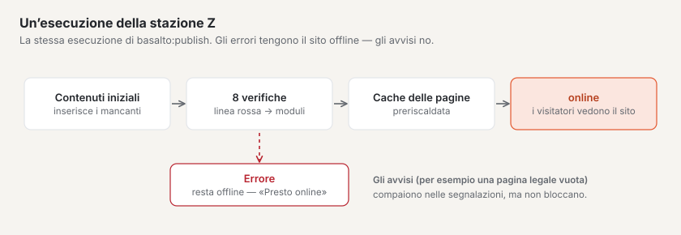
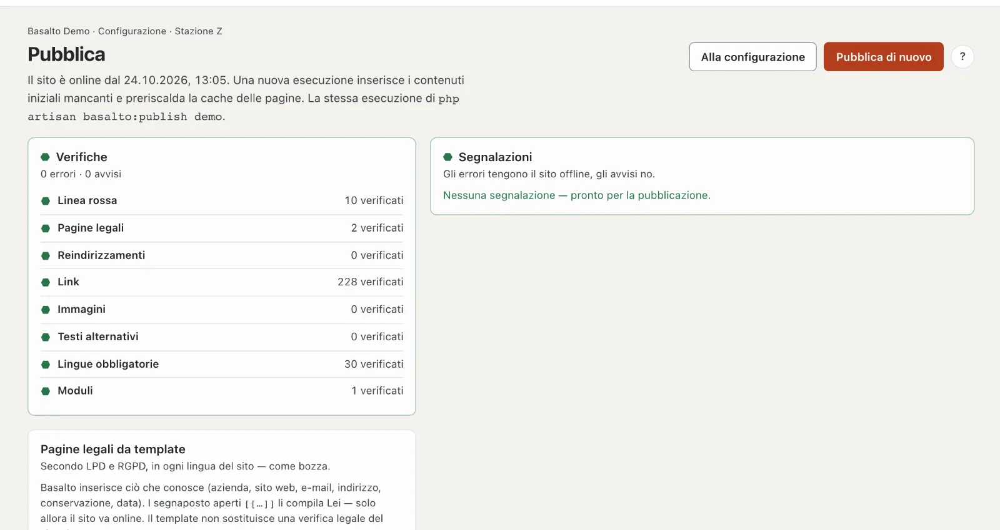

# Andare online

L’ultima stazione, **«Pronto per andare online?»** (stazione Z), verifica l’intero sito e lo rende accessibile ai visitatori. Fino ad allora visitatrici e visitatori vedono una pagina «Presto online»; Lei vede il sito finché ha effettuato l’accesso al backend.

## Dove

Modalità «Configurazione» › «Pronto per andare online?» › **«Pubblica»** — oppure sulla pagina iniziale della configurazione **«Pubblica (Z)»**. Nella console è la stessa esecuzione di `php artisan basalto:publish <site>`.

In alto è indicato lo stato: «Il sito non è ancora online — i visitatori vedono «Presto online».» oppure «Il sito è online dal …».

1. **«Metti online»** o, se il sito è già online, **«Pubblica di nuovo»** — avvia l’esecuzione. Se ci sono errori, il pulsante è bloccato: «Prima corregga gli errori — l’elenco mostra dove.». «Alla configurazione» riporta al rapporto di verifica.
2. **Verifiche** — otto verifiche, ognuna con simbolo e «… verificati».
3. **Segnalazioni** — ogni messaggio con «Apri →» verso il punto in cui si può risolvere. **Gli errori tengono il sito offline, gli avvisi no.** Senza segnalazioni: «Nessuna segnalazione — pronto per la pubblicazione.».
4. **Pagine legali da template** — vedi sotto.

## Che cosa fa un’esecuzione

1. **Inserire i contenuti iniziali** — pagine e contenuti che il tema porta con sé (nello Starter per esempio pagina iniziale, Chi siamo, blog, Contatto e il piè di pagina). Basalto inserisce solo ciò che manca ancora; ciò che è stato modificato resta com’è.
2. **Verificare** — le otto verifiche qui sotto.
3. **Preriscaldare la cache delle pagine** — le pagine sono poi già pronte, i primi visitatori non attendono.
4. **Mettere online** — se non restano errori.

In alto compare poi per esempio «Messo online — 8 contenuti iniziali importati, 23 pagine preriscaldate».

### Contenuti iniziali

La stazione «Con che cosa parte?» non ha una pagina propria: i contenuti iniziali li inserisce questa esecuzione. Se vuole vederli, il percorso porta a «Vedi pagine». I contenuti iniziali che ha modificato o eliminato restano così: una nuova esecuzione non sovrascrive nulla e non recupera nulla dal cestino.

## Le otto verifiche

| Verifica | Che cosa viene verificato | Segnalazione tipica |
| --- | --- | --- |
| **Linea rossa** | le dieci verifiche dalla A alla Z del tema | un errore nel tema |
| **Pagine legali** | note legali e informativa sulla privacy esistono e sono pubblicate in ogni lingua, senza segnaposto aperti | «Note legali «…» manca» · «ha un segnaposto aperto» (errore) · «è vuota» (avviso) |
| **Reindirizzamenti** | ogni reindirizzamento porta a una pagina pubblicata e non gira in cerchio | «Il reindirizzamento /vecchio gira in cerchio» |
| **Link** | i link nei contenuti e nelle voci di menu portano a una pagina | «Il link a /prezzi non porta da nessuna parte» |
| **Immagini** | le immagini inserite esistono e non sono nel cestino | «L’immagine #12 manca o è nel cestino» |
| **Testi alternativi** | le immagini inserite hanno un testo alternativo in ogni lingua — se il sito ha attivato «Testo alternativo obbligatorio» o il tema richiede la verifica (il tema Starter lo fa) | «Immagine … senza testo alternativo in EN» |
| **Lingue obbligatorie** | ogni contenuto pubblicato è pubblicato in tutte le lingue obbligatorie | «… non è pubblicato nella lingua obbligatoria EN» |
| **Moduli** | ogni modulo ha un’azione (e-mail, salvataggio o webhook) e destinatari validi | «Il modulo … non ha alcuna azione» · avviso se il mailer non invia e-mail |

## Pagine legali da template

Senza note legali e informativa sulla privacy il sito non va online. La scheda **«Pagine legali da template»** le crea entrambe secondo la LPD svizzera e il GDPR europeo — in ogni lingua del sito, come **bozza**:

1. **«Inserisci Note legali»** o **«Inserisci informativa sulla privacy»**. Basalto chiede prima conferma; una bozza esistente viene sostituita, la versione pubblicata resta.
2. Ciò che è noto lo inserisce Basalto: azienda, sito web, e-mail, indirizzo, termini di conservazione, data.
3. I **segnaposto** aperti `[[…]]` li compila nell’editor — finché ne resta uno aperto, la verifica segnala un errore.
4. Pubblichi le pagine come ogni contenuto (vedi [Approvazione](../redaktion/freigabe.md)).

Il template non sostituisce una verifica giuridica nel singolo caso.

## Domande frequenti

**Il pulsante «Metti online» è bloccato.**
C’è almeno un errore. Le segnalazioni lo indicano; «Apri →» porta lì.

**Devo «Pubblica di nuovo» dopo ogni modifica?**
No. I contenuti vanno online tramite l’approvazione, il tema tramite la sua approvazione. Una nuova esecuzione conviene se il tema porta nuovi contenuti iniziali o se vuole verificare l’intero sito.

## Per continuare

- [Hosting](../betrieb/hosting.md)
- [Siti](../verwaltung/sites.md)
- [Configurazione: progettare e costruire il sito](README.md)
