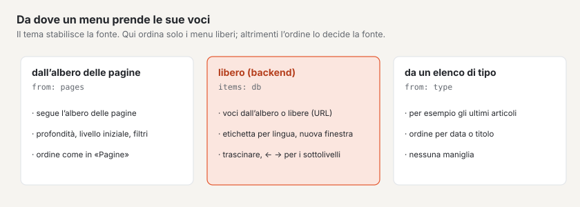
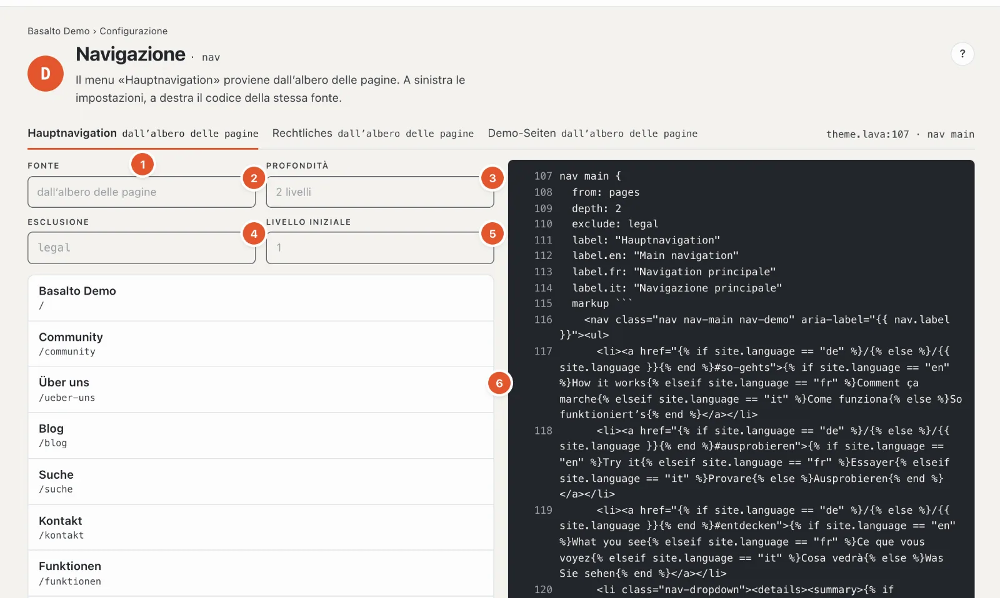
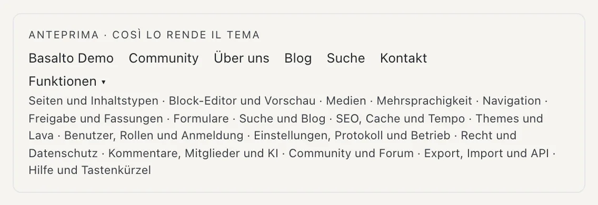

# Menu

La stazione **«Come ci si orienta?»** mostra i menu del sito: menu principale, piè di pagina, note legali e altri. Quali menu esistono e dove si trovano sulla pagina lo stabilisce il tema; qui ne vede le voci, le imposta e — nei menu curati liberamente — le ordina.

## Dove

Modalità «Configurazione» › «Come ci si orienta?» › **«Modifica menu»**. In alto c’è una scheda per menu con la sua fonte, per esempio «Navigazione principale dall’albero delle pagine», a destra il punto nel tema («theme.lava:107 · nav main»).

## Da dove un menu prende le sue voci

- **Dall’albero delle pagine** — il menu segue l’[albero delle pagine](../redaktion/seiten.md). Una nuova pagina compare da sola; l’ordine lo cambia in «Pagine» (il link «Modificare l’ordine in «Pagine»» porta lì). Qui perciò «nessuna maniglia».
- **Curato liberamente** — le voci nascono qui nel backend: pagine dall’albero o indirizzi liberi, in qualsiasi ordine e profondità.
- **Da un elenco di tipo** — per esempio gli articoli più recenti; l’ordine segue l’elenco (data o titolo).
- **Dal tema** — voci fisse che si trovano nel tema; si possono modificare solo lì.

## Un menu dall’albero delle pagine

1. **Scegliere il menu** — una scheda per menu.
2. **Fonte** — da dove provengono le voci.
3. **Profondità** — quanti livelli dell’albero mostra il menu, per esempio «2 livelli» (pagine principali e le loro sottopagine).
4. **Esclusione** — pagine che il menu tralascia, per esempio le pagine legali.
5. **Livello iniziale** — da quale livello parte il menu; 1 è il livello superiore. Con **Solo** un menu mostra esclusivamente determinate pagine (nello Starter il menu «Note legali»).
6. **Le voci**, come compaiono nel menu, rientrate per livelli, con indirizzo.

Queste impostazioni si trovano nel tema e qui sono visibili per controllo. Nel menu compaiono solo pagine pubblicate e visibili — mancano le pagine con «Nascondi nel menu (resta raggiungibile)» (impostazioni della pagina, scheda «Esperti») e, per i visitatori, le pagine protette. Se l’elenco è vuoto, compare «Vuoto — il menu mostra solo pagine pubblicate e visibili.».

## Un menu curato liberamente

Se il tema prevede un menu curato liberamente, sotto l’elenco si trova il campo **«Aggiungi voce»**:

- **Cercare una pagina** — digiti una parte del titolo («chi»), e le pagine corrispondenti compaiono con indirizzo; un
  clic o Invio inserisce la pagina. La sua **etichetta** segue il titolo della pagina finché non la sovrascrive.
- **Inserire un indirizzo** — «/blog», «https://…», «www.…» (diventa «https://www.…»), «mailto:» o «tel:». Se
  l’indirizzo è una pagina del sito, Basalto inserisce la pagina (che segue poi le rinominazioni); altrimenti si apre una
  voce libera con questo indirizzo — per i siti web esterni subito «In una nuova finestra».
- **«Manca ancora:»** — pagine pubblicate che mancano ancora nel menu, prima il livello superiore; un clic le inserisce.

Per ogni voce imposta:

- **Etichetta** — per una pagina la lasci vuota, allora la voce si chiama come la pagina. Le etichette di altre lingue
  si trovano dietro «Etichetta in altre lingue»; se manca in una lingua, la voce riprende l’etichetta della lingua
  predefinita («— riprende …»).
- **Destinazione** — per una voce libera l’indirizzo. Se lì c’è il percorso di una pagina del sito, Basalto offre
  **«Collega come pagina»**.
- **Visibile** — una voce nascosta resta nell’elenco («nascosto»), ma non compare nel menu.
- **In una nuova finestra** — il link apre una nuova scheda («↗ nuova finestra»); consueto per i siti web esterni.

«Modifica» apre una voce, «Elimina» la rimuove dopo la domanda «Eliminare davvero?». Le modifiche si salvano da sole; «✓ salvato» lo conferma.

### Ordinare

- **Trascinare** ordina le voci. Se rilascia una voce **più a destra**, diventa sottovoce della voce sopra.
- Con la tastiera: **↑ ↓** sposta, **→** crea una sottovoce (più in profondità), **←** la riporta indietro di un livello (più in alto).
- Il nuovo ordine si salva subito; se qualcosa non va, il motivo compare in basso a destra.

Una voce verso una pagina non pubblicata porta «non pubblicato» e compare solo quando la pagina è online.

## L’anteprima

Sotto il codice si trova **«Anteprima · così lo rende il tema»**: il menu come lo vedono visitatrici e visitatori, con i sottomenu. Con più lingue sceglie la **Lingua dell’etichetta**.

A destra si trova il codice del menu nel tema — la stessa fonte delle impostazioni a sinistra. Si modifica nell’editor del tema (stazione D).

## Domande frequenti

**Una nuova pagina manca nel menu.**
È pubblicata? Si trova nell’albero delle pagine sotto una pagina che il menu mostra, e non più in profondità della profondità impostata? «Nascondi nel menu (resta raggiungibile)» non è spuntato?

**Non riesco a cambiare l’ordine.**
Il menu proviene dall’albero delle pagine, da un elenco di tipo o dal tema — l’ordine appartiene alla fonte. Se compare «Non può modificare questo menu.», il Suo ruolo consente l’area «Navigazione» solo in visualizzazione.

## Per continuare

- [Tipi di contenuto](inhaltstypen.md)
- [Pagine e albero delle pagine](../redaktion/seiten.md)
