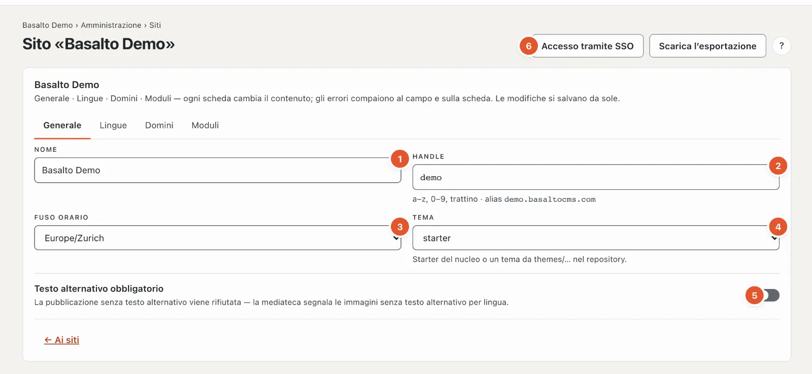
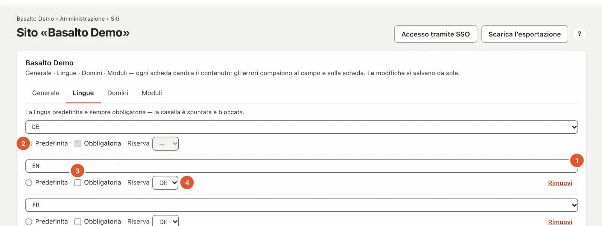
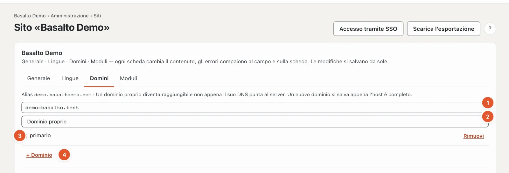
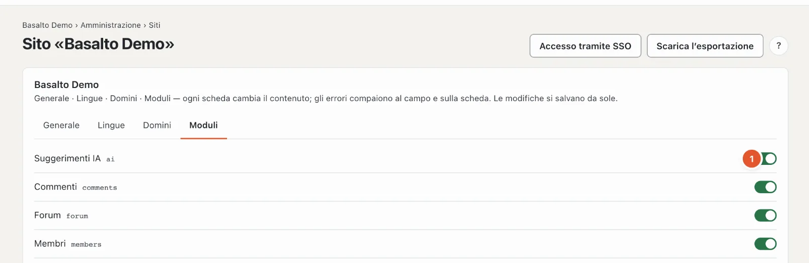

# Il sito

La prima stazione del percorso, **«Che cos’è il sito?»**, pone le basi per tutto il resto: nome, lingue, domini, fuso orario, tema e moduli. Si trova nella modalità «Amministrazione» sotto **Siti** — il percorso porta direttamente al sito in cui lavora.

## Dove

Modalità «Amministrazione» › **Siti** › aprire il sito, oppure nel percorso «Che cos’è il sito?» › «Modifica sito». L’elenco «Siti» mostra tutti i siti dell’installazione con lingue, domini e stato; **«Nuovo sito»** ne crea un altro (nome, handle, lingua predefinita, tema — «Salva e chiudi»).

La pagina ha quattro schede. Le modifiche si salvano da sole; «salvato» accanto al campo lo conferma. Se un dato non è corretto, l’errore compare accanto al campo e come numero sulla scheda.

## Scheda «Generale»

1. **Nome** — così si chiama il sito nel backend, nelle e-mail e nel titolo del sito web.
2. **Handle** — il nome breve tecnico: lettere minuscole, cifre e trattino. Fa parte dell’**alias**, l’indirizzo al quale il sito è raggiungibile senza dominio proprio (per esempio «demo.basaltocms.com»), e di comandi come `basalto:publish demo`. Lo cambi solo se nessuno conosce ancora il vecchio indirizzo.
3. **Fuso orario** — per data e ora del sito, per esempio nelle pubblicazioni pianificate.
4. **Tema** — quale tema fornito usa il sito. È più comodo cambiarlo sotto [Temi](aussehen.md#temi): lì vede prima che cosa cambia.
5. **Testo alternativo obbligatorio** — se l’interruttore è attivo, viene respinta ogni pubblicazione che contiene un’immagine senza testo alternativo in una lingua; la mediateca contrassegna tali immagini. Di fabbrica è disattivato — alcuni temi però esigono i testi alternativi di per sé (il tema Starter lo fa).
6. In alto a destra: **«Accesso tramite SSO»** configura l’accesso tramite un login aziendale (vedi [SSO](../betrieb/sso.md)); **«Accesso per account cliente»** i pulsanti «Accedi con Google» ecc. nel frontend (vedi [Accesso per account cliente](../verwaltung/kundenanmeldung.md)); **«Scarica l’esportazione»** scarica l’intero sito come ZIP — contenuti come JSON e tutti i media, nello stesso formato dell’importazione, senza invii dei moduli e membri. Entrambi li vedono solo i gestori e l’amministrazione dell’account.

## Scheda «Lingue»

Una riga per lingua:

1. **Lingua** — sceglierla dall’elenco.
2. **Predefinita** — la lingua principale del sito. Da essa nascono tutte le traduzioni. Ce n’è esattamente una.
3. **Obbligatoria** — senza questa lingua un contenuto non viene approvato. La lingua predefinita è sempre obbligatoria; la sua casella è spuntata e bloccata.
4. **Riserva** — se in questa lingua manca la versione pubblicata, i visitatori vedono la versione della lingua di riserva (e così via fino alla lingua predefinita).
5. **«+ Lingua»** aggiunge una riga, **«Rimuovi»** toglie una lingua. I contenuti di questa lingua restano nel database, ma non compaiono più.

Come agiscono nella quotidianità traduzione, lingue obbligatorie e lingua di riserva è descritto in [Tradurre](../redaktion/uebersetzen.md).

## Scheda «Domini»

In alto si trova l’**alias** del sito. Sotto, una riga per dominio:

1. **Host** — l’indirizzo senza «https://», per esempio «www.la-sua-azienda.ch». Un nuovo dominio si salva non appena l’host è completo.
2. **Tipo**:
   - **Dominio proprio** — l’indirizzo al quale il sito deve comparire,
   - **Alias** — un ulteriore indirizzo dello stesso sito,
   - **Reindirizzamento** — un vecchio indirizzo che reindirizza all’indirizzo principale.
3. **primario** — l’indirizzo principale; compare nella sitemap, nei link e nelle e-mail.
4. **«+ Dominio»** e **«Rimuovi»**.

Perché un dominio funzioni, nel DNS deve puntare al server. In abbonamento (SaaS) alias e domini propri li gestisce l’account: la scheda rimanda allora ad **Account › Domini** (vedi [Domini](../redaktion/domains.md)).

## Scheda «Moduli»

Ogni modulo installato ha un interruttore: **attivo** significa che il sito lo usa — voci di menu, blocchi e pulsanti del modulo compaiono. **«sempre attivo»** compare accanto ai moduli che non si possono disattivare. Quali moduli sono installati lo regola «Amministrazione › Moduli»; senza moduli compare «Nessun modulo installato.».

| Modulo | Che cosa porta |
| --- | --- |
| Suggerimenti IA | Farsi proporre miglioramenti del testo, traduzione, SEO e testi alternativi — vedi [Suggerimenti IA](../redaktion/ki.md) |
| Commenti | Commenti sotto articoli e pagine — vedi [Commenti](../redaktion/kommentare.md) |
| Membri | Pagine solo per membri che hanno effettuato l’accesso — vedi [Membri](../redaktion/mitglieder.md) |

## Domande frequenti

**Non vedo «Accesso tramite SSO», «Accesso per account cliente» e «Scarica l’esportazione».**
Entrambi sono riservati al gestore e all’amministrazione dell’account.

**Ho rimosso una lingua — le traduzioni sono sparite?**
No. Restano salvate e ricompaiono non appena aggiunge di nuovo la lingua.

## Per continuare

- [Aspetto: temi, design e varianti d’immagine](aussehen.md)
- [Siti](../verwaltung/sites.md)
