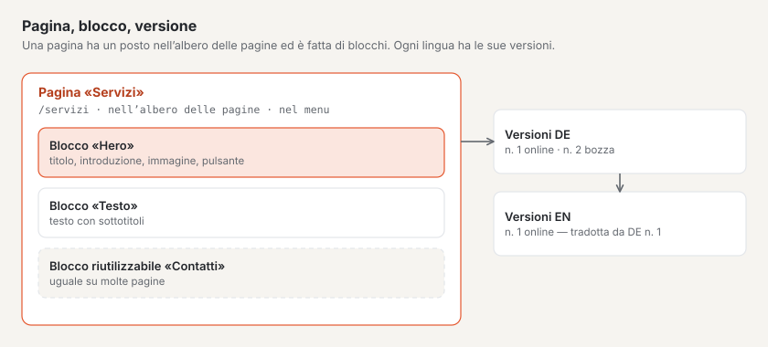

# I termini principali

Basalto usa pochi termini, ma sempre allo stesso modo. Questa pagina li spiega in una frase e mostra come sono
collegati. Nel backend compaiono le stesse parole.

## Installazione e sito

| Termine | Significato |
| --- | --- |
| **Installazione** | Basalto su un server, con un database. Utenti, ruoli, licenza e aggiornamenti valgono per l’intera installazione. |
| **Sito** | Un sito web nell’installazione, con nome, indirizzo (dominio), lingue e tema. Un’installazione può avere più siti. |
| **Dominio** | L’indirizzo al quale un sito è raggiungibile, per esempio `studio-esempio.ch`. |
| **Lingua predefinita** | La lingua principale del sito. Da essa nascono tutte le traduzioni. |

## Contenuti

| Termine | Significato |
| --- | --- |
| **Pagina** | Una voce nell’albero delle pagine con un proprio indirizzo, per esempio «Servizi» sotto `/servizi`. |
| **Albero delle pagine** | L’ordine di tutte le pagine: pagine principali e, sotto di esse, le loro sottopagine. Da esso nascono menu, indirizzi e percorsi di navigazione (breadcrumb). |
| **Contenuto** | Una voce senza posto fisso nell’albero delle pagine, per esempio un articolo del blog o una persona. |
| **Tipo di contenuto** | Il genere di un contenuto con i suoi campi, per esempio «Messaggio» con titolo, data e testo. |
| **Blocco** | Un elemento di una pagina: hero, testo, immagine, schede, domande e risposte, modulo … |
| **Blocco riutilizzabile** | Un gruppo di blocchi che compare uguale su più pagine e si modifica in un solo punto. |
| **Media** | Immagini e file del sito nella mediateca. Ogni immagine riceve un testo alternativo per le persone che non la vedono. |

## Versioni e approvazione

| Termine | Significato |
| --- | --- |
| **Versione** | Uno stato di un contenuto in una lingua. Ogni modifica inizia come nuova versione; quelle precedenti restano conservate. |
| **Bozza** | Una versione a cui si sta ancora scrivendo. Basalto la salva automaticamente. |
| **Invia per approvazione** | Sottoporre la versione alla verifica. |
| **Approva** | Approvare la versione verificata per la pubblicazione. |
| **Pubblica** | Mettere online la versione approvata — subito o a un momento pianificato. |
| **Online** | La versione che i visitatori vedono sul sito web. |

## Grafica ed estensioni

| Termine | Significato |
| --- | --- |
| **Tema** | Aspetto e struttura di un sito: colori, caratteri, layout, menu, blocchi, tipi di contenuto e contenuti iniziali. |
| **Lava** | Il linguaggio in cui sono scritti i temi. Invisibile per la redazione. |
| **Layout** | La cornice di una pagina con le sue regioni, per esempio intestazione, contenuto e piè di pagina. |
| **Modulo** | Un’estensione come moduli di contatto, commenti, membri o forum, attivabile e disattivabile per ogni sito. |
| **Plugin** | Un modulo dal Marketplace o di terzi. |

## Persone

| Termine | Significato |
| --- | --- |
| **Utente** | Una persona con accesso al backend. |
| **Ruolo** | Ciò che un utente può fare in un sito: Redattore, Approvatore, Traduttore, Amministratore o Gestore. |
| **Membro** | Una visitatrice con un account sul sito web, per esempio per pagine protette o per il forum — senza accesso al backend. |
| **Passkey** | Accedere con impronta digitale, volto o blocco del dispositivo invece che con un codice via e-mail. |

## Per continuare

- [Installare Basalto](installieren.md)
- [Visita guidata del backend](rundgang.md)
