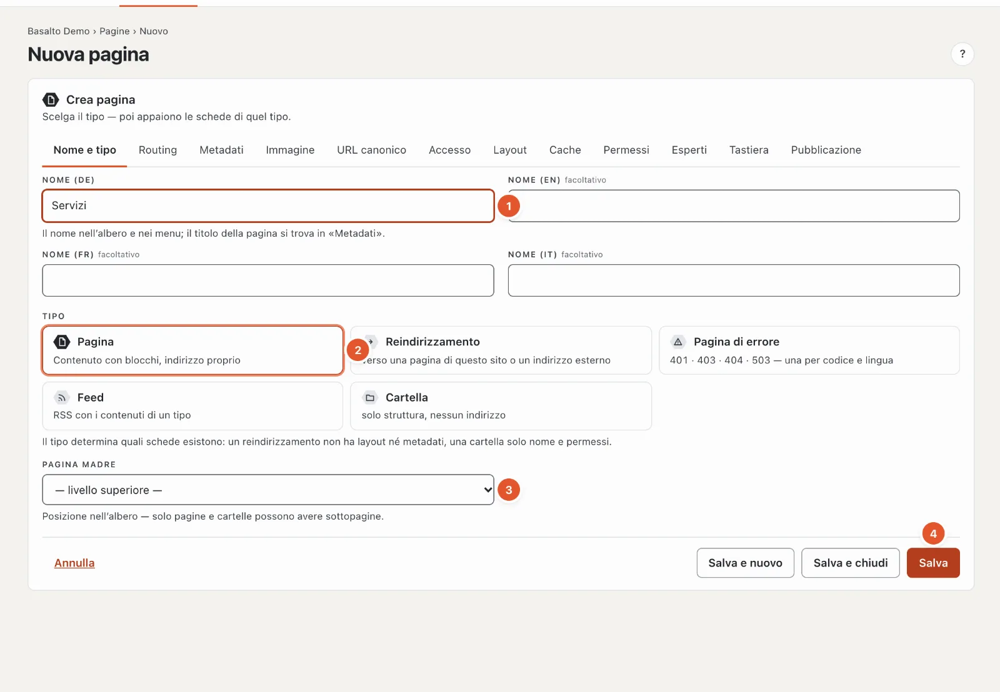
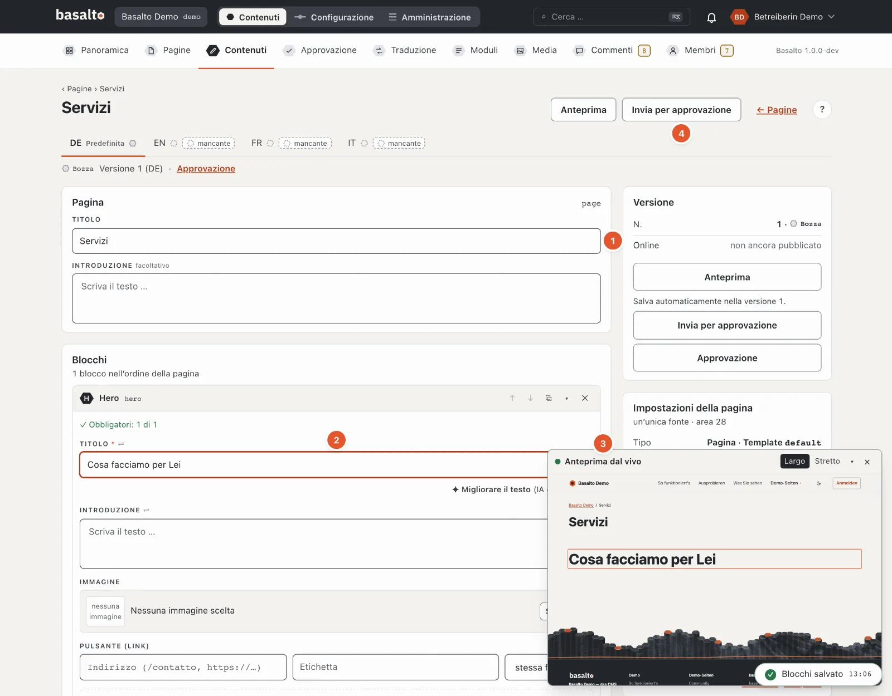
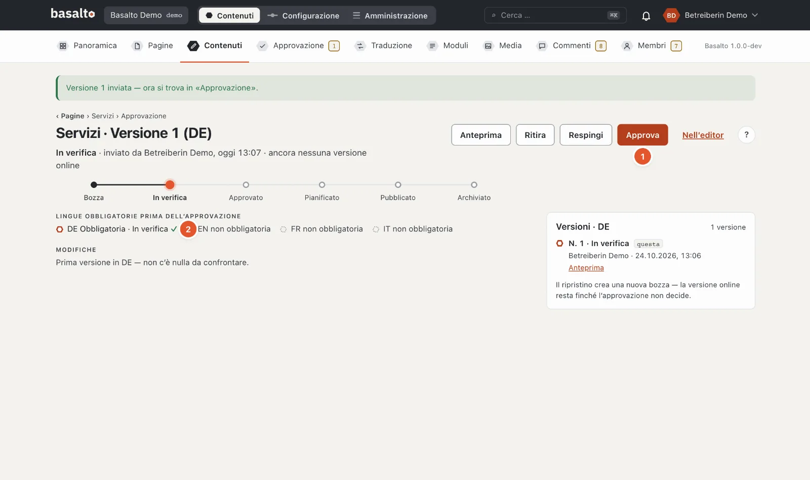
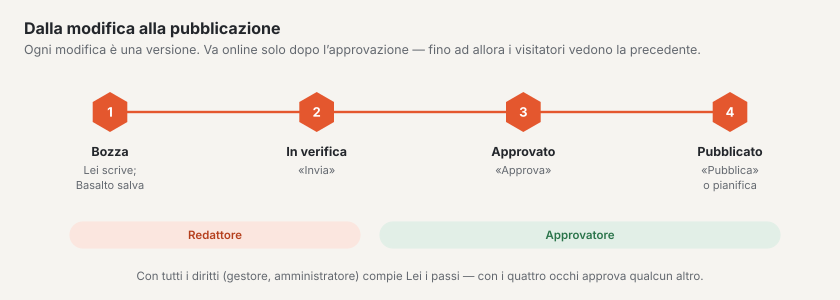
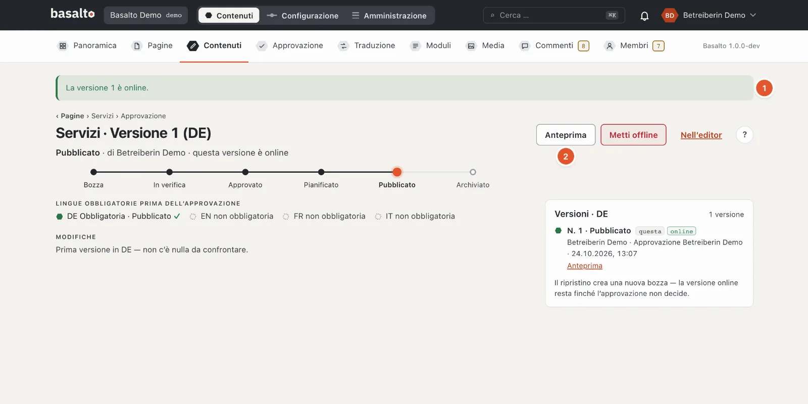

# La prima pagina

Crea una nuova pagina «Servizi», la riempie di blocchi, inserisce un’immagine e la pubblica. Poi la pagina si trova sul
sito web e nel menu. L’esempio richiede circa un quarto d’ora.

## 1. Creare la pagina

1. Modalità «Contenuti» › **Pagine** › **«Nuovo»**.
2. Nella scheda «Nome e tipo» (numeri come nell’immagine qui sopra):
   1. **Nome** — «Servizi». Il nome compare nell’albero delle pagine e nel menu; da esso nasce l’indirizzo `/servizi`.
   2. **Tipo** — «Pagina» è preselezionato: contenuto con blocchi e indirizzo proprio.
   3. **Pagina madre** — «livello superiore» per una pagina principale. Se sceglie un’altra pagina, «Servizi» ne diventa
      la sottopagina, per esempio `/chi-siamo/servizi`.
   4. **«Salva»**.
3. Basalto apre le impostazioni della nuova pagina. In alto a destra **«Modifica contenuto»** porta nell’editor.

Le altre schede — Metadati, Immagine, Accesso, Layout e altre — ora non Le servono. Le loro impostazioni predefinite
vanno bene per una pagina normale.

## 2. Inserire blocchi e scrivere

1. **Titolo** — è già compilato: «Servizi». Sotto può scrivere un’introduzione.
2. Sotto **«Blocchi»** sceglie in «Aggiungi blocco» un blocco, qui **«Hero»** — un grande titolo con introduzione,
   immagine e pulsante. Scriva nel campo **«Titolo»** del blocco: «Cosa facciamo per Lei».
3. L’**anteprima dal vivo** mostra la pagina come la vedranno i visitatori e segue ogni inserimento. «Largo» e
   «Stretto» passano da schermo a telefono.
4. Con **«+ Inserisci blocco»** aggiunge altri blocchi, per esempio «Testo» per il testo continuo o «Schede» per più
   servizi affiancati. Le frecce sul blocco lo spostano, ✕ lo rimuove.

Non deve salvare: Basalto salva poco più di un secondo dopo ogni inserimento e lo segnala in basso a destra, per
esempio «Blocchi salvati». Ciò che scrive resta una **bozza** — sul sito web non cambia ancora nulla.

## 3. Inserire un’immagine

1. Nel blocco «Hero», sotto **«Immagine»**, clicchi su **«Scegli …»**. La mediateca si apre in una finestra.
2. Scelga un’immagine — oppure ne aggiunga una nuova con **«Carica»**.
3. Verifichi il **testo alternativo**. Basalto lo precompila dal nome del file; meglio è una frase che dice che cosa si
   vede nell’immagine — per le persone che non la vedono. Lo modifica in **Media**, nel dettaglio dell’immagine. Il
   tema Starter non pubblica alcuna pagina con un’immagine senza testo alternativo.

Basalto genera da sé, da ogni immagine, le dimensioni adatte per schermo e telefono. Maggiori dettagli in
[Media](../redaktion/medien.md).

## 4. Verificare e pubblicare

Una versione va online in tre passi:

1. **«Invia per approvazione»** — in alto a destra nell’editor. La versione è ora «In verifica» e compare sotto
   «Approvazione».
2. **«Approva»** — sulla pagina di approvazione (link «Approvazione» sotto il titolo). Sotto è indicato se tutte le
   **lingue obbligatorie** sono pronte; senza di esse Basalto non approva.
3. **«Pubblica»** — la versione va subito online. Con **«Pianifica pubblicazione»** sceglie invece data e ora.

Se ha tutti i diritti (Gestore o Amministratore), esegue Lei stessa o Lei stesso i tre passi. Altrimenti una persona
con il ruolo «Approvatore» approva la Sua versione; la campanella le segnala che qualcosa è in attesa.

1. **«La versione 1 è online»** — la pagina si trova sul sito web.
2. **«Anteprima»** la mostra; sul sito web la raggiunge sotto `/servizi`.

Se modifica la pagina in seguito, nasce la **versione 2** come bozza. I visitatori continuano a vedere la versione 1
finché non pubblica la versione 2.

## Se qualcosa non funziona

| Vede | Causa | Soluzione |
| --- | --- | --- |
| Al salvataggio «1 dato non è corretto» con un numero sulla scheda «Routing» | L’indirizzo è già assegnato. | Nella scheda «Routing» scegliere un altro slug, per esempio `servizi-2025`. |
| «Approva» è bloccato: «Approvazione solo con tutte le lingue obbligatorie» | Una lingua obbligatoria non ha ancora una versione. | Tradurre la pagina (vedi [Menu e lingue](menue-und-sprachen.md)) o non tenere la lingua come obbligatoria. |
| «Pubblica» è bloccato a causa di un’immagine | Un’immagine non ha testo alternativo. | Aggiungere il testo alternativo nella mediateca. |
| Manca «Invia per approvazione», c’è solo «Anteprima» | Il Suo ruolo non può modificare questa pagina. | Chiedere alla persona che amministra il Suo sito. |

## Per continuare

- [Menu e lingue](menue-und-sprachen.md)
- [Modificare i contenuti con i blocchi](../redaktion/bloecke.md)
- [Approvazione e pubblicazione](../redaktion/freigabe.md)
