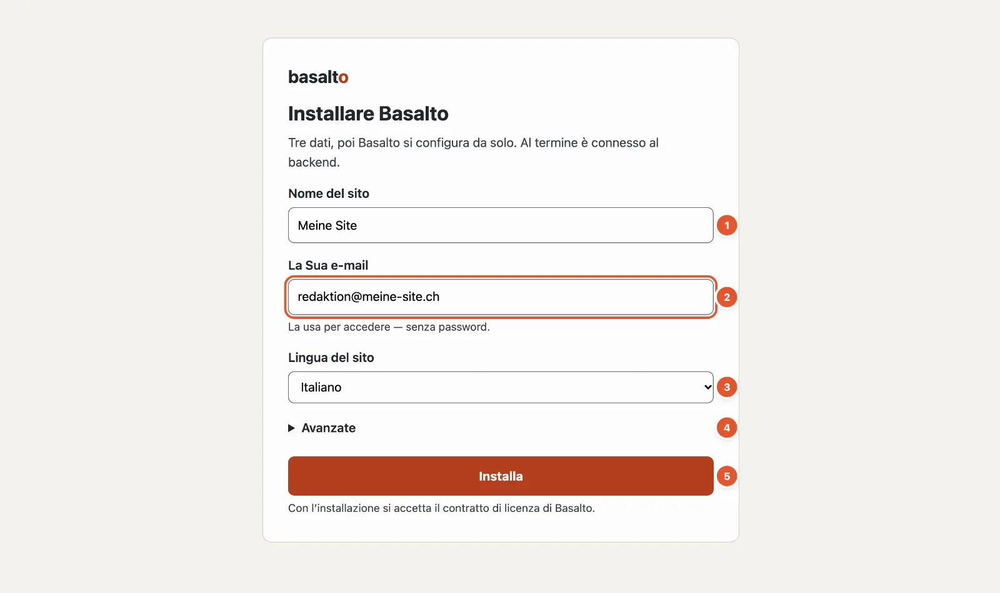
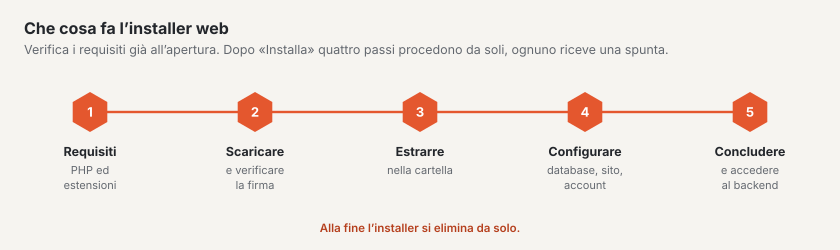

# Installare Basalto

Il modo più semplice per installare Basalto è il **web installer**: un unico file che Lei mette in una cartella vuota e
apre nel browser. Bastano tre dati, poi ha già effettuato l’accesso al backend — senza terminale, senza password e
senza server di posta.

## Che cosa Le serve

| Che cosa | Valore |
| --- | --- |
| Spazio web o server web locale | con PHP 8.4 o più recente e HTTPS |
| Estensioni PHP | `mbstring`, `intl`, `gd`, `zip`, `sodium` e `pdo_sqlite` (oppure `pdo_mysql` o `pdo_pgsql`) |
| Una cartella vuota | la cartella del Suo dominio presso l’hoster, in locale una cartella servita dal server web |
| Un indirizzo e-mail | per il Suo primo account |

Non deve creare alcun database: di fabbrica Basalto usa SQLite, un file nella cartella dell’installazione. Per siti
grandi sceglie MariaDB, MySQL o PostgreSQL sotto «Avanzate».

Se manca un requisito, l’installer lo indica sotto «Requisiti mancanti» prima di fare qualsiasi cosa.

## Passo per passo

1. Scarichi l’installer da basaltocms.com sotto **Download** — un file `index.php`.
2. Lo metta nella cartella **vuota**: presso l’hoster via FTP nella cartella del dominio, in locale per esempio in
   `~/Sites/mio-sito`.
3. Apra l’indirizzo nel browser, per esempio `https://mio-sito.ch` o `http://mio-sito.test`.
4. Compili il modulo (numeri come nell’immagine qui sopra):
   1. **Nome del sito** — proposto in base al nome della cartella; può cambiarlo in seguito.
   2. **La Sua e-mail** — con essa accederà in futuro, con un codice via e-mail o un passkey. Il codice lo digita o
      lo incolla in sei caselle; quando ci sono tutte le cifre, si prosegue da sé.
   3. **Lingua del sito** — la lingua predefinita. Altre lingue le aggiunge dopo.
   4. **Avanzate** — solo se desidera usare un altro database o inserire subito una chiave di licenza.
   5. **«Installa»**.
5. Attenda finché i quattro passi — scaricare e verificare la firma, estrarre, configurare, concludere — hanno un segno
   di spunta. Poi l’installer La porta nel backend.

L’installer verifica la firma del pacchetto scaricato prima di estrarlo: un pacchetto modificato viene respinto. Poi
configura il database, crea il Suo sito con il tema Starter e alcune pagine iniziali e La fa accedere. Alla fine si
elimina da solo.

## Dopo l’installazione

- **Configurare un passkey.** La panoramica del backend glielo propone. Con un passkey accede con impronta digitale,
  volto o blocco del dispositivo — anche quando un’e-mail non arriva.
- **Guardare le pagine iniziali.** Il Suo sito ha già una pagina iniziale, «Chi siamo», «Contatto», «Ricerca», un blog,
  «Note legali» e «Protezione dei dati». Ne sostituisce i testi con i Suoi.
- **Inserire una licenza** non appena il sito lavora per un’azienda o un’associazione — maggiori dettagli in
  [Licenza](../verwaltung/lizenz.md). Senza chiave Basalto funziona nel livello gratuito.

## Se qualcosa non funziona

| Vede | Causa | Soluzione |
| --- | --- | --- |
| «La cartella non è vuota» con un elenco di file | Nella cartella ci sono già dei file. | Rimuovere i file indicati o usare una nuova cartella. I file che gli hoster creano da sé (`.htaccess`, `.user.ini`, `.well-known`, `cgi-bin`, `error_log`) possono restare. |
| «L’installazione è già in corso in un altro browser» | Un altro browser ha iniziato l’installazione. | Continuare lì — oppure eliminare il file `.basalto-install.json` nella cartella e ricominciare. |
| «Requisiti mancanti» con un elenco | PHP è troppo vecchio o manca un’estensione. | Nell’amministrazione del Suo hoster aumentare la versione di PHP o attivare l’estensione. |
| Dopo l’installazione il browser mostra un elenco di file o «Forbidden» | Il server web parte dalla cartella principale invece che dalla cartella `public/`. | Con Apache l’installer crea un file `.htaccess` che lo regola; con nginx impostare la radice del dominio su `public/`. |

## Altre vie

Chi lavora su un proprio server con console installa Basalto con Composer e il comando `php artisan basalto:install`.
Lo descrive l’[Installazione nel manuale d’esercizio](../betrieb/installation.md), insieme a hosting, backup e
aggiornamenti.

## Per continuare

- [Visita guidata del backend](rundgang.md)
- [La prima pagina](erste-seite.md)
