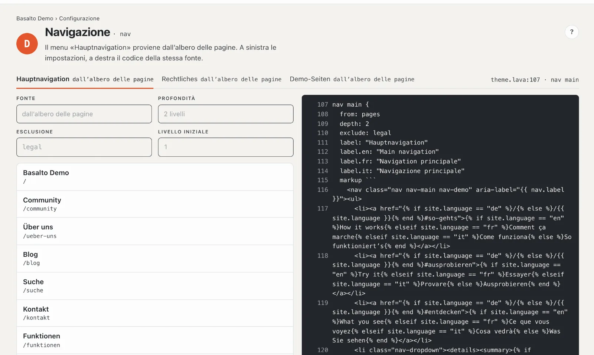
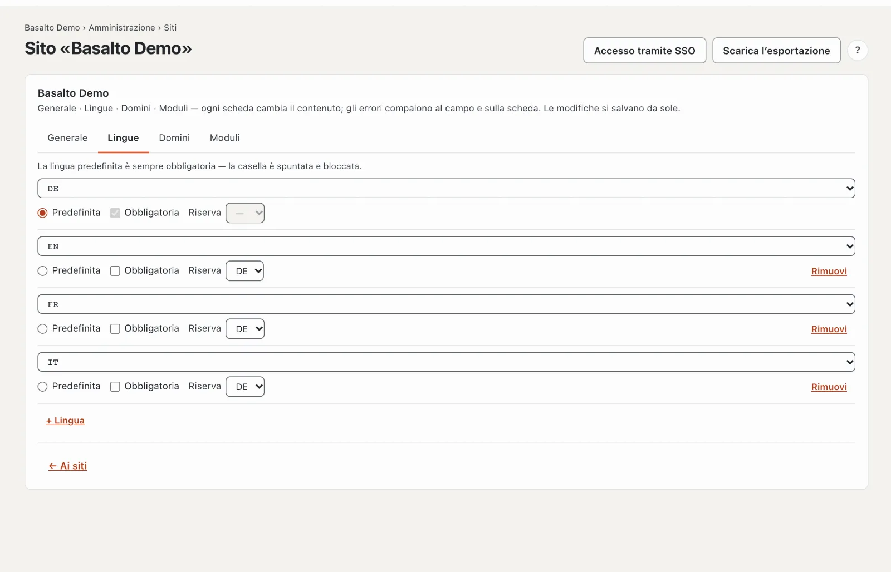
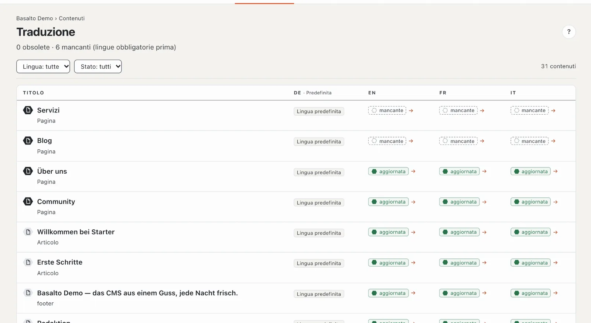

# Menu e lingue

Dopo la pubblicazione la nuova pagina compare da sola nel menu. Qui vede da dove il menu prende le sue voci, come
cambiare l’ordine e come il Suo sito riceve una seconda lingua.

## Il menu

Nel tema Starter il **menu principale segue l’albero delle pagine**: ogni pagina pubblicata del livello superiore vi
compare, con le sue sottopagine sotto. Non deve quindi curare il menu.

- **Visualizzare:** modalità «Configurazione» › «Come ci si orienta?» › **«Modifica menu»**. Una scheda per menu —
  menu principale, note legali e altri — con la fonte e le voci così come le vedono i visitatori.
- **Cambiare l’ordine:** modalità «Contenuti» › **Pagine** › sulla pagina **«Sposta»** (freccia in su e in giù) e
  scegliere il nuovo posto. Il menu segue subito.
- **Togliere una pagina dal menu:** nelle impostazioni della pagina, scheda «Esperti», spuntare
  **«Nascondi nel menu (resta raggiungibile)»**. La pagina resta raggiungibile al suo indirizzo.

Nel menu compaiono solo pagine pubblicate. Se manca una pagina, di solito è ancora una bozza.

Alcuni temi hanno in più **menu curati liberamente**, le cui voci compone Lei stessa o Lei stesso nella
configurazione. Maggiori dettagli in [Menu](../einrichtung/menues.md).

## Una seconda lingua

1. Modalità «Amministrazione» › **Siti** › il Suo sito › scheda **«Lingue»**.
2. **«+ Lingua»** e scegliere la lingua, per esempio l’inglese.
3. Per ogni lingua imposta:
   - **Predefinita** — la lingua principale da cui nascono tutte le traduzioni. Ce n’è esattamente una.
   - **Obbligatoria** — senza questa lingua Basalto non approva alcun contenuto. All’inizio lasci la casella vuota, così
     può pubblicare pagine anche prima della traduzione.
   - **Riserva** — se manca una traduzione, i visitatori vedono la versione di questa lingua, per esempio il tedesco
     invece di una pagina vuota.

Le modifiche si salvano da sole. Sul sito web compare un selettore di lingua non appena esiste una seconda lingua.

## Tradurre la pagina

1. Modalità «Contenuti» › **Traduzione** — l’elenco di tutti i contenuti con il loro stato per lingua.
2. Nella riga «Servizi» clicchi su **«mancante»** nella colonna della lingua.
3. **«Crea traduzione da tedesco»**. A sinistra c’è il testo tedesco da leggere, a destra scrive la traduzione — campo
   per campo, blocco per blocco. Basalto salva automaticamente.
4. La traduzione va online come ogni versione: **Invia per approvazione**, **Approva**, **Pubblica** — vedi
   [La prima pagina](erste-seite.md#4-verificare-e-pubblicare).

Se in seguito modifica il testo tedesco, la traduzione passa a **«obsoleta»** finché qualcuno non la aggiorna.
Immagini e numeri valgono per tutte le lingue e si curano solo nella lingua predefinita.

## Se qualcosa non funziona

| Vede | Causa | Soluzione |
| --- | --- | --- |
| La nuova pagina manca nel menu | Non è ancora pubblicata, oppure «Nascondi nel menu» è spuntato. | Pubblicare la pagina o togliere la spunta nella scheda «Esperti». |
| Manca la scheda «Lingue» | Il Suo ruolo non amministra siti. | Chiedere a una persona con il ruolo Amministratore o Gestore. |
| «Crea traduzione da tedesco» è bloccato | Il Suo ruolo non può modificare questa lingua, oppure non esiste ancora una versione tedesca. | Far verificare il ruolo o scrivere prima la versione tedesca. |

## Per continuare

- [Invitare il team](team.md)
- [Tradurre](../redaktion/uebersetzen.md)
- [Pagine e albero delle pagine](../redaktion/seiten.md)
