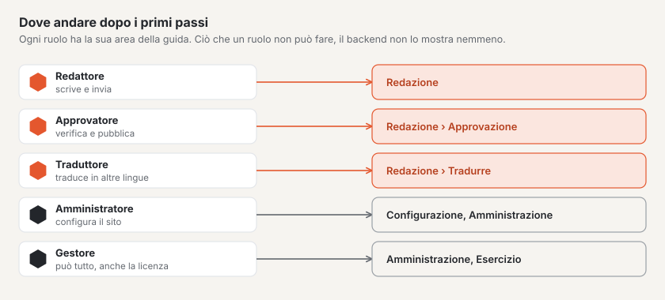

# Come proseguire

Il Suo sito funziona, la prima pagina è online, il team è invitato. Da qui ogni ruolo approfondisce la propria parte
della guida — questa pagina mostra dove.

## Per la redazione

- [Pagine e albero delle pagine](../redaktion/seiten.md) — sottopagine, reindirizzamenti, cestino.
- [Modificare i contenuti con i blocchi](../redaktion/bloecke.md) — tutti i blocchi, testo formattato, incollare da
  Word, ripristinare versioni precedenti.
- [Media](../redaktion/medien.md) — cartelle, testi alternativi, punto focale, sostituire.
- [Moduli](../redaktion/formulare.md) — adattare il modulo di contatto, leggere gli invii.

## Per approvazione e traduzione

- [Approvazione e pubblicazione](../redaktion/freigabe.md) — verificare, respingere, pianificare, mettere offline.
- [Tradurre](../redaktion/uebersetzen.md) — tradurre fianco a fianco, aggiornare le traduzioni obsolete.

## Per la configurazione

- [Configurazione](../einrichtung/README.md) — il percorso in nove stazioni.
- [Aspetto](../einrichtung/aussehen.md) — colori, caratteri, logo e cambio di tema.
- [Andare online](../einrichtung/live-gehen.md) — dominio proprio, rapporto di verifica, pubblicare.

## Per l’amministrazione

- [Amministrazione](../verwaltung/README.md) — siti, utenti, ruoli, impostazioni.
- [Aggiornamenti](../verwaltung/updates.md) — mantenere aggiornati nucleo, moduli e temi.
- [Licenza](../verwaltung/lizenz.md) — livelli e chiavi.

## Per tecnica ed esercizio

- [Manuale d’esercizio](../betrieb/README.md) — hosting, backup, monitoraggio e comandi.
- [Documentazione per sviluppatori](../entwickler/README.md) — temi in Lava, moduli e l’API.
- [Marketplace](../marktplatz/README.md) — trovare o offrire temi e plugin.

## Per continuare

- [Primi passi con Basalto](README.md)
- [Guida per la redazione](../redaktion/index.md)
