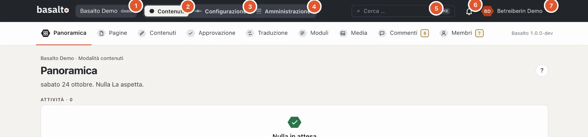
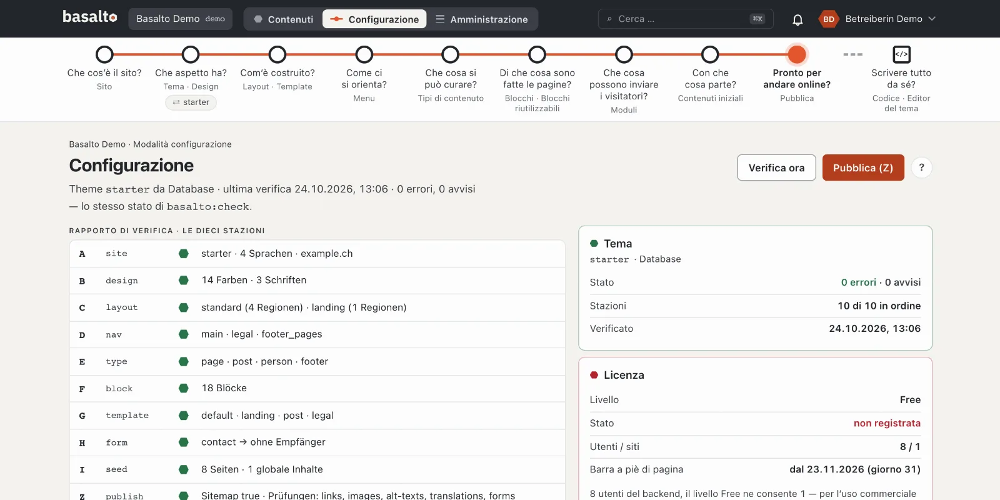
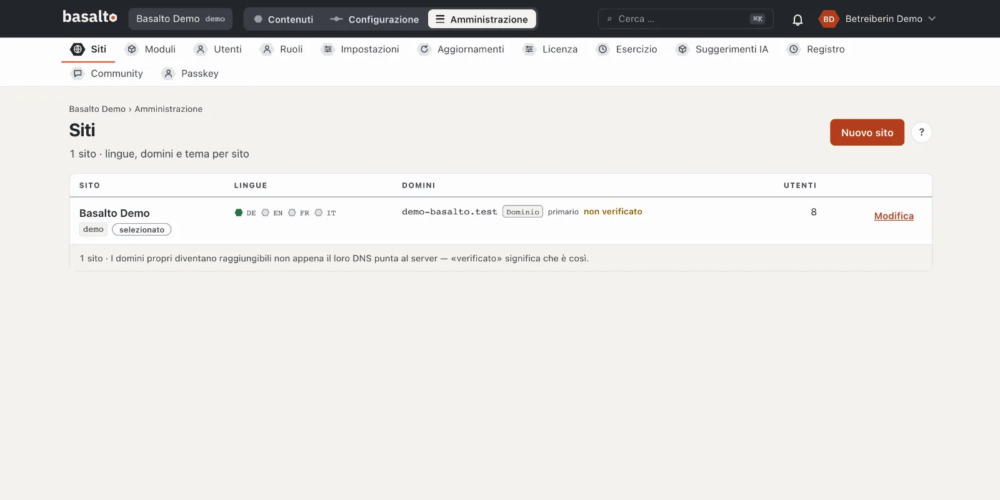
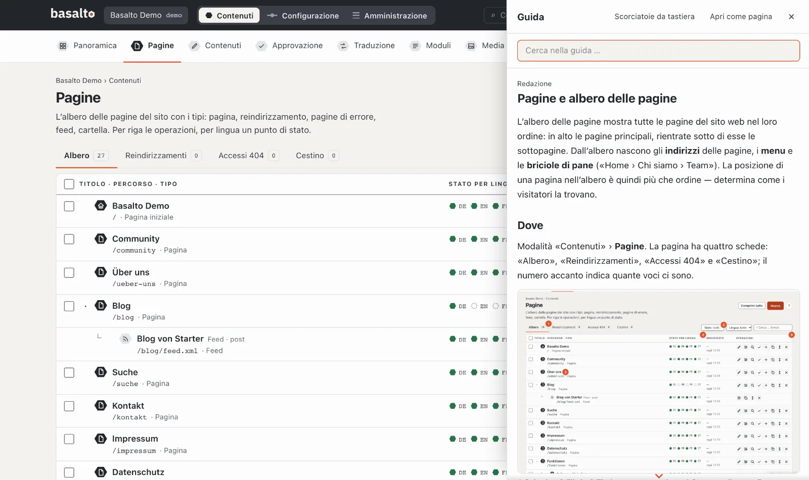

# Visita guidata del backend

Il backend ha tre **modalità**: «Contenuti» per il lavoro redazionale quotidiano, «Configurazione» per l’aspetto e la
struttura del sito e «Amministrazione» per siti, utenti ed esercizio. Questa visita guidata mostra dove si trova che
cosa e come orientarsi.

## L’intestazione

L’intestazione è uguale in tutte le modalità:

1. **Il sito** — se lavora in più siti, qui cambia sito.
2. **Contenuti** — pagine, blocchi, media, traduzione e approvazione.
3. **Configurazione** — aspetto, struttura, menu e tipi di contenuto del sito.
4. **Amministrazione** — siti, utenti, ruoli, impostazioni, aggiornamenti e licenza.
5. **Cerca** — trova pagine, contenuti, media e utenti; più rapido con **⌘K** o **Ctrl+K**.
6. **La campanella** — le Sue notifiche, per esempio quando una versione attende la Sua verifica.
7. **Il Suo nome** — il menu con profilo, impostazioni, modalità scura, guida ed «Esci».

Vede solo le modalità di cui il Suo ruolo ha bisogno: chi scrive soltanto vede «Contenuti», ma né «Configurazione» né
«Amministrazione».

## Modalità «Contenuti»

Sotto l’intestazione si trovano le **stazioni** della modalità:

| Stazione | A che cosa serve |
| --- | --- |
| **Panoramica** | Ciò che La attende: versioni da verificare, elementi respinti, traduzioni mancanti, avvisi. |
| **Pagine** | L’albero delle pagine del sito web — creare, ordinare, modificare pagine. |
| **Contenuti** | Voci senza posto fisso nell’albero, per esempio articoli del blog. |
| **Approvazione** | Tutto ciò che deve essere verificato o pubblicato. |
| **Traduzione** | Ciò che manca o è obsoleto in altre lingue. |
| **Moduli** | I moduli e i loro invii. |
| **Media** | Immagini e file. |
| **Commenti**, **Membri** | Solo se il modulo è attivato per il sito. |

Un numero color ambra accanto a una stazione significa: lì qualcosa La attende. Un numero grigio serve solo a titolo
informativo.

## Modalità «Configurazione»

La configurazione guida attraverso il sito con un **percorso** — nove stazioni, ognuna con una domanda: «Che cos’è il
sito?», «Che aspetto ha?», «Com’è costruito?» fino a «Pronto per andare online?». Un anello scuro significa «in
ordine», una ✗ rossa «qui manca qualcosa». Sotto si trova il **rapporto di verifica** con dieci verifiche. Per ora la
configurazione non Le serve: il tema Starter è già configurato. Maggiori dettagli in
[Configurazione](../einrichtung/README.md).

## Modalità «Amministrazione»

Qui gestisce l’installazione: **Siti** con lingue e domini, **Moduli**, **Utenti** e **Ruoli**, **Impostazioni**,
**Aggiornamenti**, **Licenza**, **Esercizio** e il **Registro** di tutte le modifiche. Maggiori dettagli in
[Amministrazione](../verwaltung/README.md).

## La guida

- Il pulsante rotondo **«?»** in alto a destra apre la guida che corrisponde alla pagina attuale — come barra sul
  margine destro. La pagina dietro resta utilizzabile.
- Più rapido con il tasto **?** o **F1**.
- In alto nella barra cerca in tutta la guida; **«Apri come pagina»** mostra la guida a tutto schermo,
  **«Scorciatoie da tastiera»** elenca tutte le scorciatoie.

## Se qualcosa non funziona

| Vede | Causa | Soluzione |
| --- | --- | --- |
| Manca «Configurazione» o «Amministrazione» | Il Suo ruolo non consente la modalità. | Chiedere alla persona che amministra il Suo sito. |
| Un pulsante è grigio e accanto c’è un motivo | Il Suo ruolo non può eseguire questo passo, per esempio «Il Suo ruolo non approva». | Lasciare il passo alla persona competente o far cambiare il ruolo. |
| L’accesso chiede ogni volta un codice | Il Suo account non ha ancora un passkey. | Nella panoramica scegliere «Configurare passkey». |

## Per continuare

- [La prima pagina](erste-seite.md)
- [Guida per la redazione](../redaktion/index.md)
