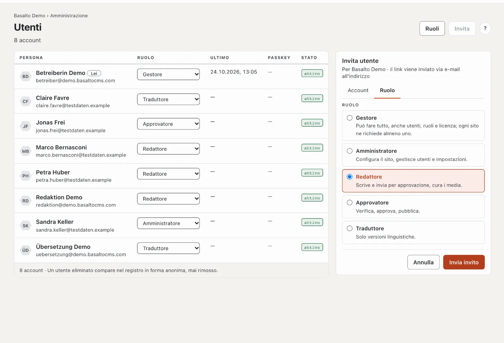

# Invitare il team

Chi collabora riceve un proprio account con un **ruolo**: esso determina che cosa la persona può fare nel sito. Basta un
invito — la persona accede con il link dell’e-mail, del tutto senza password.

## Invitare qualcuno

1. Modalità «Amministrazione» › **Utenti** › **«Invita»**. A destra si apre la scheda «Invita utente».
2. Scheda **«Account»**: l’**indirizzo e-mail** della persona.
3. Scheda **«Ruolo»**: scegliere il ruolo — ognuno con una frase che dice che cosa può fare.
4. **«Invia invito»**.

Il link nell’e-mail è valido 72 ore e utilizzabile una sola volta. Finché la persona non lo apre, compare nell’elenco
come «invitato»; con **«Invia di nuovo»** invia un nuovo link.

## Quale ruolo?

| Ruolo | Può | Adatto per |
| --- | --- | --- |
| **Redattore** | scrivere pagine e contenuti, curare i media, inviare versioni per approvazione | chi fornisce testi e immagini |
| **Approvatore** | verificare ciò che è stato inviato, approvare, pubblicare, mettere offline | chi risponde del sito web |
| **Traduttore** | tradurre contenuti in altre lingue | traduttrici e traduttori |
| **Amministratore** | tutto nel sito, anche configurazione, utenti e impostazioni | chi gestisce il sito |
| **Gestore** | tutto, anche la licenza; ogni sito ne ha almeno uno | Lei stessa o Lei stesso |

Assegna solo ruoli che non possono fare più del Suo. Il ruolo lo cambia in seguito nell’elenco, colonna **«Ruolo»** —
la modifica vale subito. Ruoli propri con diritti calibrati con precisione li crea sotto **«Ruoli»**; maggiori dettagli
in [Ruoli](../verwaltung/rollen.md).

## Buono a sapersi

- **Quattro occhi:** se nessuno deve approvare il proprio lavoro, attivi nelle impostazioni il principio dei quattro
  occhi. Allora ogni versione richiede una seconda persona.
- **Una persona, più siti:** chi ha già un account in un altro sito riceve con l’invito anche un ruolo in questo —
  esattamente uno per sito.
- **Qualcuno lascia il team:** **disattivare** l’account nella scheda della persona. Il suo lavoro e il registro restano
  conservati.

## Se qualcosa non funziona

| Vede | Causa | Soluzione |
| --- | --- | --- |
| L’invito non arriva | L’installazione non invia e-mail, oppure l’e-mail è finita nello spam. | Controllare la cartella spam; le impostazioni di posta le configura l’esercizio (vedi [Installazione nel manuale d’esercizio](../betrieb/installation.md)). |
| «invitato · scaduto» | Le 72 ore sono trascorse. | **«Invia di nuovo»**. |
| Il ruolo desiderato manca nella selezione | Può fare più del Suo ruolo. | Far inviare l’invito da una persona con un ruolo superiore. |

## Per continuare

- [Come proseguire](naechste-schritte.md)
- [Utenti](../verwaltung/benutzer.md)
