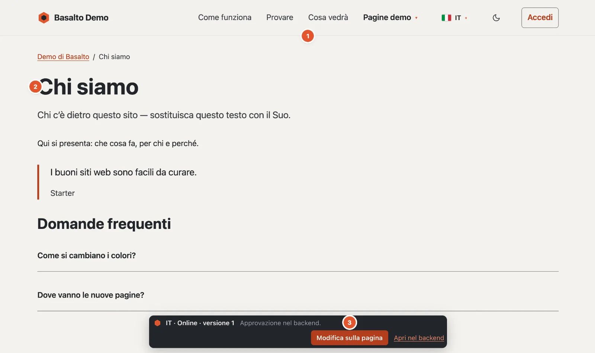
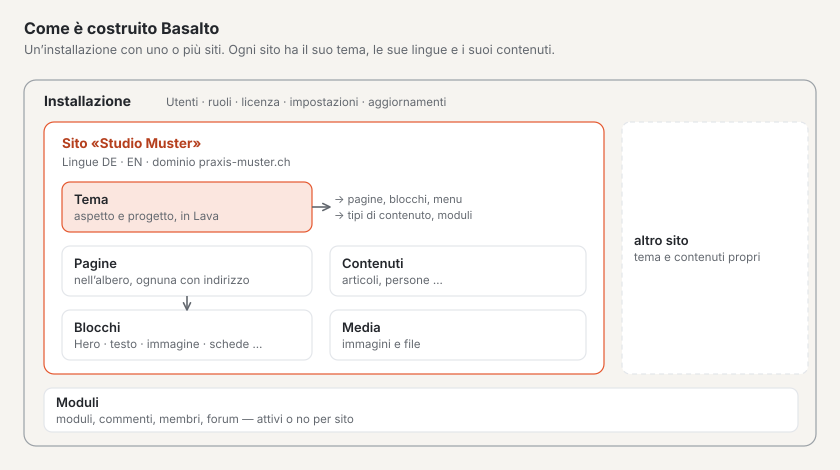

# Che cos’è Basalto?

Basalto è un sistema di gestione dei contenuti: Lei cura i contenuti del Suo sito web nel browser, e Basalto li
distribuisce in modo rapido, accessibile e in più lingue. Grafica e struttura del sito sono definite in un **tema**; la
redazione lavora solo con i contenuti e non deve sapere nulla di tecnica.

1. **Il menu** — nasce dall’albero delle pagine: una nuova pagina vi compare non appena è pubblicata.
2. **Il contenuto** — composto da blocchi, qui titolo, testo, citazione e domande con risposte.
3. **La barra** — visibile solo alle persone che hanno effettuato l’accesso: lingua, stato e versione della pagina, più
   **«Modifica sulla pagina»** e **«Apri nel backend»**. I visitatori non la vedono mai.

## Sito web e backend

Ogni sito Basalto ha due lati:

- **Il sito web** — ciò che vedono le Sue visitatrici e i Suoi visitatori. Mostra sempre e solo contenuti
  **pubblicati**.
- **Il backend** sotto `/admin` — lì crea pagine, scrive, carica immagini, traduce e approva. Ogni modifica nasce prima
  come bozza e va online solo dopo l’approvazione.

## Com’è costruito Basalto

- Un’**installazione** è Basalto su un server. Può gestire uno o più **siti**, ciascuno con indirizzo, lingue e aspetto
  propri.
- Il **tema** di un sito determina aspetto e struttura: quali blocchi esistono, quali menu, quali tipi di contenuto.
  Basalto include il tema **Starter**; altri si trovano nel Marketplace.
- I **moduli** completano un sito con moduli di contatto, commenti, membri o un forum. Li attiva o disattiva per ogni
  sito.

## Che cosa contraddistingue Basalto

| Caratteristica | Che cosa significa per Lei |
| --- | --- |
| **Versioni e approvazione** | Nulla va online per sbaglio. Ogni modifica è una versione, quelle precedenti si possono ripristinare. |
| **Multilingue fin dall’inizio** | Le traduzioni nascono dalla lingua predefinita; Basalto mostra che cosa manca o è obsoleto. |
| **Blocchi con anteprima** | Costruisce le pagine con blocchi pronti e vede la pagina mentre scrive nell’anteprima dal vivo. |
| **Accesso senza password** | Con un codice via e-mail o un passkey — nessuna password che qualcuno possa dimenticare o indovinare. |
| **Rapido e accessibile** | Il sito web funziona senza JavaScript pesante; il backend verifica i contrasti dei colori ed esige testi alternativi. |
| **Ruoli** | Redattore, Approvatore, Traduttore, Amministratore e Gestore — ognuno vede solo ciò che gli serve. |

## Per chi

- **Redazione:** cura testi e immagini senza occuparsi di grafica o tecnica.
- **Agenzie e web design:** configurano siti, adattano i temi e li consegnano alla redazione.
- **Sviluppatrici e sviluppatori:** scrivono temi nel linguaggio Lava ed estendono Basalto con moduli.
- **Esercizio:** installa, salva e aggiorna Basalto sul proprio server o presso un hoster.

## Per continuare

- [I termini principali](begriffe.md)
- [Installare Basalto](installieren.md)
