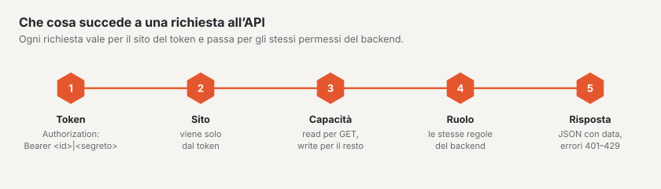

# API REST

Basalto dispone di un’API REST per i contenuti, compresi approvazione, media e menu. Parla JSON, vale sempre per
esattamente un sito e verifica gli stessi permessi del backend. Indirizzo di base: `https://<ihre-site>/api/v1`.



## Creare un token

1. Nel backend aprire il proprio profilo (menu sotto il suo nome) › scheda **«Token API»**.
2. Scegliere **Nome**, **Sito** e **Capacità**: `read` per leggere (`GET`), `write` per scrivere (`POST`, `PATCH`,
   `PUT`, `DELETE`). Facoltativamente una **Data di scadenza** — vale fino alla fine del giorno nel fuso orario del suo
   profilo.
3. Il token appare **una sola volta**. Lo copi e lo conservi in un luogo sicuro; Basalto salva solo un checksum.

## Come decide l’API

- **Sito:** ogni token appartiene a esattamente un sito. Il sito di una richiesta deriva solo dal token — non esiste
  alcun parametro per indicarlo. I contenuti di altri siti per il token non esistono (404).
- **Permessi:** prima la capacità del token (`read`, `write`), poi il **ruolo** della persona nel sito — le stesse
  regole del backend: la redazione crea e invia per approvazione, l’approvazione approva e pubblica, il principio dei
  quattro occhi vale anche qui.
- **Non valido** è un token se è stato revocato o è scaduto (401), se la persona non appartiene più al sito o il suo
  account è disattivato (403). Una sessione nel backend non sostituisce un token (401).
- **Limite:** 120 richieste al minuto per token; le intestazioni `X-RateLimit-*` mostrano lo stato, oltre arriva 429
  con `Retry-After`. Il limite si trova nella configurazione sotto `basalto.api.per_minute`.

```bash
export TOKEN='<id>|<geheim>'          # dal profilo
export B=https://ihre-site.ch/api/v1
H=(-s -H "Authorization: Bearer $TOKEN" -H 'Accept: application/json')
```

## Risposte ed errori

- **Successo:** JSON con `data`; gli elenchi in più con `links` (`first`, `last`, `prev`, `next`) e `meta`
  (`current_page`, `per_page`, `total`, `last_page`). Orari in ISO 8601 (UTC). L’eliminazione risponde `204` senza
  contenuto.
- **Errori:** `401`, `403` e `404` con `{"message": "…"}`; `422` con `{"message": "…", "errors": {"feld": ["…"]}}`.
  Le violazioni dell’approvazione (transizione, principio dei quattro occhi, lingue obbligatorie, slug, testo
  alternativo) si trovano sotto `errors.workflow`.

```bash
curl -s -o /dev/null -w "%{http_code}\n" -H 'Accept: application/json' $B/entries        # 401 senza token
```

## Contenuti

| Metodo e percorso | Capacità · permesso | Scopo |
|---|---|---|
| `GET /entries` | read · appartiene al sito | elenco, i più recenti prima; filtri `type`, `status`, `locale`, `q` (titolo), `updated_since` (ISO 8601, `+` come `%2B` o `Z`), `per_page` (1–100, predefinito 25), `page` |
| `GET /entries/{id}` | read · appartiene al sito | un contenuto con la versione più recente e quella pubblicata per lingua; con `?locale=xx` in più `data.locale`: la versione che vedono gli ospiti (`published`, seguendo le lingue di riserva del sito, con `resolved`, `fallback`, `url`), e lo stato più recente di questa lingua (`latest`) |
| `POST /entries` | write · modificare contenuti | nuovo contenuto di un tipo del tema (`type`, `title`, facoltativi `slug`, `intro`, `content`, `fields`); la prima versione è una bozza nella lingua predefinita. Le pagine nascono nell’albero delle pagine del backend |
| `PATCH /entries/{id}` | write · modificare o tradurre | modifica in `locale` (altrimenti la lingua predefinita); ciò che manca viene dalla versione più recente. Se questa è una bozza, la si continua a scrivere — altrimenti nasce una nuova bozza, come con il salvataggio automatico nell’editor |
| `POST /entries/{id}/workflow/{schritt}` | write · per passaggio | `submit`, `withdraw` (modificare); `approve`, `reject` con `comment` (approvare); `schedule` con `at`, `unschedule`, `publish`, `unpublish` (pubblicare); ciascuno in `locale` |
| `DELETE /entries/{id}` | write · modificare | nel cestino (ripristino nel backend) |

```bash
curl "${H[@]}" "$B/entries?per_page=2"
# {"data":[{"id":8,"type":"post",…},{"id":7,"type":"person",…}],
#  "links":{…,"next":"https://ihre-site.ch/api/v1/entries?per_page=2&page=2"},
#  "meta":{"current_page":1,"per_page":2,"total":6,"last_page":3,…}}

curl "${H[@]}" "$B/entries/2?locale=en"
# data.locale: requested "en", resolved "de", fallback true, published.title "Über uns"

curl "${H[@]}" -X POST -H 'Content-Type: application/json' \
  -d '{"type":"post","title":"Aus der API","fields":{"category":"Neuigkeiten"}}' $B/entries      # 201

curl "${H[@]}" -X POST -H 'Content-Type: application/json' -d '{"locale":"de"}' $B/entries/309/workflow/submit

curl "${H[@]}" -X DELETE $B/entries/309                                                      # 204
```

## Media

| Metodo e percorso | Capacità · permesso | Scopo |
|---|---|---|
| `GET /media` | read · appartiene al sito | elenco; `q` (nome, titolo, autore), `type` (`image`, `document`), `folder_id`, `per_page` |
| `GET /media/{id}` | read · appartiene al sito | file, titolo, autore, testo alternativo per lingua, dimensioni, punto focale, stato delle varianti d’immagine, `file_url` |
| `GET /media/{id}/file` | read · appartiene al sito | il file originale |
| `POST /media` | write · modificare contenuti o gestire media | caricare (multipart `file`, facoltativo `folder_id`) — le stesse verifiche del backend: tipo e dimensione, spazio di archiviazione, SVG senza script; le varianti d’immagine nascono poi in background |
| `PATCH /media/{id}` | write · come caricare | modificare solo quanto indicato: `title`, `credit`, `alt` per ogni lingua del sito |
| `DELETE /media/{id}` | write · gestire media | nel cestino |

```bash
curl "${H[@]}" -F "file=@team.jpg;type=image/jpeg" $B/media
# 201 {"data":{"id":4,"name":"team.jpg","width":1600,"height":1000,"variants_state":"pending","alt":{"de":null,"en":null},…}}

curl "${H[@]}" -X PATCH -H 'Content-Type: application/json' -d '{"alt":{"de":"Das Team vor dem Büro"}}' $B/media/4
```

## Menu

| Metodo e percorso | Capacità · permesso | Scopo |
|---|---|---|
| `GET /navigation` | read · appartiene al sito | i menu del tema: `handle`, `label`, `source` (`pages`, `type`, `db`, `theme`), `editable`, `depth` |
| `GET /navigation/{menü}` | read · appartiene al sito | in `locale`: `items` come sul sito web (`label`, `href`, `new_window`, `entry_id`, `children`), `raw` le voci libere salvate |
| `POST /navigation/{menü}/items` | write · modificare contenuti | voce libera in un menu gestito liberamente: `kind` (`entry` con `entry_id` o `url` con `url`), `label` per lingua, `parent_id`, `visible`, `new_window` |
| `PUT /navigation/items/{id}` | write · modificare contenuti | modificare, con tutti i campi come alla creazione |
| `DELETE /navigation/items/{id}` | write · modificare contenuti | eliminare; le voci subordinate salgono di livello |

```bash
curl "${H[@]}" -X POST -H 'Content-Type: application/json' \
  -d '{"kind":"url","url":"https://example.com","label":{"de":"Partner"},"new_window":true}' $B/navigation/footer/items   # 201
```

## Form senza cambio di pagina

Le pagine con un form (``) ricevono un piccolo script incorporato. Invia il form con `fetch` e
`Accept: application/json`:

- **Successo:** `200 {"message": "<Danke-Text>", "redirect": null}` — il testo di ringraziamento sostituisce il form in
  un’area con `role="status"`. Se il form ha un reindirizzamento (`redirect: -> /danke`), il browser va lì.
- **Errore:** `422` con `errors` — un elenco in cima al form (`role="alert"`), il messaggio presso il campo con
  `aria-invalid` e `aria-describedby`, il focus sul primo campo errato.
- **Lo spam** (campo trappola, controllo del tempo, cinque invii al minuto per indirizzo) riceve la stessa risposta di
  una persona e viene soltanto contato.
- **Senza script** il form invia come di consueto con reindirizzamento.
- **Disattivare** nel tema: `data-basalto-ajax="false"` su un elemento che racchiude il form.

## Che cosa l’API non può fare

- Creare o spostare pagine nell’albero delle pagine, le cartelle della mediateca e il ripristino dal cestino esistono
  solo nel backend.
- Gli indirizzi delle varianti d’immagine portano al backend e richiedono un accesso; per l’API esiste `file_url`, il
  file originale.
- I moduli non possono ancora registrare endpoint propri sotto `api/v1`.

`php artisan route:list --path=api` mostra tutte le route dell’installazione.

## Per continuare

- [Moduli e plugin](erweiterungen.md)
- [Ruoli](../verwaltung/rollen.md)
- [Approvazione e pubblicazione](../redaktion/freigabe.md)
