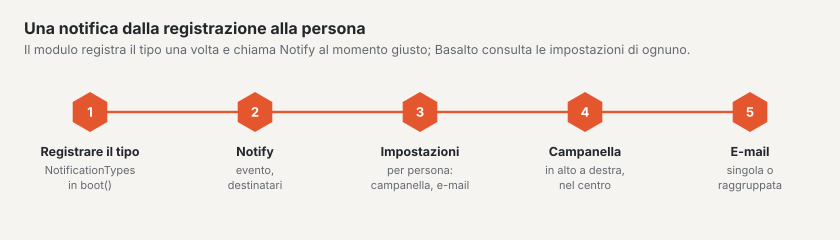

# Notifiche

Basalto ha una **campanella** in alto a destra nel backend, un **centro** con tutte le
notifiche e nel profilo una scheda **«Notifiche»**, in cui ogni persona attiva e disattiva campanella ed e-mail per
ciascun tipo. Il nucleo e i moduli inviano tramite la stessa interfaccia — a un plugin servono due passaggi:
registrare il tipo e chiamare `Notify` al momento giusto.



## 1. Registrare un tipo

Nel `boot()` del service provider, tramite il registro `Basalto\Core\Notifications\NotificationTypes`:

```php
use Basalto\Core\Access\Level;
use Basalto\Core\Notifications\NotificationTypes;

app(NotificationTypes::class)->type(
    'shop.order',                       // chiave: minuscole con punto, prefisso = modulo
    'Neue Bestellung im Shop',          // etichetta nel profilo (testo tedesco = chiave della traduzione)
    'Shop',                             // gruppo nel profilo
    'Auf Rechnung oder mit Karte.',     // descrizione sotto l’etichetta (facoltativa)
    area: 'shop',                       // chi può riceverla e impostarla (sezione, vedere Ruoli e diritti)
    level: Level::Edit,                 // … a partire da questo livello (predefinito: vedere)
    mail: true,                         // predefinito e-mail (predefinito campanella: attiva)
    icon: 'license',                    // simbolo nell’esagono (nomi come nel menu)
);
```

| Parametro | Significato |
| --- | --- |
| `area` | Sezione da `Areas` — il tipo compare solo per le persone che la vedono su uno dei loro siti. Senza sezione è **personale** (riguarda il proprio account o i propri contenuti) e visibile a tutti. |
| `scope` | `NotificationType::BACKEND` (predefinito) o `NotificationType::EXTRANET` — allora la sezione vale nel team del produttore, e la notifica compare nella campanella dell’extranet. |
| `bell`, `mail` | Valori predefiniti, finché la persona non imposta nulla. |
| `mailRequired` | L’e-mail arriva sempre (fattura, disdetta); si può disattivare solo la campanella. |
| `mailAvailable: false` | L’e-mail si imposta altrove (destinatari di un form) — nel profilo compare un trattino invece di un interruttore. |
| `when` | `Closure(): bool` — visibile solo finché la condizione è vera (ad es. solo nell’esercizio SaaS). |

I testi (etichetta, gruppo, descrizione) vanno, come tutti i testi di un modulo, in `lang/{en,it,fr}.json`.

## 2. Notificare

```php
use Basalto\Core\Notifications\Notify;

Notify::make('shop.order')
    ->title('Neue Bestellung :number', ['number' => $order->number])
    ->body('Von :name über :amount.', ['name' => $order->name, 'amount' => $amount])
    ->url(route('basalto.shop.orders.show', $order), 'Bestellung öffnen')
    ->toArea($site)              // tutti quelli del sito con la sezione del tipo
    ->except($request->user())   // chi l’ha scatenata non ha bisogno di un messaggio
    ->send();                    // numero dei destinatari
```

| Metodo | Effetto |
| --- | --- |
| `make($key)` | Tipo dal registro — una chiave sconosciuta solleva un’eccezione (gli errori di battitura emergono nel test). |
| `title($text, $params)`, `body($text, $params)` | Testo tedesco con segnaposto; la traduzione nella lingua della persona avviene alla visualizzazione o all’invio. |
| `url($url, $action)` | Destinazione di un clic ed etichetta del pulsante nell’e-mail. Relativa (`/admin/…`) se la richiesta gira su un altro host. |
| `site($site)` | A quale sito appartiene — all’apertura il backend passa a quel sito. `toArea()` la imposta da sé. |
| `to($users)`, `toArea($site, $area, $level)`, `toExtranet($area, $level)` | Destinatari: singole persone, tutti quelli con una sezione su un sito o il team del produttore. Mai le persone disattivate. |
| `except($user)` | Escludere una persona. |
| `collapse($key)`, `titleMany($text)` | Raggruppare le non lette con la stessa chiave: dieci ordini diventano una riga «:count neue Bestellungen». |

Quali canali entrano in gioco lo decide `NotificationSettings` in base alle impostazioni della persona: interruttore
principale, interruttori per campanella ed e-mail, scelta per tipo. La campanella scrive subito, l’e-mail passa dalla
coda. Il messaggio contiene solo dati pronti (nessun modello) — la coda non conosce alcun mandante.

## E-mail proprie, e-mail esistenti

- Un’e-mail propria (allegato, struttura propria): ereditare da `Basalto\Core\Notifications\BasaltoNotification` e
  sovrascrivere `toMail()`.
- Mostrare in più nella campanella un’e-mail obbligatoria esistente: includere il trait `AlsoInBell` e fornire
  `bellKind()` nonché `bell()` (titolo, testo, indirizzo) — così fanno fatture, periodo di prova, disdetta, dominio ed
  esportazione del SaaS.

## Che cosa segnala il nucleo stesso

| Chiave | Quando | A chi |
| --- | --- | --- |
| `content.submitted` | versione inviata per approvazione | approvazione del sito |
| `content.rejected`, `content.approved`, `content.published` | respinta (con commento), approvata, pubblicata | chi l’ha inviata |
| `forms.submitted` | nuovo invio (raggruppato per form) | sezione «Moduli» |
| `security.access` | passkey aggiunta o rimossa, token API creato | la persona stessa |
| `support.access` | il supporto del produttore apre il sito | sezione «Impostazioni» |
| `operations.backup_failed` | backup non riuscito (non nell’esercizio SaaS) | sezione «Esercizio» |
| `account.*` | fattura, periodo di prova, disdetta, dominio online, esportazione (e-mail obbligatorie, solo SaaS) | proprietà e fatturazione |
| `extranet.domains`, `extranet.cancellations` | dominio aggiuntivo richiesto, l’account disdice | team nell’extranet |

I moduli inclusi registrano `comments.posted`, `members.pending`, `licensing.orders`, `marketplace.review` e
`marketplace.reported`.

## Archiviazione e protezione dei dati

La campanella scrive nella tabella `notifications` di Laravel, integrata con `kind`, `scope` e `site_id`.
L’informativa nel profilo elenca le notifiche di una persona, l’eliminazione di una persona le rimuove.
Nell’esportazione di un sito non vengono incluse — appartengono alle persone, non al sito.

## Per continuare

- [Moduli e plugin](erweiterungen.md)
- [Guida per la redazione](../redaktion/index.md#notifiche)
