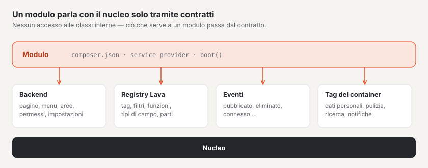

# Moduli e plugin

Basalto ha **un’unica** interfaccia di estensione per entrambi: i moduli li fornisce Basalto (`modules/*`,
`basalto/module-*`), i plugin provengono da terze parti — tecnicamente sono costruiti allo stesso modo. Un’estensione
si rivolge al nucleo solo tramite contratti pubblici: l’interfaccia del backend, il registry di Lava,
gli eventi di dominio e i tag del container. Ciò di cui un modulo ha bisogno lo ottiene il contratto — nessun accesso a
classi interne.



Due esempi sotto `modules/`:

- `modules/example` — il modulo più piccolo: una pagina del backend, una voce di menu, una
  migrazione ed estensioni Lava.
- `modules/comments` — un modulo vero: tag Lava, route del frontend, moderazione con numero sul
  menu, protezione dei dati e ciclo di cancellazione.

## Struttura di un pacchetto

```text
modules/example/
├── composer.json                 pacchetto, service provider, manifest
├── src/ExampleServiceProvider.php
├── src/Http/Controllers/…
├── database/migrations/…
├── lang/de/backend.php, lang/en/backend.php, lang/en.json …
└── resources/js/pages/Hello.vue  pagina Inertia «example::Hello»
```

### `composer.json` con manifest

```json
{
    "name": "basalto/module-example",
    "type": "library",
    "require": { "php": "^8.4", "basalto/core": "*" },
    "autoload": { "psr-4": { "Basalto\\Modules\\Example\\": "src/" } },
    "extra": {
        "laravel": {
            "providers": ["Basalto\\Modules\\Example\\ExampleServiceProvider"]
        },
        "basalto": {
            "module": "example",
            "name": "Beispiel",
            "api": 1,
            "lava": "example",
            "switchable": true
        }
    }
}
```

| Chiave in `extra.basalto` | Significato |
| --- | --- |
| `module` | Handle del modulo — minuscole, cifre, `-` e `_`; al tempo stesso prefisso in Lava e namespace delle pagine Inertia |
| `name` | Nome visualizzato |
| `api` | Versione dell’interfaccia di estensione, oggi `1` |
| `lava` | Namespace in Lava (uguale all’handle) |
| `switchable` | se il modulo può essere attivato e disattivato per sito |
| `requires` | Handle di altri moduli di cui ha bisogno (ad es. il Marketplace `["licensing"]`) — indicazione per le persone e per il Marketplace; oggi il nucleo non la impone |

Laravel trova il service provider tramite la package discovery (`extra.laravel.providers`). Il `composer.json` nella
cartella principale dell’installazione include tutte le cartelle sotto `modules/*` come pacchetti locali (`path`).

`Backend::module()` legge il manifest e lo archivia (`Backend::modules()`). Se un modulo sia attivabile lo determina
il parametro `switchable` alla chiamata — la voce nel manifest oggi è solo un’indicazione (per il Marketplace).

## Service provider

Tutto avviene in `boot()`. Il modulo di esempio per intero:

```php
final class ExampleServiceProvider extends ServiceProvider
{
    public function boot(): void
    {
        $root = dirname(__DIR__);
        $this->loadTranslationsFrom($root.'/lang', 'example');
        $this->loadJsonTranslationsFrom($root.'/lang');
        $this->loadMigrationsFrom($root.'/database/migrations');

        $backend = $this->app->make(Backend::class);
        $backend->pages('example', $root.'/resources/js/pages');
        $backend->module('example', 'example::backend.title', composerJson: $root.'/composer.json');
        $backend->menu('example::backend.title', 'basalto.example', 50, Backend::MODE_CONTENT, module: 'example', icon: 'module');
        $backend->routes(static function (): void {
            Route::get('example', HelloController::class)->name('example');
        });

        $this->app->extend(Registry::class, static function (Registry $registry): Registry {
            $registry->module('example')
                ->function('example.greeting', static fn (mixed $name): string => 'Grüezi '.(string) $name)
                ->tag('example.cart', static function (array $args, array $named): string { /* … */ })
                ->fieldType('example.price', ['input' => 'number', 'step' => 0.05, 'currency' => 'CHF']);

            return $registry;
        });
    }
}
```

## Interfaccia del backend: `Basalto\Core\Backend\Backend`

Un singleton nel container (`$this->app->make(Backend::class)`).

| Metodo | Firma | Scopo |
| --- | --- | --- |
| `module` | `module(string $handle, string $label, bool $switchable = true, ?string $composerJson = null, bool $enabledByDefault = true): self` | Registrare un modulo; `$label` è una chiave di traduzione; `$composerJson` fornisce il manifest; `$enabledByDefault` falso significa disattivato di fabbrica |
| `menu` | `menu(string $label, string $route, int $order = 100, string $mode = self::MODE_CONTENT, ?string $module = null, ?string $icon = null): self` | Voce di menu; `$route` è un nome di route, `$mode` uno tra `MODE_CONTENT` (Contenuti), `MODE_SETUP` (Configurazione), `MODE_ADMIN` (Amministrazione). Con `$module` la voce scompare quando il modulo è disattivato per il sito |
| `count` | `count(string $route, Closure $count): self` | Numero sulla voce di menu di questa route, per sito: `fn (Site $site): int` |
| `pages` | `pages(string $namespace, string $directory): self` | Directory con pagine Vue sotto un namespace |
| `routes` | `routes(Closure $routes): void` | Route sotto il percorso del backend (`basalto.backend.path`, predefinito `admin`) con il middleware del backend (`web`, `auth`, account attivo, scelta del sito, Inertia) e prefisso del nome `basalto.` |
| `moduleEnabled` | `moduleEnabled(string $handle, Site $site): bool` | il modulo è attivo per questo sito? |
| `modules`, `menuItems`, `menuByMode`, `counts`, `pageNamespaces`, `path`, `middleware`, `vite` | — | Lettura per il nucleo |

Un esempio di `count()` dal modulo dei commenti — il numero di commenti in attesa sul menu:

```php
$backend->count('basalto.comments.index', static fn (Site $site): int => Comment::query()->withoutGlobalScopes()
    ->where('site_id', $site->id)->where('status', CommentStatus::Pending->value)->count());
```

### Route

`routes()` aggiunge il percorso del backend e il prefisso del nome: `Route::get('example', …)->name('example')` diventa
`/admin/example` con il nome `basalto.example` — in linea con la voce di menu sopra. Le route al di fuori del backend
(ad esempio l’invio di commenti dal frontend) le crea il modulo stesso:

```php
Route::post('comments/{entry}', CommentSubmissionController::class)->whereNumber('entry')
    ->middleware(['web', 'basalto.site'])->withoutMiddleware(ValidateCsrfToken::class)->name('basalto.comments.submit');
```

### Sezioni e permessi

Ogni route del backend appartiene a una **sezione** con un gruppo (Contenuti, Configurazione, Amministrazione). Il
modulo registra le sue sezioni in `boot()` e assegna le route per prefisso; singole route possono richiedere un
livello più alto:

```php
app(Areas::class)->register('members', 'Mitglieder', Areas::CONTENT, 'members')
    ->map('basalto.members.', 'members')
    ->route('basalto.members.settings', 'members', Level::All);
```

Senza indicazione propria, GET richiede «vedere», DELETE «eliminare» e tutto il resto «modifica». Il middleware
`GuardAreaAccess` verifica ogni richiesta, il menu nasconde le voci senza permesso. Le route senza assegnazione
richiedono «Impostazioni · tutto», e il test `AreaCoverageTest` le segnala. Nel codice si chiede
`Gate::allows('area', [$site, 'members', Level::Delete])` o `Access::allows()`; le lingue le verifica
`Access::authorizeLocale()`. «Prendere in prestito» il permesso di un’altra capacità (ad esempio `update` del sito) non
è più necessario. Come gli operatori impostano i ruoli: [Ruoli e diritti](../betrieb/rollen.md).

### Pagine Inertia con namespace

Un controller esegue il render di `Inertia::render('example::Hello', [...])`; la parte prima di `::` è il namespace da
`pages()`, la parte dopo il percorso della pagina senza `.vue`. Il nucleo usa `core::…`.

```php
final class HelloController
{
    public function __invoke(Request $request): Response
    {
        $greeting = (new Renderer(app(Registry::class)))->render('{{ example.greeting(name) }}', ['name' => $request->user()->name ?? 'Gast']);

        return Inertia::render('example::Hello', ['greeting' => $greeting]);
    }
}
```

Il nucleo include nel suo bundle le pagine di tutti i moduli forniti: `packages/core/resources/js/backend.ts` cerca
`modules/<namensraum>/resources/js/pages/<Seite>.vue`. Il namespace deve quindi corrispondere al nome della cartella
sotto `modules/`. Una build propria per i plugin di terze parti (`resources/dist` con manifest tramite `vite()`) è
ancora in sospeso.

### Attivabile per sito

Attivare e disattivare i moduli attivabili: Amministrazione › Siti › Modifica sito › scheda «Moduli». Il salvataggio
avviene in `sites.settings.modules.<handle>`; senza voce vale il valore predefinito del modulo — di solito attivo, con `module(…, enabledByDefault: false)` disattivato di fabbrica (così la vendita licenze e il Marketplace, che girano solo su basaltocms.com). Le voci di menu con `module:`
scompaiono da sole. **Tutto il resto lo verifica il modulo stesso** con `moduleEnabled()` — così fa il
modulo dei commenti nell’output del tag, nell’invio e nella moderazione:

```php
abort_if($site === null || ! $this->backend->moduleEnabled('comments', $site), 404);
```

Da disattivato i dati restano salvati.

## Estendere Lava: il registry

Lava richiama solo ciò che è registrato (`Basalto\Lava\Runtime\Registry`, un’istanza per applicazione). Un modulo
estende l’istanza nel container e registra **solo sotto il suo prefisso** — tramite `module('handle')`, che fornisce una
`Basalto\Lava\Runtime\ModuleRegistry`. Un nome senza prefisso, con un prefisso altrui o già occupato solleva una
`LogicException`. I temi non registrano mai nulla.

```php
$this->app->extend(Registry::class, static function (Registry $registry): Registry {
    $registry->module('comments')
        ->tag('comments.list', static fn (array $args, array $named, Context $ctx): string => app(CommentsRenderer::class)->render($named, $ctx));

    return $registry;
});
```

| Metodo della `ModuleRegistry` | Firma | In Lava |
| --- | --- | --- |
| `function` | `function(string $name, Closure $fn): self` — parametri a piacere, nel filtro il primo è il valore | `{{ example.greeting(name) }}`, `{{ preis \| example.money }}` |
| `tag` | `tag(string $name, Closure $fn): self` — `fn (array $args, array $named, Context $ctx): string` | `` |
| `fieldType` | `fieldType(string $name, array $options = []): self` | `field preis: example.price` |
| `property` | `property(string $keyword, string $name): self` | proprietà aggiuntiva, ad es. `property('type', 'example.sku')` → `example.sku:` in un `type` |
| `part` | `part(string $name, string $label, array $settings, Closure $render): self` — `fn (array $settings, array $vars, string $lang): string` | parte Lava `part warenkorb: shop.cart { … }` |

Indicazioni:

- **I tag restituiscono HTML** ed eseguono da sé l’escape (`htmlspecialchars`). `$args` sono gli argomenti posizionali,
  `$named` quelli nominati; `$ctx->get('page')` e `$ctx->get('site')` forniscono le variabili della pagina.
- **Gli errori in una funzione o in un tag** (tipo errato, argomento mancante) diventano un errore Lava con riga;
  il tema non vede alcuno stack PHP. Valgono i limiti del renderer (tempo, cicli, profondità).
- **I tipi di campo** dei moduli li conosce il verificatore (`basalto:check`) e li propone («`price` — intendeva
  `example.price`?»). Le opzioni (`['input' => 'number', …]`) le archivia il registry (`fieldTypeOptions()`);
  il form del backend non le valuta ancora.
- **Language server:** i nomi registrati compaiono nel completamento e nell’hover, la firma il language server la
  legge dalla closure.

## Eventi di dominio

Il nucleo emette eventi Laravel con payload stabile (namespace `Basalto\Core\Events`). Un modulo si mette in ascolto
con `Event::listen(…)`.

| Evento | Payload | Quando |
| --- | --- | --- |
| `EntrySaved` | `Entry $entry, EntryVersion $version` | è stata salvata una versione linguistica (bozza) |
| `VersionTransitioned` | `EntryVersion $version, EntryStatus $from, EntryStatus $to, ?string $comment` | una versione ha cambiato stato nel workflow |
| `VersionPublished` | `EntryVersion $version` | una versione è online |
| `MediaUploaded` | `Media $media` | è stato caricato un media |
| `MediaTrashed` | `Media $media, int $usages` | un media è finito nel cestino (con il numero di contenuti che lo includono ancora) |
| `MediaRestored` | `Media $media` | un media è tornato dal cestino |
| `SiteCreated` | `Site $site` | è stato creato un sito |
| `SiteUpdated` | `Site $site, array $before, array $after` | dati di base di un sito modificati |
| `UserLoggedIn` | `Authenticatable $user, string $method` | accesso al backend (codice, link o passkey) |

Tutte le proprietà sono `public readonly`.

Chi vuole notificare delle persone in occasione di un evento — nella campanella e via e-mail, secondo le loro
impostazioni — registra un tipo e chiama `Notify`: vedere [Notifiche](benachrichtigungen.md).

## Protezione dei dati: tag del container

I dati personali nelle tabelle dei moduli si agganciano a informativa, cancellazione e ciclo di cancellazione del nucleo
tramite due tag del container. Entrambi si aspettano una **closure** nel container.

| Tag | Chiamato da | Firma della closure | Valore restituito |
| --- | --- | --- | --- |
| `basalto.person-data` | `Basalto\Core\Privacy\PersonData` (`basalto:privacy`, profilo e gestione utenti nel backend) | `fn (string $email, bool $delete): array` | per l’informativa un elenco per tipo (viene aggiunto all’informativa), per la cancellazione un numero per tipo |
| `basalto.cleanup` | `basalto:cleanup` (ogni giorno alle 03:00) | `fn (Settings $settings): array` | per tipo il numero di record eliminati; compare nell’output e nel registro |

Così il modulo dei commenti collega entrambi:

```php
$this->app->instance('basalto.person-data.comments', (new CommentPersonData)(...));
$this->app->tag(['basalto.person-data.comments'], 'basalto.person-data');
$this->app->instance('basalto.cleanup.comments', CommentPersonData::cleanup(...));
$this->app->tag(['basalto.cleanup.comments'], 'basalto.cleanup');
```

`CommentPersonData::__invoke(string $email, bool $delete): array` fornisce `['kommentare' => [...]]` o
`['kommentare' => $anzahl]`; `CommentPersonData::cleanup(Settings $settings): array` elimina per sito lo spam e
quanto cancellato dopo il termine `comments.retention_days` (predefinito 365) e fornisce `['Kommentare' => $anzahl]`.
L’indirizzo e-mail arriva in minuscolo e senza spazi; la ricerca vale su tutti i siti.

## Account del frontend e pagine protette

L’**account del frontend** appartiene al nucleo (`Basalto\Core\FrontendAccounts`). Vendita licenze, Marketplace e membri lo condividono senza dipendere l’uno dall’altro. I nomi più vecchi della vendita licenze
(`Basalto\Modules\Licensing\Accounts\Customer`, `CustomerAuth`, `CustomerLogin`, `CustomerLoginCode`,
`Frontend\LoginForm`, `Http\CustomerLoginController`, `Http\Middleware\…`, `Notifications\CustomerLoginCodeNotification`)
restano come `class_alias` e sono considerati deprecati; il codice nuovo usa i nomi del nucleo. Un alias è la stessa
classe (`instanceof` vale per entrambi i nomi) — solo i confronti tramite il nome della classe come stringa (ad esempio
`Notification::assertSentTo(…, AlterName::class)`) vedono il nome del nucleo.

| Interfaccia | Scopo |
| --- | --- |
| `CustomerAuth::useFor('modul', ?Policy::class)` | Il modulo usa l’account (nel `boot()`). Le route `POST /account/login`, `/account/code`, `/account/logout` e la pagina di accesso `GET /account/login` rispondono su un sito solo se uno dei moduli che lo usano è attivo. |
| `RegistrationPolicy::opensRegistration(Site)` | L’accesso sul sito può creare nuovi account? Senza regola sì. Se nessuno dei moduli attivi lo consente, i codici vanno solo a indirizzi con account (la risposta al browser resta uguale). |
| `CustomerAuth::current()` · `::available(Site)` · `::MIDDLEWARE` (`basalto.customer`) | Chi ha effettuato l’accesso (solo account del sito della richiesta), se l’account esiste sul sito, middleware per route solo con account |
| `LoginForm::render($request, $lang, $pfad, $intro, $zweck)` | Il form di accesso per tag propri; `$zweck` (ad es. `members`) torna dopo il codice come `CustomerSignedIn::$purpose` |
| Evento `Events\CustomerSignedIn` (`customer`, `site`, `purpose`) | Dopo il codice corretto — i membri creano così l’iscrizione la prima volta |

**Sezioni dell’account cliente:** il tag `` (parte Lava «Account cliente», impostazioni `buy`, `entry`, `catalog`, `start`) mostra l’intero account: un’intestazione compatta con saluto, a sinistra le sezioni come navigazione (numero, punto di avviso), a destra sempre una sola — prima la panoramica con «Prossimi passi», una tessera per sezione e «Di recente». Ogni sezione ha l’ancora `#konto-<key>`; un’ancora ovunque in una sezione (`#lizenz-12`) apre quella sezione. Un modulo aggiunge una sezione registrando in `boot()` una classe — `app(AccountAreas::class)->add(MiaSezione::class)` — che implementa `Basalto\Core\FrontendAccounts\Hub\AccountArea`:

| Metodo | Scopo |
| --- | --- |
| `key()` · `position()` | Ancora `#konto-<key>` e ordine (siti 10, licenze 20, installazioni 30, Marketplace 40, community 50, fatture 60, profilo 90) |
| `pitch($page)` | Per gli ospiti: simbolo, titolo e una frase (`AreaPitch`) — oppure `null` |
| `summary($page)` | Con accesso: `AreaSummary` con etichetta, simbolo, numero, tono (`lava`, `warn`), compiti (`AreaTodo`), eventi (`AreaEvent`), pulsanti (`AreaAction`) e messaggi — `null` nasconde la sezione |
| `render($page, $summary)` | Il contenuto della sezione; cornice, titolo e ancora li imposta l’account |

La sezione viene creata di nuovo a ogni output e può conservare dati tra `summary()` e `render()`. `AccountPage` fornisce sito, lingua, percorso, richiesta, account con accesso e `t()` per i testi, `Icons::svg()` i simboli dell’account. Elementi del markup: `konto-zeilen` con `konto-zeile`, `konto-sechseck`, `konto-chip`, `konto-knopf`, `konto-leer`, `konto-klappe`.

**Pagine protette:** il nucleo conosce la protezione (scheda «Accesso», `access.protected`, ereditata tramite
`access.children`; `Pages::isProtected()`), ammette le pagine protette nella navigazione e negli elenchi solo per chi è
autorizzato e mai in sitemap, indice di ricerca e feed, e risponde agli ospiti con 401 (a chi ha effettuato l’accesso
senza permesso con 403). Chi può vederle lo decide un modulo tramite `PageAccess::useGate(Gate::class)` con il contratto
`Basalto\Core\Content\ProtectedPageGate` (`enabled`, `adminUrl`, `allows`, `denied`, `login`); senza modulo le vede solo
la redazione del backend del sito. Gli elenchi propri di un modulo chiedono `app(PageAccess::class)->mayView($entry)`.

**Protezione dei dati:** `PersonData` chiama prima i moduli (`basalto.person-data`) e **poi** gli account del frontend
del nucleo — un modulo trova quindi i suoi dati durante la cancellazione ancora tramite l’e-mail dell’account;
anonimizzare l’account non è compito suo.

## Obblighi di un’estensione

Ciò che ogni estensione deve rispettare:

1. **Scope del sito** su ogni tabella con contenuti di un sito: colonna `site_id` e nel modello il trait
   `Basalto\Core\Sites\BelongsToSite` (scope globale sul sito attuale, `site_id` alla creazione) — in più un test
   che dimostri che un secondo sito non vede nulla.
2. **Traduzioni** per l’interfaccia (DE, EN, IT, FR) sotto `lang/`; le etichette di menu sono chiavi di traduzione.
3. **Migrazioni** nel pacchetto (`loadMigrationsFrom`), mai nel nucleo.
4. **Dati personali** da collegare a `basalto.person-data` e, se ci sono termini, a `basalto.cleanup`.
5. **Esportazione:** ogni tabella con `site_id` deve essere inclusa nell’esportazione del sito o esclusa con
   motivazione — altrimenti un test del nucleo diventa rosso. Un’interfaccia tramite cui i moduli esportano da sé le
   proprie tabelle è ancora in sospeso; fino ad allora la motivazione si trova in
   `Basalto\Core\Transfer\SiteExporter::EXCLUDED` (così per il modulo dei commenti).

## Per continuare

- [Lava — il linguaggio dei temi](lava.md)
- [Notifiche](benachrichtigungen.md)
- [API REST](api.md)
