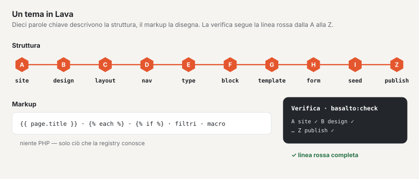

# Lava — il linguaggio dei temi

Lava descrive un intero tema in un unico linguaggio: struttura (sito, design, layout, menu, tipi di contenuto, blocchi,
template, form, contenuti iniziali, pubblicazione) e markup. Il markup conosce output, cicli, condizioni,
macro, filtri e funzioni — ma non PHP. Un tema quindi non può eseguire codice né registrare nulla;
Lava si estende solo tramite il registry del nucleo e dei moduli ([Moduli e plugin](erweiterungen.md)).

Per la sintassi fa fede la grammatica in `packages/lava/grammar/lava-1.ebnf` (vedere [Grammatica](#grammatica)).



## Struttura di un tema

Un tema è una cartella sotto `themes/` (o sotto `BASALTO_THEMES_PATH`). Come modello serve
`themes/starter`, vedere [Temi](themes.md).

| File o cartella | Obbligatorio | Scopo |
| --- | --- | --- |
| `theme.lava` | sì | Punto d’ingresso. Inizia con la riga di versione `lava 1` (se manca, il verificatore avvisa). Può includere altri file `.lava` con `include "datei.lava"` — solo al livello superiore, solo all’interno della cartella, senza cicli. |
| `<ordner>/<name>.lava.html` | no | Markup di un elemento come file a sé invece che nel recinto: `layouts/`, `blocks/`, `templates/`, `navs/`, `parts/`. Il file prevale sul recinto nella definizione. |
| `assets/` | no | Fogli di stile, script, caratteri, immagini — serviti senza build. Estensioni consentite: `css`, `js`, `svg`, `woff2`, `woff`, `png`, `jpg`, `jpeg`, `webp`, `avif`, `ico`. L’indirizzo porta un checksum (`/_theme/{site}/{hash}/{pfad}`), ogni modifica ne riceve uno nuovo. |
| `assets/preview.(webp\|png\|jpg\|svg)` | no | Immagine di anteprima in Configurazione › Temi (cercata in quest’ordine). |
| `theme.json` | no | Dati per la gestione dei temi e per il pacchetto: `label`, `author`, `version`, `license`, `description`. Senza `label` vale il nome da `site`; senza `version` `basalto:theme-pack` impacchetta come `0.0.0`. |

```json
{
    "label": "Starter",
    "author": "Basalto",
    "version": "1.0.0",
    "license": "MIT",
    "description": "Das Beispiel-Theme von Basalto …"
}
```

## La parte strutturale in breve

```lava
lava 1

# commento fino a fine riga (tranne quando «#» inizia un colore come #b53f1d)
site starter {
  name: "Starter"
  languages: de, en            # elenco, virgole facoltative
  default: de
  domain: example.ch
}

type page {
  label: "Seite"  label.en: "Page"        # suffisso di lingua di due lettere minuscole
  field title: text required translatable # elemento con tipo e flag dopo «:»
  field content: blocks { allow: hero, text }
  route: /{slug}                           # percorso con segnaposto
  template: default                        # riferimento a una definizione
}

layout landing extends standard {          # modificatore dopo il nome
  region hero before main
}
```

- **Gli elementi** hanno la forma `wort name: typ flags { … }`; **le proprietà** la forma `schluessel: werte`.
- **Valori:** stringhe in `"…"` o `'…'`, numeri, `true`/`false`, colori da `#rgb` a `#rrggbbaa`, percorsi `/…`,
  riferimenti (parole semplici) e frecce `->` (destinazione di una voce di menu o di un link nel seed).
- **Gli a capo contano:** concludono una proprietà. Un elemento per riga, se seguono solo valori.
- **Il markup** sta in un recinto dopo la parola `markup` (tre backtick prima e dopo, come in Markdown) o in
  un file `.lava.html` (vedere sopra). Il recinto viene ripreso così com’è; l’indentazione comune viene eliminata.
- **La logica appartiene al markup:** un valore con `{{` o `{%` in una parte strutturale è un avviso.
- **Varianti di lingua:** `label.en`, `label.it`, `label.fr` … valgono nella rispettiva lingua; il valore senza suffisso
  è in tedesco. Se una lingua manca, Basalto prende l’inglese e solo dopo il valore senza suffisso — un’interfaccia
  in italiano mostra quindi «Hero» invece di «Bühne» finché manca `label.it`.

## Le dieci parole chiave e la linea rossa A–Z

Un tema risponde a dieci domande, una stazione per domanda. `php artisan basalto:check` e la configurazione nel backend
mostrano la stessa linea (fonte: `Basalto\Lava\Diagnostics\Step`, `Basalto\Lava\Theme\Line`).

| Stazione | Parola chiave | Domanda | Proprietà · sottoelementi |
| --- | --- | --- | --- |
| A | `site` | Chi sono? | `name languages default domain redirects timezone` |
| B | `design` | Che aspetto ho? | `space radius images css logo` · `color font images` |
| C | `layout` | Dove sta cosa? | `region`, markup; in più le parti Lava `part` |
| D | `nav` | Come ci si orienta? | `from items depth start exclude only label` · `item`, markup |
| E | `type` | Quali contenuti esistono? | `label route template` · `field`; in più `global` (`label` · `field`) |
| F | `block` | Di che cosa sono fatte le pagine? | `label group hint` · `field`, markup |
| G | `template` | Come viene mostrato un contenuto? | `for layout noindex` · `region`, markup |
| H | `form` | Come mi si raggiunge? | `label to subject thanks spam submit store redirect webhook retain consent` · `field` |
| I | `seed` | Con che cosa comincio? | `page global` e ogni nome di tipo (`post …`, `person …`) |
| Z | `publish` | Può andare online? | `seo sitemap robots cookie legal redirects check` · `seo legal redirects` |

**Rappresentazione scura:** un colore in `design` può portare un secondo valore per lo scuro, `color text: #23262b dark #ebe8e3`.
Vale quando il sistema operativo dei visitatori è impostato su scuro o quando scelgono «Scuro» con ``;
scegliendo «Chiaro» resta chiaro. I colori senza valore scuro valgono in entrambe le rappresentazioni. `basalto:check` calcola
i contrasti anche per la palette scura.

**Logo nelle e-mail:** l’intestazione di ogni e-mail mostra il logo del sito. Gmail e Outlook non mostrano l’SVG — metta
quindi accanto al logo lo stesso file in PNG (`logo: assets/logo.svg` → `assets/logo.png`) in dimensione tripla: l’e-mail
mostra un terzo dei pixel (126 pixel di altezza → 42 pixel). Un logo largo (logotipo) sta da solo, un simbolo con accanto il
nome del sito; senza PNG compare il nome. Un logo della mediateca appare se è un PNG, JPEG o GIF. Se il Suo logo è scuro, lo
metta nel PNG su una superficie chiara e arrotondata in `#f6f4f0`, il colore dello sfondo dell’e-mail: in modalità scura
l’app Gmail e Outlook scuriscono da sole l’e-mail, ma non le immagini — senza superficie un logo scuro scompare, con essa
risalta su uno scudo chiaro.

**Blocchi nella palette:** `group` assegna un blocco a un gruppo della palette nell’editor, `hint` è una
frase sotto di esso — entrambi con varianti linguistiche come `label`:

```lava
block hero {
  label: "Bühne"  label.en: "Hero"
  group: "Einstieg"  group.en: "Intro"
  hint: "Grosser Titel mit Einleitung, Bild und Knöpfen — oben auf der Seite."
  field title: text required translatable
}
```

Senza `group` l’editor ordina in base ai campi (immagine e titolo con pulsante → «Apertura», ripetizioni →
«Elenchi e griglie», pulsante senza immagine → «Azioni», nessun campo di contenuto → «Dai dati», altrimenti «Testo» o
«Immagini»); senza `hint` compaiono i nomi dei campi. Lo **schema** di ogni scheda lo disegna l’editor stesso a partire
dai campi: un titolo (`title`, `heading`) come barra spessa, il testo continuo come righe, un’immagine (`image` o un campo
di testo `art`, `cover`, `logo`) come superficie d’immagine, i link come pulsanti, i repeater come schede, numeri, passaggi
o domande espandibili (in base ai loro campi `question`, `value`). Campi accessori come `art_overlay` o `cta_label` non
disegnano nulla di proprio.

**Campi nel form:** ciò che la redazione vede nel form del blocco deriva dal campo — tutto con
varianti linguistiche come `label`:

```lava
block hero {
  field title: text required translatable { label: "Titel"  label.en: "Title"  placeholder: "z. B. Willkommen" }
  field cta: link { label: "Knopf" }
  field cta_label: text translatable { label: "Beschriftung des Knopfs"  help: "Leer = Titel der Zielseite"  from: "cta.label" }
  field art_credit: text advanced { label: "Bildnachweis" }
}
```

- `label` — l’etichetta. Senza di essa l’editor ricava dal nome un testo leggibile (`cta_label` → «Pulsante ·
  Etichetta», `art_overlay` → «Immagine · Grafica sovrapposta»); i nomi di campo in maiuscolo non compaiono più.
- `help` — una frase sotto il campo; `placeholder` — un esempio nel campo vuoto.
- `from` — il campo il cui valore vale finché questo è vuoto; il campo vuoto lo mostra come «vuoto = «…»». Un
  campo `x_label` accanto a un link `x` vale così anche senza `from`. Il markup continua a decidere da sé
  (`{{ cta_label | default(cta.label) }}`) — `from` lo spiega soltanto alla redazione.
- `pick: image` su un campo di testo (un indirizzo d’immagine come `art`) — il form mostra la mediateca come finestra di
  dialogo con caricamento e trascinamento; viene salvato `media:<id>`, e il markup riceve l’indirizzo dell’immagine. Un
  file sotto `assets/` del tema si può continuare a digitare; `asset()` lascia invariati gli indirizzi completi (`https://…`).
- Flag `advanced` — il campo sta sotto «Altre possibilità». Senza `advanced` nel blocco stanno in alto i campi
  obbligatori, i campi compilati e per ogni tipo il primo campo (testo, testo continuo, immagine, link, blocchi annidati,
  repeater), fino ad arrivare a tre; i blocchi con al massimo quattro campi mostrano tutto.

Inoltre al livello superiore esistono `global` (conta per E), `part` (conta per C) e `include` (nessuna stazione). I
moduli possono registrare altre proprietà per parola chiave (sempre con prefisso, ad es. `example.sku`).

### Stato per stazione

- `✓` — la stazione è presente e senza errori; dopo, un riepilogo (ad es. «2 lingue», «11 blocchi»).
- `✗` — un errore di questa stazione (il primo con riga e suggerimento) o la parola chiave manca («`nav` manca»).
- `–` — solo per Z: «attende i passaggi precedenti», finché una stazione precedente ha `✗` e `publish` manca.

«Linea rossa completa — pronta per publish» compare quando tutte e dieci le stazioni hanno `✓` e non c’è alcun errore.
Gli avvisi (`!`) non fermano la linea.

### Che cosa verifica ogni stazione

Per tutte le stazioni vale: una parola chiave sconosciuta è un **errore** con suggerimento («`desing` — intendeva
`design`?»). Proprietà e sottoelementi sconosciuti sono **avvisi** con suggerimento — non rompono il tema.

| Stazione | Errori (`✗`) | Avvisi (`!`) |
| --- | --- | --- |
| A `site` | — | proprietà sconosciuta |
| B `design` | valore di colore diverso da `#rgb`, `#rrggbb` o `#rrggbbaa`; `css` non `.css`, `logo` non `.svg/.png/.webp/.jpg/.jpeg`, `src` del carattere non `.woff2/.woff`; file mancante nella cartella del tema | contrasto sotto WCAG 2.2 AA (4,5:1 per il testo) per le coppie `text`, `muted`, `link` su `background` nonché `X-text` o `on-X` su `X` |
| C `layout`, `part` | `extends` su layout sconosciuto; sintassi del markup; regione con `part`, `nav` o `global` inesistente; parte di tipo sconosciuto; parte senza `source:` (per `nav`, `global`, `form`, `sitemap`, `list`) o con fonte sconosciuta | impostazione che il tipo della parte non conosce; markup annidato più di 6 livelli `each`/`if` |
| D `nav` | voce di menu senza destinazione `-> …`; la destinazione non è una pagina da `seed`; `only:`/`exclude:` nomina un template sconosciuto; `from:` non è né `pages` né un tipo; `items:` diverso da `db`; sintassi del markup | annidamento |
| E `type`, `global` | campo senza tipo; tipo di campo sconosciuto (nucleo e moduli, con suggerimento); `blocks { allow: … }` con blocco sconosciuto; `relation <typ>` con tipo sconosciuto (consentiti: `form`, `page`, `global` o un tipo del tema); `template:` sconosciuto | — |
| F `block` | come E per i campi; sintassi del markup | annidamento |
| G `template` | senza `for:` o per tipo sconosciuto; senza `layout:` o layout sconosciuto; regione che il layout (incluso `extends`) non ha; `nav`, `global` o `part` in una regione inesistente; sintassi del markup | annidamento |
| H `form` | campo del form senza tipo o di tipo sconosciuto; `select`/`radio` senza `options:`; lo stesso per i campi in `group` | — |
| I `seed` | pagina con `template:` sconosciuto; blocco in `content { … }` inesistente | `{{`/`{%` nei valori (logica nella struttura) |
| Z `publish` | `legal { … }` richiede una pagina che manca in `seed` | — |

Tipi di campo del nucleo: `text textarea richtext blocks markdown number checkbox bool date datetime select tags image
gallery file link relation repeater slug email url color code seo json` — in più quelli dei moduli (`example.price`).

Tipi di campo dei form: `text email number tel url date textarea select radio checkbox file range hidden explanation group`.

Ciò che `basalto:publish` verifica in più rispetto al database (`check: links, images, alt-texts, translations, forms`
nonché sempre linea rossa, pagine legali e reindirizzamenti) si trova in `Basalto\Core\Publish\PublishChecks`.

## Markup

Il markup sta nel recinto di un `layout`, `nav`, `block`, `template` o `part` (tipo `html`) o nel corrispondente
file `.lava.html`.

### Output, commenti, variabili

```lava
{{ page.title }}                 {# sempre con escape HTML #}
{{ raw body }}                   {# senza escape — solo per testo continuo dall’editor (richtext), il nucleo lo ripulisce #}
{{ title | upper }}              {# filtro #}
{{ count(items) }}               {# funzione #}
{# commento, non compare nell’output #}

```

L’accesso con `.` e `[…]` funziona solo su array e proprietà pubbliche, mai su metodi. Un nome sconosciuto
dà `null`; una funzione senza parentesi è un errore.

| Variabile | Dove | Contenuto |
| --- | --- | --- |
| `site.name`, `site.language`, `site.domain`, `site.logo` | ovunque | sito da `site`, lingua attuale, indirizzo del logo |
| `site.cancellation` | ovunque | indirizzo di «Disdire i contratti qui» — vuoto dove non si può disdire nulla |
| `page.*` | pagine | `title`, `intro`, campi del tipo, `url`, `path`, `locale`, `is_home`, `canonical`, `image`, `alternates` (per `locale`, `url`), `breadcrumbs` |
| `content` | markup del template | i blocchi renderizzati della pagina (da emettere con `{{ raw content }}`) |
| `regions.<name>` | markup del layout | `true` se la regione ha contenuto (ad es. ``) |
| nomi dei campi, `block.name`, `block.index` | markup del blocco | valori dei campi del blocco, nome e posizione del blocco |
| `nav.name`, `nav.label`, `nav.items` | markup della nav | per voce `href`, `label`, `current`, `active`, `new_window` |
| `loop.index`, `loop.index0`, `loop.first`, `loop.last`, `loop.length` | in `each` | contatori del ciclo |

### Cicli e condizioni

```lava

  <li>{{ loop.index }}. {{ item.title }}</li>

  <li>Noch nichts da.</li>


{{ key }}={{ value }}

………
```

### Espressioni

| Tipo | Notazione |
| --- | --- |
| Logica | `and` `&&` · `or` `\|\|` · `not` `!` |
| Confronto | `==` `!=` `<` `>` `<=` `>=` · `in`, `not in` (elenco o sottostringa) |
| Calcolo | `+` `-` `*` `/` `%` (la divisione per zero è un errore) |
| Concatenazione | `~` (`"Seite " ~ loop.index`) |
| Condizionale | `a if bedingung else b` |
| Letterali | numeri, `"…"`/`'…'`, `true`, `false`, `null`, elenchi `[1, 2]`, mappe `{ key: wert }` |

Parole riservate: `and or not in if else true false null as with`.

### Macro e inclusioni

```lava
<a class="card" href="{{ href }}">{{ title }}</a>

   {# tre chiamate equivalenti #}

{{ card("Kontakt", "/kontakt") }}

       {# legge parts/card.lava.html; «with» passa variabili #}
```

`include` legge `<pfad>.lava.html` dal tema — mai al di fuori della cartella. Se il valore dopo `with` è una mappa,
le sue chiavi diventano variabili; altrimenti si chiama `item`.

### Tag

Un tag è ``; gli argomenti sono separati da spazi o virgole.

| Tag | Effetto |
| --- | --- |
| `` | set di caratteri, viewport, variabili di design del sito e fogli di stile del tema — per primo nel `<head>` |
| `` | selettore chiaro/scuro per i visitatori (sole/luna, scelta salvata nel browser) — solo se `design` ha colori scuri |
| `` | titolo, descrizione, canonical, `robots` e dati Open Graph della pagina (da `publish.seo` e dai dati della pagina) |
| `` | contenuto di una regione (nel markup del layout) |
| `` · `` · `` | navigazione, parte Lava o form in questo punto |
| `` | immagine con variante da `design.images` (WebP con `srcset`, fonte AVIF, larghezza e altezza, `loading`) |
| `` | link da un campo `link` |
| `` | emettere un testo con escape |
| `` · `` | breadcrumb e cambio lingua con il markup standard (markup proprio tramite `page.breadcrumbs` e `page.alternates`) |
| `` · `` | condividere: e-mail e reti come semplici link (nulla esce prima del clic), «Copia link» e la condivisione del dispositivo; indirizzo e titolo della pagina se non indicati |
| `` · `` · `` | paginazione, categorie e archivio per `entries()` |
| `` | modulo di ricerca e risultati del sito — per parole, senza distinzione di maiuscole e accenti |
| `` | blocchi annidati di un campo `blocks` (già renderizzati) |
| `` · `` | vedere sopra |
| `` | commenti (modulo `comments`); i moduli portano tag propri con prefisso |
| `` · `` · `` | accesso/uscita, accesso e iscrizione (modulo `members`, vedere sotto) |

Un tag sconosciuto fallisce al render, non alla verifica.

### Tag dei membri

Il modulo «Membri» (`members`) porta con sé tre tag — anche come parti Lava con lo stesso nome, quindi in una
regione (`region header: part konto`) o come blocco di una pagina. Tutti e tre non emettono **niente** se il modulo è
disattivato per il sito. Se il modulo manca del tutto nell’installazione, un tag fallisce al render (come ogni tag
sconosciuto) — per questo, in un tema che deve funzionare anche senza il modulo, sta dentro una condizione:

```lava
<div class="header-account"></div>
```

`site.modules` nomina i moduli attivi per il sito (`site.modules.comments`, `site.modules.members` …).

| Tag | Ospiti | Con accesso effettuato | Impostazioni |
| --- | --- | --- | --- |
| `` | link «Accedi» (`a.members-link`) alla pagina di accesso | pulsante «Esci» (`form.members-link.is-signed-in`) | `login: "/pfad"` — destinazione di «Accedi»; altrimenti la pagina di accesso dalle impostazioni dei membri o `/account/login` |
| `` | accesso tramite codice via e-mail (`section.account-login#konto-anmeldung`) — chi accede così si iscrive secondo la regola del sito | «Accesso come … · Esci» (`form.account-signed-in`) | — |
| `` | come `members.login` | stato dell’iscrizione (`section.members-panel#konto`): attiva dal …, in attesa di approvazione, bloccata, nessun invito — oppure «Diventa membro» (`form.members-join`) — in più «Esci» | — |

Le pagine protette mostrano agli ospiti l’accesso da sole (la pagina di errore 401 del sito o una pagina «Accesso
richiesto» nel layout del tema, al posto di `page.intro`, altrimenti all’inizio di `<main>`); per questo il tema
non ha bisogno di alcun tag. Per gli ospiti l’output è uguale per tutti e può provenire dalla cache delle pagine (il primo
passaggio dell’accesso non ha token CSRF); chi ha effettuato l’accesso non riceve mai una pagina dalla cache. Si
possono modellare le classi `account-login`, `account-form`, `account-intro`, `account-status`, `account-signed-in`,
`members-panel`, `members-state` (con `is-active`, `is-pending`, `is-blocked`, `is-none`), `members-join`, `members-link`
nonché le classi dei form del nucleo (`form`, `form-field`, `form-error`, `form-help`). Il tema Starter mostra un esempio.

### Limiti

Al render valgono al massimo 10 000 iterazioni di ciclo, 2 secondi e un annidamento (inclusione, macro,
ciclo, condizione) fino a profondità 8 (`Basalto\Lava\Runtime\Limits`); oltre, il render si interrompe con un errore
Lava con riga. Il verificatore avvisa già da 7 livelli `each`/`if`. Un errore PHP in una funzione registrata diventa
un errore Lava con riga — il tema non vede mai uno stack PHP.

## Parti Lava

Una **parte** è un componente pronto con impostazioni, definito una volta e collocato in regioni o nel markup:

```lava
part main_nav: nav {
  source: main
  label: "Hauptnavigation"  label.en: "Main navigation"
}
part lang_switch: languages

layout standard {
  region header: part main_nav, part lang_switch    # riempimento predefinito della regione
  region main
  …
}
```

Nel markup la stessa parte si scrive ``. Le parti contano per la stazione C.

| Tipo | Etichetta | Impostazioni | Output |
| --- | --- | --- | --- |
| `nav` | Navigazione | `source depth start only exclude label` | la navigazione `source`; le impostazioni dell’istanza sovrascrivono quelle della `nav` |
| `breadcrumbs` | Breadcrumb | — | breadcrumb della pagina |
| `languages` | Cambio lingua | — | link alle versioni linguistiche |
| `global` | Contenuto globale | `source` | campi del contenuto globale |
| `form` | Form | `source` | il form |
| `sitemap` | Sitemap HTML | `source depth start only exclude label` | tutti i livelli della navigazione `source` |
| `search` | Ricerca | — | come `` |
| `list` | Elenco | `source per label` | contenuti più recenti del tipo `source` |
| `html` | HTML | — | markup proprio nel recinto della parte |

I moduli registrano tipi propri con prefisso (`shop.cart`), vedere [Moduli e plugin](erweiterungen.md).

Che cos’altro può riempire una regione (nel layout come valore predefinito, nel template per tipo): `content`,
`content.first`, `content.rest` (i blocchi della pagina, interi o divisi), `nav <name>`, `global <name>`,
`part <name>`, `breadcrumbs`, `languages`.

Da non confondere con altri due tipi di riutilizzo:

- `include "datei.lava"` al livello superiore inserisce altra **struttura** in `theme.lava`. Una definizione con nome
  che esiste già con tipo e nome (ad esempio `nav main`) sostituisce quella precedente. Così il Lava di un sito — viene
  incluso alla fine — sostituisce un menu o un blocco del tema; la demo lo usa per il suo menu principale.
- `` nel markup include un **file di markup** `parts/karte.lava.html`.

## Filtri e funzioni

Filtri e funzioni sono lo stesso elenco: `{{ wert | name(a, b) }}` chiama `name(wert, a, b)`. Sono registrati
in `Basalto\Lava\Runtime\Registry::standard()`; `entries` lo imposta l’applicazione al render di una pagina.

| Nome | Chiamata | Risultato |
| --- | --- | --- |
| `count` | `count(liste)` | numero di elementi, altrimenti `0` |
| `length` | `text \| length` | caratteri di un testo (Unicode) o numero di elementi |
| `upper`, `lower` | `text \| upper` | maiuscolo o minuscolo (Unicode) |
| `truncate` | `text \| truncate(100, "…")` | accorciato a n caratteri, con terminazione aggiunta (predefiniti 100 e `…`) |
| `date` | `datum \| date("d.m.Y")` | data nel formato PHP, predefinito `d.m.Y`; accetta timestamp o testo di data |
| `join` | `liste \| join(", ")` | elementi uniti, predefinito `, ` |
| `first`, `last` | `liste \| first` | primo o ultimo elemento |
| `keys` | `map \| keys` | chiavi di una mappa |
| `default` | `wert \| default("–")` | sostituto, se il valore è `null`, vuoto o un elenco vuoto |
| `json` | `wert \| json` | JSON (Unicode e `/` senza escape) |
| `range` | `range(1, 5)` | elenco da a a b, al massimo 10 000 elementi |
| `url` | `"blog/a" \| url` | indirizzo con `/` iniziale; `http…` resta invariato |
| `t` | `text \| t` | il testo invariato — segnaposto, una traduzione non avviene ancora |
| `nl2br` | `{{ raw text \| nl2br }}` | esegue l’escape e inserisce `<br />` — perciò da emettere con `raw` |
| `replace` | `text \| replace("a", "b")` | sostituisce ogni occorrenza |
| `slug` | `text \| slug` | minuscole, tutto tranne `a–z` e `0–9` diventa `-` (le dieresi spariscono: «Zürich» → `z-rich`) |
| `entries` | `entries("post", 10)` | contenuti pubblicati di un tipo con paginazione (per voce tra l’altro `url`, `title`, `date`, `intro`, `category`, `category_url`, `author`) |
| `asset` | `asset("demo/editor.svg")` | indirizzo di un file sotto `assets/` del tema (immagini, grafiche), con checksum — vuoto se il file manca |

Le funzioni dei moduli portano il prefisso del modulo, ad es. `{{ example.greeting(name) }}` o
`{{ preis | example.money }}`. Quali nomi conosce un’installazione lo mostra il completamento del language server.

## Verificare: `php artisan basalto:check`

```text
basalto:check [--theme=THEME] [--site=SITE] [--json]
```

| Opzione | Significato |
| --- | --- |
| `--theme=` | directory del tema relativa all’installazione, ad esempio `themes/starter` — da indicare sempre |
| `--site=` | handle di un sito: verifica il tema che il sito usa davvero — dal database (`lava_sources`), se ne ha uno, altrimenti la cartella |
| `--json` | linea e segnalazioni come JSON (`line`, `diagnostics`) |

Il comando termina con codice 0 senza errori, altrimenti 1. Gli avvisi non modificano il codice.

Sul tema Starter:

```text
$ php artisan basalto:check --theme=themes/starter
Theme «starter» (Dateien)
A site       ✓ starter · 2 Sprachen · example.ch
B design     ✓ 14 Farben · 3 Schriften
C layout     ✓ standard (4 Regionen) · landing (1 Regionen)
D nav        ✓ main · legal
E type       ✓ page · post · person · footer
F block      ✓ 11 Blöcke
G template   ✓ default · landing · post · legal
H form       ✓ contact → ohne Empfänger
I seed       ✓ 8 Seiten · 1 globale Inhalte
Z publish    ✓ Sitemap true · Prüfungen: links, images, alt-texts, translations, forms
Rote Linie vollständig — bereit für publish.
```

Con un errore (un template rimanda a un layout scritto male, abbreviato):

```text
G template   ✗ Template «default» verweist auf unbekanntes Layout «standart» — meinten Sie «standard»? (Zeile 78)
  ✗ [G] Template «default» verweist auf unbekanntes Layout «standart» (theme.lava:78:1) — meinten Sie «standard»?
```

Ogni segnalazione nomina stazione, messaggio, file, riga e colonna e — se ce n’è uno — un suggerimento. Gli errori in
lettura (file `include` mancante o circolare) non portano alcuna stazione; in quel caso la linea mostra tutte le
stazioni come mancanti.

## Grammatica

La sintassi completa si trova come EBNF in
`packages/lava/grammar/lava-1.ebnf`: parte strutturale, lessico, markup,
espressioni e — come commento — le proprietà per parola chiave. Le modifiche all’interno di `lava 1` sono solo
additive; le forme esistenti restano valide, una rottura sarebbe `lava 2`.

## Per continuare

- [Temi](themes.md)
- [Language server per Lava](sprachdienst.md)
- [Moduli e plugin](erweiterungen.md)
