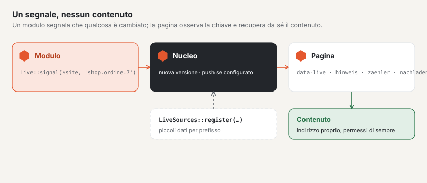

# Aggiornamento in tempo reale nei moduli

I moduli segnalano tramite lo stesso canale del forum che qualcosa è cambiato — e le pagine si aggiornano senza che un
modulo abbia bisogno di JavaScript proprio. Il segnale non trasporta contenuti: la pagina osserva una **chiave** e
recupera le novità tramite il suo indirizzo consueto, con i diritti che lì valgono comunque.



## 1. Inviare un segnale

```php
use Basalto\Core\Live\Live;

app(Live::class)->signal($site->id, 'shop.bestellung.'.$order->id);
```

- Le chiavi sono composte da lettere minuscole, cifre, `-` e `_`, separate da punti (al massimo cinque parti); la prima
  parte è il prefisso del modulo.
- `signal()` attende la conclusione di una transazione in corso — la pagina non recupera mai il contenuto prima che sia
  visibile.
- Se il push è configurato, il segnale va al server WebSocket dopo la risposta; un errore lì non interrompe nulla.
- Le chiavi personali degli account si chiamano `konto.{id}` (account clienti) e `benutzer.{id}` (backend, senza sito).

## 2. Un punto nel markup

`Live::attributes()` fornisce gli attributi per un punto che si aggiorna da sé — emessi alla consegna della pagina,
quindi dopo il Suo controllo dei diritti:

```php
$attributes = app(Live::class)->attributes($site->id, 'shop.bestellungen', 'hinweis');
$html = '<p class="hinweis" hidden'.$attributes.'>Neue Bestellungen — <a href="">Aktualisieren</a></p>';
```

| Azione | Che cosa fa l’isola | Indicazioni aggiuntive |
| --- | --- | --- |
| `hinweis` | mostra l’elemento (nascosto) non appena qualcosa cambia | — |
| `zaehler` | mostra un numero dai dati utili, nascosto a 0 | `feld` |
| `nachladen` | recupera un frammento e lo inserisce al clic | `quelle`, `nach`, `ziel`, `eins`, `mehr` |
| `schreibt` | mostra chi sta scrivendo (dati `schreibt`), senza sé stessi; ogni voce scade dopo i suoi secondi | `ich`, `eins`, `zwei`, `mehr` |

Le indicazioni aggiuntive si passano come quarto argomento (`['feld' => 'offen']` diventa `data-live-feld="offen"`).
`nachladen` richiama `quelle?nach=<nach>` e si aspetta JSON `{anzahl, html, url, nach}`: `html` finisce in `ziel`
(selettore CSS); senza `html` il clic porta a `url`; `eins` e `mehr` sono i testi per il numero (`:count`).

Se il markup di una pagina montata contiene un punto del genere, Basalto vi aggiunge da sé il piccolo script
dell’aggiornamento in tempo reale. Nelle altre pagine lo includa con `Islands::attach($html)`.

## 3. Dati utili per prefisso

Chi vuole fornire piccoli dati insieme a una chiave modificata — ad esempio un contatore — registra una sorgente in
`boot()`:

```php
use Basalto\Core\Live\LiveSources;

app(LiveSources::class)->register('shop', static fn (int $siteId, string $key): ?array => [
    'offen' => Order::query()->where('site_id', $siteId)->where('status', 'offen')->count(),
]);
```

L’interrogazione richiama la sorgente solo per le chiavi che sono cambiate. I dati utili li vedono tutti coloro che
osservano la chiave — i dati personali vanno su chiavi personali.

## 4. Isole proprie

Per JavaScript proprio ci sono due eventi su `document`:

| Evento | Quando | `detail` |
| --- | --- | --- |
| `basalto:live` | una versione è cambiata | `{ key, version, data }` |
| `basalto:inhalt` | del markup è stato caricato e inserito | `{ root }` — rilevare le isole al suo interno |

## 5. Presenza: chi scrive, chi modifica

`Presence` tiene una breve lista di chi si trova in un punto in questo momento. Il nucleo la usa per «chi sta
scrivendo» nella community (chiavi `schreibt.…`, classe `Typing`) e per «chi sta modificando» nel backend
(`bearbeitet.…`). `update($siteId, $key, $id, $name, $attivo, $ttl)` registra l’arrivo o l’uscita e invia un segnale;
`current()` restituisce la lista con i secondi rimanenti.

Il Suo campo di risposta ottiene «chi sta scrivendo» con due righe:

```php
$editor = Islands::editor('antwort', 'body', '', $lang, 6, true, ['typing' => Typing::key('shop.'.$id), 'preview' => route('basalto.community.preview', absolute: false)]);
$indicatore = Islands::typingIndicator($site->id, 'shop.'.$id, $lang, $profiloId);
```

Il punto non ha bisogno di una propria fonte: i dati per `schreibt.…` li fornisce il nucleo.

## Buono a sapersi

- L’interrogazione `/_live` funziona senza sessione e legge solo versioni dalla cache; il lavoro oneroso va nella
  sorgente del contenuto, non nel segnale.
- Segnali solo ciò che tutti coloro che osservano la chiave possono vedere (contenuti in attesa solo al momento
  dell’approvazione).
- Configurazione, cadenza e push sono descritti in [Configurare l’aggiornamento in tempo reale](../betrieb/live.md).

## Per continuare

- [Moduli e plugin](erweiterungen.md)
- [Notifiche](benachrichtigungen.md)
- [Configurare l’aggiornamento in tempo reale](../betrieb/live.md)
