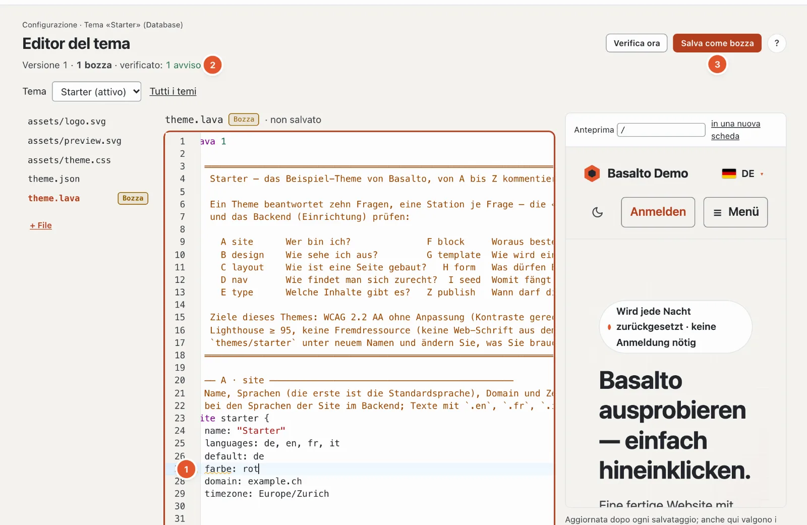

# Language server per Lava

Il language server porta le segnalazioni di `basalto:check` nell’editor — durante la digitazione, anche per file non
salvati — e in più completamento, salto alla definizione e spiegazioni. Esiste due volte con lo stesso nucleo
(`Basalto\Lava\Lsp\LanguageService`): come server LSP per VS Code e PhpStorm e nell’editor Lava del backend.



## `php artisan basalto:lsp`

```text
basalto:lsp [--stdio]
```

Avvia un language server (LSP) tramite input e output standard. `--stdio` è il valore predefinito; VS Code aggiunge
l’opzione da sé. L’output standard appartiene al protocollo, i messaggi PHP vanno su stderr. Il server non scrive mai
un file.

| Metodo LSP | Prestazione |
| --- | --- |
| `textDocument/publishDiagnostics` | Segnalazioni all’apertura e a ogni modifica; viene compilato l’intero tema (la cartella più vicina con `theme.lava`), ogni segnalazione finisce nel suo file |
| `textDocument/completion` | Parole chiave, proprietà, tipi di campo (inclusi i moduli), tipi di parti, nel markup tag, filtri e funzioni, nomi dal tema |
| `textDocument/definition` | Salto a blocchi, parti, layout, template, tipi, navigazioni, form, globali e pagine da `seed` |
| `textDocument/hover` | Spiegazione di parole chiave, tipi di campo, firma di filtri e funzioni, forma dei tag |

Non inclusi: rinomina, formattazione, struttura, aiuto alla firma durante la digitazione. Un tema dal database il
server LSP non lo verifica — per questo ci sono l’editor Lava nel backend (sotto) e `basalto:check --site=<handle>`.

## Integrare VS Code e PhpStorm

Compilare, installare e configurare — estensione per VS Code, impostazioni `lava.phpPath` e `lava.artisanPath`,
bundle TextMate e LSP4IJ per PhpStorm — è descritto in
`tools/vscode-lava/README.md`. In breve:

```sh
cd tools/vscode-lava
npm install && npm run compile && npx @vscode/vsce package
code --install-extension basalto-lava-0.1.0.vsix
```

In PhpStorm LSP4IJ avvia il server con `php $PROJECT_DIR$/artisan basalto:lsp`; i file `*.lava` e
`*.lava.html` vengono associati ai language ID `lava` e `lava-html`.

## Lo stesso servizio nell’editor Lava

L’editor del tema nel backend (Configurazione › Editor del tema, vedere [Temi](themes.md)) usa lo stesso
`LanguageService` tramite HTTP:

```text
POST /admin/einrichtung/lava/sprachdienst      Route basalto.setup.lava.language
```

`admin` è il percorso del backend (`basalto.backend.path`). La richiesta gira nella sessione del backend (accesso
effettuato, token CSRF, permesso `update` sul sito). Si lavora sul tema del sito con tutte le bozze aperte
e il contenuto non salvato dell’editor.

| Campo | Obbligatorio | Significato |
| --- | --- | --- |
| `action` | sì | `diagnostics`, `completions`, `hover` o `definition` |
| `path` | sì | percorso modificabile nel tema, ad es. `theme.lava` o `assets/theme.css` (come nell’editor del tema, vedere [Temi](themes.md)) |
| `lava_source` | sì (può essere vuoto) | contenuto attuale dell’editor, al massimo 512 KB |
| `line` | no | riga a partire da 1 |
| `character` | no | carattere a partire da 0, contato in UTF-16 come nel browser |

| `action` | Risposta |
| --- | --- |
| `diagnostics` | `{"findings": [{file, line, column, character, severity, message}, …]}` |
| `completions` | `{"items": [...]}` |
| `hover` | `{"markdown": "..."}`, senza risultato `{"markdown": null}` |
| `definition` | `{"location": {...}}`, senza risultato `{"location": null}` |

L’editor (CodeMirror 6) richiede le segnalazioni dopo ogni pausa di digitazione, i suggerimenti con Ctrl+Spazio, la
spiegazione al passaggio del mouse e la definizione con F12.

## Per continuare

- [Lava — il linguaggio dei temi](lava.md)
- [Temi](themes.md)
