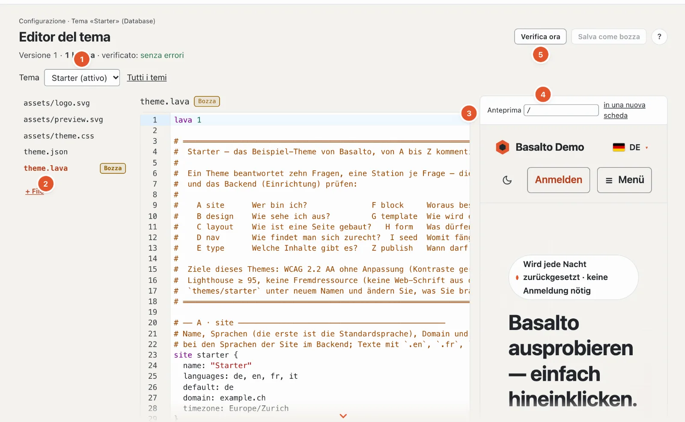

# Temi

Un tema è una cartella con `theme.lava`, `assets/` e facoltativamente `theme.json` — il linguaggio relativo è descritto in
[Lava — il linguaggio dei temi](lava.md). Questa pagina mostra dove si trovano i temi, come si inizia con il tema Starter,
come si usano design token e contenuti iniziali, come si distribuisce un tema come pacchetto e come un sito gestisce il
proprio tema nel database.



## Cartelle dei temi

| Impostazione | Significato |
| --- | --- |
| `BASALTO_THEMES_PATH` (`basalto.themes_path`) | cartella con i temi; vuoto significa `themes/` nel progetto |
| `BASALTO_DEFAULT_THEME` (`basalto.default_theme`) | tema di un sito senza scelta propria, ad esempio `starter` |
| `BASALTO_DEFAULT_SITE` (`basalto.default_site`) | sito per i comandi senza handle, ad es. `basalto:tokens` |

È considerata un tema ogni sottocartella con un `theme.lava`. Quale tema usa un sito si sceglie nel backend sotto
Configurazione › Temi; lì si trovano anche i dati da `theme.json`, l’immagine di anteprima, l’estensione e il banco di
prova di ogni tema e — prima di un cambio — che cosa il sito non mostrerebbe più dopo. Al cambio non viene eliminato nulla.

## Il tema Starter come modello

`themes/starter` è un esempio completamente commentato di tutte e dieci le stazioni: due
lingue (DE, EN), caratteri di sistema, un foglio di stile senza build, nessuno script (tranne il piccolo selettore
chiaro/scuro, inline) e nessuna risorsa esterna, una rappresentazione scura (`color … dark #…`), contrasti calcolati
secondo WCAG 2.2 AA. Porta con sé diciotto blocchi (tra cui form, elenco dei post, ricerca e commenti nonché, per le
pagine iniziali, «Hero con scheda», «Cifre chiave», «Passaggi», «Selezione», «Funzioni» con simboli e «Avvisi»), un blog
con feed Atom, pagine legali e contenuti iniziali. «Immagine con grafica» (`visual`) sovrappone a un’immagine una grafica
trasparente — foto con schema, come mostra la demo; «Hero con scheda» e «Selezione» possono fare lo stesso con `art` e
`art_overlay`.

```sh
cp -R themes/starter themes/mein-theme
php artisan basalto:check --theme=themes/mein-theme
```

Poi adattare in `theme.json` nome, autore e versione e in `site` nome, lingue e dominio.

## Design token

Ogni colore, carattere, spaziatura e il raggio da `design` diventano una variabile CSS (`--color-text`,
`--font-body`, `--space-3`, `--radius`). `` le scrive nell’intestazione di ogni pagina — con la
variante di colori scelta dal sito (`palette`, vedi [Lava](lava.md)) e, sopra, le sovrascritture del sito da
Configurazione › Design.

```text
basalto:tokens [--tailwind] [<site>]
```

| Argomento / opzione | Significato |
| --- | --- |
| `<site>` | handle del sito, altrimenti `BASALTO_DEFAULT_SITE`, altrimenti il primo sito |
| `--tailwind` | come `@theme { … }` per Tailwind 4 invece che come `:root { … }` |

```text
$ php artisan basalto:tokens --tailwind
@theme {
 --color-text: #23262b;
 --color-background: #f6f4f0;
 …
```

Per un tema che costruisce il proprio CSS con Tailwind: `php artisan basalto:tokens --tailwind > themes/x/assets/tokens.css`.

## Contenuti iniziali: `seed`

La stazione I (`seed`) crea pagine con titolo, slug, template e blocchi per lingua, in più contenuti globali e
contenuti di tipi propri (`post willkommen { … }`, `person redaktion { … }`) — pubblicati, affinché il sito dopo la
prima messa online sia pronto senza lavoro manuale.

```text
basalto:seed <site>
```

L’importazione è **idempotente**: ogni voce porta un UUID fisso derivato da sito e nome del seed. Ciò che esiste già
resta intatto (anche se modificato o eliminato), le lingue mancanti si aggiungono. L’output nomina ogni voce creata e
alla fine «Seed: n angelegt, m schon vorhanden».

Se il seed di un tema è cambiato (nuovi testi, nuovi blocchi), `basalto:seed <site> --auffrischen` porta la modifica
su un sito esistente: le voci che sono ancora esattamente come il seed le ha create (tutte le versioni senza autore)
vengono ricreate; ciò che qualcuno ha modificato o eliminato nel backend resta.

`php artisan basalto:publish <site>` importa anche il seed, verifica il sito e lo mette online; `--ohne-seed`
tralascia il seed, `--dry-run` si limita a verificare.

Se il sito ha un Lava proprio (editor Lava, livello «Sito»), può portare un `seed` proprio. Ciò che ha lo stesso nome
sostituisce quello del tema al suo posto — `page home { … }` nel Lava del sito è la nuova pagina iniziale, `global footer
{ … }` il nuovo piè di pagina. Così fa la demo con il tema Starter.

## Pacchetti di temi

Un pacchetto è uno ZIP per la distribuzione e il Marketplace: tutti i file della cartella del tema sotto `<name>/`, in più
`manifest.json` e — con chiave — `signature`.

```text
basalto:theme-pack <name> [--output=ORDNER] [--key=SCHLUESSEL]
basalto:theme-verify <zip> [--public-key=SCHLUESSEL]
```

| Comando · opzione | Significato |
| --- | --- |
| `theme-pack <name>` | cartella sotto `themes/`; scrive `<name>-<version>.zip` (versione da `theme.json`, altrimenti `0.0.0`) |
| `--output=` | cartella di destinazione, predefinita `storage/app/themes` |
| `--key=` | chiave Ed25519 segreta, Base64 o percorso di un file con Base64 |
| `theme-verify <zip>` | verifica ogni file rispetto al manifest |
| `--public-key=` | chiave Ed25519 pubblica, Base64 o file — solo così la firma viene verificata |

Il manifest (formato 1):

```json
{
    "format": 1,
    "name": "starter",
    "version": "1.0.0",
    "files": {
        "assets/theme.css": "7430…1dd5",
        "theme.lava": "c858…1a8e"
    }
}
```

`files` contiene per ogni file il checksum SHA-256; i file il cui nome inizia con `.` mancano nel pacchetto. La firma è
Ed25519 su `manifest.json`, codificata in Base64. `theme-verify` segnala un errore se un file è modificato, manca nel
pacchetto o non figura nel manifest, se manca `theme.lava` e — con `--public-key` — se la firma manca o non
corrisponde. Senza `--public-key` «signiert» indica soltanto che è allegata una firma.

```text
$ php artisan basalto:theme-pack starter --output=/tmp/pakete --key=/tmp/secret.key
/tmp/pakete/starter-1.0.0.zip · 5 Dateien · signiert
$ php artisan basalto:theme-verify /tmp/pakete/starter-1.0.0.zip --public-key=/tmp/public.key
Paket in Ordnung: starter 1.0.0 · 5 Dateien · signiert
```

Una coppia di chiavi la genera libsodium, ad esempio:

```sh
php -r '$k = sodium_crypto_sign_keypair();
  file_put_contents("secret.key", base64_encode(sodium_crypto_sign_secretkey($k)));
  file_put_contents("public.key", base64_encode(sodium_crypto_sign_publickey($k)));'
```

`theme-pack` non verifica il Lava — eseguire prima `basalto:check`.

## La libreria dei temi del sito e l’editor Lava

Accanto ai temi forniti nella cartella `themes/` (valgono per tutti i siti dell’installazione, nel backend in sola
lettura) ogni sito ha una propria **libreria dei temi** nel database: un numero qualsiasi di temi propri, ciascuno con
file di testo, immagini e caratteri, bozze e versioni. Così si possono aggiungere, modificare e rimuovere temi anche
dove il disco è volatile (Laravel Cloud) o la cartella appartiene a tutti i clienti (SaaS).

| Parte | Archiviazione |
| --- | --- |
| Voce | `site_themes` (nome, denominazione, provenienza `ordner` · `kopie` · `paket` · `marktplatz`, firma) |
| File di testo | `lava_sources` con `scope = theme:<id>` |
| Immagini e caratteri | disco standard sotto `theme-assets/<site>/<theme>/…`; percorsi con checksum in `site_themes.assets`, affinché le pagine formino gli indirizzi senza leggere i file |
| Bozze, versioni | `theme_drafts`, `theme_versions` con `site_theme_id` |

Quale tema mostra un sito continua a trovarsi in `sites.theme`. Se un tema proprio ha lo stesso nome di una cartella,
prevale sulla cartella — così agisce «Riprendi nel database»; le immagini e i caratteri che gli mancano provengono
allora dalla cartella.

### Stazione «Temi»

**Configurazione › Temi** (`/admin/einrichtung/themes`) mostra «Temi propri» e «Temi forniti». Cambiare,
aggiungere e rimuovere può chi può modificare il sito.

| Azione | Che cosa succede |
| --- | --- |
| **Aggiungi tema › Carica pacchetto** | ZIP con `manifest.json` (al massimo 20 MB, 800 file, 50 MB estratto). Vengono verificati i checksum e — se presente — la firma con la chiave del prodotto o del Marketplace. Nome dal manifest; se è già assegnato (anche da una cartella), con contatore (`starter-2`) |
| **Crea copia** | da ogni tema (proprio o cartella) con tutti i file, le immagini e i caratteri, con un nuovo nome |
| **Dal Marketplace** | modulo «Marketplace»: un tema arriva firmato come nuovo tema proprio; un’installazione successiva dello stesso tema arriva come bozze (aggiornamento) |
| **Passa a questo tema** | come finora, con resoconto di ciò che il sito poi non mostra più |
| **Anteprima** | l’intero sito con questo tema nella propria sessione |
| **Scarica come pacchetto** | tema proprio con immagini, tema da cartella così com’è (non firmato) |
| **Rimuovi** | tema proprio con file, immagini, bozze e versioni — non quello attivo, a meno che subentri una cartella con lo stesso nome |
| **Nascondi** | togliere un tema fornito dall’elenco di questo sito (`sites.settings.themes.hidden`); non quello attivo |

Nel registro: `theme.add`, `theme.copy`, `theme.remove`, `theme.hide`, `theme.show`, `theme.asset`, `site.theme`.

### Editor del tema

**Configurazione › Editor del tema** (`/admin/einrichtung/theme-editor`) modifica ogni tema proprio — quello attivo o,
con `?theme=<name>`, uno che il sito non mostra ancora (scelta in alto). File a sinistra, codice al centro, anteprima
a destra.

| Passaggio | Che cosa succede |
| --- | --- |
| **Riprendi nel database** | se il sito mostra un tema da cartella: crea un tema proprio con lo stesso nome con i file di testo; la versione 1 fissa lo stato di partenza |
| **Modifica** | ogni modifica è una bozza per file (l’eliminazione di un file è una bozza senza contenuto). Sono modificabili i percorsi su `.lava`, `.html`, `.json`, `.css`, `.js`, `.svg`, `.txt`, `.md`, al massimo 512 KB, UTF-8; `theme.lava` non si può eliminare |
| **Verifica prima del salvataggio** | una bozza viene salvata solo se l’intero tema con essa compila senza errori — altrimenti risposta 422 con le segnalazioni sul testo. Gli avvisi vengono riportati, ma non bloccano |
| **Conflitto** | chi salva con uno stato obsoleto (il checksum `base` non corrisponde) riceve 409 invece di sovrascrivere in silenzio |
| **Anteprima** | ogni pagina del sito con le bozze (anche di un tema non attivo), renderizzata nel backend (`vorschau-seite?pfad=/…`); oppure l’intero sito con le bozze nella propria sessione — il sito stesso resta invariato |
| **Invia per approvazione**, **Pubblica** | come finora, con principio dei quattro occhi (`four_eyes`); ogni pubblicazione è una versione del tema. Le immagini vengono ritagliate di nuovo solo se cambiano le varianti d’immagine del tema attivo |
| **Versioni**, **Scarta** | le ultime 50 versioni per tema; una precedente torna come bozze |
| **Immagini e caratteri** | caricare (`woff2`, `woff`, `png`, `jpg`, `jpeg`, `webp`, `avif`, `ico`, al massimo 5 MB per file, 40 MB in totale) in una cartella sotto `assets/`, eliminare — vale subito, senza bozza |
| **Esporta**, **Importa** | pacchetto del tema con immagini; un’importazione arriva come bozze (testo) e subito (immagini) |
| **Torna alla cartella** | solo per un tema proprio con il nome di una cartella: il sito mostra di nuovo la cartella, il tema proprio resta nella libreria come `<name>-eigen` con bozze e versioni |

L’editor di codice è CodeMirror 6 con evidenziazione di Lava e lo stesso language server di VS Code — segnalazioni dopo
ogni pausa, suggerimenti con Ctrl+Spazio, spiegazione al passaggio del mouse, F12 per la definizione (vedere
[Language server per Lava](sprachdienst.md)).

> Ancora in sospeso: le bozze CSS compaiono nell’anteprima solo dopo la pubblicazione, perché gli asset del tema
> leggono la versione online.

### Verificare un tema del database

```sh
php artisan basalto:check --site=<handle>
```

verifica il tema che il sito usa davvero (riga d’intestazione «(Datenbank)» o «(Dateien)»).

## `basalto:lava-import`

```text
basalto:lava-import <site> [--theme=THEME] [--scope=theme|site]
```

Copia un tema da file senza backend come record in `lava_sources` — ad esempio quando si configura un sito su un
server senza disco scrivibile. Con `--scope=theme` i file finiscono nella libreria dei temi del sito, nel tema proprio
con il nome del loro tema (se manca, viene creato).

| Argomento / opzione | Significato |
| --- | --- |
| `<site>` | handle del sito |
| `--theme=` | directory del tema relativa all’installazione, ad esempio `themes/starter` — da indicare sempre |
| `--scope=` | `theme` (predefinito): il tema del sito · `site`: integrazioni proprie del sito, che vengono incluse sotto `site/…` alla fine di `theme.lava` (ad es. tipi di contenuto propri dal backend) |

I record esistenti con lo stesso percorso vengono sovrascritti; i file non UTF-8 vengono saltati. A differenza di
«Riprendi nel database» nell’editor, il comando non crea **alcuna versione**.

## Per continuare

- [Lava — il linguaggio dei temi](lava.md)
- [Aspetto: temi, design e varianti d’immagine](../einrichtung/aussehen.md)
- [Marketplace per autrici e autori](../marktplatz/autoren.md)
