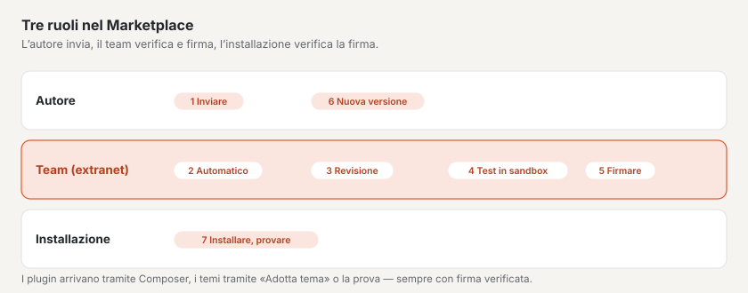

# Marketplace per autrici e autori

Nel Marketplace su basaltocms.com offre temi e plugin per Basalto. Ogni invio viene verificato automaticamente,
esaminato a mano e, all’approvazione, firmato da basaltocms.com — solo allora compare nel catalogo. Una
voce è gratuita o costa una tantum per installazione; vendere è possibile non appena basaltocms.com attiva la parte
a pagamento e il suo account Stripe è collegato ([Vendere](#vendere)).



> **Condizioni:** chi invia accetta le condizioni per gli autori
> ([Condizioni per gli autori del Marketplace](../recht/de/autoren-bedingungen.md), nel prodotto sotto `/_recht/<sprache>/autoren-bedingungen`).
> Sono una bozza, la verifica legale è in sospeso. Data e versione dell’accettazione sono riportate per ogni versione.

## Account autore

1. Nella pagina **«Account autore»** su basaltocms.com inserire l’e-mail. Non c’è alcuna password: riceve un
   codice via e-mail; la prima volta nasce così il suo account cliente (lo stesso dell’acquisto di licenze).
2. **«Crea profilo autore»:** «Nome come autore» (persona, ditta o studio — così compare nel catalogo), località, sito web.
3. Dopo compaiono **«Nuovo invio»**, **«I Suoi invii»** con stato e rapporto di verifica e il
   **«Token Composer»**. Se il Marketplace a pagamento è attivato, tre schede ordinano l’account: **Voci** (quanto
   appena nominato), **Vendite** e **Versamento**.

Le voci altrui non le vede nell’account autore, e un nome di pacchetto appartiene all’autore che lo ha inviato per primo.

## Formati dei pacchetti

Un invio è uno ZIP. Se si tratta di un tema o di un plugin, il Marketplace lo riconosce dal contenuto.

### Tema

Un pacchetto di tema nel formato di `basalto:theme-pack` ([Temi](../entwickler/themes.md#pacchetti-di-temi)): i file della
cartella del tema e `manifest.json` con il checksum SHA-256 di ogni file.

```sh
php artisan basalto:check --theme=themes/mein-theme   # verificare prima il Lava
php artisan basalto:theme-pack mein-theme              # → storage/app/themes/mein-theme-1.0.0.zip
```

- **Nome:** il nome della cartella — minuscole, cifre e trattino, al massimo 64 caratteri.
- **Versione** da `theme.json` (`version`), come numero di versione tipo `1.2.0`; senza indicazione `theme-pack` impacchetta `0.0.0`.
- **Dati** da `theme.json`: `label` (titolo nel catalogo), `description`, `license`, `preview` (percorso di
  un’immagine di anteprima nel pacchetto: SVG, PNG, JPG o WebP, al massimo 1 MB).
- **Obbligatorio:** `category` — una tra `firma`, `portfolio`, `gastro`, `verein`, `magazin`, `onepager`,
  `shop` — e almeno un’immagine: `screenshots` (elenco di percorsi nel pacchetto, 1–6 immagini, PNG, JPEG o WebP, ciascuna
  al massimo 1 MB) o `preview`.
- **Facoltativo:** `homepage`, `docs`, `support` (indirizzi https). Un `seed` con contenuti iniziali mostra il tema nella
  sandbox e nella vetrina con contenuto anziché vuoto.

```json
{
    "label": "Fjord",
    "description": "Ruhig und klar, mit Dunkelmodus.",
    "version": "1.0.0",
    "license": "MIT",
    "category": "firma",
    "preview": "assets/preview.svg",
    "screenshots": ["assets/screens/start.webp", "assets/screens/kontakt.webp"],
    "docs": "https://example.ch/fjord"
}
```
- **Niente PHP:** i file con `.php`, `.phtml` o `.phar` la verifica li rifiuta — i temi sono dati.
- Una firma propria non è necessaria; basaltocms.com firma di nuovo all’approvazione.

### Plugin

Un pacchetto Composer come ZIP: `composer.json` alla radice o nell’unica cartella della radice (come un archivio che un servizio di hosting del codice fornisce come ZIP).
Struttura e interfaccia come per i moduli ([Moduli e plugin](../entwickler/erweiterungen.md)).

```json
{
    "name": "hersteller/karten",
    "version": "1.0.0",
    "type": "basalto-plugin",
    "license": "MIT",
    "description": "Karten als Lava-Tag",
    "require": { "php": "^8.4", "basalto/core": "*" },
    "autoload": { "psr-4": { "Hersteller\\Karten\\": "src/" } },
    "extra": {
        "laravel": { "providers": ["Hersteller\\Karten\\KartenServiceProvider"] },
        "basalto": {
            "module": "karten", "name": "Karten", "api": 1,
            "category": "inhalte",
            "icon": "assets/icon.svg",
            "screenshots": ["assets/screens/block.png"],
            "adds": { "blocks": ["Karte"], "forms": [], "types": [], "pages": [], "settings": ["Kartenanbieter"] }
        }
    }
}
```

| Campo | Regola |
| --- | --- |
| `name` | nome Composer valido `hersteller/paket`, in minuscolo |
| `version` | obbligatorio — il Marketplace legge la versione da qui (`1.2.0`, `v` davanti consentito) |
| `type` | `library`, `basalto-plugin` o `basalto-module` |
| `extra.basalto` | `module` (handle: a–z, 0–9, `-` e `_`, con una lettera all’inizio, al massimo 40 caratteri), `name` (nome visualizzato), `api` = `1` |
| `extra.laravel.providers` | almeno un service provider |
| `autoload.psr-4` | altrimenti indicazione: le classi non sono caricabili |
| `license` | se differisce dalla licenza scelta all’invio, c’è un’indicazione |
| `extra.basalto.category` | obbligatorio: `inhalte`, `formulare`, `shop`, `marketing`, `medien`, `mitglieder`, `anbindung` o `entwicklung` |
| `extra.basalto.icon` | SVG, PNG o WebP nel pacchetto, al massimo 256 KB — altrimenti indicazione, il catalogo mostra l’iniziale |
| `extra.basalto.screenshots` | 1–6 immagini nel pacchetto (PNG, JPEG, WebP, ciascuna al massimo 1 MB) — altrimenti indicazione |
| `extra.basalto.adds` | che cosa aggiunge il plugin al sito: `blocks`, `types`, `forms`, `pages`, `settings` (ciascuno un elenco di nomi) — il catalogo lo mostra secondo le stazioni del percorso di configurazione; altrimenti indicazione |
| `homepage`, `support.docs`, `support.issues` | indirizzi https verso sito web, documentazione e supporto |

## Che cosa controlla la verifica automatica

Al caricamento il Marketplace verifica subito il pacchetto e se nome e versione sono riconoscibili; gli errori
compaiono presso il campo. La verifica completa gira poi nella coda e termina nel **rapporto di verifica** con sette
passaggi. Nel farlo non viene eseguito nulla del pacchetto.

| Passaggio | Verificato | Rifiuto in caso di |
| --- | --- | --- |
| **Pacchetto** | ZIP leggibile, dimensione, percorsi | oltre 10 MB compresso o 50 MB estratto, oltre 2000 file; **ZIP slip** (percorsi con `..`, percorsi assoluti, lettere di unità, backslash); link simbolici |
| **Manifest** | Tema: manifest e checksum, compilatore Lava; plugin: `composer.json`, `php -l` di ogni file PHP, elenco dei divieti | manifest mancante o non corrispondente, errori del compilatore, errori di sintassi, chiamate vietate, campi non validi |
| **Test** | Temi: il compilatore invece dei test; plugin: se sono allegati test | — (i test inclusi non vengono mai eseguiti; la revisione li legge) |
| **Banco di prova** | Temi: contrasti secondo WCAG 2.2 AA (chiaro e scuro), modalità scura, risorse esterne (`src`, `<link href>`, `url()`, `@import` verso server esterni), peso degli asset, contenuti iniziali; plugin: PHPStan (livello 5, statico), accessi in scrittura, test | — (solo indicazioni; gli indicatori compaiono come marchi nel catalogo) |
| **Sandbox** | installiamo l’invio in un’installazione usa e getta con contenuti di esempio e lo proviamo | ciò che lì non funziona, con nota |
| **Firma** | aperta fino all’approvazione | — |
| **Revisione** | a mano | motivo del rifiuto |

**Elenco dei divieti** (tramite il tokenizer PHP; commenti e testi non contano): `exec`, `shell_exec`, `system`,
`passthru`, `proc_open`, `popen`, `pcntl_exec`, `pcntl_fork`, `dl`, `create_function`, `eval` e
l’operatore backtick portano al rifiuto. Scrivere aggirando Flysystem (`file_put_contents`, `fopen`, `fwrite`,
`unlink`, `rename`, `copy`, `mkdir`, `chmod`, `symlink` e altri) produce un’**indicazione** — sono consentiti solo i
dischi di storage.

**Le indicazioni** non portano al rifiuto, ma la revisione le vede: avvisi del compilatore Lava, una linea rossa
incompleta, test mancanti, `autoload.psr-4` mancante.

## Inviare

**«Nuovo invio»** nell’account autore:

| Campo | |
| --- | --- |
| «Pacchetto (ZIP)» | obbligatorio, al massimo 10 MB |
| «Licenza» | obbligatorio, per voce: MIT, GPL-3.0-or-later, LGPL-3.0-or-later, Apache-2.0, BSD-3-Clause o la Licenza Basalto Marketplace |
| «Prezzo per installazione» e «Valuta» | solo con Marketplace a pagamento attivato e account Stripe collegato; vuoto = gratuito ([Vendere](#vendere)) |
| «Breve descrizione» | una riga per la scheda nel catalogo; vuoto = dal pacchetto |
| «Descrizione» | testo semplice; le righe vuote separano i paragrafi |
| «Novità» | modifiche di questa versione |
| Accettazione | «Accetto le condizioni per autori.» — senza di essa il Marketplace non accetta nulla |

Per indirizzo IP il Marketplace accetta al massimo 30 invii all’ora.

## Revisione e rifiuto

| Stato | Significato |
| --- | --- |
| **in verifica** | la verifica automatica è in corso |
| **in revisione** | verifica superata, segue la revisione (di regola da due a tre giorni lavorativi) |
| **pubblicato** | approvato, firmato, nel catalogo e nel repository Composer |
| **rifiutato** | automaticamente (i punti contrassegnati nel rapporto di verifica) o nella revisione con motivazione |

Dopo la verifica automatica testiamo l’invio in una **sandbox** — un’installazione propria solo per
questo test, con i contenuti iniziali del tema o con il tema Starter. Poi viene eliminata. Solo un test in sandbox
superato consente l’approvazione; in caso di «non superato» la nostra nota compare nel motivo del rifiuto.

Nel catalogo ogni voce porta il suo **banco di prova**: gli indicatori della verifica automatica e «Testato in sandbox il …».
I temi approvati ricevono una **vetrina** — un sito con i loro contenuti iniziali, che i visitatori provano dal vivo.

Per ogni decisione riceve un’e-mail nella sua lingua. All’approvazione titolo, testi, licenza e immagine di anteprima
della versione passano alla voce. Dopo un rifiuto, correggere i punti e caricare di nuovo con **«Invia di nuovo»**
nella stessa voce.

## Valutazioni

Acquirenti e utenti valutano le voci con 1–5 stelle e un testo; la media compare sulla scheda nel catalogo
(«★ 4.6 (12)») e consente di ordinare per «Valutazione». Le proprie voci non si possono valutare. Per ogni nuova
valutazione riceve un’e-mail. Con l’accesso all’account cliente, nella pagina della voce sotto ogni valutazione compare
**«Rispondi pubblicamente»** — salvata vuota, la risposta viene rimossa. Le valutazioni inappropriate (pubblicità,
insulti, dati personali) le nasconde il team di basaltocms.com con motivazione; non contano allora nella media.

## Versioni

- Ogni invio è una versione di una voce. Per una nuova versione scegliere **«Invia di nuovo»** nella voce —
  il pacchetto deve portare lo stesso nome.
- Un numero di versione che è già in verifica, in revisione o pubblicato non si può inviare una seconda
  volta — aumentare il numero. Un numero rifiutato può riutilizzarlo.
- Il catalogo mostra la versione pubblicata più alta; Composer riceve tutte le versioni pubblicate.

## Token Composer

Sotto **«Token Composer»** creare un token con **«Genera token»**; l’utente è l’e-mail dell’account, la password il
token. Un nuovo token rende non valido quello vecchio. Il token serve a tutti coloro che installano plugin dal
Marketplace — anche senza voci proprie ([Marketplace per installazioni](installieren.md)). Con il suo token riceve
anche le sue versioni a pagamento, senza acquistarle.

## Vendere

Le voci a pagamento esistono non appena basaltocms.com attiva il Marketplace a pagamento (le condizioni per gli autori
lo annunciano 30 giorni prima). Fino ad allora il campo «Prezzo» manca nell’invio.

### Collegare Stripe Connect

Il versamento avviene tramite **Stripe Connect** con un **account Express**: Stripe verifica la sua identità, registra
il suo conto bancario e versa direttamente la sua quota. basaltocms.com non vede né dati bancari né dati del documento
d’identità.

1. Nell’account autore, scheda **«Versamento»** → **«Collega con Stripe»**. basaltocms.com crea l’account e la invia
   all’onboarding di Stripe.
2. Compilare i dati presso Stripe. Poi torna all’account autore; se il link è scaduto, basaltocms.com
   ne genera uno nuovo.
3. Lo stato lo mantiene aggiornato Stripe (evento `account.updated`):

| Stato | Significato |
| --- | --- |
| **non collegato** | ancora nessun account Stripe |
| **dati mancanti** | onboarding non completato, oppure Stripe richiede altri dati — **«Completa i dati presso Stripe»** |
| **collegato ✓** | dati inviati, Stripe sta ancora verificando; può inviare versioni a pagamento |
| **versamenti attivi ✓** | Stripe versa secondo il suo calendario dei versamenti |

Con **«Apri la dashboard Stripe»** vede presso Stripe versamenti, conto bancario e dati fiscali.

### Prezzo

Nell’invio indicare **«Prezzo per installazione»** (ad es. `59` o `59.50`; vuoto = gratuito) e **«Valuta»** (CHF,
EUR o USD) — tra 5 e 5000.

- Una voce a pagamento è sempre sotto la **Licenza Basalto Marketplace**; la licenza la cambia il Marketplace stesso.
- Il prezzo vale con l’**approvazione** della versione, come testi e licenza — un nuovo prezzo richiede quindi una nuova
  versione. Chi ha già ottenuto la voce gratuitamente conserva le versioni gratuite.
- Un acquisto vale **una tantum per installazione** e porta **un anno di aggiornamenti**: tutte le versioni che escono
  fino a un anno dopo l’acquisto. Dopo, l’acquirente riceve le nuove versioni solo con un nuovo acquisto.
- La voce si può acquistare solo finché Stripe consente bonifici sul suo account — altrimenti presso la voce compare
  «Al momento non acquistabile».

### Commissione

basaltocms.com trattiene il **10 per cento del prezzo IVA esclusa**; le voci gratuite sono senza commissione. Esempio
senza IVA: prezzo CHF 59.00 → commissione CHF 5.90 → **CHF 53.10 per Lei**. Se basaltocms.com è assoggettata all’IVA,
la commissione vale sull’importo netto, e l’IVA resta a basaltocms.com. basaltocms.com annuncia una commissione
diversa a tutti gli autori via e-mail almeno 30 giorni prima; finché non vale, è indicata nella scheda «Vendite». Il
venditore è Lei: la ricevuta La indica, basaltocms.com fa da intermediario.

Tecnicamente ogni acquisto è una **destination charge**: Stripe addebita l’acquirente sull’account di basaltocms.com,
trattiene lì commissione (e IVA) come `application_fee_amount` e trasferisce il resto sul suo account Express. Le
commissioni di Stripe le sostiene basaltocms.com, non riducono la sua quota. In caso di rimborso completo Stripe
storna la sua quota, e l’acquirente perde l’accesso.

### Vendite e versamento

- Scheda **«Vendite»:** somma per mese (in base al mese del pagamento, per valuta) con fatturato, commissione e
  importo del versamento, sotto le ultime vendite. Dati sugli acquirenti non ne vede.
- Scheda **«Versamento»:** stato di Stripe Connect, il mese in corso («CHF 1'550 vendite · commissione 10 % ·
  CHF 1'395»), il **prossimo versamento** e gli ultimi versamenti. Data e importo di un versamento li stabilisce Stripe
  (calendario dei versamenti, periodo di attesa); basaltocms.com li mostra non appena Stripe li pianifica
  (`payout.created`). Fino ad allora compare la quota in sospeso dai suoi acquisti — come stima.

## Per continuare

- [Marketplace](README.md)
- [Temi](../entwickler/themes.md)
- [Moduli e plugin](../entwickler/erweiterungen.md)
