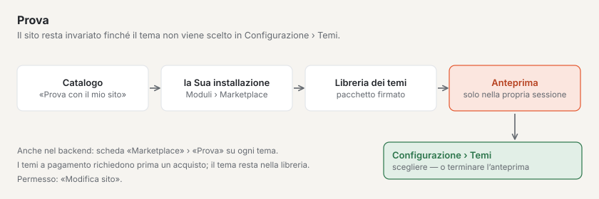

# Marketplace per installazioni

Ogni installazione di Basalto vede nel backend il catalogo del Marketplace di basaltocms.com. I plugin arrivano
nell’installazione tramite Composer, i temi come pacchetto firmato tramite «Adotta tema» — un caricamento ZIP per il
codice non esiste. Le voci a pagamento le acquista prima su basaltocms.com ([Acquistare](#acquistare)).

## Amministrazione › Moduli

**Amministrazione › Moduli** (`/admin/module`) — solo per proprietari e amministrazione del sito. Due schede:

| Scheda | Contenuto |
| --- | --- |
| **Moduli** | moduli e plugin installati, il loro stato su questo sito («attivo su questo sito» o «disattivo …») e ciò di cui hanno bisogno; «Al sito» porta all’interruttore |
| **Marketplace** | catalogo di basaltocms.com con filtro temi/plugin e ricerca; «Installa» apre la finestra di installazione |

L’attivazione non avviene qui, ma per sito sotto **Amministrazione › Siti › Modifica sito › scheda «Moduli»**.

Una **scheda** nella scheda «Marketplace» mostra nome, autrice, prezzo («gratuito» o ad es. «CHF 59»), stelle con il
numero di valutazioni, installazioni e il **banco di prova**: indicatori della verifica automatica come marchi — ✓
soddisfatto, ✗ non soddisfatto, ○ nessuna indicazione (temi ad es. contrasti secondo WCAG 2.2 AA, modalità scura, senza
risorse esterne; plugin ad es. PHPStan, salva solo tramite storage, con test) e «Testato in sandbox il …». Solo i temi
hanno **«Prova»**.

Il catalogo il nucleo lo legge senza token tramite `GET <BASALTO_MARKETPLACE_URL>/marketplace/api/entries` e lo tiene
dieci minuti in cache; **«Ricarica»** lo recupera subito. Se basaltocms.com non è raggiungibile, la scheda mostra
«Marketplace non raggiungibile» e riprova dopo un minuto — il resto del backend non lo attende. Il nucleo riprende dalla
risposta solo i campi noti e costruisce ogni indirizzo da sé a partire da `BASALTO_MARKETPLACE_URL`.

## Acquistare

Le voci a pagamento portano nel catalogo il prezzo («CHF 59») invece di «gratuito». L’acquisto avviene su basaltocms.com
nell’account cliente — lo stesso account usato per le licenze e il token Composer.

1. Nella pagina della voce **«Acquista CHF 59»**. Senza accesso si passa prima all’**account cliente** (codice via
   e-mail, nessuna password); lì **«Continua con l’acquisto»** riporta alla voce.
2. Con l’accesso effettuato compilare **«Per quale installazione?»** (dominio o nome — compare sulla ricevuta) e
   acquistare. Il pagamento avviene presso **Stripe Checkout** con i metodi di pagamento che basaltocms.com ha attivato
   presso Stripe.
3. Non appena Stripe conferma il pagamento (di solito dopo pochi secondi), l’acquisto compare nell’account cliente sotto
   **«Acquisti nel Marketplace»**: data, importo, installazione, **Aggiornamenti fino al**, la **ricevuta** in PDF e,
   per i temi, il pacchetto firmato. La ricevuta arriva anche via e-mail, nella lingua dell’acquisto.

Che cosa comprende un acquisto:

- **una tantum per installazione** — per un’altra installazione acquista di nuovo;
- **un anno di aggiornamenti:** tutte le versioni che escono fino a un anno dopo l’acquisto. Dopo, Composer e
  «Adotta tema» non forniscono più versioni più recenti; un nuovo acquisto aggiunge un altro anno. Le versioni che ha
  può continuare a usarle;
- la **Licenza Basalto Marketplace** dell’autore. Restituzione entro 14 giorni secondo le CG — con il rimborso termina
  l’accesso.

Senza acquisto basaltocms.com risponde per una versione a pagamento con **403** (con token) o **401** (senza).

## Installare un plugin

La finestra di installazione mostra i comandi da copiare («Copia i comandi»). Da eseguire nell’installazione:

```sh
composer config repositories.basalto composer https://basaltocms.com/composer
composer config http-basic.basaltocms.com <E-Mail> <Token>
composer require hersteller/karten:^1.0
php artisan migrate
```

- **Token:** l’utente è l’e-mail del suo account cliente su basaltocms.com, la password il token dall’**account
  autore** (accesso tramite codice, anche senza voci proprie; [Token Composer](autoren.md#token-composer)). Senza una
  coppia valida il repository Composer del Marketplace risponde con 401, e Composer chiede le credenziali.
- `composer config http-basic…` scrive il token in `auth.json` nella cartella del progetto. Questo file non va nel
  controllo di versione (`/auth.json` è in `.gitignore`); su Laravel Cloud va depositato come secret `COMPOSER_AUTH`.
- Composer verifica al download il checksum SHA-1 del pacchetto (`dist.shasum`). Il pacchetto contiene inoltre
  manifest e firma del Marketplace (`basalto-manifest.json`, `basalto-signature`).
- Dopo `migrate` il plugin compare sotto **Moduli**; se è attivabile, attivarlo sul sito.
- Una build propria per le pagine del backend (Vue) dei plugin di terze parti è ancora in sospeso
  ([Moduli e plugin](../entwickler/erweiterungen.md#pagine-inertia-con-namespace)).

Gli aggiornamenti arrivano come per ogni pacchetto Composer: `composer update hersteller/karten`, poi `php artisan migrate`.

**I plugin a pagamento** il repository Composer li fornisce solo al token di un acquirente: `packages.json` nomina per
ogni token solo le versioni che può ottenere (gratuite tutte, a pagamento fino alla fine dell’anno di aggiornamenti).
Acquisti quindi con lo stesso account cliente il cui token si trova in `auth.json`.

## Provare un tema



Nella pagina di un tema nel catalogo: **«Prova con il mio sito»** — inserire l’indirizzo del proprio sito Basalto,
poi **«Vai a …»**. Nella propria installazione **Amministrazione › Moduli › Marketplace › Prova** chiede conferma;
**«Prova con il mio sito»** porta il tema (firmato) nella libreria dei temi (vedere [Temi](../entwickler/themes.md))
e mostra con esso il sito nella propria sessione. Il sito resta invariato finché il tema non viene scelto sotto
**Configurazione › Temi**. Nella scheda «Marketplace» c’è lo stesso pulsante **«Prova»** su ogni scheda di tema,
in più il banco di prova di ogni voce.

- Durante il recupero compare «Recupero in corso …». Per i temi a pagamento la prova avverte che prima è necessario un
  acquisto; se il tema non esiste (più), lo dice.
- Dopo, una fascia «Anteprima con il tema …» indica che sta vedendo un’anteprima. Si termina tramite la fascia o sotto
  **Configurazione › Temi**; lì sceglie anche il tema per il sito. Il tema resta nella libreria, anche se
  termina l’anteprima.
- Per provare serve il permesso di modificare il sito.

## Adottare un tema

Per un tema la finestra mostra **«Adotta tema»**. Basalto

1. scarica il pacchetto da `<BASALTO_MARKETPLACE_URL>/marketplace/themes/<name>/<version>.zip` (al massimo 10 MB),
2. confronta il checksum SHA-256 con il catalogo,
3. verifica manifest e **firma della chiave del Marketplace** con la chiave pubblica nel nucleo — senza una firma
   valida non viene ripreso nulla,
4. crea i file come **bozze** nell’editor del tema (**Configurazione › Editor del tema**).

La pubblicazione avviene lì come per ogni modifica del tema, dopo anteprima e approvazione ([Temi](../entwickler/themes.md)).
Fino ad allora resta online il tema precedente.

**I temi a pagamento** Basalto li scarica con l’e-mail e il token del suo account cliente — da `BASALTO_MARKETPLACE_EMAIL` e
`BASALTO_MARKETPLACE_TOKEN` oppure, se mancano, da `auth.json` (`http-basic.<host>`, come per Composer). Le
credenziali vanno solo a `BASALTO_MARKETPLACE_URL`. Se la finestra segnala «Nessun acquisto di questo tema …», manca
l’acquisto con questo account oppure l’anno di aggiornamenti è terminato. Senza un’installazione propria con `.env` (ad
esempio sul SaaS) scarica il pacchetto firmato nell’account cliente.

## Valutare

Nella pagina di una voce, sotto **«Valutazioni»**, compaiono la media con la distribuzione delle stelle e le
valutazioni altrui — con la dicitura **«acquistato»** (voce a pagamento, acquisto comprovato) o **«installato»** (download
tramite Composer o «Adotta tema» con e-mail e token comprovato).

Con l’accesso all’account cliente: scegliere le stelle (1–5), facoltativamente un titolo, poi **«La Sua esperienza»**
(10–2000 caratteri) e **«Pubblica valutazione»**. Le voci a pagamento le valuta solo chi le ha acquistate. Per account
cliente c’è una valutazione per voce; **«Modifica valutazione»** la sostituisce (una risposta dell’autrice viene allora
meno), **«Elimina la mia valutazione»** la rimuove. Sotto la valutazione compare il nome con l’iniziale del cognome
dall’account cliente — mai l’e-mail.

Sotto ogni valutazione altrui compare **«Segnala valutazione»** — anche senza account cliente: scegliere il motivo
(«Pubblicità o spam», «Offensiva o denigratoria», «Contiene dati personali», «Non riguarda questa voce», «Altro»),
facoltativamente un’indicazione, poi **«Invia segnalazione»**. Per persona conta una segnalazione per valutazione; chi
ha valutato non viene a sapere chi ha segnalato. Da tre segnalazioni aperte una valutazione è nascosta provvisoriamente,
finché il team decide.

## Impostazioni

| Variabile | Significato | Predefinito |
| --- | --- | --- |
| `BASALTO_MARKETPLACE_URL` | indirizzo del Marketplace per catalogo, pacchetti di temi e i comandi Composer mostrati | `https://basaltocms.com` |
| `BASALTO_MARKETPLACE_PUBLIC_KEY` | chiave Ed25519 pubblica per la verifica della firma — solo per test o per un Marketplace proprio | vuoto: `Core::MARKETPLACE_PUBLIC_KEY` |
| `BASALTO_MARKETPLACE_EMAIL`, `BASALTO_MARKETPLACE_TOKEN` | e-mail e token dell’account cliente per i temi a pagamento — come secret, mai in un file sotto controllo di versione | vuoto: da `auth.json` |

Per provare contro un sito di prodotto locale impostare `BASALTO_MARKETPLACE_URL=https://basalto.localhost`; l’host
per `http-basic` porta allora con sé una porta, se l’indirizzo ne ha una.

## Per continuare

- [Aspetto: temi, design e varianti d’immagine](../einrichtung/aussehen.md)
- [Aggiornamenti](../verwaltung/updates.md)
- [Marketplace](README.md)
