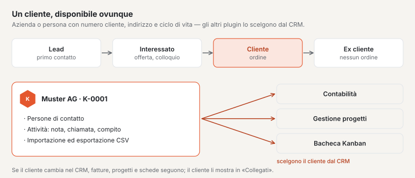
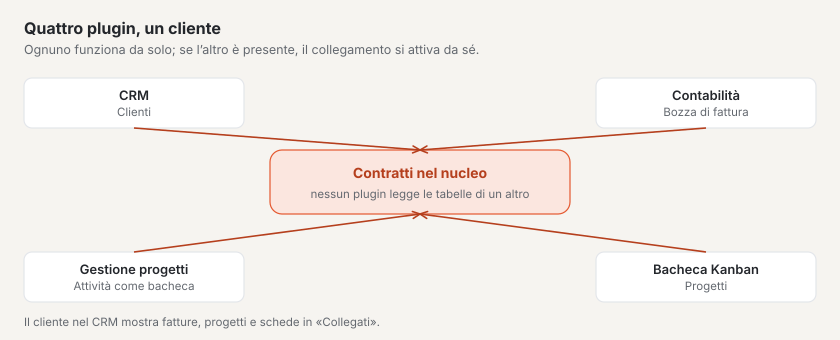

# Plugin «CRM»

Con il «CRM» gestisce i Suoi clienti in un unico posto: aziende e persone con numero cliente, indirizzo, persone di
contatto, attività e la loro fase del ciclo di vita — dal primo contatto all’ex cliente. Se ha anche i plugin
«Contabilità», «Gestione progetti» o «Bacheca Kanban», questi scelgono i clienti direttamente dal CRM. Il plugin è a
pagamento — CHF 99 con un anno di aggiornamenti — e viene da Basalto.

## Installare e attivare

1. Lo acquisti su basaltocms.com — una volta per installazione ([Acquistare](installieren.md#acquistare)).
2. Nel backend in **Amministrazione › Moduli › Marketplace**, clicchi su **«Installa»** per «CRM»
   ([Installare un plugin](installieren.md#installare-un-plugin)).
3. Lo attivi in **Amministrazione › Siti › Modifica sito › scheda «Moduli»**. Di fabbrica è disattivato.

In seguito compare la voce **«CRM»** in **Contenuti**. Il numero accanto indica i compiti aperti in scadenza oggi o
prima.

## Creare un cliente

1. In **CRM**, clicchi su **«Nuovo cliente»**.
2. Scelga il **Tipo**: **Azienda** o **Persona**. Il **Paese** è impostato sulla Svizzera — se il cliente si trova in un
   altro paese, lo scelga prima (elenco con bandiere; digitando si cerca).
3. Per un’azienda digiti la **Ragione sociale**: da tre lettere compaiono sotto proposte dal registro di commercio del
   paese. Ne scelga una e il CRM compila via, NPA, località e IDI. Per una persona inserisca **Nome** e **Cognome** —
   formano poi il nome. Un’azienda non ha questi campi; inserisca i suoi interlocutori in **Persone di contatto**.
4. Appena lascia il campo, il cliente è creato — non c’è un pulsante «Crea». Si apre la pagina del cliente, il cursore
   resta nel campo in cui si trovava e ciò che ha digitato nel frattempo è conservato.
5. Completi il resto: **Ciclo di vita** (vedi sotto), **«Anche fornitore»** se acquista anche da questo cliente, e-mail,
   telefono, indirizzo e, se lo desidera, **Lingua**, **Sito web**, **Responsabile** e **Note**.

Ogni campo si salva da sé: al campo compare brevemente «salvato». Se qualcosa non va, il messaggio appare in rosso al
campo e quel campo resta non salvato finché non è corretto. Il **numero cliente** lo assegna il CRM stesso: «K-0001»,
«K-0002» e così via, senza lacune.

### Aiuti nella compilazione

- **Via e numero:** digiti via e numero civico e il CRM propone indirizzi corrispondenti nel paese. La scelta compila
  NPA e località.
- **Telefono:** davanti al campo c’è la bandiera con il prefisso. Il campo accetta solo cifre, tante quante ne hanno i
  numeri del paese, e le raggruppa come d’uso («79 123 45 67»). La bandiera segue il paese del cliente; se sceglie
  un’altra bandiera nel campo del telefono, cambia anche il paese — finché non è inserito un NPA.
- **Note:** un clic nel campo apre l’editor con tutti gli strumenti (titoli, elenchi, link, tabelle e altro) in una
  finestra. Ciò che scrive è ripreso subito; «Fatto» o Esc chiude la finestra.
- **Da dove vengono le proposte:** aziende dal registro IDI dell’Ufficio federale di statistica (Svizzera), da
  «Recherche d’entreprises» (Francia) e altrimenti da GLEIF (solo aziende con un LEI); indirizzi dall’elenco ufficiale
  degli indirizzi degli edifici tramite swisstopo (Svizzera), dalla Base Adresse Nationale (Francia) e altrimenti da
  OpenStreetMap. Il Suo sito interroga questi servizi tramite il proprio server — il Suo browser non parla direttamente
  con loro. Entrambi si disattivano in **Amministrazione › Impostazioni › Ricerca**. Se non c’è nulla di adatto, resta
  ciò che ha digitato.

| Campo | Che cosa viene verificato |
| --- | --- |
| **Paese** | scelta con bandiera; di fabbrica Svizzera |
| **Telefono** | solo cifre, tante quante ne hanno i numeri del paese; salvato in formato internazionale («+41 79 123 45 67») |
| **NPA** | Svizzera e Liechtenstein: quattro cifre da 1000 a 9658 · Austria: quattro cifre · Germania, Francia, Italia: cinque cifre · altri paesi: fino a 12 caratteri |
| **IDI** | se inizia con «CHE», ha la forma CHE-123.456.789, eventualmente seguita da «IVA» |
| **E-mail** | un indirizzo valido; viene salvato in minuscolo |

## Ciclo di vita

| Fase | Significato |
| --- | --- |
| **Lead** | primo contatto, ancora nessun colloquio |
| **Cliente potenziale** | siete in trattativa o ha inviato un’offerta |
| **Cliente** | c’è un ordine — è il valore di fabbrica |
| **Ex cliente** | al momento nessun ordine |

Cambi la fase sul cliente o per più clienti alla volta: li selezioni nell’elenco e scelga in basso **«Ciclo di vita:
…»**.

**Valori propri:** se manca una fase, la digiti nella scelta **Ciclo di vita** e scelga **«+ Aggiungi «…»»** — lo stesso
per il **tipo** di un’attività. La **funzione** di una persona di contatto propone funzioni usuali per reparto
(direzione, finanze, acquisti …); ne digiti semplicemente un’altra. Gli elenchi si gestiscono in **Amministrazione ›
Elenchi di scelta**.

## Persone di contatto

Per un’azienda registri in **Persone di contatto** le persone con cui ha a che fare: nome, cognome, **Funzione**,
e-mail e telefono (nel paese del cliente). Una di esse è il **Contatto principale** — la prima automaticamente; spunti **«Contatto principale»**
per un’altra per cambiare. Un clic su una persona di contatto la apre per la modifica; lì la si può anche eliminare.

**Buono a sapersi:** con il plugin «Gestione progetti», l’indirizzo e-mail di una persona di contatto apre i progetti di
questo cliente nell’account cliente del sito web.

## Attività e compiti

In **«Registra attività»** annota ciò che è successo con il cliente o che resta da fare:

| Tipo | Per |
| --- | --- |
| **Nota** | ciò che vuole ricordare |
| **Chiamata**, **Riunione**, **E-mail** | colloqui con data ed eventualmente persona di contatto |
| **Attività** (compito) | qualcosa da fare — con **«Scadenza il»** |

La **nota** di un’attività la scrive, come le note del cliente, nell’editor con tutti gli strumenti — un clic nel campo
lo apre. Con **«Registra»** l’attività compare nell’elenco; qui c’è un pulsante perché un’attività è completa solo con
tipo, data e nota.

I compiti aperti sono in cima presso il cliente; passata la data diventano rossi. **«Segna come completato»** conclude un
compito. La cifra chiave **«Compiti scaduti»** sopra l’elenco e il numero accanto alla voce di menu contano tutti i
compiti aperti in scadenza oggi o prima.

## Chiedere una recensione

Le recensioni su Google o su altre piattaforme aiutano i nuovi clienti a scegliere. Il CRM invia la richiesta per Lei —
manualmente, quando è il momento giusto, per esempio dopo un progetto concluso.

1. Una volta, sotto **CRM › «Recensioni»**, inserisca il **link alla recensione**: idealmente una pagina del Suo sito che
   porta al modulo di recensione — oppure direttamente il link del Suo Profilo dell’attività su Google («Chiedi
   recensioni»). Se vuole, scriva lì un **testo proprio**; se resta vuoto, il testo arriva nella lingua del cliente.
2. Nella scheda del cliente faccia clic su **«Chiedere una recensione»**. Come destinatario viene proposto prima il
   contatto principale; può scegliere ogni persona di contatto con un indirizzo e-mail e l’indirizzo del cliente.
   **Oggetto** e **testo** sono precompilati — in tedesco, inglese, francese o italiano secondo il campo **Lingua** del
   cliente — e si possono modificare.
3. **«Invia»** spedisce l’e-mail: saluto, il Suo testo, il pulsante **«Scrivere una recensione»** con il Suo link e il
   Suo nome nei saluti. Nella scheda del cliente compare poi un’attività «Richiesta di recensione» con destinatario e
   testo; riaprendo il modulo vede quando ha chiesto l’ultima volta.

Nel plugin «Gestione progetti», per un progetto concluso con un cliente del CRM, **«Chiedere una recensione al
cliente»** porta direttamente lì.

**Chiedere in modo corretto:** chieda a tutti i clienti allo stesso modo, non solo a quelli soddisfatti, e non offra
nulla in cambio — lo richiedono Google e le altre piattaforme.

## Trovare clienti

L’elenco mostra tutti i clienti non archiviati, per nome. La **ricerca** trova nomi, numeri cliente, località,
indirizzi e-mail, IDI e persone di contatto — accenti, maiuscole e minuscole non contano: «zurich» trova Zürich. Più
parole devono comparire tutte («anna keller»). Inoltre filtra per **Ciclo di vita** e in **Elenco** per **Attivo**,
**Fornitori** o **Archivio**.

## Archiviare invece di eliminare

I clienti non vengono eliminati, ma archiviati — sul cliente con **«Archivia»** o per più clienti nell’elenco. Un cliente
archiviato si può ancora vedere e modificare, ma non compare più in nessuna selezione degli altri plugin; fatture,
progetti e schede lo mantengono. In **Elenco › Archivio** lo recupera con **«Ripristina»**.

## Importazione ed esportazione

In **CRM › Importazione ed esportazione**:

- **«Esporta tutti i clienti»** scarica tutti i clienti non archiviati come file CSV.
- **«Scarica il modello»** fornisce un file con le colonne e una riga d’esempio.
- **«Importa un elenco»** accetta un file CSV.

Il file usa il punto e virgola come separatore ed è salvato in UTF-8 — in Excel come «CSV UTF-8». Le colonne si chiamano
**Numero cliente**, **Tipo**, **Ragione sociale**, **Nome**, **Cognome**, **Ciclo di vita**, **Fornitore**, **E-mail**,
**Telefono**, **Sito web**, **Via e numero**, **NPA**, **Località**, **Paese**, **IDI**, **Lingua** e **Note**; la riga
d’intestazione può essere anche in tedesco, inglese o francese, e non tutte le colonne devono essere presenti.
Nell’importazione vale:

- Una riga con un **numero cliente** o un **indirizzo e-mail noti** modifica quel cliente invece di crearne un doppione.
  Celle vuote e colonne mancanti lasciano i suoi dati come sono.
- Tutte le altre righe diventano nuovi clienti con il numero cliente successivo.
- Una riga con errori — per esempio un NPA sbagliato — viene saltata; il messaggio la indica con il suo numero. Le altre
  righe vengono riprese.

Le note compaiono nell’export come testo senza formattazione, i numeri di telefono nel formato del loro paese.

**Buono a sapersi:** i valori che Excel leggerebbe come formula (per esempio un numero di telefono che inizia con «+»)
ricevono un apostrofo davanti nell’esportazione. Nell’importazione sparisce di nuovo.

## Con gli altri plugin

Appena un cliente è creato, gli altri plugin lo possono scegliere — senza altri passi:

| Plugin | Che cosa fa con il cliente |
| --- | --- |
| **Contabilità** | clienti come debitori per le fatture, fornitori come creditori |
| **Gestione progetti** | progetti per cliente; gli indirizzi e-mail del cliente e delle persone di contatto aprono i progetti nell’account cliente |
| **Bacheca Kanban** | collegare schede ai clienti |

Se modifica nome o indirizzo nel CRM, gli altri plugin riprendono la modifica. Ciò che sanno di un cliente — fatture,
progetti, schede — figura presso di lui in **«Collegati»**.

## Protezione dei dati

- **Informazioni e cancellazione** per indirizzo e-mail le gestisce l’amministrazione sotto «Amministrazione › Utenti»
  (oppure `php artisan basalto:privacy`): l’informazione indica i clienti con questo indirizzo, con attività e persone di
  contatto. La cancellazione rimuove le persone di contatto con questo indirizzo; un cliente che è una persona perde nome,
  indirizzo, telefono, note e attività — il numero cliente resta, affinché fatture e progetti mantengano il loro
  riferimento. Per un’azienda sparisce solo l’indirizzo e-mail.
- L’**esportazione di un sito** non porta con sé i clienti — usi a questo scopo l’esportazione CSV.

## Se qualcosa non funziona

| Segno | Causa | Soluzione |
| --- | --- | --- |
| «Il NPA in Svizzera e nel Liechtenstein ha quattro cifre (1000–9658).» | NPA e paese non corrispondono | inserire il codice ISO corretto in **Paese**, per esempio DE per la Germania |
| «Un’azienda ha bisogno di una ragione sociale.» | tipo «Azienda» senza ragione sociale | inserire la ragione sociale o scegliere il tipo «Persona» |
| Un cliente manca nella selezione della contabilità o di un progetto | è archiviato, oppure il CRM è disattivato per questo sito | ripristinarlo in **Elenco › Archivio** o attivare il CRM in «Moduli» del sito |
| «Il file non ha una riga d’intestazione riconoscibile …» | la prima riga non nomina colonne note | scaricare il modello e riprenderne la riga d’intestazione |
| Gli accenti sono sbagliati dopo l’importazione | il file non è salvato in UTF-8 | scegliere «CSV UTF-8» in Excel |
| Un cliente c’è due volte dopo l’importazione | né il numero cliente né l’indirizzo e-mail corrispondevano | archiviare il doppione; la prossima volta riprendere la colonna **Numero cliente** dall’esportazione |

## Per continuare

- [Marketplace per installazioni](installieren.md)
- [Marketplace](README.md)
- [Plugin «Quote sociali con fattura QR»](plugin-vereinsbeitraege.md)
