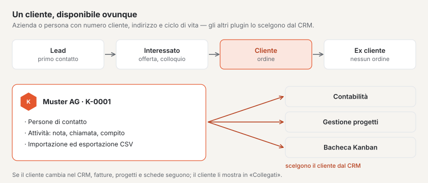
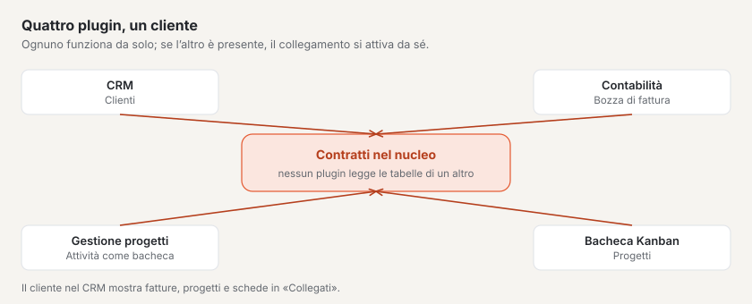

# Plugin «CRM»

Con il «CRM» gestisce i Suoi clienti in un unico posto: aziende e persone con numero cliente, indirizzo, persone di
contatto, attività e la loro fase del ciclo di vita — dal primo contatto all’ex cliente. Se ha anche i plugin
«Contabilità», «Gestione progetti» o «Bacheca Kanban», questi scelgono i clienti direttamente dal CRM. Il plugin è a
pagamento — CHF 99 con un anno di aggiornamenti — e viene da Basalto.

## Installare e attivare

1. Lo acquisti su basaltocms.com — una volta per installazione ([Acquistare](installieren.md#acquistare)).
2. Nel backend in **Amministrazione › Moduli › Marketplace**, clicchi su **«Installa»** per «CRM»
   ([Installare un plugin](installieren.md#installare-un-plugin)).
3. Lo attivi in **Amministrazione › Siti › Modifica sito › scheda «Moduli»**. Di fabbrica è disattivato.

In seguito compare la voce **«CRM»** in **Contenuti**. Il numero accanto indica i compiti aperti in scadenza oggi o
prima.

## Creare un cliente

1. In **CRM**, clicchi su **«Nuovo cliente»**.
2. Scelga il **Tipo**: **Azienda** o **Persona**. Per un’azienda inserisca la **Ragione sociale**, per una persona
   **Nome** e **Cognome** — formano poi il nome.
3. Scelga il **Ciclo di vita** (vedi sotto) e spunti **«Anche fornitore»** se acquista anche da questo cliente.
4. Completi indirizzo, e-mail, telefono e, se lo desidera, **IDI**, **Lingua**, **Sito web**, **Responsabile** e
   **Note**.
5. **«Crea»**.

Il **numero cliente** lo assegna il CRM stesso: «K-0001», «K-0002» e così via, senza lacune. Poi si apre il cliente;
tutto ciò che vi modifica si salva da sé.

| Campo | Che cosa viene verificato |
| --- | --- |
| **Paese** | codice ISO di due lettere, per esempio CH, LI, DE, AT, FR o IT; vuoto significa Svizzera |
| **NPA** | Svizzera e Liechtenstein: quattro cifre da 1000 a 9658 · Austria: quattro cifre · Germania, Francia, Italia: cinque cifre · altri paesi: fino a 12 caratteri |
| **IDI** | se inizia con «CHE», ha la forma CHE-123.456.789, eventualmente seguita da «IVA» |
| **E-mail** | un indirizzo valido; viene salvato in minuscolo |

## Ciclo di vita

| Fase | Significato |
| --- | --- |
| **Lead** | primo contatto, ancora nessun colloquio |
| **Cliente potenziale** | siete in trattativa o ha inviato un’offerta |
| **Cliente** | c’è un ordine — è il valore di fabbrica |
| **Ex cliente** | al momento nessun ordine |

Cambi la fase sul cliente o per più clienti alla volta: li selezioni nell’elenco e scelga in basso **«Ciclo di vita:
…»**.

## Persone di contatto

Per un’azienda registri in **Persone di contatto** le persone con cui ha a che fare: nome, cognome, **Funzione**,
e-mail e telefono. Una di esse è il **Contatto principale** — la prima automaticamente; spunti **«Contatto principale»**
per un’altra per cambiare. Un clic su una persona di contatto la apre per la modifica; lì la si può anche eliminare.

**Buono a sapersi:** con il plugin «Gestione progetti», l’indirizzo e-mail di una persona di contatto apre i progetti di
questo cliente nell’account cliente del sito web.

## Attività e compiti

In **«Registra attività»** annota ciò che è successo con il cliente o che resta da fare:

| Tipo | Per |
| --- | --- |
| **Nota** | ciò che vuole ricordare |
| **Chiamata**, **Riunione**, **E-mail** | colloqui con data ed eventualmente persona di contatto |
| **Attività** (compito) | qualcosa da fare — con **«Scadenza il»** |

I compiti aperti sono in cima presso il cliente; passata la data diventano rossi. **«Segna come completato»** conclude un
compito. La cifra chiave **«Compiti scaduti»** sopra l’elenco e il numero accanto alla voce di menu contano tutti i
compiti aperti in scadenza oggi o prima.

## Trovare clienti

L’elenco mostra tutti i clienti non archiviati, per nome. La **ricerca** trova nomi, numeri cliente, località,
indirizzi e-mail, IDI e persone di contatto — accenti, maiuscole e minuscole non contano: «zurich» trova Zürich. Più
parole devono comparire tutte («anna keller»). Inoltre filtra per **Ciclo di vita** e in **Elenco** per **Attivo**,
**Fornitori** o **Archivio**.

## Archiviare invece di eliminare

I clienti non vengono eliminati, ma archiviati — sul cliente con **«Archivia»** o per più clienti nell’elenco. Un cliente
archiviato si può ancora vedere e modificare, ma non compare più in nessuna selezione degli altri plugin; fatture,
progetti e schede lo mantengono. In **Elenco › Archivio** lo recupera con **«Ripristina»**.

## Importazione ed esportazione

In **CRM › Importazione ed esportazione**:

- **«Esporta tutti i clienti»** scarica tutti i clienti non archiviati come file CSV.
- **«Scarica il modello»** fornisce un file con le colonne e una riga d’esempio.
- **«Importa un elenco»** accetta un file CSV.

Il file usa il punto e virgola come separatore ed è salvato in UTF-8 — in Excel come «CSV UTF-8». Le colonne si chiamano
**Numero cliente**, **Tipo**, **Ragione sociale**, **Nome**, **Cognome**, **Ciclo di vita**, **Fornitore**, **E-mail**,
**Telefono**, **Sito web**, **Via e numero**, **NPA**, **Località**, **Paese**, **IDI**, **Lingua** e **Note**; la riga
d’intestazione può essere anche in tedesco, inglese o francese, e non tutte le colonne devono essere presenti.
Nell’importazione vale:

- Una riga con un **numero cliente** o un **indirizzo e-mail noti** modifica quel cliente invece di crearne un doppione.
  Celle vuote e colonne mancanti lasciano i suoi dati come sono.
- Tutte le altre righe diventano nuovi clienti con il numero cliente successivo.
- Una riga con errori — per esempio un NPA sbagliato — viene saltata; il messaggio la indica con il suo numero. Le altre
  righe vengono riprese.

**Buono a sapersi:** i valori che Excel leggerebbe come formula (per esempio un numero di telefono che inizia con «+»)
ricevono un apostrofo davanti nell’esportazione. Nell’importazione sparisce di nuovo.

## Con gli altri plugin

Appena un cliente è creato, gli altri plugin lo possono scegliere — senza altri passi:

| Plugin | Che cosa fa con il cliente |
| --- | --- |
| **Contabilità** | clienti come debitori per le fatture, fornitori come creditori |
| **Gestione progetti** | progetti per cliente; gli indirizzi e-mail del cliente e delle persone di contatto aprono i progetti nell’account cliente |
| **Bacheca Kanban** | collegare schede ai clienti |

Se modifica nome o indirizzo nel CRM, gli altri plugin riprendono la modifica. Ciò che sanno di un cliente — fatture,
progetti, schede — figura presso di lui in **«Collegati»**.

## Protezione dei dati

- **Informazioni e cancellazione** per indirizzo e-mail le gestisce l’amministrazione sotto «Amministrazione › Utenti»
  (oppure `php artisan basalto:privacy`): l’informazione indica i clienti con questo indirizzo, con attività e persone di
  contatto. La cancellazione rimuove le persone di contatto con questo indirizzo; un cliente che è una persona perde nome,
  indirizzo, telefono, note e attività — il numero cliente resta, affinché fatture e progetti mantengano il loro
  riferimento. Per un’azienda sparisce solo l’indirizzo e-mail.
- L’**esportazione di un sito** non porta con sé i clienti — usi a questo scopo l’esportazione CSV.

## Se qualcosa non funziona

| Segno | Causa | Soluzione |
| --- | --- | --- |
| «Il NPA in Svizzera e nel Liechtenstein ha quattro cifre (1000–9658).» | NPA e paese non corrispondono | inserire il codice ISO corretto in **Paese**, per esempio DE per la Germania |
| «Un’azienda ha bisogno di una ragione sociale.» | tipo «Azienda» senza ragione sociale | inserire la ragione sociale o scegliere il tipo «Persona» |
| Un cliente manca nella selezione della contabilità o di un progetto | è archiviato, oppure il CRM è disattivato per questo sito | ripristinarlo in **Elenco › Archivio** o attivare il CRM in «Moduli» del sito |
| «Il file non ha una riga d’intestazione riconoscibile …» | la prima riga non nomina colonne note | scaricare il modello e riprenderne la riga d’intestazione |
| Gli accenti sono sbagliati dopo l’importazione | il file non è salvato in UTF-8 | scegliere «CSV UTF-8» in Excel |
| Un cliente c’è due volte dopo l’importazione | né il numero cliente né l’indirizzo e-mail corrispondevano | archiviare il doppione; la prossima volta riprendere la colonna **Numero cliente** dall’esportazione |

## Per continuare

- [Marketplace per installazioni](installieren.md)
- [Marketplace](README.md)
- [Plugin «Quote sociali con fattura QR»](plugin-vereinsbeitraege.md)
