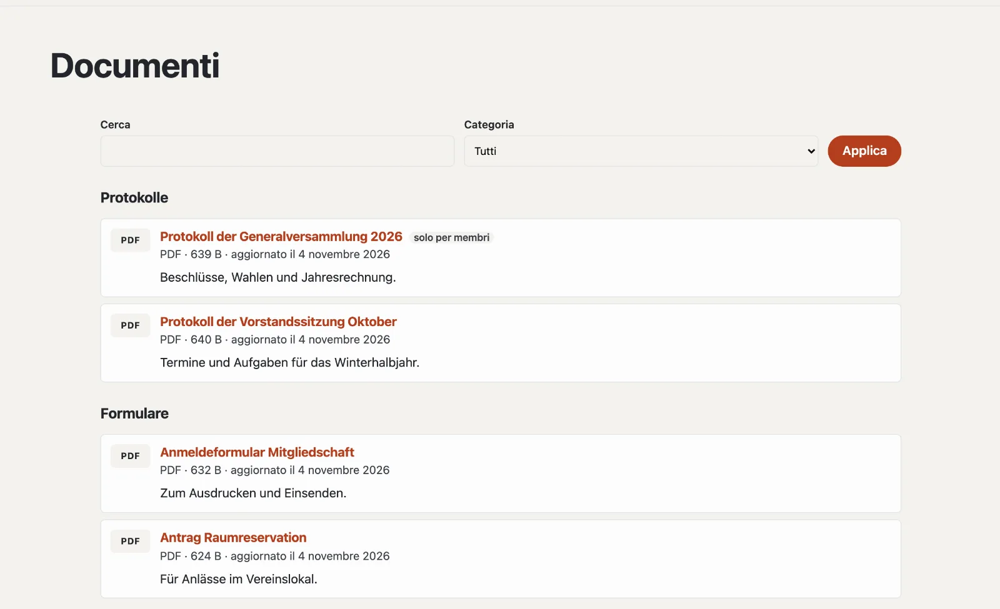

# Plugin «Documenti e download»

Con «Documenti e download» mette a disposizione file da scaricare: verbali, moduli, listini prezzi, statuti. I
visitatori li trovano per categoria su una pagina propria; se carica una nuova versione, il link resta lo stesso. I
documenti «Solo per membri» possono essere scaricati solo da membri che hanno effettuato l’accesso. Il plugin è
gratuito e viene da Basalto.



## Installare e attivare

1. Nel backend in **Amministrazione › Moduli › Marketplace**, clicchi su **«Installa»** per «Documenti e download»
   ([Installare un plugin](installieren.md#installare-un-plugin)).
2. Lo attivi in **Amministrazione › Siti › Modifica sito › scheda «Moduli»** per i siti — di fabbrica è disattivato.

In seguito compare la scheda **«Documenti»** in **Contenuti**.

## Creare la pagina dei documenti

1. **Pagine › Nuovo** (o una pagina esistente), nome per esempio «Download».
2. Scheda **«Esperti»** › **«Montare un modulo»** › **«Documenti»**, salvare.
3. Pubblicare la pagina come di consueto.

La pagina mostra tutti i documenti per categoria, con una ricerca da sei documenti in su. `?kategorie=<id>` mostra una
sola categoria — pratico come link dal menu.

## Caricare un documento

In **Contenuti › Documenti**, **«Carica documento»**: scelga il file, un titolo (vuoto: dal nome del file) e una
categoria. Compare subito sulla pagina dei documenti. Sono ammessi PDF, Word, Excel, PowerPoint, OpenDocument, RTF,
testo, CSV, ZIP e immagini (JPEG, PNG, WebP) fino a 20 MB.

| Nel documento | |
| --- | --- |
| Titolo, descrizione | per lingua del sito |
| Categoria | per i gruppi sulla pagina dei documenti |
| Solo per membri | gli ospiti vedono il documento con un lucchetto e accedono per scaricarlo |
| Mostra sulla pagina dei documenti | senza la spunta il documento è **nascosto** — il suo link allora non funziona |
| Indirizzo sotto la pagina dei documenti | proposto dal titolo |
| **Carica nuova versione** | sostituisce il file, il link resta; le ultime cinque versioni restano in «Versioni precedenti» |

La colonna **«Download»** conta quante volte un file è stato scaricato.

## Categorie

In **Contenuti › Documenti › Categorie** crea categorie con nome, ID (per `?kategorie=` e Lava) e ordine. Senza
categorie tutti i documenti compaiono in un solo elenco. Se elimina una categoria, i suoi documenti restano — senza
categoria.

## Solo per membri

Con il modulo **«Membri»** gli ospiti vedono un documento «Solo per membri» con un lucchetto e accedono per scaricarlo
([Membri](../redaktion/mitglieder.md)). Se il modulo è disattivato, nessuno tranne la redazione può scaricare un tale
documento.

## Documenti su altre pagine

La parte Lava **«Documenti»** mostra i documenti di una categoria su qualsiasi pagina: in **Configurazione › Layout ›
scheda «Parti»**, **«+ Istanza»** (categoria, numero, titolo), oppure nel tema:

```lava

```

## Buono a sapersi

- I download passano dal sito, non da un percorso diretto al file — così accesso e contatore valgono sempre.
- PDF e immagini si aprono nel browser; tutto il resto viene scaricato.
- I file non fanno parte dell’esportazione di un sito; li trasferisca con il backup.

## Per continuare

- [Membri](../redaktion/mitglieder.md)
- [Marketplace per installazioni](installieren.md)
- [Marketplace](README.md)
