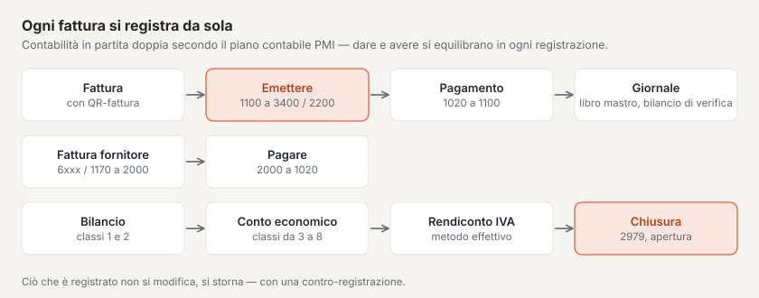

# Plugin «Contabilità»

Con «Contabilità» tiene la contabilità della Sua azienda in Basalto: contabilità in partita doppia secondo il piano
contabile PMI svizzero con giornale, libro mastro e bilancio di verifica, debitori e creditori, fatture con QR-fattura
svizzera, fatture fornitori, pagamenti, bilancio, conto economico, rendiconto IVA secondo il metodo effettivo e chiusura
annuale. Il plugin è a pagamento — CHF 149 con un anno di aggiornamenti — e proviene da Basalto.

## Installare e attivare

1. Lo acquisti su basaltocms.com — una volta per installazione ([Acquistare](installieren.md#acquistare)).
2. Nel backend in **Amministrazione › Moduli › Marketplace**, clicchi su **«Installa»** per «Contabilità»
   ([Installare un plugin](installieren.md#installare-un-plugin)).
3. Lo attivi in **Amministrazione › Siti › Modifica sito › scheda «Moduli»**. Di fabbrica il plugin è disattivato.

In seguito compare la voce **«Contabilità»** in **Contenuti**. Il numero accanto indica le fatture scadute.

## Inserire azienda e conto

In **Contabilità › Impostazioni** si trovano i dati per ogni fattura e per la sezione di pagamento QR. Si salvano da soli.

| Campo | |
| --- | --- |
| **Nome dell’azienda**, **Via**, **Numero civico**, **NPA**, **Località**, **Paese** | mittente della fattura e «Conto / Pagabile a» nella sezione di pagamento; Svizzera o Liechtenstein |
| **IBAN o QR-IBAN** | il conto dell’azienda. Con un QR-IBAN ogni fattura riporta un **riferimento QR**, con un IBAN ordinario una **Creditor Reference (RF)** |
| **ID BESR** | solo se la Sua banca ne ha assegnato uno al QR-IBAN — altrimenti lasciare vuoto |
| **Numero IDI/IVA** | figura su ogni fattura, per esempio «CHE-123.456.789 IVA» |
| **Assoggettato all’IVA** | senza la spunta le nuove posizioni non hanno IVA e la fattura indica «Non assoggettati all’IVA.» |
| **Aliquota IVA delle nuove posizioni**, **Conto ricavi delle nuove posizioni** | valori predefiniti per le posizioni — anche per le fatture trasmesse da altri plugin |
| **Conto per i pagamenti** | il conto bancario su cui vengono registrati i pagamenti (di fabbrica 1020 Banca) |
| **Termine di pagamento (giorni)** | stabilisce «Pagabile entro» quando una fattura non ha una data propria (di fabbrica 30) |
| **Frase sulla fattura** | per esempio un ringraziamento per l’ordine |

## Creare il primo esercizio

Le registrazioni appartengono sempre a un esercizio aperto. In **Contabilità › Esercizi** inserisca **Inizio** e **Fine**
e scelga **«Crea»**. Con il primo esercizio vengono creati:

- il **piano dei conti** con i conti usuali del piano contabile PMI, da 1000 Cassa e 1020 Banca a 1100 Crediti da
  forniture e prestazioni, 2000 Debiti per forniture e prestazioni e 2200 IVA dovuta, fino a 3400 Ricavi da prestazioni
  di servizi, 6000 Costi dei locali e 2979 Utile o perdita d’esercizio;
- le **aliquote IVA** dal 2024: imposta sulla cifra d’affari 8,1 % (UN81), 2,6 % (UR26) e 3,8 % (UB38), imposta
  precedente su materiale e prestazioni (VM81, VM26, VM38, conto 1170) e su investimenti e altri costi d’esercizio
  (VI81, VI26, conto 1171), ognuna con la sua cifra del rendiconto IVA.

In **Piano dei conti** aggiunge conti propri (numero da quattro a sei cifre) e rinomina quelli esistenti. Il **tipo** —
attivi, passivi, ricavi, costi o chiusura — deriva dalla classe e determina se il conto figura nel bilancio o nel conto
economico. Un conto senza la spunta **«Offrire negli elenchi di scelta»** conserva le sue registrazioni ma non compare
più in alcuna selezione. Se un’aliquota cambia, è meglio creare un nuovo codice IVA e rendere inattivo quello vecchio —
gli importi registrati mantengono la loro aliquota.

## Debitori e creditori

**Debitori e creditori** elenca i conti individuali: i **debitori** ricevono le Sue fatture, i **creditori** Le inviano
fatture. La colonna **Partite aperte** mostra ciò che resta aperto; un clic apre il conto individuale con le sue fatture.

- **Senza CRM** crea i conti individuali qui: tipo, nome o azienda, persona di contatto, indirizzo, e-mail e numero
  IDI/IVA. Il numero lo assegna la contabilità («DEB-0001», «KRE-0001»).
- **Con il plugin «CRM»** sceglie direttamente un cliente dal Suo elenco clienti in una fattura. Il conto individuale
  viene creato al primo utilizzo; nome e indirizzo li gestisce nel CRM e la contabilità segue ogni modifica. Per le
  fatture fornitori può scegliere i clienti contrassegnati come **«Fornitore»** nel CRM. Un conto individuale che
  esisteva prima del CRM si collega da sé al cliente con lo stesso indirizzo e-mail.

## Scrivere una fattura

1. Nella panoramica **Contabilità**, in **«Nuova fattura»**, scelga il **Debitore** e un **Titolo** e poi **«Creare una
   bozza»**.
2. Nella bozza, in **«Aggiungere una posizione»**, inserisca testo, **Quantità**, **Unità**, **Prezzo IVA esclusa**,
   **IVA** e **Conto ricavi** e poi **«Aggiungi»** — tante posizioni quante servono. I totali si calcolano da soli: l’IVA
   per aliquota sulla somma delle sue posizioni, arrotondata al centesimo.
3. In alto completi, se lo desidera, **Data della fattura**, **Pagabile entro** e un’**Introduzione** — se vuoti valgono il
   giorno dell’emissione e il termine di pagamento delle impostazioni. **«Anteprima (PDF)»** mostra la fattura con
   l’annotazione «Bozza».
4. **«Emettere»**: la fattura riceve il prossimo numero dell’anno («2027-0001»), il suo riferimento di pagamento e viene
   contabilizzata — crediti in dare, ricavi e IVA dovuta in avere.

Se manca ancora qualcosa — posizioni, debitore, dati del conto o un esercizio aperto per la data della fattura —, la
bozza lo indica in **«Non ancora pronta»**. **«PDF»** apre la fattura emessa con la sezione di pagamento QR per l’invio.
Una bozza si può eliminare; una fattura emessa senza pagamento si può solo **annullare** (pulsante **«Annulla»**): una
contro-registrazione la storna, e la fattura resta nell’elenco con lo stato **Annullata**.

## Registrare i pagamenti

In una fattura aperta, in **«Registra pagamento»**, inserisca l’**Importo** (è proposto l’importo aperto) e **«Ricevuto
il»** e poi **«Registra»**. La contabilità registra il conto per i pagamenti a fronte dei crediti. Sono possibili
pagamenti parziali; se l’importo basta, la fattura è **Pagata**. L’elenco della panoramica filtra per **Aperta**,
**Bozze**, **Scaduta**, **Pagato**, **Annullata** e **Tutti**.

## Registrare le fatture fornitori

In **Fatture fornitori**, in **«Registrare una fattura fornitore»**, scelga il **Creditore** e inserisca testo, **Data
della fattura**, **Importo IVA inclusa**, **Conto costi** e l’aliquota dell’**Imposta precedente**. **«Registrare e
contabilizzare»** ricava l’imposta precedente dall’importo e registra costo e imposta precedente (1170 o 1171) a fronte
dei debiti. Nella fattura fornitore, **«Registra pagamento»** contabilizza il pagamento dal conto per i pagamenti; senza
pagamento la si può annullare.

## Registrare a mano

Il **Giornale** elenca tutte le registrazioni di un esercizio con **N. giustificativo**, data, testo, **Dare**, **Avere**
e origine. In **«Registrare una scrittura»** registra Lei stesso — come scrittura «dare a avere»:

1. Inserisca **Data**, **Giustificativo** e **Testo**.
2. Scelga il conto in **Dare** e il conto in **Avere** e inserisca l’**Importo IVA inclusa**.
3. Se serve, scelga un **Codice IVA**: con l’imposta sulla cifra d’affari la quota d’imposta passa dal conto ricavi su
   2200, con l’imposta precedente dal conto costi o di immobilizzazioni su 1170 o 1171.
4. **«Contabilizzare»** — la registrazione riceve il prossimo numero di giustificativo.

Dare e avere devono corrispondere in ogni registrazione. Ciò che è registrato non si modifica mai: apra una
registrazione errata e scelga **«Annulla»** — una contro-registrazione con dare e avere invertiti la storna, poi registri
correttamente.

## Libro mastro e rapporti

- **Libro mastro:** un clic su un conto nel **Piano dei conti** mostra tutte le sue registrazioni nell’esercizio scelto
  con **Contropartita** e **Saldo** progressivo; il nuovo esercizio inizia con la registrazione di apertura.
- **Bilancio di verifica:** dare, avere e saldo per conto — il totale dare è uguale al totale avere.
- **Bilancio:** attivi (attivo circolante, attivo fisso) e passivi (capitale di terzi a breve e a lungo termine, capitale
  proprio) alla fine dell’esercizio, con l’**Esercizio precedente**. Finché l’esercizio non è chiuso, il risultato figura
  nella riga **«Utile/perdita (non chiuso)»** sotto il capitale proprio.
- **Conto economico:** ricavi e costi per classi da 3 a 8, con l’esercizio precedente; alla fine l’**Utile d’esercizio**
  o la **Perdita d’esercizio**.

I rapporti scelgono l’esercizio in alto nell’elenco; un clic su un conto apre il suo libro mastro.

## Rendiconto IVA

In **Rendiconto IVA** la contabilità calcola secondo il **metodo effettivo** con le **controprestazioni convenute** —
conta la data della fattura o della registrazione. Scelga il **trimestre**, il **semestre** o l’**anno intero**.
L’elenco mostra le cifre del modulo dell’Amministrazione federale delle contribuzioni (AFC) con importi IVA esclusa:

| Cifra | |
| --- | --- |
| **200** | Totale delle controprestazioni convenute (ricavi della classe 3) |
| **289** | Cifra d’affari senza codice IVA — verifichi qui le cifre d’affari esenti ed escluse (cifre da 220 a 280) |
| **299** | Cifra d’affari imponibile totale |
| **303**, **313**, **343** | Prestazioni all’8,1 %, al 2,6 % e al 3,8 % con l’imposta |
| **399** | Totale dell’imposta dovuta |
| **400**, **405**, **479** | Imposta precedente su materiale e prestazioni, su investimenti e altri costi d’esercizio, totale |
| **500** o **510** | importo da pagare o credito |

Il rendiconto è un aiuto: confronti i valori con il modulo dell’AFC prima di inoltrarlo e inserisca Lei stesso le
diminuzioni della controprestazione, le correzioni dell’imposta precedente e le cifre da 220 a 280.

## Chiudere l’esercizio

In **Esercizi**, l’esercizio aperto più vecchio mostra **«Concludi»**. La chiusura annuale

1. riporta il risultato con una registrazione di chiusura sul conto **2979 Utile o perdita d’esercizio**,
2. blocca l’esercizio — in seguito non sono più possibili registrazioni,
3. crea l’esercizio successivo se manca e lo apre con i saldi del bilancio (registrazione di apertura).

L’impiego dell’utile — per esempio da 2979 su 2970 Utile o perdita riportati — lo registra poi Lei stesso nel nuovo
esercizio. Il conto economico dell’esercizio chiuso continua a mostrare il risultato.

## Con CRM e gestione progetti

- **CRM:** sceglie clienti e fornitori dal CRM; il cliente nel CRM mostra le sue fatture con numero, importo e stato in
  «Collegati».
- **Gestione progetti:** il tempo registrato di un progetto arriva in contabilità come bozza di fattura — con l’aliquota
  IVA e il conto ricavi predefiniti. La bozza indica da quale plugin proviene. Se la elimina o annulla la fattura, la
  gestione progetti libera di nuovo il tempo per la fatturazione.

## Nell’account cliente

Le clienti e i clienti vedono nel loro account cliente l’area **«Fatture»** con le loro fatture emesse — tutte quelle il
cui debitore riporta il loro indirizzo e-mail e, con il CRM, anche le fatture all’azienda a cui appartengono come persona
di contatto. Le fatture aperte figurano in «Prossimi passi», e il PDF con la sezione di pagamento QR si può scaricare.

## Protezione dei dati e conservazione

- L’**informazione** per indirizzo e-mail (in «Amministrazione › Utenti» o `php artisan basalto:privacy`) elenca i conti
  individuali e le fatture.
- **Cancellazione:** fatture, registrazioni e conti individuali sono libri contabili e vanno conservati dieci anni.
  Restano con nome e indirizzo; viene cancellato l’indirizzo e-mail, affinché le fatture non compaiano più nell’account
  cliente. I conti individuali senza fattura né registrazione scompaiono del tutto.
- L’**esportazione di un sito** non porta con sé la contabilità — resta al sito d’origine.

## Buono a sapersi

- Le fatture sono calcolate al centesimo, senza arrotondamento a cinque centesimi — la QR-fattura si paga
  elettronicamente.
- La contabilità Le semplifica il lavoro, ma non sostituisce gli obblighi legali della tenuta dei conti e dell’IVA. In
  caso di dubbio faccia verificare piano dei conti, chiusura e rendiconto IVA dalla Sua fiduciaria o dal Suo fiduciario.
- Contabilità salariale, contabilità delle immobilizzazioni, metodo delle aliquote saldo e valute diverse da CHF ed EUR
  non sono compresi.

## Se qualcosa non funziona

| Segno | Causa | Soluzione |
| --- | --- | --- |
| **«Ancora nessun esercizio»** | non c’è ancora alcun esercizio | creare il primo in **Esercizi** |
| **«Dati del conto mancanti»** | mancano nome, IBAN, NPA o località dell’azienda | completarli in **Impostazioni** |
| **«Non ancora pronta»** nella bozza | mancano posizioni, debitore, dati del conto o esercizio | eseguire i passi indicati |
| «Non esiste un esercizio per il …» | la data è fuori da tutti gli esercizi | creare l’esercizio corrispondente o correggere la data |
| «L’esercizio … è chiuso» | la data è in un esercizio chiuso | registrare nell’esercizio aperto |
| «Dare e avere non corrispondono» | una registrazione non quadra | verificare gli importi delle righe |
| «L’imposta sulla cifra d’affari richiede un conto ricavi …» | il codice IVA non corrisponde ai conti | usare i codici d’imposta sulla cifra d’affari con un conto ricavi, quelli d’imposta precedente con un conto costi o di immobilizzazioni |
| Manca **«Annulla»** | la fattura ha già un pagamento | chiarire prima se il pagamento viene rimborsato; registrare una nota di credito a mano |
| Nessun cliente del CRM nella selezione | il CRM è disattivato per questo sito o il cliente è archiviato | attivare il CRM o ripristinare il cliente nel CRM |

## Per continuare

- [Plugin «CRM»](plugin-crm.md)
- [Plugin «Gestione progetti»](plugin-projektmanagement.md)
- [Marketplace per installazioni](installieren.md)
- [Marketplace](README.md)
