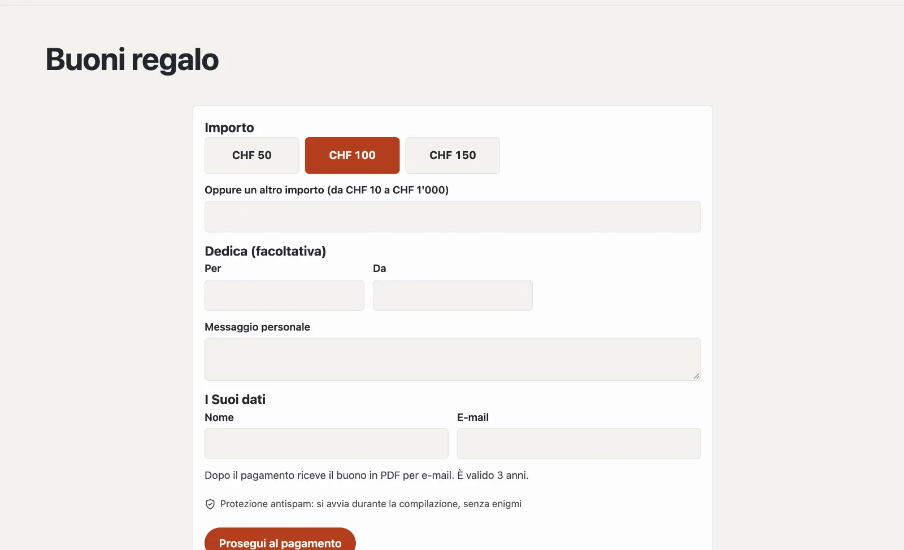

# Plugin «Vendere buoni»

Con «Vendere buoni» offre buoni regalo online: scegliere un importo, aggiungere una dedica, pagare con carta o TWINT
tramite il Suo account Stripe — e subito dopo il buono arriva nella casella di posta come PDF con un codice. Nel
backend lo riscatta in tutto o in parte e vede il valore residuo. Il plugin costa CHF 99 con un anno di aggiornamenti
e viene da Basalto.



## Installare e attivare

1. Lo acquisti nel Marketplace su basaltocms.com ([Acquistare](installieren.md#acquistare)), poi nel backend in
   **Amministrazione › Moduli › Marketplace** clicchi su **«Installa»** per «Vendere buoni»
   ([Installare un plugin](installieren.md#installare-un-plugin)).
2. Lo attivi in **Amministrazione › Siti › Modifica sito › scheda «Moduli»** per i siti — di fabbrica è disattivato.
3. Colleghi il Suo account Stripe in **Amministrazione › Pagamenti** ([Pagamenti](../verwaltung/zahlungen.md)).

In seguito compare la scheda **«Buoni»** in **Contenuti**.

## Creare la pagina dei buoni

**Pagine › Nuovo**, nome per esempio «Buoni», scheda **«Esperti»** › **«Montare un modulo»** › **«Buoni»**,
pubblicare. Lì i visitatori scelgono un importo (o un altro entro i Suoi limiti), scrivono se lo desiderano **Per**,
**Da** e un **messaggio personale** e indicano nome ed e-mail. **«Prosegui al pagamento»** porta a Stripe.

Dopo il pagamento:

- l’acquirente riceve un’e-mail con il buono in PDF (importo, dedica, codice, valido fino al, il Suo indirizzo),
- la pagina mostra il codice e **«Scarica il buono (PDF)»**,
- il Suo team riceve un messaggio «Buono venduto».

Se non viene pagato, l’ordine decade — non nasce alcun buono.

Un richiamo con gli importi come pulsanti lo inserisce su qualsiasi pagina con la parte Lava **«Buoni»**:

```lava

```

## Impostare la vendita

In fondo a **Contenuti › Buoni** in **«Vendita»**:

| Impostazione | |
| --- | --- |
| Importi a scelta | separati da virgole, p. es. 50, 100, 150 |
| Importo libero consentito, da, fino a | un altro importo entro questi limiti |
| Valido (anni) | dall’acquisto; faccia verificare la durata dal punto di vista legale per la Sua attività |
| Nota sul buono | p. es. «Riscattabile al ristorante e al bar» |

## Riscattare

In cima a **Contenuti › Buoni** in **«Riscattare»**: **codice** (trattini, spazi e minuscole non contano) e
**importo**, se lo desidera una nota come «Fattura 1043». Basalto detrae l’importo e mostra il valore residuo; non
accetta più del valore residuo, né un buono scaduto o annullato. Con valore residuo 0 il buono è **esaurito**.

La pagina di un buono mostra ogni riscatto con data, importo, nota e persona, oltre al **PDF**, **«Prolungare di un
anno»** e **«Annulla»**. Un rimborso in caso di annullamento si avvia nella dashboard Stripe.

## Buoni senza acquisto online

**«Emettere un buono»** in fondo a **Contenuti › Buoni** crea un buono valido — venduto alla cassa o regalato —, con il
PDF per e-mail se lo desidera. Emettere e riscattare funzionano anche senza pagamenti configurati.

## Protezione dei dati

Vengono salvati nome ed e-mail dell’acquirente e la dedica. Se elimina i dati di una persona in **Amministrazione ›
Utenti** ([Utenti](../verwaltung/benutzer.md)), il buono resta valido. Due anni dopo la scadenza la pulizia notturna
rimuove i dati personali; gli ordini mai pagati già dopo un giorno.

## Per continuare

- [Pagamenti](../verwaltung/zahlungen.md)
- [Marketplace per installazioni](installieren.md)
- [Marketplace](README.md)
