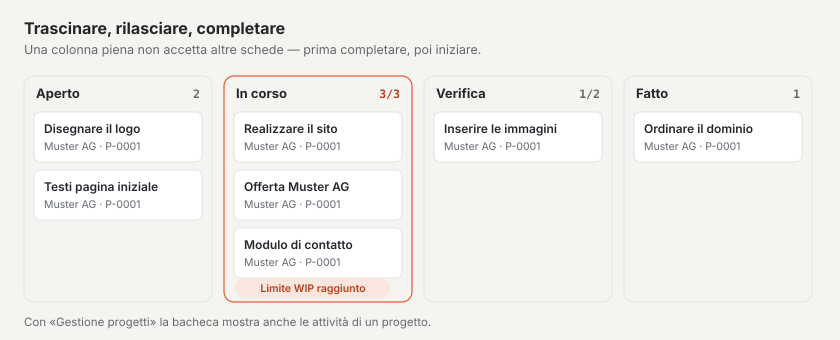

# Plugin «Bacheca Kanban»

Con la «Bacheca Kanban» pianifica il lavoro secondo il metodo Kanban: le schede passano di colonna in colonna, da
«Aperta» a «Fatto», e un **limite WIP** (work in progress — al massimo tante schede alla volta in una colonna) fa sì
che ciò che è iniziato venga prima completato. Le schede hanno una persona responsabile, una scadenza ed etichette;
con i plugin «CRM» e «Gestione progetti» le collega a clienti e progetti. Il plugin è gratuito e proviene da Basalto.

## Installare e attivare

1. Nel backend in **Amministrazione › Moduli › Marketplace**, clicchi su **«Installa»** per «Bacheca Kanban»
   ([Installare un plugin](installieren.md#installare-un-plugin)).
2. Lo attivi in **Amministrazione › Siti › Modifica sito › scheda «Moduli»** per i siti che devono usarlo — di
   fabbrica è disattivato.

In seguito compare la voce di menu **«Bacheca Kanban»** in **Contenuti**. Il numero accanto indica le schede aperte
la cui scadenza è passata.

## Creare una bacheca

1. In **Contenuti › Bacheca Kanban** inserisca nel modulo **«Nuova bacheca»** un **Nome** e, se desidera, una
   **Descrizione**.
2. **«Crea»** — la bacheca si apre.

Ogni nuova bacheca arriva con quattro colonne e tre etichette, che adatta poi in **«Impostazioni»**:

| Colonna | Limite WIP | |
| --- | --- | --- |
| **Aperta** | nessuno | tutto ciò che non è ancora iniziato |
| **In corso** | 3 | |
| **Verifica** | 2 | |
| **Fatto** | nessuno | conta come completato — qui le schede ricevono la data di completamento |

Le etichette si chiamano **Urgente** (rosso), **In attesa** (giallo) e **Idea** (lava).

## Aggiungere e spostare schede

- **Aggiungere:** sotto ogni colonna c’è il campo **«+ Aggiungi scheda»**. Digiti un titolo e prema Invio — la scheda
  compare in fondo alla colonna.
- **Con il mouse:** trascini una scheda e la rilasci dove desidera, nella stessa colonna o in un’altra.
- **Con la tastiera:** sotto ogni scheda ci sono quattro pulsanti a freccia, raggiungibili con il tasto Tab — **←** e
  **→** spostano la scheda nella colonna a sinistra o a destra (in fondo), **↑** e **↓** di un posto in alto o in
  basso.
- **Aprire:** un clic sul titolo apre la scheda.

La bacheca mostra subito il nuovo stato. Sugli schermi stretti le colonne stanno una sotto l’altra.

Ogni scheda mostra il titolo, sotto il cliente e il progetto, le etichette, la scadenza — in rosso quando è passata e
la scheda non si trova in una colonna completata — e la persona responsabile.

## Il limite WIP

In alto a destra di ogni colonna è indicato quante schede contiene, con limite per esempio **«2/3»**. Raggiunto il
limite, la colonna non accetta altre schede: non funzionano né lo spostamento né «Aggiungi scheda», e la bacheca
segnala **«La colonna «In corso» ha raggiunto il suo limite WIP (3).»** Completi prima una scheda e la faccia
avanzare — così funziona il metodo Kanban.

- Riordinare all’interno di una colonna piena e spostarne fuori le schede funziona sempre.
- Se abbassa il limite sotto il numero di schede già presenti, la colonna è bordata di rosso finché non sono avanzate
  abbastanza schede.
- Vuoto o 0 significa: senza limite.

## Modificare una scheda

Un clic sul titolo apre la scheda. Si salva da sola.

| Campo | |
| --- | --- |
| **Titolo**, **Descrizione** | di che cosa si tratta |
| **Responsabile** | una persona che lavora nel backend di questo sito — riceve una notifica |
| **Scadenza il** | passata la data, appare in rosso sulla bacheca (tranne in una colonna completata) |
| **Etichetta «…»** | le etichette della bacheca da spuntare |
| **Cliente** | solo con il plugin «CRM»: un cliente del Suo elenco clienti |
| **Progetto** | solo con il plugin «Gestione progetti»: un progetto in corso |

In alto si trovano **«Alla bacheca»**, **«Archivia»** ed **«Elimina»**.

## Impostare colonne ed etichette

Sulla bacheca, **«Impostazioni»** apre:

- **Bacheca:** nome, descrizione e fino a sei **etichette** con un colore (grigio, verde, giallo, rosso, lava). Se
  rinomina un’etichetta, resta sulle sue schede; se ne svuota il nome, scompare da esse.
- **Colonne:** un clic su una colonna ne apre il nome, il **limite WIP** e **«Le schede qui contano come
  completate»**. **«A sinistra»** e **«A destra»** cambiano l’ordine. Una colonna si può eliminare solo quando non
  contiene più alcuna scheda — nemmeno archiviata.
- **Nuova colonna:** nome, limite WIP, completato — **«Crea»** la aggiunge a destra.
- **Schede archiviate:** **«Ripristina»** le rimette in fondo alla loro colonna, se il limite WIP lo consente.

## Con CRM e gestione progetti

La bacheca Kanban funziona da sola. Se gli altri plugin sono installati e attivati per il sito, i loro dati si
aggiungono da sé:

- **Con il [plugin «CRM»](plugin-crm.md)** sceglie il **cliente** di una scheda. Se il suo nome cambia nel CRM, la
  scheda segue. Nel CRM il cliente mostra le sue schede aperte tra i dati collegati.
- **Con il [plugin «Gestione progetti»](plugin-projektmanagement.md)** sceglie il **progetto**; anche il progetto
  mostra le sue schede. Inoltre **«Come bacheca Kanban»** in un progetto apre i suoi compiti come bacheca: le colonne
  sono gli stati dei compiti, spostare cambia lo stato e i compiti restano nella gestione progetti. I limiti WIP di
  queste bacheche li imposta sotto la bacheca, in **«Limiti WIP»**. La panoramica elenca queste bacheche in **«Altre
  bacheche»**.

Se manca un plugin, la scheda non ha un campo per esso e una nota indica che cosa porterebbe il plugin. Ciò che è già
collegato a una scheda resta e appare in alto nella scheda.

## Archiviare ed eliminare

- Le **bacheche** si archiviano nella panoramica (spuntarle, poi **«Archivia»**) o in **«Impostazioni»**. Il filtro
  **«Archivio»** le mostra; **«Ripristina»** le riporta. Una bacheca si può eliminare definitivamente solo
  dall’archivio — con tutte le colonne e le schede.
- Le **schede** si archiviano dalla scheda; scompaiono dalla bacheca e figurano in **«Impostazioni»** tra le schede
  archiviate.

## Notifiche

Quando Le viene assegnata una scheda, la campanella mostra **«Scheda assegnata»** — su richiesta anche per e-mail
([Notifiche](../redaktion/index.md#notifiche)). Chi si assegna una scheda da sé non riceve alcun messaggio.

## Buono a sapersi

- Bacheche e schede appartengono al loro sito. Non vengono riprese nell’esportazione di un sito — sono lavori in corso
  con persone e rimandi ad altri plugin.
- Chi può creare e spostare schede lo stabilisce l’area **«Bacheca Kanban»** nei ruoli ([Ruoli](../verwaltung/rollen.md)).

## Se qualcosa non funziona

| Segno | Causa | Soluzione |
| --- | --- | --- |
| «La colonna «…» ha raggiunto il suo limite WIP (…).» | la colonna è piena | completare prima una scheda e farla avanzare — o aumentare il limite in «Impostazioni» |
| Mancano i campi **Cliente** o **Progetto** | il plugin «CRM» o «Gestione progetti» non è installato o è disattivato per il sito | installarlo o attivarlo in Modifica sito › «Moduli» |
| «La colonna contiene ancora schede …» | nella colonna ci sono schede, anche archiviate | spostare o eliminare le schede, poi eliminare la colonna |
| «Come bacheca Kanban» manca nel progetto | la bacheca Kanban è disattivata per il sito | attivarla in Modifica sito › «Moduli» |
| Una scheda archiviata non si può ripristinare | la sua colonna ha raggiunto il limite WIP | fare spazio nella colonna o aumentare il limite |

## Per continuare

- [Plugin «CRM»](plugin-crm.md)
- [Plugin «Gestione progetti»](plugin-projektmanagement.md)
- [Marketplace per installazioni](installieren.md)
- [Marketplace](README.md)
