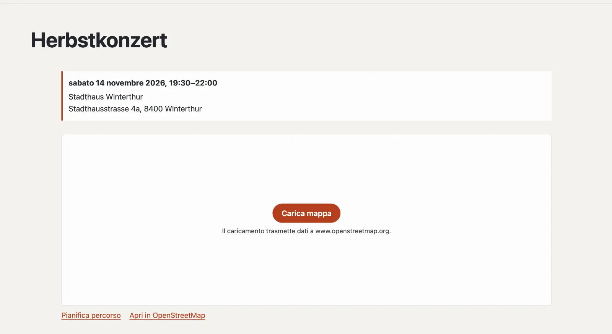

# Plugin «Mappa senza tracciamento»

«Mappa senza tracciamento» mostra un luogo su una mappa di OpenStreetMap — ma solo quando la visitatrice ci clicca.
Fino ad allora la pagina non carica nulla da un server di terzi. Basalto trova da sé gli indirizzi in Svizzera, una
sola volta, tramite la ricerca dei geodati federali (geo.admin.ch). Sotto la mappa ci sono «Pianifica percorso» e «Apri
in OpenStreetMap». Il plugin è gratuito e viene da Basalto.



## Installare e attivare

1. Nel backend in **Amministrazione › Moduli › Marketplace**, clicchi su **«Installa»** per «Mappa senza
   tracciamento» ([Installare un plugin](installieren.md#installare-un-plugin)).
2. Lo attivi in **Amministrazione › Siti › Modifica sito › scheda «Moduli»** per i siti — di fabbrica è disattivato.

## Inserire una mappa

La mappa è una parte Lava: in **Configurazione › Layout › scheda «Parti»** clicchi su **«+ Istanza»** per «Mappa» e
compili le impostazioni. Inserisca l’istanza nell’editor di una pagina con **«+ Parte Lava»** — per esempio sulla pagina
«Contatto» — oppure in una regione di un layout ([Struttura: layout, parti e template](../einrichtung/aufbau.md)).

| Impostazione | |
| --- | --- |
| Indirizzo | p. es. «Stadthausstrasse 4a, 8400 Winterthur» — Basalto cerca il luogo una volta e lo ricorda |
| Denominazione | in grassetto sotto la mappa, p. es. «Municipio» |
| Zoom | da 3 (molto lontano) a 19 (portone), 16 di fabbrica |
| Altezza | in pixel, da 200 a 800, 360 di fabbrica |

Nel tema funziona direttamente; al posto di un indirizzo vanno bene anche le coordinate:

```lava


```

Con il [plugin «Eventi»](plugin-veranstaltungen.md) ogni evento con un indirizzo mostra da sé la sua mappa.

## Verificare e correggere i luoghi

In **Contenuti › Luoghi della mappa** compare ogni indirizzo che mostra una mappa, con il luogo trovato e la sua fonte.

| Azione | Effetto |
| --- | --- |
| **Verifica indirizzo** | cerca un indirizzo in anticipo — così vede se viene trovato |
| **Latitudine, longitudine** | impostate a mano, p. es. per un ingresso sul retro dell’edificio; la fonte diventa «a mano» e Basalto non cerca più |
| **Cerca di nuovo** | interroga di nuovo geo.admin.ch; le coordinate impostate a mano vengono sostituite |
| **Dimentica** | rimuove il luogo; Basalto lo cerca di nuovo alla prossima visualizzazione di una mappa |

geo.admin.ch conosce indirizzi, luoghi e nomi della Svizzera. Se la ricerca non trova un indirizzo, al posto della
mappa compare un link «Cerca su OpenStreetMap»; Basalto riprova dopo sette giorni. Se il servizio non risponde,
Basalto non ricorda nulla e riprova alla richiesta successiva.

## Protezione dei dati

- Finché non si clicca su **«Carica mappa»**, il browser della visitatrice non contatta alcun server di terzi. Chi ha
  consentito i «Contenuti esterni» nelle impostazioni dei cookie vede subito la mappa.
- Solo con il clic la mappa si carica da OpenStreetMap (www.openstreetmap.org); OpenStreetMap riceve allora l’indirizzo
  IP e i dati del browser. Lo menzioni nella dichiarazione sulla protezione dei dati del suo sito.
- La ricerca su geo.admin.ch la fa il server di Basalto — con l’indirizzo del blocco, mai con dati dei visitatori. I
  luoghi trovati fanno parte dell’esportazione di un sito.

## Per continuare

- [Plugin «Eventi»](plugin-veranstaltungen.md)
- [Marketplace per installazioni](installieren.md)
- [Marketplace](README.md)
