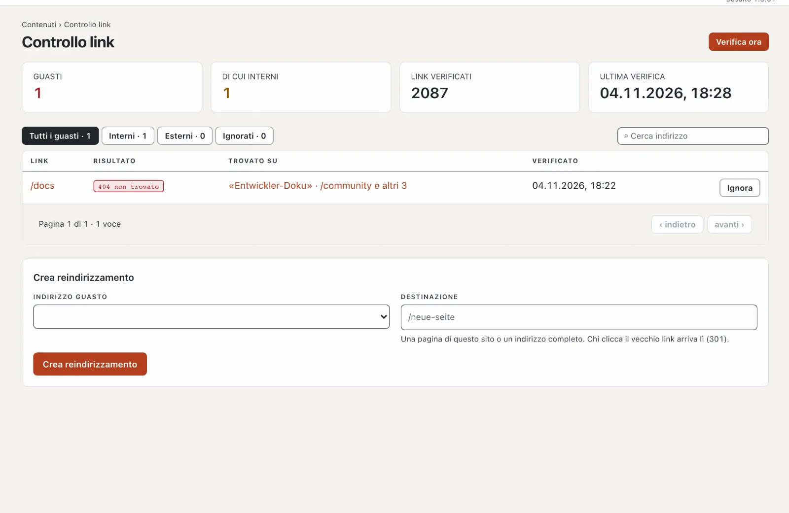

# Plugin «Controllo link»

Il controllo link trova link e immagini guasti sul Suo sito — verso pagine proprie che non esistono più e verso
indirizzi esterni che non rispondono più. Mostra su quale pagina si trova il link e, per gli errori interni, crea un
reindirizzamento con un clic. Il plugin è gratuito e viene da Basalto.

## Installare e attivare

1. Nel backend in **Amministrazione › Moduli › Marketplace**, clicchi su **«Installa»** per «Controllo link»
   ([Installare un plugin](installieren.md#installare-un-plugin)).
2. Lo attivi in **Amministrazione › Siti › Modifica sito › scheda «Moduli»** per i siti — di fabbrica è disattivato.

In seguito compare la scheda **«Controllo link»** in **Contenuti**.

## Quando avviene il controllo

- **Ogni notte** tra l’una e le cinque (fuso orario del sito), da solo — a condizione che la pianificazione
  dell’installazione funzioni ([Esercizio](../verwaltung/betrieb.md)).
- **In qualsiasi momento** con **«Verifica ora»**. I siti grandi richiedono alcuni minuti; la pagina mostra a che punto
  è il controllo.

Vengono controllate tutte le pagine pubblicate in tutte le lingue: link, immagini e file incorporati. Basalto controlla
gli indirizzi interni direttamente, senza passare dalla rete; interroga con garbo gli indirizzi esterni, uno dopo
l’altro.

## Leggere i risultati

| Colonna | |
| --- | --- |
| Link | l’indirizzo guasto |
| Risultato | p. es. «404 non trovato», «410 rimosso», «Tempo scaduto», «Nessuna connessione» |
| Trovato su | le pagine che contengono il link — un clic le apre |

In alto sceglie **«Tutti i guasti»**, **«Interni»**, **«Esterni»** o **«Ignorati»**; la ricerca filtra per indirizzo.

## Correggere un link guasto

- **Correggere sulla pagina:** apra la pagina e adatti il link nell’editor. Al controllo successivo sparisce.
- **Crea reindirizzamento** (solo indirizzi interni): il vecchio indirizzo rimanda allora in modo permanente (301) a una
  nuova destinazione — una pagina del sito o un indirizzo completo. Il reindirizzamento figura poi anche in
  **Pagine › Reindirizzamenti**.
- **Ignora:** per link voluti così o che solo occasionalmente non rispondono. In «Ignorati» li recupera con
  **«Segnala di nuovo»**.

## Nelle statistiche

In [Statistiche](../verwaltung/statistik.md), la scheda **Controllo link** mostra link non funzionanti dopo l’ultimo controllo con il numero di pagine in cui compaiono, confrontati con il periodo precedente.

## Se qualcosa non funziona

| Segno | Causa | Soluzione |
| --- | --- | --- |
| «Non ancora verificato» non cambia | la pianificazione dell’installazione non funziona | configurare cron ([Esercizio](../verwaltung/betrieb.md)) o «Verifica ora» |
| una pagina esterna è «guasta», ma si apre nel browser | blocca le richieste automatiche | «Ignora» |
| il controllo dura a lungo | molte pagine o server esterni lenti | prosegue a tappe; ricarichi più tardi |

## Per continuare

- [Reindirizzamenti](../redaktion/seiten.md#reindirizzamenti)
- [Marketplace per installazioni](installieren.md)
- [Marketplace](README.md)
