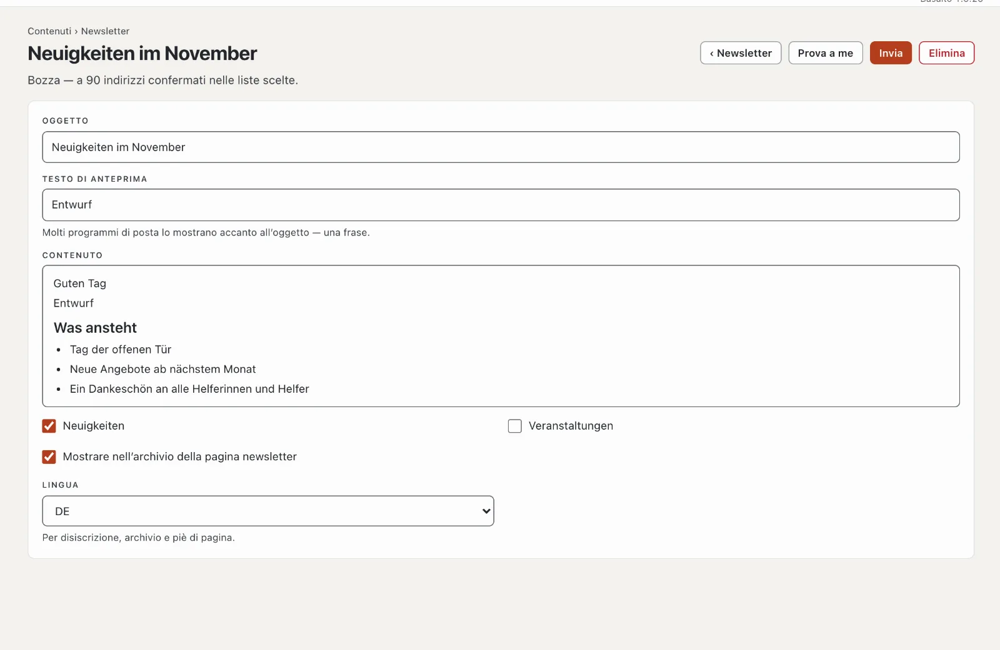

# Plugin «Newsletter»

Con «Newsletter» scrive regolarmente ai Suoi iscritti: iscrizione con conferma per e-mail (double opt-in), più liste
a scelta, disiscrizione con un clic e un archivio delle edizioni sul Suo sito. L’invio passa da un servizio di invio
come Brevo, Mailjet o Infomaniak. Il plugin costa CHF 99 con un anno di aggiornamenti e viene da Basalto.



## Installare e attivare

1. Lo acquisti nel Marketplace su basaltocms.com ([Acquistare](installieren.md#acquistare)), poi nel backend in
   **Amministrazione › Moduli › Marketplace** clicchi su **«Installa»** per «Newsletter»
   ([Installare un plugin](installieren.md#installare-un-plugin)).
2. Lo attivi in **Amministrazione › Siti › Modifica sito › scheda «Moduli»** per i siti — di fabbrica è disattivato.

In seguito compare la scheda **«Newsletter»** in **Contenuti**.

## Configurare

1. **Pagina newsletter:** **Pagine › Nuovo**, nome per esempio «Newsletter», scheda **«Esperti»** › **«Montare un
   modulo»** › **«Newsletter»**, pubblicare. Lì i visitatori si iscrivono, confermano, si disiscrivono e leggono
   l’archivio.
2. **Liste:** in **Contenuti › Newsletter › Liste e invio** almeno una lista, per esempio «Novità».
   **«Selezionabile all’iscrizione»** la rende pubblica; le liste interne le compila solo il team.
3. **Servizio di invio:** stessa pagina, più in basso. Un hosting semplice consente solo un centinaio di e-mail
   all’ora — per questo le newsletter passano da un servizio:

| Servizio | Cosa inserisce |
| --- | --- |
| Brevo | login SMTP e chiave SMTP del Suo account Brevo |
| Mailjet | chiave API come nome utente, chiave segreta come password |
| Infomaniak | indirizzo e password di una casella di posta presso Infomaniak |
| Server SMTP proprio | server, porta (587 o 465), nome utente, password |

Per Brevo, Mailjet e Infomaniak, Basalto compila da sé server e porta. L’**indirizzo del mittente** deve essere
verificato presso il servizio, e il Suo dominio ha bisogno di SPF e DKIM per il servizio — altrimenti le newsletter
finiscono nello spam. Regoli **E-mail al minuto** secondo il Suo piano. **«Verifica connessione»** accede una volta al
server. La password resta cifrata sul server; lasciata vuota, resta quella salvata.

## Iscriversi e disiscriversi

- L’**iscrizione** si trova sulla pagina newsletter e, come parte Lava **«Iscrizione alla newsletter»**, su qualsiasi
  pagina, per esempio nel piè di pagina:

```lava

```

  Con `list: "Veranstaltungen"` la parte iscrive solo a questa lista; altrimenti i visitatori scelgono tra quelle
  pubbliche.
- Dopo l’invio la persona riceve un’e-mail con **«Confermare l’iscrizione»**. Solo allora è iscritta; il link vale
  sette giorni. Basalto conserva la prova: momento del consenso, pagina dell’iscrizione, momento della conferma.
- La **disiscrizione** avviene con un clic: tramite il link in fondo a ogni edizione (con un pulsante sulla pagina
  newsletter) o tramite il pulsante di disiscrizione che programmi di posta come Gmail mostrano accanto al mittente.

## Inviare un’edizione

1. **Contenuti › Newsletter** › **«Nuova edizione»** con l’oggetto.
2. **Testo di anteprima** (una frase che molti programmi di posta mostrano accanto all’oggetto), **contenuto**
   nell’editor, spuntare le **liste**. Le modifiche si salvano da sole.
3. **«Prova a me»** invia l’edizione al Suo indirizzo.
4. **«Invia»** — la domanda indica il numero di destinatari. Poi l’invio parte al ritmo del servizio; la pagina mostra
   quante e-mail sono partite e quante non sono riuscite, con il motivo.

Con **«Mostrare nell’archivio della pagina newsletter»** l’edizione compare nell’archivio dopo l’invio — e ogni e-mail
ha il link **«Vedi nel browser»**. **«Copiare come nuova edizione»** riprende un’edizione inviata come modello.

## Iscritti

**Contenuti › Newsletter › Iscritti** mostra **Iscritto**, **In attesa di conferma** e **Disiscritto**, con ricerca,
filtro per lista, azioni multiple (disiscrivere, eliminare) e **«Confermati in CSV»**. **«Aggiungere un indirizzo»**
invia la richiesta di conferma — oppure iscrive subito la persona se ha acconsentito per iscritto in modo
dimostrabile.

## Protezione dei dati

La pulizia notturna elimina le iscrizioni non confermate dopo sette giorni e i disiscritti dopo 30 giorni. Gli
indirizzi di una persona fanno parte dell’**accesso ai dati** e dell’**eliminazione** in **Amministrazione › Utenti**
([Utenti](../verwaltung/benutzer.md)). Gli iscritti non fanno parte dell’esportazione di un sito — il loro consenso
vale per il sito precedente.

## Nelle statistiche

In [Statistiche](../verwaltung/statistik.md), la scheda **Newsletter** mostra nuove iscrizioni, disiscrizioni, edizioni ed e-mail inviate — iscritti per lista, confrontati con il periodo precedente.

## Se qualcosa non funziona

| Segno | Causa | Soluzione |
| --- | --- | --- |
| «Nessuna connessione al servizio di invio» | nome utente, password o porta errati | verificare l’accesso presso il servizio, porta 587 o 465 |
| le e-mail arrivano nello spam | mittente non verificato, SPF/DKIM mancanti | verificare il dominio presso il servizio, impostare le voci DNS |
| l’invio si ferma | la pianificazione dell’installazione non funziona | configurare cron ([Esercizio](../verwaltung/betrieb.md)) |

## Per continuare

- [Utenti](../verwaltung/benutzer.md)
- [Marketplace per installazioni](installieren.md)
- [Marketplace](README.md)
