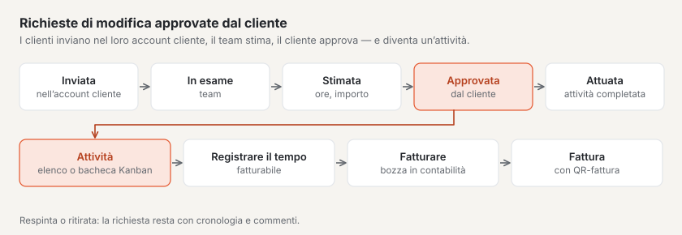

# Plugin «Gestione progetti»

Con «Gestione progetti» gestisce i progetti per i Suoi clienti: milestone, attività, tempo registrato e budget in un
unico posto. I Suoi clienti inviano **richieste di modifica** nel loro account cliente, vedono la Sua **stima
dell’impegno** e la approvano — diventa così un’attività. Il plugin funziona da sé con i plugin «CRM», «Contabilità» e
«Bacheca Kanban». È a pagamento — CHF 129 con un anno di aggiornamenti — e proviene da Basalto.

## Installare e attivare

1. Lo acquisti su basaltocms.com — una volta per installazione ([Acquistare](installieren.md#acquistare)).
2. Nel backend in **Amministrazione › Moduli › Marketplace**, clicchi su **«Installa»** per «Gestione progetti»
   ([Installare un plugin](installieren.md#installare-un-plugin)).
3. Lo attivi in **Amministrazione › Siti › Modifica sito › scheda «Moduli»** — di fabbrica è disattivato.

In seguito compare la voce **«Progetti»** in **Contenuti**. Il numero accanto indica le richieste di modifica appena
arrivate che attendono il Suo team.

## Creare un progetto

1. In **Contenuti › Progetti** inserisca il **nome** nel modulo **«Nuovo progetto»**.
2. Scelga o inserisca il **cliente**, se desidera la **tariffa oraria** e il **budget (ore)**.
3. **«Crea»** — il progetto riceve il numero successivo del sito e si apre.

L’elenco mostra i progetti in corso (pianificati, attivi, in pausa); i pulsanti sopra filtrano per **Concluso**,
**Archivio** e **Tutti**, la ricerca trova nome, numero e cliente. In alto ci sono gli indicatori: progetti in corso,
attività aperte, richieste di modifica presso il team e quelle che attendono l’approvazione del cliente.

## Dati, budget e accesso nell’account cliente

Nella pagina di un progetto i **dati** si salvano da soli:

| Campo | |
| --- | --- |
| **Cliente** | con il plugin «CRM» una scelta dal Suo elenco clienti, altrimenti un nome |
| **Stato** | Pianificato, Attivo, In pausa, Concluso o Interrotto |
| **Responsabile del progetto**, **Inizio**, **Fine** | chi è responsabile e quando si svolge il progetto |
| **Tariffa oraria**, **Valuta** | vale per il tempo registrato da ora in poi e propone l’importo di una stima |
| **Budget (ore)**, **Budget (CHF)** | gli indicatori in alto vi confrontano il tempo registrato |
| **Mostra nell’account cliente** | i clienti con accesso vedono il progetto e inviano richieste di modifica |
| **Accesso nell’account cliente (indirizzi e-mail)** | un indirizzo per riga — chi accede all’account cliente con uno di essi vede il progetto |

Gli indicatori **Ore** e **Importo** mostrano il consumo accanto al budget. Dall’80 % diventano gialli con la nota «È
stato usato più dell’80 % del budget», oltre il 100 % rossi.

**Archivia** toglie un progetto dagli elenchi e dall’account cliente; **Ripristina** lo riporta.

## Milestone e attività

- Crei le **milestone** con una data in **«Nuova milestone»**. **«Raggiunta»** registra la data; una data mancata
  appare come **scaduta**.
- Le **attività** hanno uno stato — **Aperta**, **In corso**, **Verifica**, **Fatto** —, una persona responsabile,
  una scadenza, una **stima** (come 2:30 o 2.5 ore) e, se desidera, una milestone. Un clic apre l’attività; si salva da
  sola.
- Le attività selezionate cambiano stato insieme con **«Stato: …»** nella barra in basso, oppure vengono eliminate.

## Le attività come bacheca Kanban

Se il plugin «Bacheca Kanban» è installato e attivo, in alto nella pagina del progetto compare **«Come bacheca
Kanban»**. Le attività vi appaiono come schede in quattro colonne — una per stato — con milestone, stima, scadenza e
persona responsabile. Trascini una scheda in un’altra colonna e lo stato dell’attività cambia; l’ordine resta. I limiti WIP
li imposta nella bacheca Kanban. Senza il plugin il progetto mostra le attività come elenco.

## Registrare e fatturare il tempo

1. Nella pagina del progetto in **«Registra tempo»** inserisca **data**, **durata** (1:30 o 1.5), se desidera
   un’**attività** e un **testo**; **«Fatturabile»** è spuntato.
2. **«Registra»** — il tempo compare nell’elenco **«Tempo registrato»** e conta per il budget. La tariffa oraria del progetto viene
   salvata con il tempo; se cambia in seguito, per il tempo già registrato resta quella vecchia.

**Fatturare con il plugin «Contabilità»:** **«Fattura il tempo»** trasmette tutto il tempo fatturabile non ancora
fatturato come **bozza di fattura** — una posizione per attività con le ore, la tariffa oraria e il periodo. Nella
contabilità verifica ed emette la fattura; IVA, numero e QR-fattura vengono aggiunti lì. Il tempo mostra poi la fattura
e non si può più eliminare. Se la bozza viene eliminata o la fattura annullata, il tempo torna aperto.

**Senza contabilità**, **«Tempo in CSV»** scarica tutto il tempo del progetto come tabella (punto e virgola, si apre
correttamente in Excel).

## Richieste di modifica con i clienti

Una richiesta di modifica è un desiderio di cambiamento per un progetto. Passa per questi stati:

| Stato | A chi tocca | Che cosa succede |
| --- | --- | --- |
| **Inviata** | il Suo team | inviata nell’account cliente o registrata dal team |
| **In verifica** | il Suo team | chiarisce la richiesta |
| **Stimata — in attesa di approvazione** | il cliente | la Sua stima dell’impegno (ore e importo) è presso il cliente |
| **Approvato** | il Suo team | il cliente ha approvato la stima — è stata creata un’attività con la stima |
| **Attuata** | — | tutte le attività della richiesta sono risolte |
| **Rifiutato** | — | rifiutata da Lei, oppure stima rifiutata dal cliente |
| **Ritirata** | — | il cliente l’ha ritirata prima dell’approvazione |

Ogni richiesta di modifica riceve un numero progressivo nel progetto e una priorità secondo il metodo MoSCoW:
**Indispensabile**, **Importante**, **Auspicabile** o **Non questa volta**.

### Nell’account cliente

I clienti con accesso vedono nell’account cliente la sezione **«Progetti»**: per ogni progetto le richieste di modifica
con stato e cronologia.

1. Apra **«Invia una richiesta di modifica»**.
2. Inserisca **titolo**, **«Che cosa deve cambiare?»**, se desidera **«Perché?»**, **«Quanto è importante?»** e
   **«Desiderato entro»**.
3. **«Inviare»** — il Suo team riceve un messaggio.

Quando c’è una stima, compare nell’account cliente in «Prossimi passi». Il cliente sceglie **«Approva la stima»** o
**«Rifiuta»**; finché nulla è approvato, può **ritirare** la richiesta. I commenti li scrive direttamente sulla
richiesta. A ogni nuovo stato e a ogni Sua risposta, la persona che l’ha inviata riceve un’e-mail.

**Ha accesso** chi accede con un indirizzo indicato in **«Accesso nell’account cliente»** — e, con il plugin «CRM»,
ogni indirizzo del cliente e delle sue persone di contatto.

### Nel backend

In **Contenuti › Progetti › Richieste di modifica** trova tutte le richieste, filtrate secondo a chi tocca: **Presso il
team**, **Presso il cliente**, **Approvato**, **Concluso**. Un clic ne apre una:

- **«Prendi in esame»**, **«Rifiuta»** e — una volta approvata — **«Segna come attuata»**.
- **«Stima l’impegno»**: ore, importo (vuoto: ore × tariffa oraria) e una **nota per il cliente**. **«Invia la stima»**
  porta lo stato a «Stimata» e avvisa il cliente. Una nuova stima sostituisce quella vecchia finché nulla è approvato.
- **«Commento»**: con **«Interno»** lo vede solo il Suo team, altrimenti anche il cliente.
- La **cronologia** mostra ogni cambiamento di stato e tutti i commenti.

Anche il Suo team può registrare una richiesta di modifica nella pagina del progetto, per esempio dopo una telefonata.

## Con altri plugin

| Plugin | Che cosa aggiunge |
| --- | --- |
| [CRM](plugin-crm.md) | scegliere i clienti dal Suo elenco clienti; se un cliente cambia nel CRM, il progetto segue; le persone di contatto hanno accesso nell’account cliente; il cliente nel CRM mostra i suoi progetti |
| [Contabilità](plugin-finanzbuchhaltung.md) | il tempo registrato diventa una bozza di fattura con un clic |
| [Bacheca Kanban](plugin-kanban.md) | le attività di un progetto come bacheca; le schede si possono collegare ai progetti |

In **Amministrazione › Moduli**, «Gestione progetti» indica con quali plugin funziona.

## Notifiche

Il Suo team riceve **«Nuova richiesta di modifica»**, **«Richiesta di modifica decisa»** (approvata, respinta, ritirata)
e **«Commento su una richiesta di modifica»** — nella campanella e, se impostato, per e-mail. Chi le riceve dipende dal
permesso sull’area «Progetti» ([Notifiche](../redaktion/index.md#notifiche)).

## Protezione dei dati

- **Informazioni e cancellazione** per indirizzo e-mail le gestisce l’amministrazione sotto «Amministrazione › Utenti»
  (oppure `php artisan basalto:privacy`): l’informazione indica i progetti con accesso, le richieste di modifica inviate
  e i commenti. La cancellazione rimuove l’indirizzo dagli accessi e sostituisce nome e indirizzo su richieste e
  commenti; le richieste stesse restano nel progetto.
- L’**esportazione di un sito** non porta con sé i progetti — restano sul sito precedente.

## Se qualcosa non funziona

| Segno | Causa | Soluzione |
| --- | --- | --- |
| Il cliente non vede il progetto nell’account cliente | manca l’indirizzo in «Accesso nell’account cliente», «Mostra nell’account cliente» è disattivato o il progetto è archiviato | inserire l’indirizzo, spuntare la casella, ripristinare il progetto |
| Manca «Fattura il tempo» | il plugin «Contabilità» non c’è o è disattivato per il sito — oppure non c’è tempo fatturabile aperto | attivare il plugin o usare «Tempo in CSV» |
| Manca «Come bacheca Kanban» | il plugin «Bacheca Kanban» non c’è o è disattivato per il sito | installarlo dal Marketplace e attivarlo |
| «Inserisca la durata come 1:30 o 1.5.» | durata in un’altra forma | ore e minuti con i due punti, oppure ore con il punto decimale |
| «Il tempo fatturato non si può eliminare» | il tempo appartiene a una fattura | annullare la fattura nella contabilità — poi il tempo torna aperto |
| «In questo stato non è più possibile.» | la richiesta di modifica è già decisa | guardare la cronologia; inviare una nuova richiesta |

## Per continuare

- [Plugin «CRM»](plugin-crm.md)
- [Plugin «Contabilità»](plugin-finanzbuchhaltung.md)
- [Plugin «Bacheca Kanban»](plugin-kanban.md)
- [Marketplace per installazioni](installieren.md)
