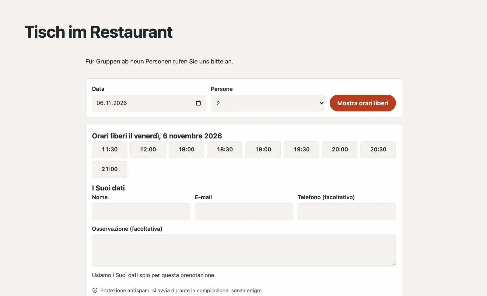

# Plugin «Prenotazioni e appuntamenti»

Con «Prenotazioni e appuntamenti» i Suoi ospiti prenotano online: un tavolo al ristorante, una consulenza, una sala.
Lei stabilisce quando si può prenotare e quanti posti ci sono; gli ospiti scelgono giorno e ora, ricevono una conferma
con voce di calendario e un promemoria e annullano da soli tramite il loro link. Se lo desidera, pagano un acconto
tramite il Suo account Stripe. Il plugin costa CHF 149 con un anno di aggiornamenti e viene da Basalto.



## Installare e attivare

1. Lo acquisti nel Marketplace su basaltocms.com ([Acquistare](installieren.md#acquistare)), poi nel backend in
   **Amministrazione › Moduli › Marketplace** clicchi su **«Installa»** per «Prenotazioni e appuntamenti»
   ([Installare un plugin](installieren.md#installare-un-plugin)).
2. Lo attivi in **Amministrazione › Siti › Modifica sito › scheda «Moduli»** per i siti — di fabbrica è disattivato.

In seguito compare la scheda **«Prenotazioni»** in **Contenuti**.

## Stabilire cosa si può prenotare

Un’**offerta** è ciò che gli ospiti prenotano — «Tavolo al ristorante», «Consulenza in negozio», «Sala riunioni». In
**Contenuti › Prenotazioni › Offerte e orari** ne crea una da un modello e poi la adatta:

| Modello | pensato per |
| --- | --- |
| Tavoli | gruppi, più alla volta, confermati subito |
| Appuntamento per una persona | una prenotazione per orario, senza chiedere il numero di persone |
| Sala | una prenotazione per orario, su richiesta |

| Impostazione | |
| --- | --- |
| Orari per giorno della settimana | come «11:30-14:00, 18:00-22:00» — in mezzo è pausa, vuoto significa chiuso |
| Durata (minuti) | per quanto tempo una prenotazione occupa i posti |
| Inizio ogni (minuti) | p. es. 30: 18:00, 18:30, 19:00 … |
| Posti contemporanei | per i tavoli il numero di persone, per gli appuntamenti di solito 1 |
| Gruppo più grande online | i gruppi più grandi La contattano direttamente; 1 = senza chiedere il numero di persone |
| Preavviso (minuti) | preavviso minimo per prenotare |
| In anticipo (giorni) | fino a quando nel futuro |
| Annullamento autonomo fino a (ore prima) | dopo solo direttamente presso di Lei |
| Conferma | **immediata** (la prenotazione vale subito) o **su richiesta** (Lei accetta o rifiuta) |
| Acconto | fisso o per persona; 0 = nessuno |
| Prenotabile online | senza la spunta l’offerta è in pausa |

**Chiuso** (stessa pagina): ferie, giorni festivi, serate private — dal primo all’ultimo giorno, per un’offerta o per
tutte. Le prenotazioni esistenti in quel periodo restano; la nota indica quante sono.

## Creare la pagina di prenotazione

1. **Pagine › Nuovo** (o la Sua pagina «Prenotare» esistente).
2. Scheda **«Esperti»** › **«Montare un modulo»** › **«Prenotazioni»**, salvare e pubblicare.

Con un’offerta gli ospiti prenotano direttamente su questa pagina; con più offerte scelgono prima l’offerta. Un giorno
senza orari liberi indica i prossimi giorni liberi. Gli orari al completo sono barrati.

Prenotare rapidamente da qualsiasi pagina — per esempio la pagina iniziale — con la parte Lava **«Prenotare»** (giorno
e persone, si prosegue sulla pagina di prenotazione) oppure nel tema:

```lava

```

## Cosa ricevono gli ospiti

| Quando | E-mail |
| --- | --- |
| confermata subito | conferma con voce di calendario (.ics) e link alla propria prenotazione |
| su richiesta | conferma di ricezione; più tardi conferma o rifiuto |
| prima dell’appuntamento | promemoria (regolabile: 2 ore, un giorno o due giorni prima, oppure nessuno) |
| annullata o modificata | comunicazione con i nuovi dati |

Tramite il link alla propria prenotazione gli ospiti vedono lo stato, scaricano la voce di calendario e **annullano**
da soli fino al termine. Il Suo team riceve un messaggio per nuove prenotazioni, richieste e annullamenti (campanella ed
e-mail, regolabile nel profilo).

## Gestire le prenotazioni

**Contenuti › Prenotazioni** mostra un giorno (scorrere con **«‹ Giorno precedente»**, **«Oggi»**,
**«Giorno seguente ›»**) oppure **«Tutte in arrivo»**, **«Richieste»** e **«Precedenti»**, con ricerca per nome, e-mail
o telefono. Il numero nel menu indica le richieste aperte.

- **Conferma**, **Rifiuta** e **Annulla** singolarmente o in blocco — gli ospiti ricevono un’e-mail.
- **Registrare una prenotazione** per telefonate e ospiti al banco: confermata subito, e-mail solo con un indirizzo
  e-mail. Il team può registrare fuori dagli orari e oltre i posti; se un orario risulta poi sovraprenotato, la nota lo
  segnala.
- In una prenotazione modifica offerta, giorno, ora e persone; se lo desidera, l’ospite riceve i nuovi dati. La
  **nota interna** la vede solo il team.

## Con acconto

Un acconto passa dal Suo account Stripe ([Pagamenti](../verwaltung/zahlungen.md)): dopo l’invio l’ospite viene
indirizzato a Stripe, e nel frattempo l’orario resta riservato per lui. Dopo il pagamento la prenotazione vale (o
attende come richiesta); se interrompe o non paga, il posto torna libero alla scadenza del pagamento Stripe. Un
rimborso in caso di annullamento si avvia nella dashboard Stripe. Senza pagamenti configurati, gli ospiti prenotano
senza acconto.

## Protezione dei dati

Gli ospiti indicano nome, e-mail e, se lo desiderano, telefono e osservazione. Dopo un termine (di fabbrica 365 giorni
dopo l’appuntamento, regolabile) la pulizia notturna sostituisce questi dati; giorno, ora e persone restano per i Suoi
numeri. Le prenotazioni di un indirizzo e-mail fanno parte dell’**accesso ai dati** e dell’**eliminazione** in
**Amministrazione › Utenti** ([Utenti](../verwaltung/benutzer.md)). Le prenotazioni non fanno parte
dell’esportazione di un sito; le offerte sì.

## Nelle statistiche

In [Statistiche](../verwaltung/statistik.md), la scheda **Prenotazioni** mostra nuove prenotazioni, ospiti nel periodo, cancellazioni, richieste aperte e acconti — per offerta, confrontati con il periodo precedente.

## Se qualcosa non funziona

| Segno | Causa | Soluzione |
| --- | --- | --- |
| «Questo giorno non si può prenotare online» | giorno prima del preavviso o dopo «In anticipo» | verificare le impostazioni dell’offerta |
| nessun orario in un giorno della settimana | nessun orario inserito, o chiuso | verificare gli orari e «Chiuso» |
| nessun promemoria | la pianificazione dell’installazione non funziona | configurare cron ([Esercizio](../verwaltung/betrieb.md)) |

## Per continuare

- [Pagamenti](../verwaltung/zahlungen.md)
- [Marketplace per installazioni](installieren.md)
- [Marketplace](README.md)
