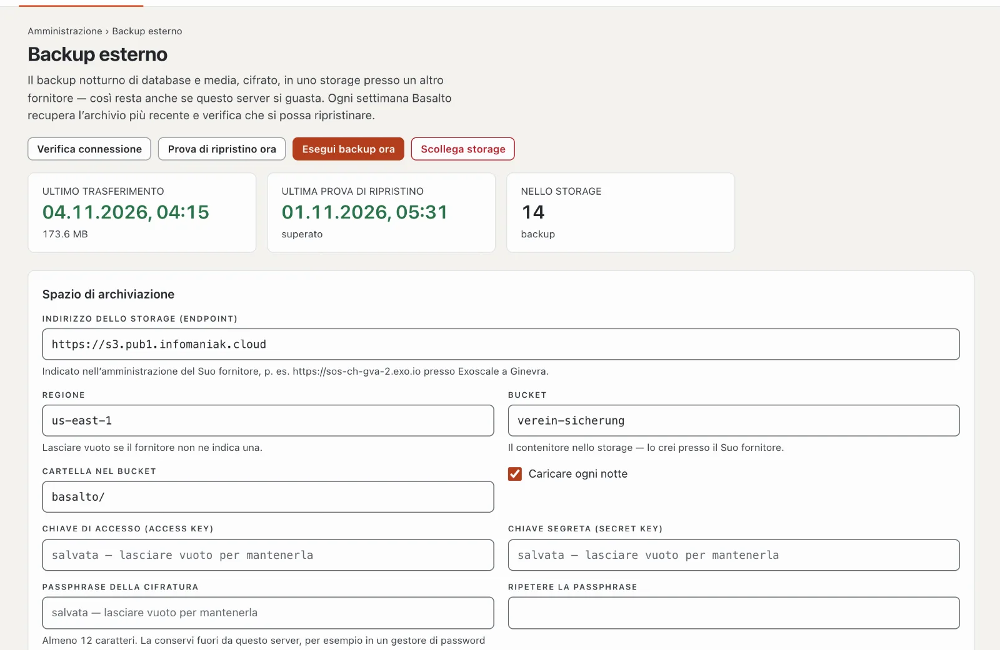

# Plugin «Backup esterno»

Ogni notte Basalto esegue il backup di database e media sul proprio server. Se il server si guasta, questo backup
sparisce con lui. «Backup esterno» carica ogni backup, cifrato, in uno storage presso un altro fornitore, vi elimina i
backup vecchi e verifica ogni settimana che il più recente si possa ripristinare. Il plugin costa CHF 79 con un anno di
aggiornamenti e viene da Basalto.



## Installare

1. Lo acquisti nel Marketplace su basaltocms.com ([Acquistare](installieren.md#acquistare)), poi nel backend in
   **Amministrazione › Moduli › Marketplace** clicchi su **«Installa»** per «Backup esterno»
   ([Installare un plugin](installieren.md#installare-un-plugin)).
2. Il plugin vale per l’intera installazione — non c’è un interruttore per sito. In seguito, in **Amministrazione**
   compare la voce **«Backup esterno»**. La vedono tutte le persone che vedono anche **Amministrazione › Esercizio**.

Il plugin richiede l’estensione PHP «sodium»; la maggior parte degli hosting la tiene attiva. Se manca, la pagina mostra
l’avviso **«Cifratura non possibile»** — il Suo hosting la attiva nelle impostazioni PHP.

## Configurare lo spazio di archiviazione

Le serve uno storage compatibile S3 presso un fornitore diverso dal Suo hosting, per esempio Infomaniak Swiss Backup o
Exoscale.

1. Presso il fornitore crei un **bucket** — il contenitore per i backup — e credenziali S3 (chiave di accesso e chiave
   segreta) che possano scrivere, leggere ed eliminare nel bucket. Con Infomaniak Swiss Backup e con Exoscale,
   endpoint, regione e credenziali si trovano nell’amministrazione del fornitore.
2. In **Amministrazione › Backup esterno** compili la sezione **«Spazio di archiviazione»**:

   | Campo | Cosa inserire |
   | --- | --- |
   | **Indirizzo dello storage (endpoint)** | l’indirizzo S3, p. es. `https://sos-ch-gva-2.exo.io` presso Exoscale a Ginevra |
   | **Regione** | p. es. `ch-gva-2` presso Exoscale; lasciare vuoto se il fornitore non ne indica una |
   | **Bucket** | il nome del bucket |
   | **Cartella nel bucket** | `basalto/` di serie — con una cartella ciascuna, più installazioni stanno in un bucket |
   | **Chiave di accesso (Access Key)**, **Chiave segreta (Secret Key)** | le credenziali del passo 1 |
   | **Passphrase della cifratura**, **Ripetere la passphrase** | almeno 12 caratteri — legga la sezione seguente |
   | **Conservare: almeno questo numero di backup**, **… di giorni** | di serie 14 backup e 30 giorni, vedi [Conservazione](#conservazione) |
   | **Caricare ogni notte** | attivo di serie |

3. **«Salva e verifica»**: Basalto scrive un piccolo file nel bucket, lo legge e lo elimina. Solo se funziona viene
   salvato; altrimenti il motivo compare all’endpoint.

La pagina non mostra mai più le chiavi salvate né la passphrase — lasciare vuoto un campo le mantiene. **«Verifica
connessione»** ripete la verifica in qualsiasi momento. **«Scollega storage»** rimuove il collegamento; i backup nello
storage restano.

## Conservare bene la passphrase

Basalto cifra ogni backup sul Suo server prima che lo lasci — il fornitore dello storage vede solo dati cifrati, nemmeno
i nomi dei file. La chiave deriva dalla passphrase (Argon2id); i dati sono cifrati con XChaCha20-Poly1305 della
libreria libsodium.

- Conservi la passphrase **fuori da questo server**, per esempio in un gestore di password. **Senza di essa nessun
  backup si può decifrare** — nemmeno da Basalto. Se si trova solo sul server, va persa con lui.
- Conservi anche l’`APP_KEY` dell’installazione: senza la stessa chiave i dati cifrati del database ripristinato non si
  possono leggere ([Backup](../betrieb/backup.md)).
- Se cambia la passphrase, i backup più vecchi nello storage richiedono ancora quella precedente. Tenga entrambe finché
  i backup più vecchi non escono dalla conservazione.

## Cosa succede ogni notte

1. Alle **03:15 UTC** Basalto esegue il backup di database e media sul server ([Backup](../betrieb/backup.md)).
2. Alle **04:15 UTC** il plugin cifra il backup più recente e lo carica come `basalto-backup-AAAAMMGG-HHMMSS.zip.enc`
   nella cartella del bucket. Poi confronta la dimensione nello storage con quella del file caricato. Un backup che si
   trova già nello storage non viene caricato una seconda volta.
3. Infine applica la conservazione.

La copia cifrata nasce per breve tempo nella cartella `storage/app` dell’installazione — lì serve tanto spazio libero
quanto è grande il backup. Il plugin carica i backup dalla cartella standard `storage/app/backups`, dove li scrive il
backup notturno; i backup che deposita altrove a mano con `--path` non vengono inclusi.

**«Esegui backup ora»** crea subito un nuovo backup e lo carica — in background. Dopo qualche minuto il risultato compare
nella **Cronologia**: ora, tipo, backup, dimensione, stato e messaggio. In alto la pagina mostra l’**Ultimo
trasferimento**, l’**Ultima prova di ripristino** e quanti backup si trovano **Nello storage**. Se **Caricare ogni notte**
è disattivato, la pagina indica **«In pausa»**; «Esegui backup ora» e la prova di ripristino funzionano ancora.

## Conservazione

Dallo storage viene eliminato solo ciò che supera **entrambi** i limiti: i backup più recenti secondo **Conservare:
almeno questo numero di backup** restano sempre, così come tutti quelli degli ultimi giorni secondo **Conservare: almeno
questo numero di giorni**. Con i valori di serie 14 e 30 restano quindi almeno i 14 backup più recenti, più tutti quelli
degli ultimi 30 giorni. Il plugin non tocca gli altri file della cartella.

## La prova di ripristino settimanale

Ogni domenica alle **05:30 UTC** il plugin recupera il backup più recente dallo storage, lo decifra durante lo
scaricamento e lo controlla con la verifica di ripristino di Basalto: manifest, dimensione e SHA-256 di ogni file.

- **Con SQLite** la prova ripristina il database in un database usa e getta e lo apre (controllo di integrità e
  conteggio).
- **Con MariaDB, MySQL o PostgreSQL** la prova verifica solo che il dump del database sia completo — intestazione, riga
  finale e tabelle principali. Non si ripristina nulla in un database; ripristini quindi di tanto in tanto un backup a
  mano in un database vuoto ([Ripristino](../betrieb/backup.md#ripristino)).

**«Prova di ripristino ora»** la avvia subito. Nella cronologia compare come **Prova di ripristino** con **«in
ordine»** o **«non riuscito»** e i passi di controllo sotto **Messaggio**; anche **Amministrazione › Esercizio** mostra
lo stato dell’ultima verifica.

## Allarme

Se un trasferimento o una prova di ripristino non riesce, tutte le persone che vedono **Amministrazione › Esercizio**
ricevono la notifica **«Backup esterno non riuscito»** nella campanella e per e-mail — con il motivo. L’e-mail è attiva
di serie; chi non la desidera la disattiva nel proprio **Profilo**, scheda **«Notifiche»**. Anche la pagina stessa
mostra il motivo in alto: **«L’ultimo trasferimento non è riuscito»** o **«L’ultima prova di ripristino non è
riuscita»**.

## Recuperare un backup

Il recupero e la decifratura avvengono sulla console del server:

```sh
php artisan basalto:ausser-haus-holen --liste                              # cosa si trova nello storage
php artisan basalto:ausser-haus-holen                                      # il più recente
php artisan basalto:ausser-haus-holen basalto-backup-20261104-031500.zip   # uno preciso
php artisan basalto:ausser-haus-holen --ziel=/srv/ripristino               # in un’altra cartella
```

Di serie lo ZIP decifrato arriva in `storage/app/backups`; se lì si trova già un file con lo stesso nome, resta
intatto. Poi prosegua come in [Ripristino](../betrieb/backup.md#ripristino): prima
`php artisan basalto:backup-verify <archivio>`, poi il ripristino.

### Dopo la perdita del server

1. Reinstalli Basalto e poi il plugin.
2. In **Amministrazione › Backup esterno** inserisca lo storage e la passphrase, poi esegua
   `php artisan basalto:ausser-haus-holen`.
   Oppure senza configurazione: scarichi il file nell’amministrazione del fornitore, lo metta sul server ed esegua
   `php artisan basalto:ausser-haus-holen --datei=/percorso/basalto-backup-20261104-031500.zip.enc --passphrase-fragen`
   — il comando chiede la passphrase.
3. Prosegua come in [Ripristino](../betrieb/backup.md#ripristino) — con l’`APP_KEY` della vecchia installazione.

`--passphrase-fragen` aiuta anche quando un backup più vecchio richiede ancora la passphrase precedente.

## Nelle statistiche

In [Statistiche](../verwaltung/statistik.md), la scheda **Backup esterno** mostra backup caricati, test di ripristino superati ed errori, confrontati con il periodo precedente.

## Se qualcosa non funziona

| Segno | Causa | Soluzione |
| --- | --- | --- |
| «Nessuna connessione allo storage: …» al salvataggio | endpoint, regione, bucket o chiavi errati, oppure le chiavi non possono scrivere nel bucket | confrontare i dati con l’amministrazione del fornitore; dare alle chiavi il diritto di scrivere, leggere ed eliminare nel bucket |
| «Cifratura non possibile» | manca l’estensione PHP «sodium» | farla attivare dall’hosting nelle impostazioni PHP |
| «Non c’è nessun backup sul server …» | il backup notturno non è in funzione | controllare la voce cron dello scheduler ([Hosting](../betrieb/hosting.md)); **Amministrazione › Esercizio** mostra lo stato |
| «Esegui backup ora» o «Prova di ripristino ora» resta senza risultato | la coda non viene elaborata | controllare la voce cron dello scheduler; i job non riusciti sono elencati in **Amministrazione › Esercizio** |
| «Decifratura non riuscita: passphrase errata o file modificato.» | il backup è cifrato con un’altra passphrase | inserire la passphrase precedente con `--passphrase-fragen` |
| «Il backup cifrato è incompleto.» nella prova | il file nello storage è troncato | **«Esegui backup ora»**, poi **«Prova di ripristino ora»**; se l’errore persiste, rivolgersi al fornitore |
| Il trasferimento non riesce per backup grandi | non c’è abbastanza spazio libero in `storage/app` per la copia cifrata | liberare spazio o prenotare più spazio presso l’hosting |

## Per continuare

- [Backup](../betrieb/backup.md)
- [Esercizio](../verwaltung/betrieb.md)
- [Marketplace per installazioni](installieren.md)
- [Marketplace](README.md)
