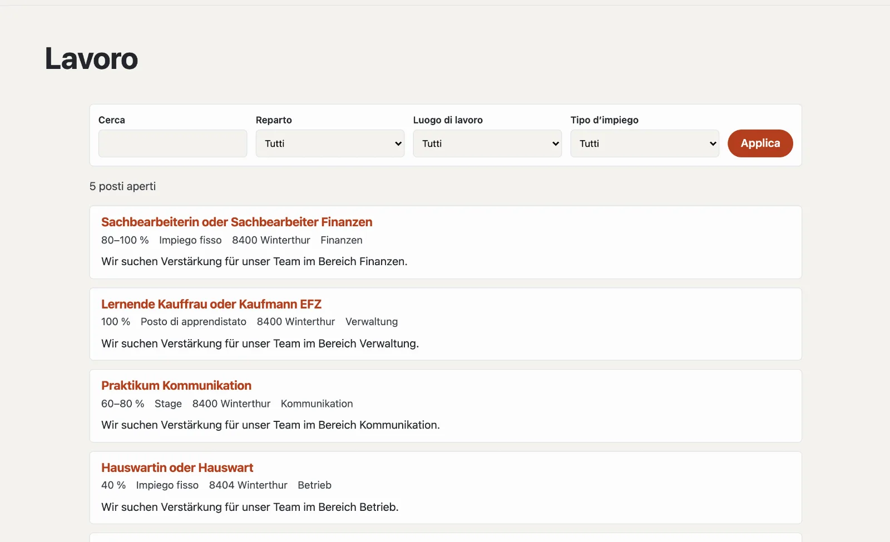

# Plugin «Offerte di lavoro»

Con «Offerte di lavoro» mette a concorso posti aperti: con grado d’occupazione, tipo d’impiego, luogo di lavoro ed
entrata in servizio, su una pagina dei posti con filtro. Le candidature arrivano tramite un modulo del sito o, se lo
desidera, tramite un link proprio. I motori di ricerca ricevono dati strutturati per ogni posto aperto. Il plugin è
gratuito e viene da Basalto.



## Installare e attivare

1. Nel backend in **Amministrazione › Moduli › Marketplace**, clicchi su **«Installa»** per «Offerte di lavoro»
   ([Installare un plugin](installieren.md#installare-un-plugin)).
2. Lo attivi in **Amministrazione › Siti › Modifica sito › scheda «Moduli»** per i siti che devono usarlo — di
   fabbrica è disattivato.

In seguito compare la scheda **«Posti»** in **Contenuti**.

## Creare la pagina dei posti

1. **Pagine › Nuovo** (o una pagina esistente), nome per esempio «Posti aperti».
2. Scheda **«Esperti»** › **«Montare un modulo»** › **«Posti»**, salvare.
3. Pubblicare la pagina come di consueto.

| Indirizzo sotto la pagina | Cosa compare |
| --- | --- |
| (la pagina stessa) | posti aperti, i più recenti per primi; da quattro posti con ricerca e filtro per reparto, luogo di lavoro e tipo d’impiego |
| `<indirizzo>` | un posto con tutti i dettagli e la candidatura |

Un posto non più a concorso resta raggiungibile al suo indirizzo — con la nota che non è più aperto, e senza
candidatura.

## Mettere a concorso un posto

In **Contenuti › Posti** crea un posto con il suo **Titolo**. All’inizio è una **bozza**; poi si apre il modulo con
tutti i dettagli. Le modifiche si salvano da sole.

| Campo | |
| --- | --- |
| Titolo, testo breve, descrizione | per lingua del sito; il testo breve compare nell’elenco e per i motori di ricerca |
| Grado da, fino a (%) | p. es. 80–100 % |
| Tipo d’impiego | impiego fisso, a tempo determinato, posto di apprendistato, stage, mandato o volontariato |
| Reparto, luogo di lavoro | per il filtro e i dati strutturati |
| In parte da casa | compare tra i dati principali |
| Entrata in servizio | vuoto significa «da convenire» |
| Messo a concorso fino al | dopo questa data il posto sparisce da solo dall’elenco |
| Persona di contatto, e-mail della persona di contatto | compaiono con il posto |
| Link per candidarsi | solo se le candidature passano da un portale per candidature |

| Pulsante | Effetto |
| --- | --- |
| **Pubblica** | il posto compare sulla pagina dei posti |
| **Segna come assegnato** | sparisce dall’elenco |
| **Rimettere a concorso** | un posto assegnato è di nuovo aperto |
| **Ritira** | di nuovo una bozza |
| **Duplica** | una copia come bozza — pratico per posti simili |

## Candidature

Senza link proprio, sotto ogni posto aperto compare il modulo di candidatura del sito:

1. In **Contenuti › Posti**, **«Crea modulo di candidatura»** — contiene nome, e-mail, telefono, messaggio, curriculum
   vitae (PDF) e altri documenti.
2. Lo adatta in **Contenuti › Moduli** («bewerbung»).
3. Sceglie un altro modulo in fondo a **Contenuti › Posti** in **«Candidatura»**.

Le candidature sono invii del modulo: le trova in **Moduli › Invii**, con la pagina del posto da cui provengono. La
colonna «Candidature» dell’elenco le conta per posto. Vengono conservate ed eliminate come tutti gli invii
([Moduli](../redaktion/formulare.md)).

## Posti aperti su altre pagine

La parte Lava **«Posti aperti»** mostra i posti aperti più recenti — per esempio sulla pagina iniziale: in
**Configurazione › Layout › scheda «Parti»** clicchi su **«+ Istanza»** (numero, titolo), poi la collochi in una
regione o la inserisca nell’editor di una pagina con **«+ Parte Lava»**. Nel tema funziona anche direttamente:

```lava

```

## Motori di ricerca e protezione dei dati

Ogni posto aperto porta dati strutturati (schema.org `JobPosting`: titolo, descrizione, tipo d’impiego, luogo di
lavoro, datore di lavoro, messo a concorso fino al) e figura nella sitemap. Il plugin stesso non salva candidature —
si trovano tra gli invii dei moduli. I posti fanno parte dell’esportazione di un sito.

## Per continuare

- [Moduli](../redaktion/formulare.md)
- [Marketplace per installazioni](installieren.md)
- [Marketplace](README.md)
