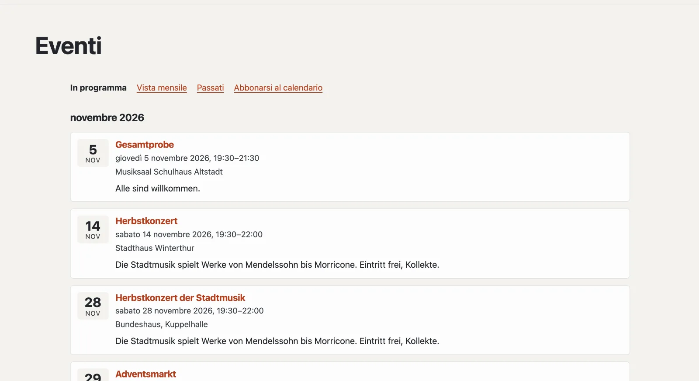

# Plugin «Eventi»

Con «Eventi» annuncia appuntamenti: concerti, prove, corsi, mercati. I visitatori li vedono come elenco e come vista
mensile, aggiungono un singolo evento al proprio calendario o si abbonano all’intero calendario del sito. I motori di
ricerca ricevono dati strutturati per ogni evento. Il plugin è gratuito e viene da Basalto.



## Installare e attivare

1. Nel backend in **Amministrazione › Moduli › Marketplace**, clicchi su **«Installa»** per «Eventi»
   ([Installare un plugin](installieren.md#installare-un-plugin)).
2. Lo attivi in **Amministrazione › Siti › Modifica sito › scheda «Moduli»** per i siti che devono usarlo — di
   fabbrica è disattivato.

In seguito compare la scheda **«Eventi»** in **Contenuti**.

## Creare la pagina degli eventi

Perché i visitatori vedano gli appuntamenti, una pagina deve ospitare il plugin:

1. **Pagine › Nuovo** (o una pagina esistente), nome per esempio «Eventi».
2. Scheda **«Esperti»** › **«Montare un modulo»** › **«Eventi»**, salvare.
3. Pubblicare la pagina come di consueto.

Ora il plugin risponde alla pagina stessa e a tutti gli indirizzi sottostanti — nel layout del suo tema, con il titolo
della pagina. Se la pagina manca, l’elenco nell’amministrazione lo segnala.

| Indirizzo sotto la pagina | Cosa compare |
| --- | --- |
| (la pagina stessa) | eventi in programma per mese |
| `monat` | vista mensile con navigazione; sugli schermi stretti come elenco dei giorni |
| `archiv` | eventi passati, i più recenti per primi |
| `kalender.ics` | calendario da abbonare — eventi in programma e quelli degli ultimi 90 giorni |
| `<indirizzo>` | un evento con tutti i dettagli |
| `<indirizzo>.ics` | lo stesso, da aggiungere al proprio calendario |

Un evento di oggi resta tutto il giorno in «In programma»; a mezzanotte (fuso orario del sito) passa all’archivio.

## Inserire eventi

In **Contenuti › Eventi** crea un evento con **Titolo** e **Inizio**. All’inizio è una **bozza**; poi si apre il
modulo con tutti i dettagli. Le modifiche si salvano da sole.

| Campo | |
| --- | --- |
| Titolo, testo breve, descrizione | per lingua del sito; se una lingua manca, compare la lingua predefinita. Il testo breve compare negli elenchi e per i motori di ricerca |
| Inizio, fine | nel fuso orario del sito; senza fine l’evento dura fino a mezzanotte |
| Tutto il giorno | conta solo la data, l’ora non compare |
| Luogo, indirizzo | per la pagina, il calendario, i motori di ricerca e «Pianifica percorso» |
| Link | iscrizione o ulteriori informazioni |
| Indirizzo sotto la pagina degli eventi | proposto dal titolo, p. es. `herbstkonzert` |

| Pulsante | Effetto |
| --- | --- |
| **Pubblica** | i visitatori vedono l’evento |
| **Annulla l’evento** | resta visibile, con la nota «Annullato»; gli abbonamenti al calendario lo tolgono alla prossima sincronizzazione |
| **Ritira** | di nuovo una bozza |
| **Duplica** | una copia come bozza — pratico per gli appuntamenti ricorrenti |

L’elenco mostra «In programma», «Passati», «Bozze» e «Tutti», con ricerca e azioni multiple (pubblicare, ritirare,
eliminare).

## Prossimi eventi su altre pagine

La parte Lava **«Prossimi eventi»** mostra i prossimi appuntamenti — per esempio sulla pagina iniziale: in
**Configurazione › Layout › scheda «Parti»** clicchi su **«+ Istanza»** per «Prossimi eventi» (numero, titolo), poi la
collochi in una regione o la inserisca nell’editor di una pagina con **«+ Parte Lava»**
([Struttura: layout, parti e template](../einrichtung/aufbau.md)). Nel tema funziona anche direttamente:

```lava

```

## Con la mappa

Se è installato e attivo anche il [plugin «Mappa senza tracciamento»](plugin-karte.md), la pagina di un evento con un
indirizzo mostra la sua mappa — solo dopo un clic.

## Motori di ricerca e protezione dei dati

Ogni evento porta dati strutturati (schema.org `Event`: nome, orari, luogo, stato, organizzatore) e figura nella
sitemap del sito. Il plugin non salva dati personali; gli eventi fanno parte dell’esportazione di un sito.

## Per continuare

- [Plugin «Mappa senza tracciamento»](plugin-karte.md)
- [Marketplace per installazioni](installieren.md)
- [Marketplace](README.md)
