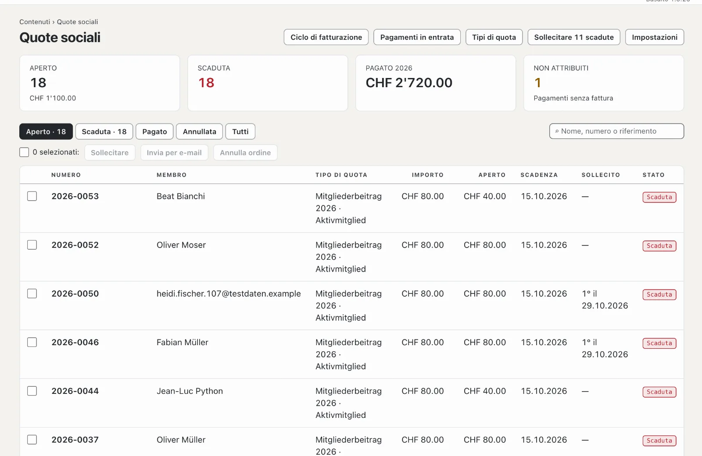

# Plugin «Quote sociali con fattura QR»

Con «Quote sociali con fattura QR» fattura le quote ai soci della Sua associazione: ogni socio ha un tipo di quota, un
ciclo di fatturazione crea le fatture in PDF con sezione pagamento QR e le invia per e-mail — oppure le prepara in un PDF
cumulativo da stampare. A ciò si aggiungono solleciti in tre livelli e i pagamenti in entrata dal file bancario nel
formato camt.054 (ISO 20022). Il plugin è a pagamento — CHF 129 con un anno di aggiornamenti — e viene da Basalto.

## Installare e attivare

1. Lo acquisti su basaltocms.com — una volta per installazione ([Acquistare](installieren.md#acquistare)).
2. Nel backend in **Amministrazione › Moduli › Marketplace**, clicchi su **«Installa»** per «Quote sociali con fattura
   QR» ([Installare un plugin](installieren.md#installare-un-plugin)).
3. Lo attivi in **Amministrazione › Siti › Modifica sito › scheda «Moduli»** — insieme al modulo **«Membri»**: le quote
   vanno ai membri attivi del sito ([Membri](../redaktion/mitglieder.md)). Di fabbrica sono entrambi disattivati.

In seguito compare la voce **«Quote sociali»** in **Contenuti**. Il numero accanto indica le fatture scadute.

## Inserire associazione e conto

In **Quote sociali › Impostazioni** inserisce i dati per ogni fattura e per la sezione pagamento QR. Si salvano da soli.

| Campo | |
| --- | --- |
| **Nome dell’associazione**, **Via**, **Numero civico**, **NPA**, **Località**, **Paese** | mittente della fattura e «Conto / Pagabile a» nella sezione pagamento; Svizzera o Liechtenstein |
| **IBAN o QR-IBAN** | il conto dell’associazione. Con un QR-IBAN ogni fattura porta un **riferimento QR**, con un IBAN normale una **Creditor Reference (RF)** — i pagamenti in entrata li attribuiscono entrambi da soli |
| **BESR-ID** | solo se la Sua banca ne ha assegnato uno al QR-IBAN — altrimenti lasciare vuoto |
| **Valuta** | CHF o EUR |
| **Termine di pagamento (giorni)** | propone «Pagabile entro» nel ciclo di fatturazione (di fabbrica 30) |
| **Termine di un sollecito (giorni)** | trascorso questo tempo è possibile il sollecito successivo; il sollecito indica questo termine (di fabbrica 14) |
| **E-mail all’ora al massimo** | di fabbrica 80 — molti hosting consentono circa 100 e-mail all’ora |
| **Frase sulla fattura** | per esempio un grazie per la fedeltà all’associazione |

Se mancano nome, IBAN, NPA o località, la panoramica mostra **«Dati del conto mancanti»** e non è possibile alcun ciclo
di fatturazione.

## Creare e assegnare i tipi di quota

In **Quote sociali › Tipi di quota**, **«Nuovo tipo di quota»** crea un nome e un importo, per esempio «Socio attivo»
con CHF 80 o «Socio passivo» con CHF 40. Un clic su un tipo di quota lo apre: nome, importo, una **descrizione** solo per
Lei, **«Selezionabile nei nuovi cicli di fatturazione»** e l’ordine.

Sotto figurano i membri attivi con tipo di quota e invio. Filtri per tipo di quota, **«Senza tipo di quota»**,
**«Esonerati»** o **«Per posta»**, selezioni i membri e scelga nella barra in basso:

| Pulsante | Effetto |
| --- | --- |
| **Tipo di quota: …** | il membro paga questo tipo di quota |
| **Esonerare** | nessuna fattura, per esempio per i membri onorari |
| **Fattura per posta** | la fattura va nel PDF cumulativo da stampare invece che per e-mail |
| **Fattura per e-mail** | di nuovo per e-mail — è l’impostazione di fabbrica |

## Avviare un ciclo di fatturazione

In **Quote sociali › Ciclo di fatturazione** vede in alto quanti membri sono attivi, quanti sono ancora **senza tipo di
quota** (non ricevono fattura) e quante e-mail sono in attesa.

1. Nel modulo **«Nuovo ciclo di fatturazione»** inserisca il **titolo** — figura sulla fattura, per esempio «Quota
   sociale 2027» —, l’**anno**, la **data della fattura** e **«Pagabile entro»**.
2. Selezioni i tipi di quota da fatturare.
3. Lasci selezionato **«Inviare subito le fatture per e-mail»** oppure invii più tardi.
4. **«Crea fatture»**.

Ogni membro attivo con uno dei tipi scelti riceve una fattura con il numero successivo dell’anno («2027-0001») e il suo
riferimento di pagamento. Nome e indirizzo provengono dall’account cliente del membro, così come sono al momento del
ciclo; la fattura appare nella lingua dell’account cliente. Chi è esonerato, in attesa di approvazione o bloccato non ne
riceve. Chi ha già una fattura con lo stesso titolo nello stesso anno viene saltato — così può ripetere più tardi lo
stesso ciclo per i nuovi membri.

## Per e-mail o per posta

- **Per e-mail:** l’e-mail indica importo e termine, il PDF con la sezione pagamento QR è allegato. Le e-mail partono
  poco a poco, al massimo tante all’ora quante impostate; il resto segue nell’ora successiva. In **«Cicli precedenti»**,
  **«Invia per e-mail»** invia tutte le fatture aperte di un ciclo non ancora partite per e-mail.
- **Per posta:** nella colonna **«Per posta»**, **«PDF cumulativo»** apre tutte le fatture del ciclo per i membri con
  «Fattura per posta» — una pagina A4 per fattura, la sezione pagamento in basso con la linea per staccarla.
- **Una singola fattura:** la apra nell’elenco, poi **«PDF»** o **«Invia per e-mail»**.

## Tenere d’occhio le fatture

La panoramica **Quote sociali** mostra numero e importo delle fatture aperte, quelle scadute, l’importo delle fatture
pagate dell’anno in corso e i pagamenti senza fattura. L’elenco filtra per **Aperto**, **Scaduta**, **Pagato**,
**Annullata** e **Tutti** e cerca per nome, numero o riferimento. Lo stato di una fattura è **Aperto**, **Pagato in
parte**, **Scaduta**, **Pagato** o **Annullata**. Per più fatture selezionate ci sono **«Sollecitare»**, **«Invia per
e-mail»** e **«Annulla»** — una fattura annullata resta nell’elenco con una nota.

## Sollecitare

Superata la data «Pagabile entro», una fattura aperta si può sollecitare:

- in alto nella panoramica con **«Sollecitare … scadute»** per tutte in una volta,
- per le fatture selezionate con **«Sollecitare»** nella barra,
- in una fattura con **«Sollecitare»**.

Ci sono tre livelli. Il successivo è possibile solo quando dall’ultimo è trascorso il **termine di un sollecito**. Il
sollecito porta il titolo «1° sollecito» (o 2° o 3°), la data del sollecito, un nuovo termine e l’importo aperto dopo i
pagamenti parziali — anche nella sezione pagamento QR. I membri con e-mail lo ricevono per e-mail; con «Fattura per
posta» il PDF della fattura mostra ora il sollecito da stampare.

## Pagamenti in entrata dal file bancario

1. Nell’e-banking scarichi l’avviso di accredito nel formato **camt.054 (ISO 20022)** come XML — di solito sotto
   documenti o estratti conto.
2. In **Quote sociali › Pagamenti in entrata** scelga il file in **«Importa file bancario»** e clicchi su **«Importa»**.
3. Il messaggio indica quanti pagamenti sono stati attribuiti, quanti no, quanti erano pagamenti parziali e quanti erano
   già stati importati.

Un accredito con il riferimento di una fattura aperta si registra da solo: se l’importo basta, lo stato della fattura
diventa **Pagato** (con la data di registrazione); altrimenti resta aperta e il resto diventa il nuovo importo aperto.
Ogni registrazione conta una sola volta, anche se carica un file due volte. Il plugin tralascia gli addebiti e gli
storni.

I pagamenti senza riferimento corrispondente — o per una fattura già pagata o annullata — figurano come **«non
attribuito»**. Ne apra uno, inserisca il **numero di fattura** in **«Attribuire una fattura»** e scelga
**«Attribuisci»**. Lì si può anche eliminare un pagamento importato per errore.

## Pagamenti a mano

Pagato in contanti all’assemblea? Nella fattura, in **«Registra pagamento»**, inserisca l’importo (è proposto l’importo
aperto), **«Ricevuto il»** e una **nota**, poi **«Registra»**. I pagamenti di una fattura figurano in fondo alla stessa.

## Nell’account cliente

I membri vedono nel loro account cliente l’area **«Quote sociali»** con le loro fatture, lo stato e il PDF — con la
sezione pagamento QR finché una fattura è aperta. Le fatture aperte figurano anche in «Prossimi passi».

## Protezione dei dati e conservazione

- **Informazioni e cancellazione** per indirizzo e-mail le gestisce l’amministrazione sotto «Amministrazione › Utenti»
  (oppure `php artisan basalto:privacy`): l’informazione indica tipo di quota e fatture. La cancellazione rimuove
  l’assegnazione; le fatture restano come documenti contabili con numero, importo e stato, ma senza nome né indirizzo.
- **Conservazione:** dieci anni dopo la fine dell’anno di fatturazione, la pulizia notturna rimuove le fatture insieme
  ai loro pagamenti.
- L’**esportazione di un sito** porta con sé solo i tipi di quota; fatture e pagamenti restano presso il sito
  precedente.

## Nelle statistiche

In [Statistiche](../verwaltung/statistik.md), la scheda **Quote sociali** mostra pagamenti ricevuti, importi aperti, fatture emesse e solleciti, confrontati con il periodo precedente.

## Se qualcosa non funziona

| Segnale | Causa | Soluzione |
| --- | --- | --- |
| **«Dati del conto mancanti»** | mancano nome, IBAN, NPA o località dell’associazione | completarli in **Impostazioni** |
| «Questo non è un IBAN valido della Svizzera o del Liechtenstein.» | errore di battitura o conto all’estero | verificare l’IBAN — la fattura QR richiede un conto in Svizzera o nel Liechtenstein |
| Un membro non riceve la fattura | non attivo, esonerato, senza tipo di quota o già una fattura con lo stesso titolo nello stesso anno | verificare lo stato in **Contenuti › Membri** e il filtro **«Senza tipo di quota»** |
| Le e-mail attendono a lungo | il contingente dell’ora è raggiunto | attendere — il resto parte nell’ora successiva |
| «Questo non è un file bancario nel formato camt.054 (ISO 20022).» | è stato caricato un PDF, un CSV o un altro formato | scaricare l’avviso di accredito come camt.054 (XML) nell’e-banking |
| Un pagamento è «non attribuito» | versato senza riferimento o con un riferimento sbagliato | inserire il numero di fattura in **«Attribuire una fattura»** |
| Manca «Sollecitare» | non ancora scaduta, il termine dall’ultimo sollecito non è trascorso o il 3° sollecito è già partito | sollecitare più tardi o contattare direttamente il membro |

## Per continuare

- [Membri](../redaktion/mitglieder.md)
- [Marketplace per installazioni](installieren.md)
- [Marketplace](README.md)
